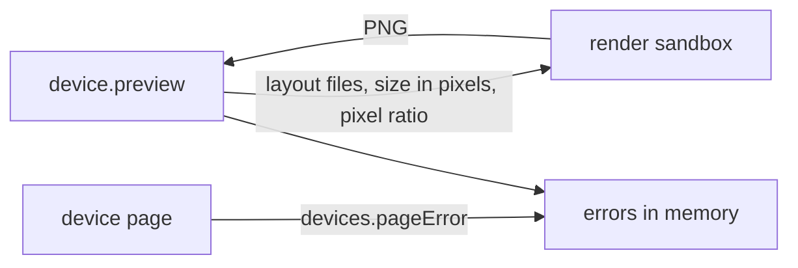

# Devices

A device is a browser that shows what the assistant puts on its screen. A browser with no session
enrols with a code and a name, and gets a device session of its own. A browser that is signed in
names itself, and the session it holds gets a device row. The device opens the device form of the
live stream and sends its screen size. The assistant lists devices and shows markdown or an image on
a screen that is on. The camera, the speaker and the microphone are not built: a device record holds
their capabilities, and every one of them stays off.

The `devices` module owns the record, the screen state, the open streams and the tools. The
[API](api.md) owns registration, enrolment and the session scope, and the [web client](client.md)
owns device mode. Read this doc before you change the `devices` module, a device tool or device
mode.

## Enrolment and the session scope

A session has a scope, `full` or `device`, stored on `identities`. Each enrolment code stores the
scope of the session it makes, on `enrolment_codes`. `sessions.enrol` takes no scope, so the session
takes the scope of its code: a device code makes only a device session, and a full code only a full
session.

A device row belongs to one session, and a session holds at most one. A device session holds its row
from enrolment until a revoke or a sign-out removes the row. A full session holds one only after it
registers.

1. A signed-in client calls `sessions.issueCode({ scope: 'device' })`, and the page `/add-device`
   shows the code. `nixie enrol-code device` issues the same code from the host.
2. A browser with no session opens `/device`, and enrols with the code and a name. Enrolment with a
   device code writes the `devices` row in the same transaction, with every capability off.
3. A browser with a full session calls `devices.register({ clientActionID, name })`. The call is for
   a `full` session only. It writes the row on the caller's own identity, with every capability off,
   in one write transaction, and returns the device's short ID. It issues no code, makes no session
   and never touches the cookie. A second register renames the row and returns the same ID. A retry
   with the same client action ID and name returns the same ID, and the same ID with another name
   gets `CLIENT_ACTION_ID_REUSED`.
4. The device switches its screen on with `devices.setCapability`. The call sets only `screen`, and
   only on the session's own device row.

`live.follow` in its device form, `devices.setCapability`, `devices.readImage` and `devices.resize`
act on the caller's own row. A full session with no row gets `NOT_A_DEVICE` and has to register
first. A device session whose row a revoke removed gets the refusal of a missing session.

`create-api-app.ts` refuses with 403 each call from a device session except `live.follow` in its
device form, `devices.resize`, `devices.pageError`, `devices.pageEvent`, `devices.setCapability`,
`devices.readImage` and `sessions.signOut`. The test in `create-device-procedures.test.ts` walks
every contract path to keep that list true. A revoke or a sign-out of a session, full or device,
removes its device row and ends its open streams. A full session's revoke also closes its computer
watch sockets. A reset keeps the device rows and clears what they show.

## The device record

The `devices` table holds a short ID from `createShortID`, the identity, the name, the capabilities
as JSON, and two pointers: `shown_sequence` and `idle_sequence`. Each pointer names the record that
holds what the screen shows:

- `device.shown` holds one show: the content, sealed under the record's own key, and `until`. A show
  that waits for an offline device holds no `until` and a `lastsMs` instead. When the device comes
  online, the server writes the show again with an `until` that lies `lastsMs` after that time.
- `device.idle_set` holds one idle scene, sealed the same way.
- `device.capability_changed` holds a switch of a capability.

A forget of a `device.shown` or `device.idle_set` record erases the content. The state reader then
drops that content, and an image that is forgotten or missing counts as erased too. The server never
holds the content outside the log.

## The screen state

`readScreenState` reads the two pointed records, and `pickScreenState` picks the show while it has
no `until` or its `until` is ahead, and the idle scene otherwise. A new show replaces the one before
it, and an `until` that passes ends the show, never returning to an older one. `pickScreenState`
never returns the layout. The device page's `pickSurface` and `devices.list` put the layout in place
of the idle scene when a region shows content or has a background, as
[Layouts and regions](#layouts-and-regions) says. An idle device with no scene shows black.

## Layouts and regions

A layout is a grid of 1 to 12 columns and 1 to 12 rows, each a whole number of `fr` from 1 to 12,
with up to 36 named regions. A grid of 13 columns, 13 rows or 37 regions gets `BAD_LAYOUT` with the
cap in its message. A region name is 1 to 32 characters of `a-z`, `0-9` and hyphens, and a region
spans one or more tracks without overlapping another or leaving the grid. A region can take a
`background`: a colour from the palette `black`, `white`, `gray`, `red`, `orange`, `yellow`,
`green`, `teal`, `blue`, `navy`, `purple`, `pink` and `brown`, or `#rrggbb`.

The background belongs to the grid, so a new layout sets it again. A region holds markdown (up to
20,000 characters), an image with `fit` `whole` or `fill`, or a live value: a clock in `HH:mm`,
`HH:mm:ss` or `EEE d MMM`, or a countdown to a time with an optional label. A region can also hold a
[page](#page-regions): up to 200,000 characters of HTML and up to 20 images. A call that declares
`packages` or `fetches` for a page gets `PACKAGES_NOT_BUILT` or `FETCHES_NOT_BUILT`, and the page
keeps what it showed before.

Two record kinds hold a layout and its content, and three tables point at those records:

- `device.layout_set` holds the grid and a short ID. A clear writes one with no grid.
- `device.region_shown` holds one region's content, sealed under the record's own key, with the
  content kind, `until`, the `onEnd` choice and the short ID that `devices.list` shows.
- `device_layouts` points each device at its newest `device.layout_set` record.
- `device_regions` points each region at its newest `device.region_shown` record.
- `device_saved_layouts` holds the layouts saved under a name, one row for each device and name,
  with a random UUID key the assistant never sees. A row holds sequences alone: the sequence of the
  `device.layout_set` record and the sequence of each region's `device.region_shown` record.

A new layout writes its record and repoints the device. It deletes the pointer of each region whose
name the grid drops and keeps the pointer of each region whose name it keeps, so a kept region keeps
its content and every other region starts blank. A layout never times out.

### Saved layouts

`device.layout_save` stores the layout the device holds under a name, and a save under a name that
is taken replaces that layout. It writes a `device.layout_saved` record. `device.layout_restore`
puts a layout back in one write transaction: it writes a new `device.layout_set` record with the
saved grid, points each region at its saved content record, and writes a `device.layout_restored`
record. A `device.region` call that waited for approval against the layout before the restore still
fails, because the restore wrote a new `device.layout_set` record. `device.layout_remove` deletes a
saved layout and writes a `device.layout_removed` record. None of the three records is erasable.

A saved layout holds no copy of the content, so a forget has nothing more to erase. A restore leaves
a region blank when a forget erased its content record, and the result lists those regions in
`emptied`. A save stores the record each region shows at that time, and a restore points the region
at that record only. So a region whose saved record's minutes ran out after the save comes back
blank and is listed in `emptied`, even with `then: 'previous'`. A reset deletes the saved layouts
along with the layout pointers, and so does a device removal, which a revoke or a sign-out of the
device's session causes.

The record kinds `device.layout_saved`, `device.layout_restored` and `device.layout_removed` have an
empty list of live topics, as the other layout records do: a device page follows its own stream,
which wakes on every commit, and no client query reads a saved layout.

`readLayout` reads a region at the time it is asked, so no timer writes and a restart loses nothing.
A region shows its newest record while the record has no `until` or its `until` is ahead. After that
the region goes blank, or with `then: 'previous'` shows the record it covered, which follows the
same rule and its own `onEnd`. A forget of a record erases its content, and the region goes blank. A
region whose image is forgotten or missing goes blank too. A reset, a revoke and a device removal
delete the layout and region pointers.

A show covers the layout without touching it, so a region's minutes keep counting under a show. The
screen draws, in order, an unexpired `device.shown` record, the layout while at least one region
shows content or has a background, then the idle scene.

`device.region` reads the layout when its call runs, so a call that waited for approval fails with
`UNKNOWN_REGION` when a clear or a new layout removed its region in the meantime. A layout set after
the call's own record also fails the call, even when it keeps the region's name, so an approval
never fills a region of a layout the user did not see. The write checks that, and reads the region
and the content it covers, in its own transaction, so two calls for one region never cover the same
content. Until that write commits, the region keeps its content.

## The streams

The device form of [`live.follow`](./live-updates.md#the-stream) takes the screen's size in pixels,
its `pixelRatio`, device pixels per CSS pixel, and the browser's IANA time zone, which the device
sends again on each reconnect and in each `devices.resize`. A page that sends no time zone gets the
deployment's default in a preview. The server keeps each open stream and its size in memory in
`createDeviceStreams`, which the API's client registry holds. A device is online while it has a
stream open, and for `deviceOfflineGraceMs` after its last one closes, so a reconnect never reads as
offline.

For an offline device, `devices.list` gives the time its last stream closed, unless the process
restarted since. `devices.resize({ width, height })` gives every open stream of the caller's device
a new size, and `devices.list` reads the new size at once. One pixels schema bounds the size in both
calls. The stream sends `opened` first, then what the screen shows now. A later event follows a
commit that touches the device, and the stream sends an event only when the state changes. The event
of a show carries the `fit` of an image, `whole` or `fill`.

A region's `layout` event carries the short ID of the region's `device.region_shown` record as
`shown`, which the device names in the errors it reports. The layout travels in its own `layout`
events, separate from the `show` and `idle` events. A stream sends one when the device holds a
layout, and again when the grid or a region's content changes, a region's minutes pass or a forget
blanks a region. A clear sends a `layout` event with no layout. A stream that opens on a device with
no layout sends no `layout` event. The stream wakes at the earliest end among the show and the
regions, including while a show covers the layout.

`devices.readImage` serves an image only while it is in the current show, the idle scene or a region
of the layout, and returns `NOT_SHOWN` otherwise.

A `message` event carries a message that `device.sendToPage` sent, with the region, the short ID of
the content it was for, the data and whether it was retained. The stream sends it only to the
streams of that device, and the device drops it when the region no longer shows that content. A
message to a stream that is not open is lost, and a retained message is the exception: the stream
sends the retained message of each page region right after its first layout, each time the stream
opens.

## Page regions

A page is a region whose content has `kind: 'html'`: the `html` in a body, and `images`, a map from
an ID the page names to an image-store short ID. The server never holds the markup outside the
record that seals it, and `devices.list` never shows it.

### The frame

The device page shows a page in an `<iframe sandbox="allow-scripts">` with no other sandbox token,
so the page runs scripts in an opaque origin. That origin gives the page no cookie, no storage, no
access to the device page's DOM and no navigation of the device page. The frame loads from
`/rpc/device/frames/<ticket>`, and the page's images from `/rpc/device/images/<ticket>`. These two
paths take no session and no client header: the ticket in the path is the credential, and
`answerPageRequest` runs before the client-header check.

A ticket names a device, a region and one `device.region_shown` record. The server issues the
tickets in memory when it builds a `layout` event.

A ticket stays the same while the stream and the region show the same content. A request reads the
layout at that moment and answers 404 unless the region still shows the content that the ticket
names. The response carries `no-store`, `nosniff` and `no-referrer`. The frame's own policy sets
`default-src 'none'`, scripts and styles inline, `connect-src 'none'`, `form-action 'none'`,
`base-uri 'none'`, and images only from that page's image URLs and `data:`. So a page can't fetch,
open a socket, submit a form or load anything else. The device page's own policy adds
`frame-src 'self'`, which keeps a page from framing another site. A page can still navigate its own
frame, and each test of the policy runs in a real browser in `answer-page-request.browser.test.ts`.

The policy also sets `sandbox allow-scripts`. A person who opens the frame's address in a tab gets
the same opaque origin, and the page reads none of the app's storage.

The policy leaves two ways out open: a peer connection reaches any server its page names, and a link
element opens a connection from a resource hint such as `preconnect`. No directive closes the
second: Chrome opens a preconnect's connection under `connect-src 'none'`, and blocks only a
prefetch. A frame, object or embed element gives the page a second window that has neither guard.
Four things close them:

- `device.region` refuses a page that holds a link, frame, object or embed element, because the page
  has no network and its styles go in a style element.
- The bridge removes `RTCPeerConnection` and `XSLTProcessor`, which builds elements by name. It
  makes `createElement`, `createElementNS` and `createDocument` build a span for each of those
  elements, with a namespace prefix or without.
- The bridge refuses `document.write` and `document.writeln`, because a page can split a start tag
  across 2 writes, and no check of each write sees the whole tag.
- The bridge cleans each string that the page turns into markup, so a string never brings the
  elements back, with or without a namespace prefix. A browser with trusted types gets this from the
  `default` policy that the bridge makes, which the frame's policy requires and allows alone. That
  policy also refuses each write, at the browser's own call, so no script can undo it. A browser
  without trusted types gets it from the bridge's own wrappers around `innerHTML`, `outerHTML`,
  `insertAdjacentHTML`, `srcdoc`, `DOMParser` and `createContextualFragment`.

The bridge's guards call only the built-ins it took before the page's script ran, so a page that
replaces a built-in, such as a method of `RegExp`, changes no guard. The browser test opens each of
those ways against a server that counts connections, in a browser with trusted types and in one
without, and expects none. The response also sets `x-dns-prefetch-control: off`. The frame builder
and the bridge live in `libs/wire`, so the device page's own browser tests frame their pages with
the same bridge.

The frame's URL is built from the request's own origin, with the forwarded protocol and host
cleaned, so a page behind a reverse proxy loads its images from the same origin as the frame. The
recipe's proxy trusts the forwarded protocol and host of the HTTPS proxy in front of it, and
`check-forwarded-proto.ts` checks that it hands them on. Its log drops each frame ticket and image
ticket from a request address, which `check-ticket-log.ts` checks.

### The page bridge

An inline script defines the frozen global `nixie` in each page:

- `nixie.send(name, data, { wake })` sends an event. The name has 1 to 64 characters and the data is
  JSON of up to 2 KiB.
- `nixie.onMessage(handler)` takes each message that `device.sendToPage` sent. A message that comes
  before the handler waits for it, and the page's retained message comes first.
- `nixie.image(id)` returns the URL of a declared image.
- `nixie.data` and `nixie.onData` exist and answer nothing.

The bridge takes a message only from its parent window, so a sibling frame can't send the page one.
It reports an uncaught error to the device page, which reports it with `devices.pageError`, so
`device.preview` shows it. The device page only takes a message from the window of its own frame.

A touch inside a frame never reaches the device page, so the bridge sends it a `touch` message, at
most 4 times a second. The device page then shows its buttons as it does for a touch of its own, so
a page that fills the screen leaves the user a way to close it, switch off the screen or sign out.

A page that replaces another page loads in a new frame, so a message for the new page never goes to
the document of the old one.

### Events from a page

The device page sends a page's event with `devices.pageEvent({ region, shown, name, data, wake })`,
which a device session may call. It drops an event past 1 a second and 30 a minute for each region,
and the server applies the same limits and drops the rest. The call returns `STALE`, and keeps
nothing, when the screen is off or the region no longer shows the content that `shown` names. The
server reads the region, the limit and the hour's wake count in the same write transaction that
keeps the event, so two events that arrive together never both take the last wake of the hour, and a
replacement that commits first makes the event stale.

A page event is outside content, as a web page is. The server writes a `device.page_event` record
with `contentSource` `untrusted` and the event's data as an erasable field, so a forget erases it.
The record names the device, the region, the event name and whether it woke the conversation. The
assistant reads the text inside the markers of an untrusted page read, and never as an instruction.
A page event carries no authority: it is not the user's message, and no rule treats it as one.

The wake is the page's request, and the server grants it for at most 6 events an hour for each
device. A page event with a wake it was granted is an inbox record, which wakes a step and reaches
the conversation as a `page-event` system message. An event with no wake, or past that limit, is no
inbox record, and the next turn's events block lists it. A page event that woke the conversation
never shows in the events block too.

A page event marks the step's policy frame as holding outside content as soon as it reaches the
model, so a rule that allows a call on owner content and asks about one on outside content asks.
That covers an event in the step's opening batch, an event that the turn's events block lists, and a
waking event that lands while the turn runs.

### Messages to a page

`device.sendToPage` sends data into the page of a region. With `retain: true` the server also keeps
the message as the page's state, the newest one for each page region, in memory in the stream
registry. A stream hands that message to the page each time the page loads, after a reload or a
reconnect, until new content replaces the page, and a restart forgets it. A `device.region` call
that writes any content drops the region's retained message and its tickets, so a temporary
replacement that ends with `previous` brings the earlier page back with no state and new tickets.
The device page keeps each region's newest retained message past its limit of 200 messages, so a
frame that loads again on the same stream starts from it. A layout event that no longer shows a page
drops that page's messages, so a page that a replacement gives back starts with no state. A retained
message is kept even when the device is offline, and the call then returns `OFFLINE`.

## Waking the model

`devices.watch({ device, wake })` sets the list of changes that wake the model, and each call
replaces the list before it. The list is the newest `device.watch_set` record for that device, and a
device that no call named has an empty list. When a device's change to online or offline is on its
list, the server writes a `device.status_changed` record to the conversation's thread, which the
conversation reads as an inbox record and which wakes a step. A change that the list leaves out
writes nothing. A device counts as offline once it has had no open stream for
`deviceOfflineGraceMs`, so a reconnect inside that time wakes nothing.

## The tools

| Tool                    | What it does                                                                                                                                      |
| ----------------------- | ------------------------------------------------------------------------------------------------------------------------------------------------- |
| `devices.list`          | Lists each device: `shortID`, name, screen, camera, online, `offlineSinceMs`, `wake`, pixels, `pixelRatio`, what it shows and the layout it holds |
| `devices.watch`         | Sets which changes of a device wake the model: `online`, `offline`, both or none                                                                  |
| `device.show`           | Shows markdown or an image, with `fit` `whole` or `fill`, for `minutes` or until the next show                                                    |
| `device.setIdle`        | Sets the idle scene: up to 8 blocks and 20,000 characters of markdown in all                                                                      |
| `device.layout`         | Sets the grid and its named regions, or clears the layout with `clear: true`                                                                      |
| `device.region`         | Fills one region, for `minutes` with `then` `blank` or `previous`, or until its next call                                                         |
| `device.layout_save`    | Saves the device's layout under a name, replacing a saved layout of that name                                                                     |
| `device.layout_restore` | Puts a saved layout back: its grid and every region's content                                                                                     |
| `device.layouts`        | Lists the saved names, each with the time it was saved                                                                                            |
| `device.layout_remove`  | Deletes a saved layout                                                                                                                            |
| `device.sendToPage`     | Sends a message into the page of a region, and keeps it for each load of the page with `retain`                                                   |
| `device.preview`        | Returns a picture of the screen and the errors the device reported, as [The preview](#the-preview) describes                                      |

All 12 declare the `note` effect and run direct, inside the turn. The user's rules still decide each
call, so an ask rule can hold a call for approval. `device.show` checks in this order and returns
the first refusal: `UNKNOWN_DEVICE`, `SCREEN_OFF`, then the image refusals `UNKNOWN_IMAGE` and
`IMAGE_FORGOTTEN`. A show to an offline device refuses nothing: the show waits, the device shows it
when it comes back online, and the result carries `waiting: true` with a message that says so. The
`minutes` of a show that waits count from the time the device comes online. An image is an
[image store](../connectors/images.md) short ID. `device.layout` returns `UNKNOWN_DEVICE`,
`SCREEN_OFF`, `BAD_LAYOUT` with the reason, then `OFFLINE`. `device.layout_save` returns
`UNKNOWN_DEVICE`, then `NO_LAYOUT` for a device that holds none. `device.layout_restore` returns
`UNKNOWN_DEVICE`, `SCREEN_OFF`, `OFFLINE`, then `UNKNOWN_LAYOUT`. `device.layout_remove` and
`device.layouts` return `UNKNOWN_DEVICE`, and the remove call returns `UNKNOWN_LAYOUT` too. An
`UNKNOWN_LAYOUT` message lists the saved names. `device.region` returns `UNKNOWN_DEVICE`,
`SCREEN_OFF`, `UNKNOWN_REGION`, `PACKAGES_NOT_BUILT`, `FETCHES_NOT_BUILT`, the image refusals, then
`OFFLINE`. `device.sendToPage` returns `UNKNOWN_DEVICE`, `SCREEN_OFF`, `UNKNOWN_REGION`,
`NOT_A_PAGE` for a region that holds no page, then `OFFLINE`. `device.preview` returns
`UNKNOWN_DEVICE`, then `SCREEN_OFF`.

`devices.list` shows the layout a device holds whether or not the device is online, unlike
`showing`, which is null while the device is offline. `showing` follows the screen's order: it is
`layout` while no show covers the layout and at least one region shows content or has a background.
Each region lists its kind, `until` and the short ID of its `device.region_shown` record, and never
its content. A blank region has a null kind.

## The preview

`device.preview` shows the assistant what a screen looks like and what went wrong on it. A web page
cannot take a picture of its own screen without a prompt on the device, so the picture is a render
of the same layout at the same size.

The result holds the screen size in device pixels and the pixel ratio, the errors, and `picture`:
`shown` with the picture beside the result, or `unavailable` with none. The size is null while the
device is offline, and an offline device still returns its last errors. The picture is `unavailable`
when the device is offline, when the render fails or passes its time limit, when the model's image
caps have no room for it, and when nixie has no render sandbox. The tool's description tells the
assistant that the picture proves nothing about what the device shows, because fonts and drawing can
differ.

### The render

`startRenderSandbox` in the `connectors` module runs each render in a new sandbox that has the rule
of a code run: no network, no grant and no tool route. It destroys the sandbox when the render ends.
A second render waits for the first, and a render never touches the assistant's computer. A render
sandbox that ignores its stop is destroyed after a short wait, so it never holds the queue. The
sandbox takes the code run's kind, because a kind of its own would leave a stored spec that the
release before cannot parse.

nixie starts the render sandbox only when the sandbox manifest holds a render image. A deployment
without one boots as before, and each preview of it has `picture: unavailable`.

The `devices` module builds the page that the sandbox opens. It picks what the screen draws as the
device page does: a show, then the layout while a region shows content or has a background, then the
idle scene. `buildPreviewPage` turns that choice into `index.html` and one file for each image that
the screen draws, so an image that a show covers is never sent. A markdown region keeps raw HTML as
text, shows a link as underlined words with no address, and shows an image as the device does, a
link labelled `image: <alt>`. A clock or a countdown shows the time of the render, in the time zone
that the device's browser sent beside its size, or in the deployment's default time zone when the
device sent none. A script in the page grows the text of each region to the largest size that fits,
as the device page does.

The server sends the files, the screen's size in device pixels and the pixel ratio. The render guest
in `guests/render` starts Chromium on an empty profile in a folder that it removes after the render.

The guest answers each request for one of the page's files from the files it received, refuses every
other request and every WebSocket, and lists the refused URLs in its reply. It waits for the page to
say that its text has fitted, and takes a PNG of exactly the requested width and height. The page
lays out at the width divided by the pixel ratio, rounded up to a whole CSS pixel, and the picture
is cut to the exact size, so a device with an odd width gets a picture of its own width. The server
sends the PNG on at that exact size, so a large screen is not shrunk, and the picture is
`unavailable` when the PNG passes the byte limit that the model takes.

A page region draws as a sealed frame of its own, a file of the page's files that holds the same
document and policy as the device's frame, with its images by path and its retained message already
in place. The guest renders it with scripts on, and the frame has the same sandbox as on the device.

`buildPreviewPage` matches each kind of region content with no fallback, so a new kind fails the
type check until `buildPreviewPage` has a branch for it.

### The errors

The device reports an error that a region's content raised with
`devices.pageError({ region, shown, message })`, which a device session may call. The device page
reports an image that a region cannot read, and each replacement image that fails reports again,
including one that fails with the same message as the image before it. It reports an image that
downloads but does not decode too. The server keeps the last 20 errors of each region, in memory, in
the stream registry beside the open streams, so a restart forgets them. The call returns `STALE`,
and keeps nothing, when the region no longer shows the content that `shown` names or the layout has
no such region. The server forgets a region's errors when `device.region` writes the region, and
forgets the errors of each region that a new grid, or a restored layout, clears. A region whose
earlier content returns when a timed content ends therefore starts with no errors. `device.preview`
returns each error's region, time and message in an untrusted block, because the text comes from the
device.

## Device mode

Device mode is the route `/device` of the web client. On load, the page calls
`devices.setCapability` with the screen setting the browser stored, and the answer shows what the
browser holds:

- A browser with no session shows the enrolment form, which makes a device session.
- A browser with a full session and no device row shows a form that names the device and calls
  `devices.register`. The session and its cookie stay as they were, so a chat tab in the same
  browser keeps working.
- A browser with a device row comes back with the screen on or off as it stored, and a button
  switches the screen. A page that registers a device starts with the screen off, whatever the
  browser stored before.

With the screen on, the page opens the device form of `live.follow`. A layout draws as a CSS grid,
and each region keeps its place as another updates. A region with a `background` draws it, with
black or white text, whichever has the higher WCAG contrast ratio on it. Markdown and a live value
grow to the largest size that fits their region, and fit again when the region's size or the text
changes. A clock or a countdown ticks each second from the browser's own time, with no event from
the server. The page renders markdown like a reply and an image on black: `whole` scales it to fit
and centres it, `fill` covers the screen and crops evenly. The page sends `devices.resize` after the
window resizes, at most once per debounce window and only when the size differs from the one the
server has, so the assistant reads the new size within a second. The server has the size from the
latest stream connect or answered resize.

While the screen is on, the page hides its close, full-screen, screen-off and sign-out buttons until
a touch or a pointer move, and shows them for `revealMs` after the latest one. Close leaves full
screen and device mode, and opens the home page. A button toggles full screen on the page's root
element with the Fullscreen API. Its label reads Full screen or Leave full screen, and follows
`fullscreenchange`, so Escape updates it. The page keeps the screen awake with the Wake Lock API
while a stream is open, and asks for the lock again when the page shows again. The web server sends
the page with a Content-Security-Policy that includes `frame-ancestors 'none'`.
