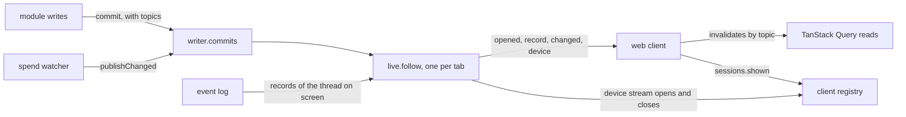

# Live updates

A client tab holds one server-sent stream, `live.follow`, and reads again whatever the stream
reports as changed. The stream carries the records of the one thread on screen, and a `changed`
event that names each kind of state a commit touched, such as the pause, the task list or a backup
notice. A device screen opens the same procedure in its own form, which carries only its screen.

A change that writes no record, or that no write makes, still reaches the tab through a topic. A
backup notice marks its topic in the transaction that writes it, and the spend watcher publishes
`spend` when the gateway's stop differs from its last read. The tab reads a topic's reads again on
its `changed` event, and reads every topic again when a stream opens, because `changed` has no event
ID and a closed stream misses it.

Two reads change with no write and have no topic of their own, so the tab reads them again on a
timer: the task list, at the time its own answer gives, and the stuck forgets. Roots such as
`sessions` and `devices` have no topic at all. See [Topics](#topics) for each.

## The stream

`live.follow` takes one of two forms. The page form takes `afterSequence`, `thread` and
`clipPayloads`. The device form takes `device.pixels`. Both are strict objects, so a device form
never parses as a page form with its key stripped.

The page form answers these events:

- `opened`, always first. The stream sends it once it listens on `writer.commits`.
- `record`, for a record whose thread is the input's `thread`, in sequence order. Its event ID is
  the record's sequence. With no `thread`, the stream sends no records.
- `changed`, with the topics of one or more commits. It has no event ID, so a closed stream misses
  it, and the client reads every topic again when a stream opens.

The device form answers `opened` once its device stream is open, then `device` events with the
screen state and each change, as [the devices doc](./devices.md#the-streams) describes.

A page stream starts after the last event ID when that is a sequence of 1 to 15 digits, and
otherwise after `afterSequence`, and never past the head, because a start past the head would skip a
`session.revoked` record that names the caller. A shredded record arrives with `isRemoved`, which
the server reads from the `record.forget_started` record that names it. A `record` event reads the
record as a page read does, as [the API doc](./api.md#reading-and-the-live-stream) describes.

The API reads the head of the log, then checks the session, and refuses a missing or revoked session
with a plain 401. The head comes first, so a revoke that commits after the check lies past the head,
where the stream replays it. A `session.revoked` record that names the caller ends a page stream
with `UNAUTHORIZED`, whether or not it sends records. A device-scope session may open the device
form only, and the page form answers `FORBIDDEN`. A full session with no device row gets
`NOT_A_DEVICE` from the device form.

The stream answers at `/rpc/live/follow`. A content blocker's default filter list blocks a path with
a `log` segment, so the stream has none.

One process holds the writer and every stream
([the database on one host](../../decisions/0011-sqlite-on-one-host.md)), so a stream wakes on the
commit event in its own process and watches no file. It sends a topic within a second of its commit,
and merges the topics of commits that land together into one `changed` event. A replay of records
sends the topics that wait between records, so a long replay never holds a topic back.

### Keepalive

The API writes a keepalive into a quiet stream at a fixed interval. oRPC's event iterator swallows
the keepalive comment, so the web client watches the bytes of the response and treats a stream that
sends no byte within its idle limit as dead. `liveStreamTiming` in the contract package holds the
interval and the idle limit, and a test asserts that 3 keepalive intervals fit in the idle limit.

## Topics

A topic is the name of one root of the web client's query keys, and no two topics share a root. The
contract's `liveTopicSchema` holds the list. A root can lack a topic, and the contract test keeps a
list of those unfollowed roots, `erasure` among them. The test fails when a topic matches no root,
or when a root has neither a topic nor a place on that list.

| Topic         | Reads under the root                             |
| ------------- | ------------------------------------------------ |
| `nixie`       | `nixie.read`, which holds the pause              |
| `spend`       | `spend.read`                                     |
| `backups`     | `backups.readNotice`                             |
| `approvals`   | `approvals.listItems`, `approvals.readProposals` |
| `calls`       | `calls.get`                                      |
| `computer`    | `computer.readHandover`                          |
| `tasks`       | `tasks.list`, `tasks.read`, `tasks.listEnded`    |
| `triggers`    | `triggers.report`                                |
| `definitions` | `definitions.listTasks`                          |
| `memory`      | the memory page's reads                          |
| `notebook`    | the notebook's reads                             |
| `images`      | `images.list`                                    |

Each module that owns record kinds declares the topics each kind changes, and the server registers
them with the log through `registerRecordTopics` when it starts the writer. Every kind has an entry,
an empty list included, and a test walks every kind the modules declare and fails on a kind with
none. The log marks the topics of every record a transaction appends. A write that creates a task
marks `tasks` and `definitions`, because a new task can belong to a definition. A trigger's fire or
skip marks `tasks`, `triggers` and `definitions`, because it moves the watermark that the next run
of a definition reads. A trigger's arm or defer marks `triggers` and `definitions` for the same
reason.

Two other marks cover a change with no record. `markChanged(tx, topics)` adds topics to the commit
of a transaction, and a transaction that rolls back drops them. `publishChanged(writer, topics)`
announces a change that no write made. The spend watcher calls it when the stop it reads, or whether
the gateway answers, differs from its last read.

Each topic has a test that makes the change and asserts that an open stream receives `changed` with
that topic.

A call has no stream of its own. The `calls` topic reaches a tab through the same stream as every
other topic, and the client reads `calls.get` again on it.

A task that comes due on a schedule changes the task list with no write, so no topic announces it.
`tasks.list` returns `changesAt`, the earliest next run of a listed task, and the client reads the
list again at that time, besides reading it on the `tasks` topic.

A forget turns stuck once it stays open long enough, with no write. The `erasure` root has no topic,
and the web client reads `erasure.readStuck` again on a timer.

## The client registry

The API holds one registry in memory, and a restart forgets it. It keeps two facts apart:

- Presence comes only from `sessions.shown` beats. An open stream never counts as present, because a
  background tab holds a stream open. The push notifier reads `presence.isPresent(withinMs)`.
- A device is online while one or more of its device-form streams are open, and for
  `deviceOfflineGraceMs` after its last one closes, so a reconnect never reads as offline. The
  devices module reads the registry's `DeviceStreams`. A device-form stream keeps its session's last
  seen time fresh, and a page stream never does.

When a client goes away, the server ends its stream within 2 keepalive intervals and drops a
device-form stream from the registry in the same step.

## The web client's side

[The client doc](./client.md#the-live-stream) describes how the web client holds the stream.
