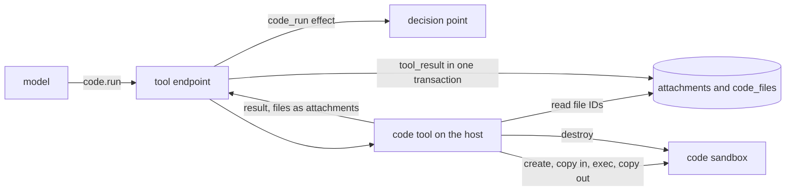

# The code tool

`code.run` runs a short program, such as a calculation, a file conversion or a chart, and returns
its output and the files it wrote. Any task can call it, the conversation included. Every code run
gets a fresh sandbox from the code image. The sandbox has no network, no grant (a credential the
sandbox runtime adds to requests) and no tool route (the guest's way back to nixie's tools), as
[sandboxes](./sandboxes.md#kinds-of-work) describes. nixie destroys the sandbox when the tool call
returns. [Tool calls](./tool-calls.md) covers the endpoint that runs the tool.

## The call

The input schema is strict. A call names a `language` (`python`, `javascript`, `typescript` or
`bash`), a `program` of 1 to 100,000 characters, up to 50 `files` and up to 10 distinct `skills`.
Each file has a `path` in the work folder and either a `file` ID, which a code run on the same
thread wrote, or a `page` ID, whose stored text is the file's content. A path holds 1 to 200
characters of `A-Z a-z 0-9 . _ / -`, has no empty, `.` or `..` segment, is never under `out/`, and
appears once. A skill is one that the caller's task pinned, and it lands at `/skills/<name>/`, owned
by root and read-only to the program.

The result holds `exitCode` (null when a signal ended the program), `stdout` and `stderr` (the start
of each stream as `text`, its `bytes`, `isCut`, and `file`, the ID of the kept stream when the
stream is longer than the text shows), `files` (each with `file`, `path`, `bytes`, `mediaType` and
`isShown`), `limit` and `seconds`. The tool declares the `code_run` effect, no destination and no
amount, with `program` as its content, so the decision point allows it under an allow rule on that
effect. Every result field is outside content. The tool runs direct, because a code run reaches
nothing outside nixie.

The tool's description holds what the model needs: the program has no network and no credentials,
what the image holds, that nothing installs, how to read a large CSV within the memory limit, each
limit with its figure, and where the program writes its output (`out/`) and reads its inputs.

## The steps of a call

1. Parse the call, and refuse a malformed one.
2. Take a slot. At most `runsAtOnce` code runs run at once in one server process, and a further call
   gets the tool error that names the limit
3. Resolve the inputs, refusing in this order: a file ID, a page ID, a skill, then the total size.
4. Create a sandbox of kind `code_run` from the code image at the `codeRun` size row, with owner
   `code_run:<callID>`. The setup copies each input in, and the program goes to `/opt/nixie`.
5. Run the program as the user `code` in `/work`, under the wall-time limit, and read the guest's
   memory-kill count before and after.
6. List `/work/out/`, and copy the files out unless a `files` limit applies.
7. Destroy the sandbox on every way out, a refusal and a thrown error included.
8. Write the result record with the files sealed as its attachments, and the `code_files` rows in
   the same transaction.

The whole call ends within `callMs`. Past it, nixie destroys the sandbox and returns a tool error
that says the code run took too long. A failed destroy repeats every minute until it succeeds,
because the sandbox holds unencrypted copies of the inputs and outputs, and the sandbox counts
towards the limit on code runs at once until then.

## The limits

The limits are constants in `codeRunLimits`, with no config key and no definition key. The result's
`limit` holds the first limit the program reached, in this order:

| `kind`      | When                                                                                     |
| ----------- | ---------------------------------------------------------------------------------------- |
| `wall_time` | the program ran for `wallTimeMs`, and nixie stopped it                                   |
| `memory`    | the guest's memory-kill count rose during the program                                    |
| `killed`    | the program ended on a `SIGKILL` that nixie did not send, and the count cannot be read   |
| `output`    | a stream passed `streamBytes`, and nixie kept the start of it                            |
| `files`     | `out/` holds more than `outputFiles` files or `outputBytes` bytes, so nixie returns none |

A program that reaches a limit still returns its result, with the limit's sentence. Nobody raises
the `codeRun` size row after a memory kill, because the program chose how much memory to use.
[Memory kills](./memory-kills.md) covers the count.

## The files

- Each file the result returns is one attachment of the `tool_result` record, sealed under that
  record's key, and one `code_files` row with the file ID, thread, record sequence, attachment
  position, size and media type. The row holds no path, because the path sits in the result's
  erasable fields.
- A stream longer than the text the result shows is kept, up to `streamBytes`, as a file at
  `.stdout` or `.stderr`. The two stream files count toward neither `files` limit.
- A file ID resolves only on its own thread. A worker's tool calls write their records on the
  caller's thread, so the caller reads the files of its worker's code runs. A stored page lasts one
  session, so a page ID works only in the session that fetched it.
- `mediaType` comes from the bytes for PNG, JPEG, GIF and WebP, else from the extension, else
  `application/octet-stream`.
- Up to 4 image files reach the model beside the result, scaled as
  [web fetch images](./web-fetch-images.md) are, and each counts against the session's image caps.
  With no session, or when the session refuses an image, `isShown` is false.
- The result record holds each skill's name and content hash and the sandbox ID in its hidden
  fields. The model never receives them.
- When the call has a session, the transaction first checks that no forget ended the session. When
  one did, nixie writes nothing and returns "A forget ended this session during the code run, so
  nixie kept nothing from it."
- A code run adds its files and up to two stream files to `nixie.db` and to each backup, so the
  output limits bound the growth.

## Sending a file

`file.send` shows the user a file that a code run on the same thread wrote, under nixie's reply. It
takes a `file` ID from a `code.run` result's `files` and an optional plain-text `caption` of 1 to
1,000 characters, and sends one file per call. The result holds the file's `file`, `name`, `bytes`
and `mediaType`, and every field is outside content, because the program chose the name and the
type.

- The tool declares the `note` effect, no destination and no amount, with `caption` as its content.
  The file goes only to the user inside nixie, so the starter rule `allow-notes` allows it, and the
  tool runs direct.
- A file ID resolves only on the thread of the call, as it does for `code.run`'s inputs. The call
  refuses a file of another thread, an unknown ID and a forgotten file with the messages that
  `code.run` gives for them.
- The call refuses a kept stream file (`.stdout` or `.stderr`), because it is the code run's output
  and not a file the program wrote. The tool finds one by the `stdout.file` and `stderr.file` of the
  code run's result record.
- The name is the last segment of the file's path in that result.
- A send stores the file ID and never a copy of the bytes. The bytes stay one attachment of the code
  run's `tool_result` record, so a forget of that record makes the sent file unreadable as well.
- The result record's transaction also writes one `code_file_sends` row with the record's sequence,
  the file ID and the thread. The row holds no free text and sits outside the erasable fields, so it
  marks which files went to the user even after a forget.

[The conversation view](../channels/client.md#the-conversation-view) covers how the user sees the
file, and [the API](../channels/api.md#reading-a-code-run-file) covers how the client reads its
bytes.

## Forgetting

A forget of a `tool_result` record makes its files unreadable with its text, and the `code_files`
row stays, so the next use of the file ID gets "The file {file} was forgotten." The same holds for a
file that `file.send` sent: the view then shows its name and size with no image and no download. A
forget of the `file.send` record itself removes only its caption and result, so the view shows
nothing for it, and the file stays readable. The sandbox holds unencrypted copies, so a forget
destroys each code sandbox of a call on a record it covers before it deletes any key, a running one
included, and finds each through its owner. A conversation reset does the same for every call on the
conversation thread.

When a destroy fails, the forget or the reset fails with "nixie could not destroy a code sandbox
that holds this text. Try the forget again.", deletes no key, and a retry runs the cleanup again.

At each server start, nixie destroys every sandbox whose owner is not the conversation, a memory
task or an open started task, so a code sandbox that a crash left goes at the next start.

## The image

The `code` image key follows every rule of the image set. The `code_run` server part declares it, so
every deployment pulls it. The image is Python 3.13 on a slim Debian base, with numpy, pandas,
scipy, duckdb, matplotlib with Pillow, openpyxl, pdfplumber and python-docx, Bun for `javascript`
and `typescript`, and bash, sqlite, jq, ripgrep, git and the common file and text tools. It holds no
package installer, no ffmpeg, no polars and no ImageMagick. The build pins every version, and the
non-root user `code` runs the program.
