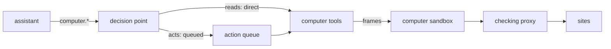

# The computer

The assistant has a computer of its own: one sandbox with a virtual desktop, a browser and a shell.
The sandbox stays: it keeps a disk between calls, so a browser sign-in or a downloaded file is still
there at the next call. Chromium runs on the desktop's display, and the shell runs bash commands in
a terminal on the same desktop. The assistant reads the whole screen and drives it with a pointer
and a keyboard, for what the page tools cannot reach. The disk is working space, not a store: what
must last goes in the notebook or in memory, which the backup covers. A forget never reaches inside
the disk.

## The sandbox

The kind `computer` has public egress, no grant and no tool route. A deployment holds one, owned by
`computer-desktop`, and recovery keeps it. The [sandbox sizes](sandboxes.md#sizes) hold its memory
and disk. The image `nixie-computer` comes from `guests/computer`.

The desktop runs Xvfb as the display, openbox as the window manager, xterm as the terminal and
x11vnc as a VNC server. The display is 1280 by 800. The VNC server listens on a Unix socket in a
directory that only the screen's account can open, and on no TCP port, so the browser and the
terminal cannot reach it. Selection and clipboard exchange are off, and so are the remote control
commands that an X client can send it through the display, which Chromium is. It accepts the keys
and pointer of a viewer, and the relay passes them only while a device
[holds the desktop](#taking-over). Read [Watching](#watching) for how the user's client reaches it.

Chromium runs in the time zone of `time.default_zone` in the config, so a page that shows "today" or
an opening hour shows the user's. Nixie hands the zone to the guest when it starts the guest, so a
changed zone reaches the browser at its next start.

The guest is one long-lived process per wake. It reads frames from `libs/wire` on stdin, answers
them one at a time on stdout, and holds no state nixie cannot rebuild, except the disk. The computer
in `modules/connectors` owns the sandbox:

- A call waits a set time for its turn, and returns `BUSY` after that. The calls into the sandbox
  therefore never overlap, whether they come from the conversation or a task. A browser call and a
  shell call share one turn.
- The sandbox sleeps after its idle time. Nixie treats every wake as a restart: it starts the guest
  again, so every tab ID from before the sleep returns `TAB_GONE`. The profile keeps the sign-ins.
- A queued click, fill, screen act or command holds the sandbox awake until its action runs or its
  approval lapses, so a card the user answers late still finds its tab.
- When the sandbox's image or spec differs from the release, nixie creates a new one at its next
  call and copies the disk into it.
- Resetting the sandbox destroys it, and the next call creates an empty one. `isDiskNew` is true on
  the first result from a disk that started empty, so the assistant knows what it held before is
  gone.

### Accounts and the disk

The guest runs as root and hands no root to anything it starts. It starts each part as an account of
its own, so one part cannot read, signal or trace another:

| Account  | Runs                                    | Holds                               |
| -------- | --------------------------------------- | ----------------------------------- |
| chrome   | Chromium, through a launcher script     | `profile`, readable by this account |
| terminal | the terminal and each `computer.run`    | `files`, readable by this account   |
| screen   | the display, openbox and the VNC server | nothing on the disk                 |

The display listens on an abstract socket only, and the sandbox's network namespace is where the
guest runs, so a command in its own network namespace cannot reach it. The guest injects the screen
tools' input and reads the windows and the picture with xdotool, xprop, xwininfo and scrot, each run
as the `screen` account in the sandbox's own namespace. The terminal's processes sit in a cgroup
with a memory limit and no swap, so a runaway command is killed there before it takes the browser's
memory. The home folder is sticky, so the terminal cannot replace the profile folder beside its
files.

### Moving from the earlier sandboxes

An earlier release kept a browser sandbox, owned by `computer-browser`, and a shell sandbox, owned
by `computer-shell`. Their kinds, `browser` and `shell`, stay readable in stored records. Recovery
keeps both sandboxes, whatever their image, until their disks are copied.

Before the computer's first call runs, nixie copies the old browser's profile into `profile` and the
old shell's files into `files`. The copy runs commands in both sandboxes, so it keeps symlinks and
the modes of files and folders, and it moves a file of any size. Nixie then lists the new folder and
compares it with the old one. Every path, kind, mode, symlink target and file size must match. It
then writes the disk marker and destroys the old sandboxes. When a copy fails, every call returns
`COMPUTER_MOVING`, and nothing is destroyed. A queued action treats `COMPUTER_MOVING` as a refusal
it may retry. A reset destroys the old sandboxes too.

## Tools

| Tool                          | Effect         | Runs   | Result                                                              |
| ----------------------------- | -------------- | ------ | ------------------------------------------------------------------- |
| `computer.browser_open`       | `fetch`        | direct | a new tab and its page text                                         |
| `computer.browser_read`       | `note`         | direct | the page again, as `text` or as a `snapshot` that marks controls    |
| `computer.browser_screenshot` | `note`         | direct | the viewport's picture, or one control's box, beside the result     |
| `computer.browser_scroll`     | `note`         | direct | `isAtEnd` and the viewport's picture beside it, with no page stored |
| `computer.browser_close`      | `note`         | direct | the tab closed                                                      |
| `computer.browser_download`   | `fetch`        | direct | a file saved to `downloads/` in the files                           |
| `computer.browser_fill`       | `send`         | queued | the page after the typed value, with `submit` to press Enter        |
| `computer.browser_click`      | `send`         | queued | the page after the click                                            |
| `computer.screenshot`         | `note`         | direct | the whole desktop's picture and the window in focus                 |
| `computer.screen_scroll`      | `note`         | direct | the wheel turned over a point, the picture and the window in focus  |
| `computer.screen_click`       | `send`         | queued | a click at a point, the window in focus and the picture after it    |
| `computer.screen_type`        | `send`         | queued | text or one key chord typed, the window in focus and the picture    |
| `computer.run`                | `computer_run` | queued | the exit code, `stdout` and `stderr` (each cut at a limit), seconds |
| `computer.read_file`          | `note`         | direct | the text of a file under `~/files`                                  |
| `computer.write_file`         | `note`         | direct | a file written under `~/files`, which replaces one of that name     |
| `computer.export_file`        | `note`         | direct | a file kept with the result, so `file.send` can send it             |

Every result field except the tab, the flags and a refusal's code is untrusted. A refusal comes back
as a result with `refused: { code, message }`, never as an error.

**Pages.** The guest writes link marks and tags each control in a snapshot as `[E4 textbox "Name"]`.
The tool stores the page like a fetched page and returns its first part, and `web_fetch` with the
page ID reads the other parts. The stored page carries a fetch URL that no URL parser accepts, so
`web_fetch` never serves it from its cache: a tab shows the live page with its cookies. A tab holds
at most 5 pages (`TAB_LIMIT`). The model's tab IDs (`t1`, `t2` and on) count up for the life of the
server, so a restart never reuses one.

**Scrolling and pictures.** `browser_scroll` takes `to` as `up`, `down` or a control ID such as
`E12`. It moves the viewport by most of a screen, or scrolls the control into view, and returns
`{ tab, isAtEnd }`. For `up`, `isAtEnd` means the top; otherwise it means the bottom. It stores no
page, so it never counts toward a tab's 5 pages. `browser_screenshot` takes an optional `control`
and then pictures that control's box, cut to the viewport, without scrolling the page, so a person
who holds the desktop keeps their view. A picture of a control wholly outside the viewport returns
`STALE_ELEMENT`, and so does either tool for a control that no longer holds its number.

**Old names.** Every browser tool carries the `browser_` prefix, and a call under a name from before
it is an unknown tool. An action queued under `computer.fill` or `computer.click` before the rename
settles as `TAB_GONE` when the action runner reaches it, as an act on a replaced sandbox does.

**The screen.** The page tools stay the main way in, because page text costs far fewer tokens than a
picture. The screen tools are for what they cannot reach. The desktop is 1280 by 800, and a click
takes a point on it. A screenshot's `width` and `height` give the size of the picture the model
sees, which is smaller than the desktop when the image long edge is under 1280. The model then
multiplies a point on the picture by 1280 divided by `width`. Each screenshot and each screen act
result carries `focus`, which is `{ kind: 'browser', tab, url }`, `{ kind: 'terminal' }` or
`{ kind: 'other' }`, and `isWatched`, which is `true` while a [watch](#watching) is open.

While a device holds the desktop, a screenshot still works and an act, a scroll, a page open, a
close, a download and a file write answer `TAKEN_OVER`. A queued act that was prepared before a hold
began, and runs after one ended, answers `SCREEN_CHANGED`, because the person may have moved the
page or the focus.

The result of a screen act carries the picture of the desktop after the act, as a screenshot does.
The connector's response holds the picture beside the result. The action runner seals its bytes as
an attachment of the outcome record and keeps the media type in the record's erasable fields, so the
picture reaches the model beside the outcome, whether the model waits for the action or reads it
later in its inbox, and a forget of the outcome erases it. The input has landed by the time the
guest takes that picture, so a picture it cannot take leaves the act done: the reply omits it and
`isShown` is `false`. A queued act reserves its picture against the session's image budget as a
screenshot does, and a picture past the budget is left out the same way.

A point outside 0 to 1279 by 0 to 799 returns `BAD_POINT`. `screen_scroll` takes `by` as a whole
number of wheel steps, 1 to 50 in either direction, where a negative number scrolls up, and returns
`BAD_STEPS` outside that range. `screen_type` takes `text`, at most 1,000 characters, or `keys`, one
chord such as `enter`, `shift+tab` or `ctrl+a`, and exactly one of the two.

**Paths.** A path is under `~/files`, and a relative path starts there. A path that leaves it by
`..` or by a symlink returns `BAD_PATH`. A file read or written has a size limit, and a larger file
returns `TOO_BIG`. `export_file` returns the result shape of a `code.run` file, and stores its bytes
as an attachment of the result record, so a forget of that record erases them.

## Reads and acts

A read changes nothing outside nixie, so `browser_open` and `browser_download` are `fetch` effects,
and the decision point asks about each site on its first visit, with the site's host and port as the
destination.

A click or a fill can post a form, so each is a queued `send`. The tool's `prepare` hook reads the
tab's URL before the decision. The host becomes the call's destination, and the URL becomes
`expectURL`, which the action hash covers. When the action runs, the guest compares the tab's URL
with `expectURL` and returns `PAGE_CHANGED` when they differ. It also returns `STALE_ELEMENT` for a
control that no longer holds its number, and `CROSS_ORIGIN_SUBMIT` for a form that posts to another
origin. Nixie keeps `expectURL` in memory, so a restart between the call and the action makes the
action refuse with `PAGE_CHANGED`, never run against a page nobody looked at.

A screen act is a queued `send`. Its `prepare` hook asks the guest for the window the act would land
on: the one under the point for a click, and the focused one for typing. That window is the
`ScreenBinding`, with its window ID, its kind, and for a browser its tab and URL. For a browser
window the tab's host is the destination, and for any other window the act has no destination, so it
always asks. Nixie keeps the binding in memory, as it keeps `expectURL`, and the action hash covers
it. Two calls with the same input can be prepared against different windows, so nixie keeps each
binding apart and matches it to the action by the hash the owner answered. A busy computer leaves
the binding in place for the retry, and only a terminal outcome removes it.

A click also stores the desktop's picture from the moment of the call, with the click's point marked
on the card. The guest takes the picture when it binds the click. The tool stores it as an
attachment of the call's own record, only when the call asks the user, and a digest of its bytes is
part of the binding that the action hash covers. A call prepared against a changed screen is
therefore a new question. The card shows the picture through the same route as a stored image, with
a ring drawn over it in the web client at the click's point, so the stored picture stays as the
screen showed it. A forget of the call, or of its proposal, erases the picture. A `screen_type` card
shows the typed text or the keys, and no picture.

When the action runs, the guest finds the window under the point again, or the focused one, and
returns `SCREEN_CHANGED` when it differs from the binding on any field. A restart between the call
and the action loses the binding, so the action returns `SCREEN_CHANGED` and never runs against a
screen nobody looked at.

The guest also refuses a screen act that belongs to another tool, both when it prepares the act and
when it runs it:

- An act on the terminal window returns `USE_RUN`, with the message "Use the computer.run tool
  instead". A scroll over the terminal returns it too.
- A click on the browser's tab strip or address bar returns `USE_BROWSER_OPEN`, with the message
  "Use the computer.browser_open tool instead". The chrome is the part of the browser window above
  the page's viewport, which the page reports. A chord that focuses the address bar or opens a tab
  or a window (`ctrl+l`, `alt+d`, `f6`, `ctrl+k`, `ctrl+e`, `ctrl+t`, `ctrl+n`, `ctrl+shift+n`)
  returns it too, in any case and any order of its modifiers.
- A browser window that shows no tab the guest tracks, such as a popup the page opened, returns
  `USE_BROWSER_OPEN` for any act, because its page top is unknown. With several browser windows, the
  guest gives a window the visible tab whose rectangle is nearest its own, and none when 2 windows
  are equally near.
- Keys that are not one known chord return `BAD_KEYS`.

An "always allow" on a screen act pins the host alone, in one rule for `computer.screen_click` and
`computer.screen_type`, with no check on the coordinates, the text, the keys or the window. One
answer therefore covers every later screen act on that site, and a rule that names the host covers
them too. The rule names those 2 tools and never widens to another `send` tool. A screen act on a
window with no host gets no "always allow", so each one asks. No starter rule allows a screen act.

A `computer.run` is its own effect, `computer_run`, because the shell reaches the internet and
`code_run` means a sandbox with none. It asks unless a rule allows it.

- An "always allow" on a command offers the pattern `<first words> *`, such as `git status *`.
- A rule's `matches` check on `command` reads the command as a syntax tree. It passes only for plain
  commands of literal words joined by `;`, `&&`, `||` or `|`. A substitution, a redirection, an
  assignment, an expansion, a glob, a background `&`, a subshell, a compound command or a line that
  does not parse fails the check, so `git status; curl x | sh` still asks under `git status *`. Each
  command on the line must match the pattern, and its name must be one word. A word that holds an
  unquoted bracket, brace, `<`, `>`, `$`, backtick or glob character fails the check too, because
  the parser can read such a word as plain text where bash runs a command.
- The starter rules allow `cat`, `df`, `du`, `grep`, `head`, `ls`, `pwd`, `stat`, `tail`, `wc` and
  `which`, one rule each, so a line passes when every command on it is the same one of them. They
  leave out `find` and `file`, because their options can run a program or write a file and a pattern
  cannot exclude an option.
- Nixie counts each call that changes the shell's disk: `write_file`, `browser_download` and `run`.
  A hold on the desktop counts as a change at its start and at its end. A run that waits for a
  decision keeps the count from when it was proposed, and returns `FILES_CHANGED` without running
  when the count moved. A queued run that finds no remembered count, such as after a restart,
  returns `TAB_GONE` without running. An approved command therefore never runs a script that changed
  after the user read the card.

## Watching

The user watches the desktop live in the web client's
[computer page](../channels/client.md#the-computer-page). The picture takes no port of the sandbox.
The VNC stream rides the guest's existing wire session as `vnc-open`, `vnc-data` and `vnc-close`
frames, each carrying a stream ID, and the guest pipes each stream to the VNC server on its
loopback. A VNC frame never waits behind a request in the guest's queue, so a long call never stalls
the picture. The guest holds at most 4 streams, and the server never writes a frame to disk.

[The API](../channels/api.md#watching-the-computer) mints the ticket and holds the socket. The
connector side, `openComputerWatch`, does the rest for each socket:

- The watch counts as open from the moment its socket opens, so `isWatched` is `true` while the
  sandbox still wakes. It turns `false` when the last watch closes. Neither change writes a record.
- The watch holds the sandbox awake until it closes. It wakes a sleeping sandbox and starts the
  guest, and a watch that closes during the wake opens no stream and releases its hold. A watch
  never takes the turn for longer than that start, so a call never answers `BUSY` because of one.
- The relay lets through the messages that a viewer needs: the handshake, `SetPixelFormat`,
  `SetEncodings` and `FramebufferUpdateRequest`. It passes `KeyEvent` and `PointerEvent` only while
  the viewer's device holds the desktop, and drops them silently otherwise. It always drops
  `ClientCutText` silently, and closes the socket and the stream on a message that is malformed,
  unknown or past a size cap, including a `SetPixelFormat` with an invalid pixel format. It reads
  the length of a `ClientCutText` as signed, because a viewer that speaks the extended clipboard
  format sends a negative one. While the sandbox wakes, it queues the viewer's bytes up to a cap far
  above what a viewer sends before it hears from the desktop, and closes the socket past it.

## Taking over

A device session takes over the desktop through `computer.takeOver` and gives it back through
`computer.handBack`. [The API](../channels/api.md#watching-the-computer) holds those two calls. One
device holds the desktop at a time, and the hold lives in memory only.

- From the moment `takeOver` is called, the assistant's new calls that change the desktop wait. A
  queued action of a `computer.` tool stays pending, with no attempt and no wake, until the hold
  ends. The runner reads the hold at its claim and again when an attempt starts, and an in-step
  action again when it starts, so a take-over between them leaves no attempt and no call. The call
  waits for the calls running when it was made, each up to its own limit from the moment it took its
  turn, and a call that arrives later is not waited for. It answers `BUSY_TOO_LONG` when they run
  past them. A second device gets `HELD_ELSEWHERE`.
- The relay passes the holder's keys and pointer to the VNC server. Each one holds off the idle
  hand-back, which ends the hold with `idle` after `computer.idle_hand_back_minutes` of no input, 30
  by default. When a hold ends, the relay drops the holder's queued key and pointer messages, and
  the guest releases every key and button the VNC server still holds pressed. A flush keeps the
  protocol messages that wait in the guest.
- A hold ends when the holder hands back, when it idles out, or when the guest restarts or nixie
  restarts. A restart writes the end record at the next start. The sandbox does not sleep during a
  hold, and a guest that stops on its own ends the hold with `restart`. When a hold ends, whoever
  ends it, the relay releases what the viewer pressed and closes every socket of the holder's
  device.
- At the start of a hold the guest starts to list the sites its browser shows: the tab in view at
  the start, each tab that comes into view and each page that navigates while it shows. A tab that
  the person opens joins the tabs, so a hand-back names it. At the end, nixie reads the sites, the
  window in focus and the terminal's text, if the terminal is in focus. The text that the screen
  cleared is not in the terminal's text.

A hold writes 2 records on the conversation's thread. `computer.takeover_started` names the device
and wakes nothing. `computer.takeover_ended` names what ended the hold and for how long, and wakes
the assistant. Both carry a short ID. The ended record keeps the sites and the window in focus as
[erasable fields](../core/erasable-fields.md), so a forget of the record erases them. The assistant
reads the window's text inside the untrusted-text markers of a page read. Each marker carries a
random ID that the text never holds, so the text cannot close the block early. The assistant names
the record by its short ID.

## The checking proxy

Every connection from the sandbox leaves through a proxy that its guest starts (`libs/egress`). The
proxy refuses an address in a denied range, resolves each host once and pins the address it checked.
Before it connects, it asks nixie to scan the URL of a plain request, and then the headers and body,
which it holds in full. A body too large to hold, and a chunked body, are refused because the proxy
cannot scan them first. The scan of headers and bodies has no typed-URL exemption.

The browser also turns off QUIC and WebRTC's non-proxied UDP, and asks nixie to scan the URL of
every request it makes, with a hop frame as the fetch guest does. Chromium may open a CONNECT
tunnel, because the guest scans each request before it enters one.

The scan channel stays open between calls. A request that a page makes while no call runs, such as a
timer in a page, is scanned with the default scans, which have no typed-URL exemption. A refused
request fails in the page and writes no record.

The terminal and each command run in a network namespace of its own that holds a loopback and
nothing else. A bridge there passes the command's proxy settings to a proxy on a Unix socket, so a
raw socket or `curl --noproxy` finds no route out. The proxy for commands refuses CONNECT, because
it cannot read an encrypted tunnel, so the shell reaches plain HTTP sites only, and the browser
fetches the rest. A command's processes end with the command.

Nixie scans the URL of a click, a fill and a run the same way, with no typed-URL exemption, because
a queued action has no message to exempt it.

## What the test sandbox shows

The test sandbox runs a guest as a plain process of the host. A test shows that a shell command has
no route out except the proxy, and that the secret scan stops a secret in a URL, a header and a
body. The shell's namespace needs unprivileged user namespaces in the sandbox's kernel; a command
fails closed when they are off. The browser's network is closed by Chromium's proxy settings alone.
A journey in `bun verify` runs against a page the harness serves on a `.test` host, which the test
build's guests resolve to the loopback address. The test sandbox has no display, so the screen tools
drive a stand-in desktop: one browser window of the display's size, whose page is the newest tab.
Pointer and key events go to that page, and the picture is the page's own. The stand-in has no
terminal and no address bar, so the guest's tests cover those refusals.

The test build also has no VNC server. Its guest, `guests/computer/src/test-main.ts`, serves a watch
from an in-process stand-in that speaks the protocol's handshake and answers each update request
with one fixed picture. Only the test build's entry imports it, so the release image holds none of
it. The imp suite runs the real server, set up as in the
[imp isolation runbook](../../runbooks/imp-isolation-tests.md).

## Memory kills

Nixie reads a sandbox's memory-kill count before and after each call. When it rose, the call returns
`OUT_OF_MEMORY`, whatever else it would have returned. A kill during `computer.run` stays inside the
terminal's cgroup, so the guest and its tabs stay. A kill during any other call restarts the guest,
which closes every tab. The [memory-kill watcher](memory-kills.md) logs `sandbox.memory_kill` with
the kind and size.
