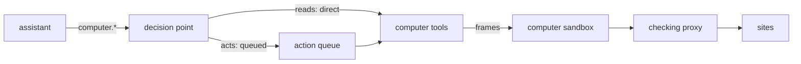

# The computer

The assistant has a computer of its own: one sandbox with a virtual desktop, a browser and a shell.
The sandbox stays: it keeps a disk between calls, so a browser sign-in or a downloaded file is still
there at the next call. Chromium runs on the desktop's display, and the shell runs bash commands in
a terminal on the same desktop. The assistant reads the whole screen and drives it with a pointer
and a keyboard, for what the page tools cannot reach. The disk is working space, not a store: what
must last goes in the notebook or in memory, which the backup covers. A forget never reaches inside
the disk.

## The switch

The computer is on only when the config has a `computer` section, and `computer: {}` turns it on
with the defaults. Its settings (`idle_hand_back_minutes` and `handover_expiry_minutes`) sit in that
section. A nixie with no `computer` section is a nixie with no computer:

- the `computer` and `takeover_restart` server parts never start, and the deployment needs no
  computer image;
- the model is offered no `computer.*` tool, and no tool of another part reaches a computer;
- the inbox holds no take-over or handover record, and the procedures of the `computer` namespace
  answer `FEATURE_OFF`;
- `nixie.read` leaves `computer` out of `features`, the web client hides the Computer menu entry and
  the take-over banner, and `/computer` shows the page that says the feature is off.

The computer adds to the lists that core modules own, each filled from the composition root: the
inbox kinds of take-over and handover records in the tasks module, which also decide whether each
wakes, and the policy's tool shapes, which tell it that `computer.run` holds a command line and that
the two screen acts share one always-allow rule. When the computer is off, both lists hold none of
its entries. Turning it off keeps its records, and turning it on again finds them as they were.

## The sandbox

The kind `computer` has public egress, no grant and no tool route. A deployment holds one, owned by
`computer-desktop`, and the restart sweep keeps it. The [sandbox sizes](sandboxes.md#sizes) hold its
memory and disk. The image `nixie-computer` comes from `guests/computer`.

The desktop runs Xvfb as the display, openbox as the window manager, xterm as the terminal and
x11vnc as a VNC server. The display is 1280 by 800. The VNC server listens on a Unix socket in a
directory that only the screen's account can open, and on no TCP port, so the browser and the
terminal cannot reach it. The primary selection is off, and so are the remote control commands that
an X client can send it through the display, which Chromium is. The VNC server sends the clipboard
to its viewers, for the [copy and paste](#copy-and-paste) of a take-over, and never sets it from a
viewer. It accepts the keys and pointer of a viewer, and the relay passes them only while a device
[holds the desktop](#taking-over). The user's client reaches it as [Watching](#watching) says.

Chromium runs in the time zone of `time.default_zone` in the config, so a page that shows "today" or
an opening hour shows the user's. Nixie hands the zone to the guest when it starts the guest, so a
changed zone reaches the browser at its next start.

The guest is one long-lived process per wake. It reads frames from `libs/wire` on stdin, answers
them one at a time on stdout, and holds no state nixie cannot rebuild, except the disk. The computer
in `modules/connectors` owns the sandbox:

- A call waits a set time for its turn, and returns `BUSY` after that. The calls into the sandbox
  therefore never overlap, whether they come from the conversation or a task. A browser call and a
  shell call share one turn.
- The sandbox sleeps after its idle time, which the deployment sets. Nixie treats every wake as a
  restart: it starts the guest again, so every tab ID from before the sleep returns `TAB_GONE`. The
  profile keeps the sign-ins. The description of every browser tool states the idle time, so the
  assistant knows how long a tab lives. A tab that closed in a sleep answers `TAB_GONE` with a
  message that names the idle time it closed after, which tells it from a tab that never existed, or
  that a restart or a crash took.
- A queued click, fill, screen act or command holds the sandbox awake until its action runs or its
  approval lapses, so a card the user answers late still finds its tab.
- When the sandbox's image or spec differs from the release, nixie creates a new one at its next
  call and copies the disk into it.
- Resetting the sandbox destroys it, and the next call creates an empty one. `isDiskNew` is true on
  the first result from a disk that started empty, so the assistant knows what it held before is
  gone.

### Accounts and the disk

The guest runs as root and hands no root to anything it starts. It starts each part as an account of
its own, so one part cannot read, signal or trace another:

| Account  | Runs                                    | Holds                               |
| -------- | --------------------------------------- | ----------------------------------- |
| chrome   | Chromium, through a launcher script     | `profile`, readable by this account |
| terminal | the terminal and each `computer.run`    | `files`, readable by this account   |
| screen   | the display, openbox and the VNC server | nothing on the disk                 |

The terminal has ffmpeg and ImageMagick (`ffmpeg`, `ffprobe` and `magick`) beside bash, git, curl,
jq and unzip. A command that transcodes a clip or resizes an image runs in the terminal's memory
limit. The [images workflow](../../../.github/workflows/images.yml) runs both tools as the
terminal's account, inside the terminal's memory limit and the sandbox's vCPUs, on every build of
the image.

The display listens on an abstract socket only, and the sandbox's network namespace is where the
guest runs, so a command in its own network namespace cannot reach it. The guest injects the screen
tools' input and reads the windows and the picture with xdotool, xprop, xwininfo and scrot, each run
as the `screen` account in the sandbox's own namespace. The terminal's processes sit in a cgroup
with a memory limit and no swap, so a runaway command is killed there before it takes the browser's
memory. The home folder is sticky, so the terminal cannot replace the profile folder beside its
files.

### Moving from the earlier sandboxes

An earlier release kept a browser sandbox, owned by `computer-browser`, and a shell sandbox, owned
by `computer-shell`. Their kinds, `browser` and `shell`, stay readable in stored records. The
restart sweep keeps both sandboxes, whatever their image, until their disks are copied.

Before the computer's first call runs, nixie copies the old browser's profile into `profile` and the
old shell's files into `files`. The copy runs commands in both sandboxes, so it keeps symlinks and
the modes of files and folders, and it moves a file of any size. Nixie then lists the new folder and
compares it with the old one. Every path, kind, mode, symlink target and file size must match. It
then writes the disk marker and destroys the old sandboxes. When a copy fails, every call returns
`COMPUTER_MOVING`, and nothing is destroyed. A queued action treats `COMPUTER_MOVING` as a refusal
it may retry. A reset destroys the old sandboxes too.

## Tools

| Tool                          | Effect               | Runs   | Result                                                              |
| ----------------------------- | -------------------- | ------ | ------------------------------------------------------------------- |
| `computer.browser_open`       | `fetch`              | direct | a new tab and its page text                                         |
| `computer.browser_navigate`   | `fetch`              | direct | a new address loaded in an open tab, and its page text              |
| `computer.browser_reload`     | `note`               | direct | the open tab loaded again, and its page text                        |
| `computer.browser_read`       | `note`               | direct | the page again, as `text` or as a `snapshot` that marks controls    |
| `computer.browser_screenshot` | `note`               | direct | the viewport's picture, or one control's box, beside the result     |
| `computer.browser_scroll`     | `note`               | direct | `isAtEnd` and the viewport's picture beside it, with no page stored |
| `computer.browser_close`      | `note`               | direct | the tab closed                                                      |
| `computer.browser_download`   | `fetch`              | direct | a file saved to `downloads/` in the files                           |
| `computer.browser_fill`       | `send`               | queued | the page after the typed value, with `submit` to press Enter        |
| `computer.browser_click`      | `send`               | queued | the page after the click                                            |
| `computer.screenshot`         | `note`               | direct | the whole desktop's picture and the window in focus                 |
| `computer.screen_scroll`      | `note`               | direct | the wheel turned over a point, the picture and the window in focus  |
| `computer.screen_click`       | `send`               | queued | a click at a point, the window in focus and the picture after it    |
| `computer.screen_type`        | `send`               | queued | text or one key chord typed, the window in focus and the picture    |
| `computer.run`                | `computer_run`       | queued | the exit code, `stdout` and `stderr` (each cut at a limit), seconds |
| `computer.read_file`          | `note`               | direct | the text of a file under `~/files`                                  |
| `computer.write_file`         | `note`               | direct | a file written under `~/files`, which replaces one of that name     |
| `computer.export_file`        | `note`               | direct | a file kept with the result, so `file.send` can send it             |
| `computer.handover`           | `note`               | direct | `asked`, after it asks the user to take over the computer           |
| `computer.handover_cancel`    | `note`               | direct | `cancelled`, after it withdraws the standing ask                    |
| `computer.take_back`          | `computer_take_back` | direct | `durationSeconds` of the hold it ended                              |

Every result field except the tab, the flags and a refusal's code is untrusted. A refusal comes back
as a result with `refused: { code, message }`, never as an error.

**Pages.** The guest writes link marks and tags each control in a snapshot as `[E4 textbox "Name"]`.
The tool stores the page like a fetched page and returns its first part, and `web_fetch` with the
page ID reads the other parts. The stored page carries a fetch URL that no URL parser accepts, so
`web_fetch` never serves it from its cache: a tab shows the live page with its cookies. The browser
holds at most 5 tabs (`TAB_LIMIT`). The model's tab IDs (`t1`, `t2` and on) count up for the life of
the server, so a restart never reuses one.

**Navigating and reloading.** `browser_navigate` takes a `tab` and a `url`, and loads the address in
that tab, which keeps its name and its place among the 5 tabs. It declares the new address's host as
its destination, as `browser_open` does, so the decision point asks about an untrusted site the same
way. `browser_reload` takes a `tab`, loads the address the tab shows, and is a `note` with no
destination, so it never asks. Both return the page as `browser_open` does. A tab that nixie does
not hold returns `TAB_GONE` before the decision point runs, so a navigation of a missing tab never
asks, and an address that is not http or https returns `BAD_URL`. A load that fails leaves the tab
open. A hold on the desktop refuses both with `TAKEN_OVER`, as it does `browser_open`.

**Blocked pages.** When `browser_open` or `browser_navigate` loads a page that a bot protection
answered in place of the site, the result carries a `blocked` reason. The guest finds it from the
status, headers and body of the navigation that made the page the tab shows, with the check that
`web_fetch` uses ([`findBotChallenge`](../../../libs/wire/src/fetch/find-bot-challenge.ts)), so both
tools name the same pages. The guest skips the body when the headers already name a challenge, and
reads no more of it than `web_fetch` does. A challenge that sends the tab on to another page reports
that page's status and no reason. When the tab's address changes after the check and before the page
is read, the result carries status 0 and no reason in place of the challenge's. Only the load that
brought the page sets it, so a later read of a tab that a person has since got past reports none.

**IPv4 hosts only.** Nixie's egress reaches IPv4 hosts only. A host that resolves to no IPv4
address, and to no address that the deployment lists as internal, is refused with the message
"`<host>` has no IPv4 address, and nixie reaches IPv4 hosts only". `browser_open` and
`browser_navigate` return it before the browser starts the load, because a browser shows the
assistant only that its tunnel failed. A redirect to such a host fails in the tunnel, so the guest
replaces the tunnel error with the same message when the proxy refused a host for it during the
load. [`web_fetch`](web-fetch.md) and the shell's proxy refuse the same host with the same message.
A host with both kinds of address connects to its first IPv4 address.

**Scrolling and pictures.** `browser_scroll` takes `to` as `up`, `down` or a control ID such as
`E12`. It moves the viewport by most of a screen, or scrolls the control into view, and returns
`{ tab, isAtEnd }`. For `up`, `isAtEnd` means the top; otherwise it means the bottom. It stores no
page. `browser_screenshot` takes an optional `control` and then pictures that control's box, cut to
the viewport, without scrolling the page, so a person who holds the desktop keeps their view. A
picture of a control wholly outside the viewport returns `STALE_ELEMENT`, and so does either tool
for a control that no longer holds its number.

**Challenges.** `browser_open`, `browser_navigate`, `browser_reload`, `browser_read` and
`browser_screenshot` each look once at the tab they name for a CAPTCHA or human check, however the
assistant came to the tab. The guest reads the address of each frame in the tab, and it counts the
elements of the page and of each frame for known markers. The frames and markers are those of
reCAPTCHA, hCaptcha, Cloudflare Turnstile and its interstitial, and Arkose. The interstitial's form
counts only with the Cloudflare token in its action, so an ordinary form with the same ID does not.
The check never reads page text, so a site cannot write words that pass for a challenge or hide one.
When it finds one, the result carries a `challenge` line that nixie writes, beside the page's text
and never inside it. The line says that a person must solve the check and to call
`computer.handover` with a reason.

**Old names.** Every browser tool carries the `browser_` prefix, and a call under a name from before
it is an unknown tool. An action queued under `computer.fill` or `computer.click` before the rename
settles as `TAB_GONE` when the action runner reaches it, as an act on a replaced sandbox does.

**The screen.** The page tools stay the main way in, because page text costs far fewer tokens than a
picture. The screen tools are for what they cannot reach. The desktop is 1280 by 800, and a click
takes a point on it. A screenshot's `width` and `height` give the size of the picture the model
sees, which is smaller than the desktop when the image long edge is under 1280. The model then
multiplies a point on the picture by 1280 divided by `width`. Each screenshot and each screen act
result carries `focus`, which is `{ kind: 'browser', tab, url }`, `{ kind: 'terminal' }` or
`{ kind: 'other' }`, and `isWatched`, which is `true` while a [watch](#watching) is open.

While a device holds the desktop, the direct reads still run: `browser_read`, `browser_screenshot`,
`screenshot` and `read_file`. A browser or screen scroll, a page open, a close, a download, a file
write and a file export answer `TAKEN_OVER`, so the assistant never moves the person's view. A
queued act stays pending, and the runner claims it after the hand-back, as
[Taking over](#taking-over) says. A queued act that was prepared before a hold began, and runs after
it ended, answers `SCREEN_CHANGED`, because the person may have moved the page or the focus.

The result of a screen act carries the picture of the desktop after the act, as a screenshot does.
The connector's response holds the picture beside the result. The action runner seals its bytes as
an attachment of the outcome record and keeps the media type in the record's erasable fields, so the
picture reaches the model beside the outcome, whether the model waits for the action or reads it
later in its inbox, and a forget of the outcome erases it. The input has landed by the time the
guest takes that picture, so a picture it cannot take leaves the act done: the reply omits it and
`isShown` is `false`. A queued act reserves its picture against the session's image budget as a
screenshot does, and a picture past the budget is left out the same way.

A point outside 0 to 1279 by 0 to 799 returns `BAD_POINT`. `screen_scroll` takes `by` as a whole
number of wheel steps, 1 to 50 in either direction, where a negative number scrolls up, and returns
`BAD_STEPS` outside that range. `screen_type` takes `text`, at most 1,000 characters, or `keys`, one
chord such as `enter`, `shift+tab` or `ctrl+a`, and exactly one of the two.

**Paths.** A path is under `~/files`, and a relative path starts there. A path that leaves it by
`..` or by a symlink returns `BAD_PATH`. A file read or written has a size limit, and a larger file
returns `TOO_BIG`. `export_file` returns the result shape of a `code.run` file, and stores its bytes
as an attachment of the result record, so a forget of that record erases them.

## Reads and acts

A read changes nothing outside nixie, so `browser_open`, `browser_navigate` and `browser_download`
are `fetch` effects, and the decision point asks about each site on its first visit, with the site's
host and port as the destination. `browser_reload` is a `note`, because it loads an address the tab
already shows.

A click or a fill can post a form, so each is a queued `send`. The tool's `prepare` hook reads the
tab's URL before the decision. The host becomes the call's destination, and the URL becomes
`expectURL`, which the action hash covers. When the action runs, the guest compares the tab's URL
with `expectURL` and returns `PAGE_CHANGED` when they differ. It also returns `STALE_ELEMENT` for a
control that no longer holds its number, and `CROSS_ORIGIN_SUBMIT` for a form that posts to another
origin. Nixie keeps `expectURL` in memory, so a restart between the call and the action makes the
action refuse with `PAGE_CHANGED`, never run against a page nobody looked at.

A screen act is a queued `send`. Its `prepare` hook asks the guest for the window the act would land
on: the one under the point for a click, and the focused one for typing. That window is the
`ScreenBinding`, with its window ID, its kind, and for a browser its tab and URL. For a browser
window the tab's host is the destination, and for any other window the act has no destination, so it
always asks. Nixie keeps the binding in memory, as it keeps `expectURL`, and the action hash covers
it. Two calls with the same input can be prepared against different windows, so nixie keeps each
binding apart and matches it to the action by the hash the owner answered. A busy computer leaves
the binding in place for the retry, and only a terminal outcome removes it.

A click also stores the desktop's picture from the moment of the call, with the click's point marked
on the card. The guest takes the picture when it binds the click. The tool stores it as an
attachment of the call's own record, only when the call asks the user, and a digest of its bytes is
part of the binding that the action hash covers. A call prepared against a changed screen is
therefore a new question. The card shows the picture through the same route as a stored image, with
a ring drawn over it in the web client at the click's point, so the stored picture stays as the
screen showed it. A forget of the call, or of its proposal, erases the picture. A `screen_type` card
shows the typed text or the keys, and no picture.

When the action runs, the guest finds the window under the point again, or the focused one, and
returns `SCREEN_CHANGED` when it differs from the binding on any field. A restart between the call
and the action loses the binding, so the action returns `SCREEN_CHANGED` and never runs against a
screen nobody looked at.

The guest also refuses a screen act that belongs to another tool, both when it prepares the act and
when it runs it. The rules read a command from `computer.run` and a site from
`computer.browser_open` and `computer.browser_navigate`, and from a screen act they would see only
keystrokes in a window:

- An act on the terminal window returns `USE_RUN`, with the message "Use the computer.run tool
  instead". A scroll over the terminal returns it too.
- A click on the browser's tab strip, address bar or window controls returns `USE_BROWSER_OPEN`,
  with the message "The tab strip and window controls are off limits; use the browser tools
  (computer.browser_open, computer.browser_navigate, computer.browser_reload) instead". The chrome
  is the part of the browser window above the page's viewport, which the page reports. A chord that
  focuses the address bar or opens a tab or a window (`ctrl+l`, `alt+d`, `f6`, `ctrl+k`, `ctrl+e`,
  `ctrl+t`, `ctrl+n`, `ctrl+shift+n`) returns it too, in any case and any order of its modifiers.
- A browser window that shows no tab the guest tracks, such as a popup the page opened, returns
  `USE_BROWSER_OPEN` for any act, because its page top is unknown. With several browser windows, the
  guest gives a window the visible tab whose rectangle is nearest its own, and none when 2 windows
  are equally near.
- Keys that are not one known chord return `BAD_KEYS`.

An "always allow" on a screen act pins the host alone, in one rule for `computer.screen_click` and
`computer.screen_type`, with no check on the coordinates, the text, the keys or the window. One
answer therefore covers every later screen act on that site, and a rule that names the host covers
them too. The rule names those 2 tools and never widens to another `send` tool. A screen act on a
window with no host gets no "always allow", so each one asks. No starter rule allows a screen act.

A `computer.run` is its own effect, `computer_run`, because the shell reaches the internet and
`code_run` means a sandbox with none. It asks unless a rule allows it.

- An "always allow" on a command offers the pattern `<first words> *`, such as `git status *`.
- A rule's `matches` check on `command` reads the command as a syntax tree. It passes only for plain
  commands of literal words joined by `;`, `&&`, `||` or `|`. A substitution, a redirection, an
  assignment, an expansion, a glob, a background `&`, a subshell, a compound command or a line that
  does not parse fails the check, so `git status; curl x | sh` still asks under `git status *`. Each
  command on the line must match the pattern, and its name must be one word. A word that holds an
  unquoted bracket, brace, `<`, `>`, `$`, backtick or glob character fails the check too, because
  the parser can read such a word as plain text where bash runs a command.
- The starter rules allow `cat`, `df`, `du`, `grep`, `head`, `ls`, `pwd`, `stat`, `tail`, `wc` and
  `which`, one rule each, so a line passes when every command on it is the same one of them. They
  leave out `find` and `file`, because their options can run a program or write a file and a pattern
  cannot exclude an option.
- Nixie counts each call that changes the shell's disk: `write_file`, `browser_download` and `run`.
  A hold on the desktop counts as a change at its start and at its end. A run that waits for a
  decision keeps the count from when it was proposed, and returns `FILES_CHANGED` without running
  when the count moved. A queued run that finds no remembered count, such as after a restart,
  returns `TAB_GONE` without running. An approved command therefore never runs a script that changed
  after the user read the card.

## Watching

The user watches the desktop live in the web client's
[computer page](../channels/client.md#the-computer-page). The picture takes no port of the sandbox.
The VNC stream rides the guest's existing wire session as `vnc-open`, `vnc-data` and `vnc-close`
frames, each carrying a stream ID, and the guest pipes each stream to the VNC server's Unix socket.
A VNC frame never waits behind a request in the guest's queue, so a long call never stalls the
picture. The guest holds at most 4 streams, and the server never writes a frame to disk.

**Why:** VNC shows every window, the terminal included, where Chromium's own screen stream shows one
tab. The assistant learns of a watch through `isWatched` so it can narrate for the user, and
watching writes no record because the user already holds the keys to everything the assistant has.

[The API](../channels/api.md#watching-the-computer) mints the ticket and holds the socket. The
connector side, `openComputerWatch`, does the rest for each socket:

- The watch counts as open from the moment its socket opens, so `isWatched` is `true` while the
  sandbox still wakes. It turns `false` when the last watch closes. Neither change writes a record.
- The watch holds the sandbox awake until it closes. It wakes a sleeping sandbox and starts the
  guest, and a watch that closes during the wake opens no stream and releases its hold. A watch
  never takes the turn for longer than that start, so a call never answers `BUSY` because of one.
- The relay lets through the messages that a viewer needs: the handshake, `SetPixelFormat`,
  `SetEncodings` and `FramebufferUpdateRequest`. It passes `KeyEvent` and `PointerEvent` only while
  the viewer's device holds the desktop, and drops them silently otherwise. It always drops
  `ClientCutText`, the extended clipboard format included, which it reads as signed because a viewer
  that speaks that format sends a negative length. It closes the socket and the stream on a message
  that is malformed, unknown or past a size cap, including a `SetPixelFormat` with an invalid pixel
  format or with another pixel size than the desktop announced. It cuts the encodings of a
  `SetEncodings` to Raw, CopyRect, ZRLE and the desktop size and cursor pseudo-encodings, and adds
  Raw when the viewer left it out. While the sandbox wakes, it queues the viewer's bytes up to a cap
  far above what a viewer sends before it hears from the desktop, and closes the socket past it.
- The relay reads the VNC server's bytes as messages too. Those encodings are the ones whose size it
  reads without decoding, so it knows where each message ends. It passes the clipboard text of the
  desktop, a `ServerCutText`, only to the viewer whose device holds the desktop, and it checks that
  at the end of the text, so a hold that ends part way through sends none of it. It closes the
  socket and the stream on bytes it cannot read as a message, because they could hold clipboard
  text.

## Taking over

A device session takes over the desktop through `computer.takeOver` and gives it back through
`computer.handBack`. [The API](../channels/api.md#watching-the-computer) holds those two calls. One
device holds the desktop at a time, and the hold lives in memory only.

- From the moment `takeOver` is called, a queued action of a `computer.` tool stays pending, with no
  attempt and no wake, until the hold ends. A direct call that would move the view answers
  `TAKEN_OVER`, as [the tools](#tools) say. The runner reads the hold at its claim. As the
  transaction that writes an attempt ends, the attempt asks the computer to admit its call, which
  checks the hold and counts the call as running in one synchronous step. When a hold has begun, the
  transaction rolls back, so the attempt leaves no record and makes no call. A take-over after the
  admission waits for that call. The call runs to its end, because the hold refuses nothing that
  runs inside an admission. An in-step action starts its attempt the same way. A direct call that
  would move the view takes an admission of its own, so a take-over made after the direct call waits
  for it.
- The take-over waits for the calls running when it was made, each up to its own limit, and a call
  that arrives later is not waited for. An admitted call's limit is the turn wait until its computer
  call takes the turn, and then that call's limit. The admission runs its call in an async context
  of its own, and only the computer calls inside that context move its limit. The take-over answers
  `BUSY_TOO_LONG` when a call runs past its limit. A second device gets `HELD_ELSEWHERE`.
- The relay passes the holder's keys and pointer to the VNC server. Each one holds off the idle
  hand-back, which ends the hold with `idle` after `computer.idle_hand_back_minutes` of no input, 30
  by default. When a hold ends, the relay drops the holder's queued key and pointer messages, and
  the guest releases every key and button the VNC server still holds pressed. A flush keeps the
  protocol messages that wait in the guest.
- A hold ends when the holder hands back, when it idles out, or when the guest restarts or nixie
  restarts. A restart writes the end record at the next start. The sandbox does not sleep during a
  hold, and a guest that stops on its own ends the hold with `restart`. When a hold ends, whoever
  ends it, the relay releases what the viewer pressed and closes every socket of the holder's
  device.
- At the start of a hold the guest starts to list the sites its browser shows: the tab in view at
  the start, each page that navigates and each tab that the person opens. The guest reads each
  address from the browser, never from a page. Playwright turns on focus emulation for each page, so
  Chromium reports every tab as visible: a background tab's navigation is listed too, and a switch
  to a tab that does not navigate is not. A tab that the person opens joins the tabs, so a hand-back
  names it. At the end, nixie reads the sites, every open tab, the window in focus and the
  terminal's text, if the terminal is in focus. The text that the screen cleared is not in the
  terminal's text.
- The hand-back lists every open tab with the tab ID the assistant names it by and its site, the
  scheme and host alone, or "a blank page" for a tab that shows no web page. A tab that the
  assistant has no name for gets the next one, so the assistant can read and click it. A window in
  focus that is neither a browser tab nor the terminal gives its title, read from the display, which
  the assistant reads inside the untrusted-text markers because any program can set it. When the
  browser closed and started again during the hold, the guest says so, nixie forgets the tab names
  it held, and the hand-back says that the earlier tabs are gone.

A hold writes 2 records on the conversation's thread. `computer.takeover_started` names the device
and wakes nothing. `computer.takeover_ended` names what ended the hold, which is `user`,
`assistant`, `idle` or `restart`, and for how long, and wakes the assistant. Both carry a short ID.
The ended record keeps the sites, the tabs and the window in focus as
[erasable fields](../core/erasable-fields.md), so a forget of the record erases them. The assistant
reads the window's text inside the untrusted-text markers of a page read. Each marker carries a
random ID that the text never holds, so the text cannot close the block early. The assistant names
the record by its short ID.

### Copy and paste

While a device holds the desktop, the user can paste text into the take-over screen and copy text
out of it. The page reads the user's clipboard only for a paste the user makes, which carries the
text in its event, and never on its own.

- A paste types the text as key events, one press and release for each character, so the text
  reaches the field in focus whether it is in the browser or the terminal. A printable ASCII
  character has the keysym of its code point, a line break is Return, a tab is Tab, and any other
  character is left out. A character outside ASCII waits for the Chromium release that carries the
  upstream keymap fix, and nixie has no workaround for it. A multi-line paste therefore submits each
  line at a shell prompt, as typing it would, and the browser suite checks the text that a focused
  field receives for such a paste. The page holds back the user's own paste chord, which would reach
  the desktop before the text does, and pastes at most 2000 characters at a time, because each one
  is 2 messages on the wire. The relay passes each key only while the device holds the desktop, so a
  hold that ends part way through a paste sends no more of it.
- Text that a program on the desktop copies reaches the relay as a `ServerCutText`. The relay passes
  it only to the viewer whose device holds the desktop, as [Watching](#watching) says, and the page
  writes it to the user's clipboard. A browser may refuse a write that no gesture asked for, and
  then the page keeps the text and offers a button that writes it, until the user hands the desktop
  back.
- The primary selection stays off, so a selection never moves without a copy or a paste.

## Asking for a take-over

The assistant asks the user to take over with `computer.handover`, which takes a `reason` of at most
500 characters. The call writes `computer.handover_asked` and changes nothing else: the hold starts
only when the user takes over. The 3 tools below are on the conversation's tool list alone, and a
task never holds them.

- `computer.handover` answers `ALREADY_ASKED` while an ask stands and `TAKEN_OVER` while a hold is
  open or a take-over waits.
- `computer.handover_cancel` closes the standing ask, writes `computer.handover_closed` with
  `by: 'assistant'`, and answers `NOT_ASKED` when none stands.
- `computer.take_back` ends the hold at once with `by: 'assistant'`, and the relay then drops the
  user's input. It answers `NOT_TAKEN_OVER` when no hold is open. The `allow-take-back` starter rule
  allows its effect, `computer_take_back`, and without the rule a call asks first.

One ask stands at a time, in memory. It ends when a take-over starts, which writes no record of its
own, when the assistant cancels it, or when it expires. An ask that no take-over answers within
`computer.handover_expiry_minutes`, 60 by default, writes `computer.handover_closed` with
`by: 'expired'`. The record that closes an ask is written before the ask is forgotten, so a failed
write leaves the ask standing: a cancel throws and can be called again, and an expiry tries again
every minute. A take-over that is called before the deadline holds the expiry until the take-over
starts or fails. A restart reopens the ask that its record shows still standing, with the time that
was left, and an ask whose time has passed expires at once.

`computer.handover_asked` keeps its reason as an [erasable field](../core/erasable-fields.md).
`computer.handover_closed` keeps who closed the ask and how long it stood. Both carry a short ID,
and neither the ask nor a cancel wakes the assistant. An expiry does, so the assistant does not wait
for a take-over that is not coming. The inbox passes each of the three on as a message with its
short ID. The assistant reads its ask as "You asked Sam to take over the computer." with the reason
inside the untrusted-content markers, escaped as a page read is, and a cancel as "You withdrew your
ask for Sam to take over the computer." It reads an expiry as "Your handover ask lapsed after
`<time>` with no take-over." Each message names the user by name, or writes "the user" when no name
is set.

Every connected [web client](../channels/client.md#the-handover-banner) shows the ask on a banner
until a take-over starts or the ask closes.

## The checking proxy

Every connection from the sandbox leaves through a proxy that its guest starts (`libs/egress`). The
proxy refuses an address in a denied range, resolves each host once and pins the address it checked.
Before it connects, it asks nixie to scan the URL of a plain request, and then the headers and body,
which it holds in full. A body too large to hold, and a chunked body, are refused because the proxy
cannot scan them first. The scan of headers and bodies has no typed-URL exemption.

The browser also turns off QUIC and WebRTC's non-proxied UDP, and asks nixie to scan the URL of
every request it makes, with a hop frame as the fetch guest does. Chromium may open a CONNECT
tunnel, because the guest scans each request before it enters one.

The scan channel stays open between calls. A request that a page makes while no call runs, such as a
timer in a page, is scanned with the default scans, which have no typed-URL exemption. A refused
request fails in the page and writes no record.

The terminal and each command run in a network namespace of its own that holds a loopback and
nothing else. A bridge there passes the command's proxy settings to a proxy on a Unix socket, so a
raw socket or `curl --noproxy` finds no route out. The proxy for commands refuses CONNECT, because
it cannot read an encrypted tunnel, so the shell reaches plain HTTP sites only, and the browser
fetches the rest. A command's processes end with the command.

Each command also has a process namespace and a mount namespace with a `/proc` of its own, so `ps`
and `/proc` list only the command's processes. The display server, the remote-screen socket path and
the browser's flags stay out of sight. The command's first process, the bridge, is PID 1.

Nixie scans the URL of a click, a fill and a run the same way, with no typed-URL exemption, because
a queued action has no message to exempt it.

## What the test sandbox shows

The test sandbox runs a guest as a plain process of the host. A test shows that a shell command has
no route out except the proxy, and that the secret scan stops a secret in a URL, a header and a
body. The shell's namespace needs unprivileged user namespaces in the sandbox's kernel; a command
fails closed when they are off. The browser's network is closed by Chromium's proxy settings alone.
A journey in `bun verify` runs against a page the harness serves on a `.test` host, which the test
build's guests resolve to the loopback address. The test sandbox has no display, so the screen tools
drive a stand-in desktop: one browser window of the display's size, whose page is the newest tab.
Pointer and key events go to that page, and the picture is the page's own. The stand-in has no
terminal and no address bar, so the guest's tests cover those refusals.

The test build also has no VNC server. Its guest, `guests/computer/src/test-main.ts`, serves a watch
from an in-process stand-in that speaks the protocol's handshake and answers each update request
with one fixed picture. Only the test build's entry imports it, so the release image holds none of
it. The imp suite runs the real server, set up as in the
[imp isolation runbook](../../runbooks/imp-isolation-tests.md).

## Memory kills

Nixie reads a sandbox's memory-kill count before and after each call. When it rose, the call returns
`OUT_OF_MEMORY`, whatever else it would have returned. A kill during `computer.run` stays inside the
terminal's cgroup, so the guest and its tabs stay. A kill during any other call restarts the guest,
which closes every tab. The [memory-kill watcher](memory-kills.md) logs `sandbox.memory_kill` with
the kind and size.
