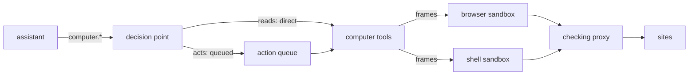

# The computer

The assistant has a browser and a shell of its own. Each one runs in a sandbox that stays: it keeps
a disk between calls, so a browser sign-in or a downloaded file is still there at the next call. The
browser sandbox runs headless Chromium and keeps the browser profile. The shell sandbox runs bash
commands and keeps the assistant's files. The disks are working space, not a store: what must last
goes in the notebook or in memory, which the backup covers. A forget never reaches inside either
disk.

## The sandboxes

The kinds `browser` and `shell` have public egress, no grant and no tool route. A deployment holds
one of each, owned by `computer-browser` and `computer-shell`, and recovery keeps both. The
[sandbox sizes](sandboxes.md#sizes) hold their memory and disks. The images `nixie-browser` and
`nixie-shell` come from `guests/browser` and `guests/shell`.

Chromium runs in the time zone of `time.default_zone` in the config, so a page that shows "today" or
an opening hour shows the user's. Nixie hands the zone to the browser guest when it starts the
guest, so a changed zone reaches the browser at its next start.

A guest is one long-lived process per wake. It reads frames from `libs/wire` on stdin, answers them
one at a time on stdout, and holds no state nixie cannot rebuild, except the disk. The computer in
`modules/connectors` owns the sandboxes:

- A call waits a set time for its turn at a sandbox, and returns `BUSY` after that. The calls into
  one sandbox therefore never overlap, whether they come from the conversation or a task.
- Each sandbox sleeps after its own idle time, which is longer for the browser than for the shell.
  Nixie treats every wake as a restart: it starts the guest again, so every tab ID from before the
  sleep returns `TAB_GONE`. The profile keeps the sign-ins.
- A queued click or fill holds the browser awake until its action runs or its approval lapses, so a
  card the user answers late still finds its tab. A queued command holds the shell the same way.
- When a sandbox's image or spec differs from the release, nixie creates a new one at its next call
  and copies the profile or the files into it.
- Resetting a sandbox destroys it, and the next call creates an empty one. `isDiskNew` is true on
  the first result from a disk that started empty, so the assistant knows what it held before is
  gone.

## Tools

| Tool                   | Effect         | Runs   | Result                                                              |
| ---------------------- | -------------- | ------ | ------------------------------------------------------------------- |
| `computer.open`        | `fetch`        | direct | a new tab and its page text                                         |
| `computer.read`        | `note`         | direct | the page again, as `text` or as a `snapshot` that marks controls    |
| `computer.screenshot`  | `note`         | direct | the viewport's picture beside the result                            |
| `computer.close`       | `note`         | direct | the tab closed                                                      |
| `computer.download`    | `fetch`        | direct | a file saved to `downloads/` on the shell's disk                    |
| `computer.fill`        | `send`         | queued | the page after the typed value, with `submit` to press Enter        |
| `computer.click`       | `send`         | queued | the page after the click                                            |
| `computer.run`         | `computer_run` | queued | the exit code, `stdout` and `stderr` (each cut at a limit), seconds |
| `computer.read_file`   | `note`         | direct | the text of a file under `~/files`                                  |
| `computer.write_file`  | `note`         | direct | a file written under `~/files`, which replaces one of that name     |
| `computer.export_file` | `note`         | direct | a file kept with the result, so `file.send` can send it             |

Every result field except the tab, the flags and a refusal's code is untrusted. A refusal comes back
as a result with `refused: { code, message }`, never as an error.

**Pages.** The guest writes link marks and tags each control in a snapshot as `[E4 textbox "Name"]`.
The tool stores the page like a fetched page and returns its first part, and `web_fetch` with the
page ID reads the other parts. The stored page carries a fetch URL that no URL parser accepts, so
`web_fetch` never serves it from its cache: a tab shows the live page with its cookies. A tab holds
at most 5 pages (`TAB_LIMIT`). The model's tab IDs (`t1`, `t2` and on) count up for the life of the
server, so a restart never reuses one.

**Paths.** A path is under `~/files`, and a relative path starts there. A path that leaves it by
`..` or by a symlink returns `BAD_PATH`. A file read or written has a size limit, and a larger file
returns `TOO_BIG`. `export_file` returns the result shape of a `code.run` file, and stores its bytes
as an attachment of the result record, so a forget of that record erases them.

## Reads and acts

A read changes nothing outside nixie, so `open` and `download` are `fetch` effects, and the decision
point asks about each site on its first visit, with the site's host and port as the destination.

A click or a fill can post a form, so each is a queued `send`. The tool's `prepare` hook reads the
tab's URL before the decision. The host becomes the call's destination, and the URL becomes
`expectURL`, which the action hash covers. When the action runs, the guest compares the tab's URL
with `expectURL` and returns `PAGE_CHANGED` when they differ. It also returns `STALE_ELEMENT` for a
control that no longer holds its number, and `CROSS_ORIGIN_SUBMIT` for a form that posts to another
origin. Nixie keeps `expectURL` in memory, so a restart between the call and the action makes the
action refuse with `PAGE_CHANGED`, never run against a page nobody looked at.

A `computer.run` is its own effect, `computer_run`, because the shell reaches the internet and
`code_run` means a sandbox with none. It asks unless a rule allows it.

- An "always allow" on a command offers the pattern `<first words> *`, such as `git status *`.
- A rule's `matches` check on `command` reads the command as a syntax tree. It passes only for plain
  commands of literal words joined by `;`, `&&`, `||` or `|`. A substitution, a redirection, an
  assignment, an expansion, a glob, a background `&`, a subshell, a compound command or a line that
  does not parse fails the check, so `git status; curl x | sh` still asks under `git status *`. Each
  command on the line must match the pattern, and its name must be one word. A word that holds an
  unquoted bracket, brace, `<`, `>`, `$`, backtick or glob character fails the check too, because
  the parser can read such a word as plain text where bash runs a command.
- The starter rules allow `cat`, `df`, `du`, `grep`, `head`, `ls`, `pwd`, `stat`, `tail`, `wc` and
  `which`, one rule each, so a line passes when every command on it is the same one of them. They
  leave out `find` and `file`, because their options can run a program or write a file and a pattern
  cannot exclude an option.
- Nixie counts each call that changes the shell's disk: `write_file`, `download` and `run`. A run
  that waits for a decision keeps the count from when it was proposed, and returns `FILES_CHANGED`
  without running when the count moved. An approved command therefore never runs a script that
  changed after the user read the card.

## The checking proxy

Every connection from either sandbox leaves through a proxy that its guest starts (`libs/egress`).
The proxy refuses an address in a denied range, resolves each host once and pins the address it
checked. Before it connects, it asks nixie to scan the URL of a plain request, and then the headers
and body, which it holds in full. A body too large to hold, and a chunked body, are refused because
the proxy cannot scan them first. The scan of headers and bodies has no typed-URL exemption.

The browser also turns off QUIC and WebRTC's non-proxied UDP, and asks nixie to scan the URL of
every request it makes, with a hop frame as the fetch guest does. Chromium may open a CONNECT
tunnel, because the guest scans each request before it enters one.

The shell runs each command in a network namespace of its own that holds a loopback and nothing
else. A bridge there passes the command's proxy settings to a proxy on a Unix socket, so a raw
socket or `curl --noproxy` finds no route out. The proxy refuses CONNECT, because it cannot read an
encrypted tunnel, so the shell reaches plain HTTP sites only, and the browser fetches the rest. A
command's processes end with the command.

Nixie scans the URL of a click, a fill and a run the same way, with no typed-URL exemption, because
a queued action has no message to exempt it.

## What the test sandbox shows

The test sandbox runs a guest as a plain process of the host. A test shows that a shell command has
no route out except the proxy, and that the secret scan stops a secret in a URL, a header and a
body. The shell's namespace needs unprivileged user namespaces in the sandbox's kernel; a command
fails closed when they are off. The browser's network is closed by Chromium's proxy settings alone.
A journey in `bun verify` runs against a page the harness serves on a `.test` host, which the test
build's guests resolve to the loopback address.

## Memory kills

Nixie reads a sandbox's memory-kill count before and after each call. When it rose, the call returns
`OUT_OF_MEMORY` with the sandbox's kind, whatever else it would have returned, and the guest
restarts, which closes every tab of the browser. The [memory-kill watcher](memory-kills.md) logs
`sandbox.memory_kill` with the kind and size.
