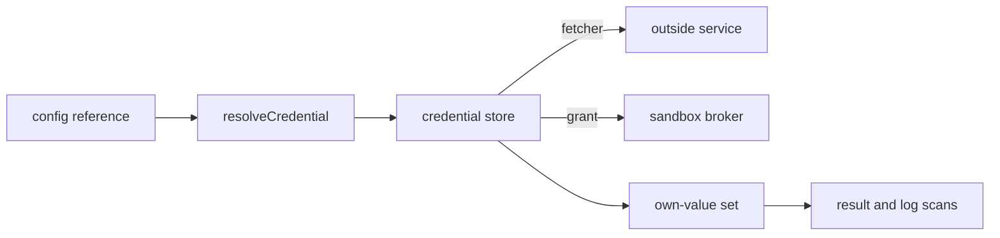

# The credential store

Every credential nixie uses on the user's behalf comes from one place, the credential store, and no
tool, connector or adapter holds a value. A part of nixie names a credential by a reference, a
resolver turns the reference into an entry, and the part uses the entry through the store: a fetcher
makes a request to an outside service with the value added on the host, and a grant gives a
sandbox's broker the value for one host. A value never enters a tool result, a prompt, a log line, a
record or an error message.

The store has one backend, the secrets file. The file holds the search, image and model credentials,
the spend gateway's token, and the user's name and pronouns. The
[server](../deployment/server.md#configuration-and-secrets) decrypts it at start.

## References and the resolver

A config key that names a credential holds a `deployment:<name>` reference, which one schema
validates for every key. The resolver turns a reference and its class into an entry of the secrets
file: `model` reads `model_credentials`, `connector` reads `connector_credentials` and `setting`
reads `settings`.

- A missing connector or setting entry stops the server at start with `MissingCredentialError`.
- A missing model entry resolves to `null`, because a model credential that the sandbox host holds
  needs no entry.
- The user's name and pronouns are settings that the prompt needs. `readSetting` returns them, and
  they never reach a fetcher.
- `impd_token` and the definitions export secrets stay top-level fields that the server reads at
  start, because no tool uses them.
- A lint rule refuses a read of the secrets file's groups outside the credentials module, so a value
  cannot reach a part that bypasses the store.

## The fetcher

A connector calls a service through `store.fetcher`, which has the shape of the global `fetch` and
adds the credential on the host. A connector registers a credential with the origins it may reach
and where the value goes: a bearer header, a header of its own, the password of HTTP Basic, or the
URL path. The store checks each request before anything leaves the host:

- The request goes only to an origin the caller passed, which the credential's registration must
  also hold.
- A redirect keeps the credential only when it stays on the same origin. A redirect to an origin the
  caller did not pass fails.
- The host resolves on every hop, and an address outside the public ranges fails, as in
  [web fetch](web-fetch.md#the-fetcher). The connection goes to the address that passed the check,
  so a second lookup cannot return another one. The spend gateway's control URL is the one service
  that may use `http` and a private address, because the deployment runs it and names it in the
  config.
- A request that sets `Authorization`, `Proxy-Authorization`, `Cookie` or the credential's own
  header, or a URL with a user name or a password, fails. **Why:** a connector that builds one of
  these from a tool argument would send the request to an allowed host under another account.

The fetcher removes the value from the response before the connector sees it, in its plain,
URL-encoded and base64 forms: the status text, each header and the body. It buffers and decodes a
body up to a fixed cap, and refuses a larger one. The same removal applies to an error message. The
refusals are `CredentialRefusalError`, which an adapter lets pass, so the tool call fails with an
error and no reply. The checks live in `libs/egress`, so web fetch shares them.

## Grants

The model credential reaches a sandbox only through its grant. `store.grant` puts a secret into the
sandbox adapter, limited to the model host, and the adapter returns the broker's secret name.

- A credential nixie holds gets a name from an HMAC-SHA-256 of the profile, the header, the host and
  the value, under the fingerprint key. A rotated value therefore gets a new name, because the
  broker keeps a granted secret under its name and nixie cannot change its value.
- A credential that the sandbox host holds keeps the unkeyed name that profile always had, because
  no value goes in.
- The sandbox adapter writes `sandbox.grant_started` before it installs the secret, and
  `sandbox.granted` when the sandbox is created. Both records keep the broker's name and host, and
  for a credential nixie holds, its reference and fingerprint.
- Cleanup removes a broker secret that nixie added once no live sandbox holds a grant of it. It runs
  at start and after each sandbox destroy. It finds the names in the two records, including the
  names of a grant that never reached `sandbox.granted`, and never removes a name that a host-held
  profile gives or that a grant in flight holds.

## Fingerprints and own values

The loader derives a fingerprint key from the deployment key with HKDF-SHA-256, so the secrets file
gains no entry. A fingerprint is the first 8 hex digits of an HMAC of the value under that key. A
record shows a credential by its reference and fingerprint, never by the value or an unkeyed hash of
it. **Why:** a short value hashed without a key can be guessed from the hash.

Every value in the secrets file, and the top-level secrets, joins one live set of the values nixie
holds as its own. Each scan reads the set when it runs and keeps its own filter:

- The turn-input search, the web fetch scan and the computer scan read the set with
  `web_fetch.secret_own_values` and its minimum length.
- Every tool result passes a scan of the whole set before it reaches the model or the log. A value
  found is cut and replaced with `[secret removed]`, so the model sees that something was cut.
- The scan of a tool result leaves out the user's name and pronouns, which the prompt shows the
  model by design. The spend gateway's token and every other registered setting stay in.

## Tests

A test that plants a fake value in the secrets file asserts that the value appears in no tool
result, no log line, no record and no error. `createTestCredentials` in the module's `test-utils`
builds a resolver and a store over the groups a test names. A test build lets the store send each
request through the global `fetch` after all its checks, so a mock network answers it, and a release
build drops that path.
