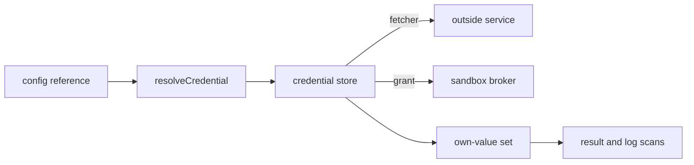

# The credential store

Every credential that a tool, a connector or a model uses on the user's behalf comes from one place,
the credential store. Before you add a connector that calls an outside service, or a config key that
names a credential, [register](#bindings-and-the-removal-counter) the credential and reach the
service through the store's [fetcher](#the-fetcher) or a [grant](#grants).

A part of nixie names a credential by a reference, a resolver turns the reference into an entry, and
the store serves the entry: a fetcher makes a request to an outside service with the value added on
the host, and a grant passes the value through the sandbox adapter to a sandbox's broker for one
host. No tool or connector ever holds a value. A credential's value never enters a tool result, a
prompt, a log line, a record or an error message. [Two secrets](#references-and-the-resolver) stay
outside the store.

A release server's store has one backend, the secrets file, which the
[server](../deployment/server.md#configuration-and-secrets) decrypts at start. It holds the search,
image and model credentials, the spend gateway's token, and the user's name and pronouns, settings
the prompt shows by design. A held backend adds the [OAuth tokens](#oauth-tokens) that nixie changes
at runtime. Every build of the server runs it over
[the credential database](credential-database.md).

## References and the resolver

A config key that names a credential holds a `deployment:<name>` reference, which one schema
validates for every key. The resolver turns a reference and its class into an entry of the secrets
file: `model` reads `model_credentials`, `connector` reads `connector_credentials` and `setting`
reads `settings`.

- A missing connector or setting entry stops the server at start with `MissingCredentialError`.
- A missing model entry resolves to `null`, because a model credential that the sandbox host holds
  needs no entry.
- The user's name and pronouns are settings that the prompt needs. `readSetting` returns them, and
  they never reach a fetcher.
- `impd_token` and the definitions export secrets are the exceptions: they stay top-level fields
  that the server reads at start, outside the store's resolver, because no tool uses them. Their
  values still join the own-value set.
- A lint rule refuses a read of the secrets file's groups outside the credentials module, so a value
  cannot reach a part that bypasses the store. It also refuses a destructured group and a read
  through a variable that a secrets object was copied to.

## The fetcher

A connector calls a service through `store.fetcher`, which has the shape of the global `fetch` and
adds the credential on the host. A connector registers a credential with the origins it may reach
and where the value goes: a bearer header, a header of its own, the password of HTTP Basic, or the
URL path. The store checks each request before anything leaves the host:

- The request goes only to an origin the caller passed, which the credential's registration must
  also hold.
- A redirect keeps the credential only when it stays on the same origin. A redirect to an origin the
  caller did not pass fails.
- The host resolves on every hop, and an address outside the public ranges fails, as in
  [web fetch](web-fetch.md#the-fetcher). The connection goes to the address that passed the check,
  so a second lookup cannot return another one. The spend gateway's control URL is the one service
  that may use `http`, a private address and an IPv6-only address, because the deployment runs it
  and names it in the config.
- A request that sets `Authorization`, `Proxy-Authorization`, `Cookie` or the credential's own
  header, or a URL with a user name or a password, fails. A redirect to a URL with a user name or a
  password fails too. **Why:** a connector that builds one of these from a tool argument would send
  the request to an allowed host under another account.

The fetcher removes the value from the response before the connector sees it, in its plain,
URL-encoded and base64 forms: the status text, each header and the body. It buffers a body and
decodes it up to a fixed cap, and refuses a larger one: the decoder stops at the cap, so a small
compressed body never allocates what it expands to. The same removal applies to an error message and
to an abort or timeout reason a caller passes, which loses its cause. A header whose name holds the
value is dropped. The refusals are `CredentialRefusalError`, which an adapter lets pass, so the tool
call fails with an error and no reply. The checks live in `libs/egress`, so web fetch shares them.

## Bindings and the removal counter

`register` turns a reference and a spec into a binding. A file reference registers at once. A
database reference returns a promise, because `register` reads the reference's removal counter
first. Each binding carries the counter's value at the moment it was made. Registering the same
reference and spec again returns the same binding ID with the counter's current value. The store
keeps a frozen copy of the spec, so a caller that changes the object it passed in afterwards cannot
move the origins or provider endpoints the credential reaches.

A removal of a database credential advances its counter in the same transaction. Every handle that
the store hands out from a binding, such as a fetcher, `refresh`, `refreshIfDue` or `readStatus`,
compares its binding's counter with the current one before it reads a value, and fails with
`CredentialRemovedError` when they differ. The error is a `CredentialRefusalError`, so a tool call
that meets it fails with an error and no reply. A binding registered after the removal carries the
new counter and works. A file binding always carries counter 0, because nothing removes a file
credential.

A fetcher checks the counter again just before the request leaves, under a lock per credential that
`remove` also takes, and holds the lock until it has handed the request off. A removal therefore
stops the request, or lands after it left, and a check after the answer refuses the reply. A removal
during the refresh after a 401 makes the fetch throw `CredentialRemovedError`.

## OAuth tokens

A spec of kind `oauth_client` or `oauth_token` names its provider: the token URL, an optional revoke
URL, the issuer of its ID tokens and the client ID. Each provider URL must be on one of the spec's
origins, and a provider request goes through the fetcher with `redirects: 'none'`, so the pinned
connection and the body cap apply. The client secret, the authorization code, the PKCE verifier and
the refresh token go in the request body, never in a header, and no connector holds them. The
fetcher cuts the client secret from the reply and from any error.

The held backend interface is `HeldBackend`. It stores a client's secret, a token with its state,
and the removal counter, and it keeps each token's key under a random UUID. `writeToken` saves a
token only when the credential's counter still equals the one the caller read, and `remove` deletes
the credential and advances the counter in one transaction. `writeState` takes the counter too, so a
late result of an older binding never changes the status of a credential that was removed and
connected again. `writeToken` also takes the record of a refresh, `credential.refresh_saved`, and
commits it with the token, so a crash leaves both or neither.

A token records the `sub` of the account its ID token named at the credential's first use. A second
code exchanged into the same credential that names another account, or none, marks the credential
`needs_consent`, revokes the new tokens, saves nothing and throws `TokenRequestError` with the code
`account_changed`. A second code for the same account replaces the token and removes the old key.

An exchange or a refresh holds the credential's slot lock from its read of the stored token until it
saved its own and removed the key it replaced. **Why:** two saves that both find the slot empty
leave the first one's key with no token. Before it writes, an exchange checks its client's counter
again. After it releases the lock, it revokes the tokens of a save that kept nothing.

### Exchange

`exchange` sends an authorization code to the token URL and saves the tokens under the credential ID
the caller passes. Its result holds the expiry and the account the ID token named, never a token.
When the reply holds an ID token, nixie checks its issuer, audience and expiry before it reads `sub`
or `email`. A failed check throws `TokenRequestError` with the code `id_token_issuer`,
`id_token_audience`, `id_token_expired` or `id_token_malformed`, revokes the tokens that arrived,
and saves nothing. An exchange takes an optional `probeRevocable` callback, which it asks with the
`sub` before each revocation of a token it keeps nothing of. A caller answers false for an account
whose grant another live connection uses, because the provider ends the whole grant when any token
of it is revoked. nixie does not check the token's signature, because the token comes straight from
the provider's token URL over the checked connection.

### Refresh

- One refresh runs per credential and binding generation at a time. A caller that arrives during one
  waits for its result. A handle made before a removal never joins the refresh of a credential that
  was connected again.
- A fetcher on a database binding refreshes a token that is about to expire before it sends. A
  request that the service rejects with 401 gets one refresh and one retry. A second 401 marks the
  credential `failing` with the reason `unauthorised`. The retry reads the token as the refresh
  saved it, so a token that is about to expire does not start a second refresh. A streamed request
  body is read into bytes before the first send, so the retry sends it again.
- A request to the provider's token or revoke URL has a deadline, which the store's
  `tokenRequestTimeoutMs` option sets. A request that has no answer by then counts as `no_answer`,
  so a provider that leaves a request open stalls no later refresh.
- `refreshIfDue` refreshes a token that is about to expire, or that went a week since its last
  success, once the backoff after a failure has run out. The backoff grows with each failure and has
  a cap, as web fetch's host backoff does.
- 3 failed refreshes in a row mark the credential `failing`, with the reason `service_error` or
  `no_answer`. A refusal for good, such as `invalid_grant`, marks it `needs_consent`. A successful
  refresh returns the credential to `active`.
- Each refresh creates a new key and seals its result under it. After the save, the refresh removes
  the key of the token the save replaced. After a failure, it removes the new one.
- A refresh that finishes after a removal advanced the counter revokes the token it received, which
  is the new refresh token, or the new access token when the reply holds none. It saves nothing and
  removes its new key. When the credential still holds a token, a consent connected it again while
  the refresh ran, so the refresh drops its reply and revokes nothing: the revocation would end the
  grant of the new token.

### Records

| Record                         | Written                                                                                 |
| ------------------------------ | --------------------------------------------------------------------------------------- |
| `credential.refresh_started`   | before the request leaves; it names the credential, the new key and the removal counter |
| `credential.refresh_saved`     | with the save; it holds the new access token's fingerprint                              |
| `credential.refresh_failed`    | after a refresh that gave no token                                                      |
| `credential.refresh_discarded` | after a removal moved the counter; it records whether revoking worked                   |
| `credential.refresh_lost`      | at start, for a refresh that sent and never saved                                       |
| `credential.status_changed`    | when a credential's status or reason changes                                            |

A record holds a credential's ID and a fingerprint, never a token, a client secret or a key. Every
kind has an entry, with no live topic, in `credentialRecordTopics`, which the server registers.

At start, `recover` reads the log for each `credential.refresh_started` that no saved, failed,
discarded or lost record closes. The provider may hold a token nixie never saved, and revoking the
spent one may not end it, so `recover` marks the credential `needs_consent` and writes
`credential.refresh_lost` for the refresh. A credential whose removal counter moved since the
refresh began was connected again, so `recover` leaves its status and only closes the refresh. The
next start finds nothing. The check reads the log alone, so it holds after a crash that loses the
held backend's memory. The server runs `recover` at each start, over the credential database, and
the crash suite `recover-credential-refresh.test.ts` kills the process during a refresh and checks
the status after the restart.

## Grants

The model credential reaches a sandbox only through its grant. `store.grant` puts a secret into the
sandbox adapter, limited to the model host, and the adapter returns the broker's secret name.

- A credential nixie holds gets a name from an HMAC-SHA-256 of the profile, the header, the host and
  the value, under the fingerprint key. A rotated value therefore gets a new name, because the
  broker keeps a granted secret under its name and nixie cannot change its value.
- A credential that the sandbox host holds keeps the unkeyed name that profile always had, because
  no value goes in.
- A grant reaches only the paths of the model API the profile speaks, under the path of its base
  URL, on the model host. A sandbox that has no spend gateway therefore cannot call another endpoint
  of that host, such as a token endpoint. With the gateway, the grant takes the gateway's route path
  instead.
- The sandbox adapter writes `sandbox.grant_started` before it installs the secret, and
  `sandbox.granted` when the sandbox is created. Both records keep the broker's name and host, and
  for a credential nixie holds, its reference and fingerprint.
- Cleanup removes a broker secret that nixie added once no live sandbox holds a grant of it. It runs
  at start, and after each sandbox destroy for the names that earlier servers added. Only a
  `sandbox.grant_started` record, or a `sandbox.granted` record with a reference, proves that nixie
  added a name. A name that only other `sandbox.granted` records give stays, because a credential
  the sandbox host holds has no reference and its secret belongs to that host, even after its
  profile leaves the config.
- A runner caches its grant and makes sandboxes from it later, so the cleanup after a destroy never
  removes a name the running server added. Such a name stays in the broker until the next start,
  when cleanup removes it if no live sandbox holds it. Adds and removals run one at a time.

## Fingerprints and own values

The loader derives a fingerprint key from the deployment key with HKDF-SHA-256, so the secrets file
gains no entry. A fingerprint is the first 8 hex digits of an HMAC of the value under that key. A
record shows a credential by its reference and fingerprint, never by the value or an unkeyed hash of
it. **Why:** a short value hashed without a key can be guessed from the hash.

Every value in the secrets file, and the top-level secrets, joins one live set of the values nixie
holds as its own. Each scan reads the set when it runs and keeps its own filter:

- The turn-input search, the web fetch scan and the computer scan read the set with
  `web_fetch.secret_own_values` and its minimum length.
- Every tool result passes a scan of the whole set but the user's name and pronouns, whatever a
  value's length, before it reaches the model or the log. The scan covers the result's fields and
  its attachments, such as the files a code tool call returns. A value found is cut and replaced
  with `[secret removed]`, so the model sees that something was cut.
- The tool-result scan leaves out the user's name and pronouns because the prompt shows them to the
  model by design. It still covers the spend gateway's token and every other registered setting.

## Tests

`startFakeOAuthProvider` in `test-utils` runs a provider's token and revoke endpoints as a real
HTTPS site on the loopback address, which a test reaches through the pinned connection. The crash
suite `recover-credential-refresh.test.ts` in the server's `e2e/` folder starts nixie, begins a
refresh against a provider that never answers, kills the process with `SIGKILL`, starts it again on
the same data directory, and checks that the credential is `needs_consent`. A second test holds the
process at the fault point `credential.refresh.token_saved`, after the transaction that commits the
token and its `credential.refresh_saved` record, kills it there, and checks that the restart finds
both and leaves the credential `active`.

Plant a fake value in the secrets file and assert that it appears in no tool result, no log line, no
record and no error. `createTestCredentials` in the module's `test-utils` builds a resolver and a
store over the groups a test names. A test build lets the store send each request through the global
`fetch` after all its checks, so a mock network answers it, and a release build drops that path. The
test build resolves each `.test` host to a public address, so the address checks and the body cap
run as they do in a release build. When a test starts nixie with a loopback HTTPS site, every
request goes over the pinned connection a release build opens, and to that site alone. The
planted-key test runs both ways, so a fault in either body reader fails it.
