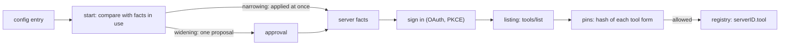

# MCP proxy

The MCP proxy lets the model use the tools of an outside MCP server, such as an issue tracker, under
the same rules as nixie's own tools. The user lists each server in the `mcp` section of the config.
nixie signs in to the server as the user, lists its tools, and registers each tool the user allowed
under the name `<serverID>.<tool>`. The server is outside nixie, so everything it sends is outside
content, and the user, never the server, decides what the model may call. The
[credential store](./credentials.md) holds the tokens, and [tool calls](./tool-calls.md) covers the
endpoint that serves the registered tools.

## Server facts and approvals

A server's facts are its URL, its OAuth client ID, its scopes, whether it is trusted and the private
address range it may sit in. The config states the facts the user wants. The log holds the facts in
use, which are the facts the user last approved.

At each start nixie compares the two. A fact that gives the server more reach is a widening: a new
URL or client ID, a scope the server lacked, `trusted` switched on, or a wider range. A widening
changes who nixie talks to or what that party may do, so it never applies by itself: the server
holds, and nixie writes one approval proposal that names the facts it asks for. The server keeps the
facts in use until the user approves.

A narrowing, which gives the server less reach, applies at once and leaves a record, because nothing
the user approved is lost by it. An entry that does both counts as a widening, so the proposal
carries every fact of the entry. A proposal that the user declined or that lapsed comes again only
when the entry differs from the facts it asked for, so a restart never repeats a question the user
answered. A server that leaves the config is removed: its grant and client credentials go to the
credential store's forget, and its pins stay as records.

The proposal belongs to the shared proposal path, as the `mcp` family. The answer re-reads the facts
and compares their hash with the one the user saw, so a config edit between the proposal and the
answer refuses the answer.

## Signing in

`mcp.connect` starts a sign-in for a server that holds approved facts. nixie asks the server's URL
without a token, reads the `resource_metadata` of the `401` answer, and follows it to the
authorization server's metadata. It refuses an authorization server that does not offer PKCE with
`S256`, or that has an endpoint that is not https. The authorize URL carries the PKCE challenge, a
state that begins with `mcp_`, and the server's URL as the `resource`. nixie is a public client, so
no secret exists to send.

The browser returns to `/connections/mcp/return`, which calls `mcp.finishSignIn`. nixie checks that
the state is its own and has not lapsed, and that the `iss` parameter names the authorization server
that nixie asked, so a second server cannot answer for the first. It then exchanges the code through
the credential store. The PKCE verifier waits in memory under the state, because a restart in the
middle of a sign-in costs only another press of Connect. Tokens never leave the store: a refresh
token is sealed with a key of its own, which the forget removes.

Every request to the server goes through a fetcher that the store makes for the server's origin. It
follows no redirect, and it reaches a private address only for the host that the server's private
range pairs with that address. Responses stream, and the fetcher removes the credential from each
event as the event arrives.

## Pins

A tool's form is its name, title, description, input schema, output schema and annotations. nixie
hashes the form in canonical JSON, with sorted keys and NFC text, and pins the hash the user
allowed. The model sees only the pinned form. The listing's newest hash is kept beside it.

| Listing shows                             | Untrusted server      | Trusted server                    |
| ----------------------------------------- | --------------------- | --------------------------------- |
| A tool nixie has not seen                 | hidden until allowed  | hidden until allowed              |
| A changed form with no new input property | stopped until allowed | pin moves, the user gets a notice |
| A changed form with a new input property  | stopped until allowed | stopped until allowed             |

A new tool stays hidden on every server because the model would otherwise use a tool the user never
read. A new input property stops even a trusted server's tool, because a property is the way a
server asks for a new kind of data. nixie writes an allow proposal for each waiting tool, and the
approval moves the pin to the hash the proposal holds. The tool form is the server's text, so the
listing record keeps it in an erasable field, and a forget of the record leaves the hash and removes
the form. A tool whose form can no longer be read stays stopped.

A name that the model cannot read stays hidden, with the reason: the server's tool name must use
only letters, digits, `_` and `-`, and the model's name for the tool must fit 64 characters and must
not equal the model name of another tool. The config load refuses a server ID that is the first
segment of one of nixie's own tools, such as `web` for `web_fetch`.

## The registry

The tool registry takes a second source of tools beside nixie's own. The proxy provides one: a tool
joins the registry as `<serverID>.<tool>` only while it has a pin and is exposed or stopped, and its
server is not removed. Hidden tools and tools without a pin never register. The registry reads the
source's names each time it is asked, so an allow or a removal changes what the model can call
without a restart. nixie's own tool wins a name that both hold.

A proxied tool declares the strictest effects, which are write, delete and send, and counts every
string argument as content, so each call needs an approval until a later change lets a server's
tools declare less. Every field of a result is outside content. A call of a proxied tool answers
with an error, because the call path is not built yet.
