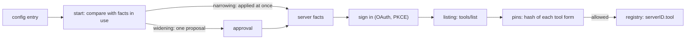

# MCP proxy

The MCP proxy lets the model use the tools of an outside MCP server, such as an issue tracker, under
the same rules as nixie's own tools. The user lists each server in the `mcp` section of the config.
nixie signs in to the server as the user, lists its tools, and registers each tool the user allowed
under the name `<serverID>.<tool>`. Everything the server sends is outside content, because the
server is outside nixie. Only the user decides which of the server's tools the model may call. The
[credential store](./credentials.md) holds the tokens, and [tool calls](./tool-calls.md) covers the
endpoint that serves the registered tools.

## Server facts and approvals

A server's facts are its URL, its OAuth client ID, its scopes, whether it is trusted and the private
address range it may sit in. The user sets the facts they want in the config. The log holds the
facts in use, which are the facts the user last approved.

At each start nixie compares the two. A fact that gives the server more reach is a widening: a new
URL or client ID, a scope the server lacked, `trusted` switched on, or a wider range. A widening
changes who nixie talks to or what that party may do, so it never applies by itself. The server is
held, and nixie writes one approval proposal that names the facts it asks for. The server keeps the
facts in use until the user approves.

A narrowing, which gives the server less reach, applies at once and leaves a record, because nothing
the user approved is lost by it. A narrowing that drops a scope also forgets the server's grant, so
the user signs in again and the new grant holds only the scopes that remain: a refresh would
otherwise keep the dropped scope. An entry that both widens and narrows counts as a widening, and
its proposal carries every fact of the entry. A proposal that the user declined or that lapsed comes
again only when the entry differs from the facts it asked for, so a restart never repeats a question
the user answered. A server that leaves the config is removed: its grant and client credentials go
to the credential store's forget, and its pins stay as records.

The proposal belongs to the shared proposal path, as the `mcp` family. When the user answers, nixie
re-reads the facts, compares their hash with the one the user saw, and refuses the answer when the
config changed in between. A server card shows the URL, the client ID, the scopes, the trust and the
range, so a change of client ID alone reads as a change.

## Signing in

`mcp.connect` starts a sign-in for a server that holds approved facts. nixie sends a request to the
server's URL without a token, reads the `resource_metadata` of the `401` response, and follows it to
the authorization server's metadata. It refuses an authorization server that does not offer PKCE
with `S256`, or that has an endpoint that is not https. The authorize URL carries the PKCE
challenge, a state that begins with `mcp.`, and the server's URL as the `resource`. nixie is a
public client, so no secret exists to send.

The browser returns to `/connections/google/return`, the one OAuth return route that Google's
consent uses too. The route sends a state that begins with `mcp.` to `mcp.finishSignIn`, and every
other state to the Google consent. nixie checks that the state is its own and has not lapsed, and
that the `iss` parameter is present and names the authorization server that nixie asked, so a second
server cannot answer for the first. A return with no `iss` stops before the exchange, whether or not
the server's metadata says it returns one. nixie then exchanges the code through the credential
store, which reaches a token endpoint on a private host the same way every other request does.

nixie keeps the PKCE verifier only in memory, keyed by the state, because a restart in the middle of
a sign-in costs only another press of Connect. Tokens never leave the store. The store seals each
refresh token with a key of its own, and its forget removes the key with the credential.

Once the exchange has saved the grant, nixie records the issuer, the token endpoint and the
revocation endpoint of the sign-in. After a restart, nixie discovers the authorization server again.
nixie neither refreshes a grant nor lists its server when the grant has no recorded sign-in, such as
one saved just before nixie stopped, or when discovery now names another issuer or endpoint. A
refresh would send the refresh token to a party the user never signed in to, so only a new sign-in
replaces the grant.

Every request to the server goes through a fetcher that the store makes for the server's origin. It
follows no redirect, and it reaches a private address only for the host that the server's private
range pairs with that address. Responses stream, and the fetcher removes the credential from each
event as the event arrives.

## Pins

A tool's form is its name, title, description, input schema, output schema and annotations. nixie
hashes the form in canonical JSON, with sorted keys and NFC text, and pins the hash the user
allowed. On a trusted server, the user allowed each later change when they trusted the server. The
model sees only the pinned form. nixie keeps the listing's newest hash beside the pin.

| Listing shows                             | Untrusted server      | Trusted server                    |
| ----------------------------------------- | --------------------- | --------------------------------- |
| A tool nixie has not seen                 | hidden until allowed  | hidden until allowed              |
| A changed form with no new input property | stopped until allowed | pin moves, the user gets a notice |
| A changed form with a new input property  | stopped until allowed | stopped until allowed             |

A new tool stays hidden on every server because the model would otherwise use a tool the user never
read. A new input property stops even a trusted server's tool, because a property is the way a
server asks for a new kind of data. nixie writes an allow proposal for each waiting tool, and the
approval moves the pin to the hash the proposal holds. The tool form is the server's text, so the
listing record keeps it in an erasable field, and a forget of the record leaves the hash and removes
the form. A tool whose form can no longer be read stays stopped.

A listing that omits a tool closes the tool's open allow proposal, so a withdrawn form cannot be
approved. A form that the registry refuses stays hidden with the reason, and nixie writes no
proposal for it. That includes a form whose input or output schema cannot compile, such as one with
a `$ref` that names nothing. nixie refuses an approval of a waiting proposal for such a form, or for
a form that a forget erased. When a trusted server's change applies, or a listing drops a tool,
nixie writes an `mcp.notice` record that names the tool and its old and new hash.
`nixie mcp notices` prints the newest ones, one JSON line each, newest first, and takes `--limit`.
The tool rows are decided inside the write transaction, so an allow that commits while a listing
runs is never overwritten with an older pin. A server listing has one timeout for every page
together, so a server that keeps returning a page cursor cannot hold a sign-in open. After the user
declines an allow proposal or it lapses, `nixie mcp allow <tool>` writes a new one, because an
unchanged listing proposes nothing.

The model sees each tool under the Agent SDK's name for it: `mcp__nixie__` and then the registry
name, with each character other than a letter, a digit, `_` or `-` turned into `_`. The model sees
`tracker.item_get` as `mcp__nixie__tracker_item_get`. nixie hides a tool, with the reason, when the
model cannot read its name. The server's tool name must use only letters, digits, `_` and `-`, and
the model's name for the tool must fit 64 characters and differ from the model name of every other
tool. The config load checks each server ID against a list of the first segments of nixie's own
tools, such as `web` for `web_fetch`, and refuses a match. The conversation endpoint checks the
registry itself at its start, which catches a tool that a release adds and the list lacks.

## The registry

The tool registry takes a second source of tools beside nixie's own. The proxy is that source. A
tool joins the registry as `<serverID>.<tool>` only while it has a pin, is exposed or stopped, its
server is not removed and the record that holds its pinned form can still be read. Hidden tools and
tools without a pin never register. The registry reads the source's names each time it is asked, so
an allow or a removal changes what the model can call without a restart. nixie's own tool wins a
name that both hold.

A tool joins the registry only when its pinned form has a declaration (see
[Effect declarations](#effect-declarations)). A form without one stays hidden with the reason, and a
call to it fails at the registry stage of the decision point. A tool whose override does not fit its
pinned form stays `stopped_unfit` until the override or the form changes. It stays in the registry
in its pinned form while that form can still be read, as a `stopped_changed` tool does, and nixie
refuses each call to it.

Before a task run reads its tool list, the registry asks each source to prepare the run's tools. The
proxy lists the server of each named `<serverID>.<tool>`, unless that server's backoff is running. A
failed listing leaves the pinned tools in place, and the preparation never rejects.

## Effect declarations

A tool's declaration comes from the override file of its server in the definitions repo, or from the
annotations of its pinned form when the file has no entry for the tool. A tool with a read effect
runs direct, and a tool with any other effect is queued.
[Effect declarations of proxied tools](mcp-proxy-declarations.md) holds the annotation table, the
override file format, the fit check and the reconcile.

## Calls and results

Every call of a proxied tool passes the same steps as a call of any other tool, then reaches the
server. Before the decision point the tool clears the call. A call reaches the server only when the
server's newest listing passed and left the tool exposed, so a server cannot skip the hash check by
failing its listing. A call that cannot reach the server returns plain error text that names the
server or the tool, and asks for no approval:

- "tracker waits for your approval", for a server that is held;
- "tracker needs you to sign in again", for a grant that needs consent, whatever status the last
  listing got, and for a grant whose refresh the authorization server refused during the call;
- "tracker.item_get changed and waits for your review", for a stopped tool;
- "tracker is unreachable, next try 09:05", for a server whose newest listing failed.

When the newest listing failed and its next try is due, the call lists the server itself before it
runs. Each call opens one connection to the configured URL through the credential store's fetcher,
with no redirect, and the MCP client runs with no sampling, roots, logging or input-request
capability. An input request from a server ends the call as a failure.

nixie reads the result against the pinned form. A tool whose form has no output schema returns
`{ text }`: the text blocks joined by a blank line, the image blocks as images, and a last line that
counts the blocks the proxy drops. A tool with an output schema returns the server's structured
content, which the connector and the registry check against the pinned schema, so an answer outside
it is never a done action. A server's own error keeps its text and sets the call's error flag.

The tool's definition holds its pinned hash, and the call record keeps it. A call runs only under
the form it loaded. When a listing moves the pin after the call loaded the tool, nothing runs and
the call returns an error that asks the model to call again. A call checks its input and its result
against the pin hash it loaded, never the newest one. The proxy reads the pin again once the call's
session is open and before `tools/call` leaves, so a listing that lands while the session opens
cannot move it between the check and the send.

A tool declared by an override carries the hash of the snapshot that held the override, and a call
that would record another snapshot runs nothing and asks the model to call again, because the
declaration it decided under is no longer in force. A direct call reads both the pin and the
snapshot again after its clearance and its policy decision, right before it runs. An approved call
of a direct tool does so after its stored call and its prepared facts are read, and it runs only
when the pin is still the one in the call record. A seed that changes only an override cannot let a
call run under the old declaration.

An approved call of a queued tool runs only when the current pin accepts its saved arguments, the
argument that an idempotency key fills included, and otherwise settles as refused.

Every field of a proxied result is `untrusted`, so the endpoint sends the whole result as one text
block inside `tool-result` markers with a random ID, and sends no structured content. nixie's own
direct tools follow the same rule: one whose result fields are all `untrusted` gets the markers. A
field that the declaration names no source for counts as `untrusted`, so a tool whose output schema
names no field, or whose source map is empty, is wrapped in the markers too. One of nixie's own
tools with trusted output keeps its structured content. The pictures of a result go to the model
only when the turn's image budget has room for all of them, and a proxied call reserves them from
that budget. Text that nixie writes itself, such as a refusal, carries no markers.

An approved call of a queued tool reaches the action runners through the connector that
`findConnector` returns for it. The connector clears the call again before it runs. A refusal or a
server error settles the action as refused, and a call that fails after it left settles as
ambiguous, as does an answer that nixie cannot read or that breaks the output schema. Unless the
tool's override sets a reconcile, an ambiguous action comes to the user.

The model reads a queued action that failed, was cancelled or ended unknown as an error, with the
reason inside the `tool-result` markers, because the reason can hold the server's own words.

A retry runs only under the declaration its first attempt ran under. The action runner hands the
connector the snapshot of that first attempt. A connector whose declaration came from another
snapshot sends nothing and leaves the action ambiguous, whether the new declaration sets a key or a
check, and so does a connector that declares no reconcile any more. A check whose read tool answers
only with pictures, or outside its output schema, is inconclusive and never schedules a retry.

The reason of a refused action holds the server's own words. A call that waits for the action, and a
queued or approved call that ends in a server error, gets that reason inside the markers, as an
error.

## Health

The proxy keeps one health state per server in memory, shared by every task run: the failed listings
in a row, the next try, the last error and whether the newest listing passed. The last error is one
of `refused`, `error`, `unparsable`, `timeout` or `unauthorised`. Failed listings back off, doubling
at each failure between the first and the longest wait that `healthDefaults` in
[`types.ts`](../../../modules/mcp/src/health/types.ts) sets, and the proxy makes each try on that
schedule. A task run that starts during the backoff skips the listing.

After the number of failed listings in a row that `unhealthyAfter` in `healthDefaults` sets, the
server is unhealthy, and the proxy writes one `mcp.health_changed` record with the last error and
the next try. The next passed listing writes one more, for the recovery. A start resets every state
and writes a recovery record for each server whose last record said unhealthy. A grant that needs
consent does not count as a failed listing. The proxy reads the need from the grant's state, never
from the HTTP status. It marks the server's cached health as healthy, writes a recovery record when
the server was unhealthy, and stops listing the server until the user signs in.

## The model's view

The `mcp.servers` tool lists every server that is not removed, with its state, its sign-in, its
health and the count of its tools that are exposed, stopped and hidden. The conversation holds it
beside the proxied tools. The config load refuses `mcp` as a server ID.

## Notices to the user

A trusted server's change to a tool, and a tool that a listing drops, each write an `mcp.notice`
record, which marks the `mcp` live topic. `mcp.readNotices` returns the newest notices to a
signed-in client, and `nixie mcp notices` prints them for the host.

A pin that moves by a trusted server's change also reaches the tasks that hold the tool. Each task
with an open run whose tool list names the tool, or the whole server with `<serverID>.*`, gets the
same system message in its inbox.

A pin that moves by a trusted server's change also writes a `tool_changed` record in the same
transaction, on the conversation's thread. It sits in the conversation's inbox without waking the
model, and the next turn reads it as a system message of type `mcp` that names the tool with its old
and new hash. The tasks module owns that record kind, because the `mcp.` records sit off every
thread.

## Tests

The mcp module's test utilities start a stand-in MCP site on loopback over https: Streamable HTTP at
`/mcp`, OAuth with PKCE, and a refresh token that rotates at each use. `startStandInMcp` runs the
proxy over the real credential store against that site, with the site's host paired with a loopback
range, so a test signs in, lists, fails a listing, drops a tool, expires the access token and has
the refresh refused through the same paths as a release.
