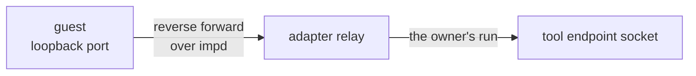

# Sandboxes

nixie runs untrusted work in sandboxes: the conversation's model loop, each worker, each code run,
the fetch sandbox and each coding session. A sandbox gets only the network and the credentials its
kind of work needs, and the caller names the kind, never the egress or the grants, so no caller can
hand a model loop a route out by mistake. nixie reaches sandboxes through its own sandbox interface,
under [0016](../../decisions/0016-own-interfaces.md). `modules/sandbox` holds the interface, the
kinds and the lifecycle records. `adapters/sandbox-imp` runs each sandbox as an imp microVM and is
the one package that imports imp's client, and `adapters/sandbox-process` is a test-build double
that runs each guest as a local process. [Tool calls](./tool-calls.md) covers the endpoint a
sandbox's tool route reaches.

## Kinds of work

A sandbox spec holds the kind of work, the image, the owner, the egress, the grants, the tool route
and the limits. The owner is the run or tool call the sandbox belongs to, which crash recovery
reads. The kind alone sets the rest of the spec:

| Kind         | Egress    | Model credential | Tool route |
| ------------ | --------- | ---------------- | ---------- |
| conversation | None      | Yes              | Yes        |
| worker       | None      | Yes              | Yes        |
| code run     | None      | No               | No         |
| fetch        | Public    | No               | No         |
| coding       | Allowlist | Yes, and others  | Yes        |

A grant is a credential that the sandbox runtime injects into requests for one host, so the guest
holds only a placeholder. Every grant is an exit for whatever the sandbox holds: a guest that can
make an authenticated request can carry its data out in it. Every adapter therefore checks a spec
before it writes a record or reaches its runtime, and refuses public egress with any grant, and a
grant beside any egress outside a coding session. A model loop's one credential, its model grant,
reaches only the model's API, and the loop has no network beside it.

## Records and recovery

Every create, grant, sleep, wake and destroy writes a sandbox record, and the sandboxes projection
holds one row per sandbox not yet destroyed, with the adapter that made it, its owner, its state and
its spec.

An adapter records a create before it makes anything. A crash between the record and the sandbox
then leaves a row that recovery finds, never a sandbox with no row. A create that fails removes what
it made and records the sandbox destroyed. An adapter rebuilds a handle from the stored spec, so an
adapter in a later process can destroy what the last process made, and crash recovery destroys every
sandbox whose owner no longer runs
([leases and recovery](../core/leases-and-recovery.md#crash-recovery)). A grant's environment holds
placeholders only, so a spec in a record never holds a credential.

## The tool route

A sandbox with a tool route reaches nixie's tools over a reverse forward, never over a network route
to the host.

imp opens the forward from a fixed loopback port inside the guest, and impd binds it to that one
imp, so the far end never depends on what the guest claims. For each connection the guest opens, the
adapter resolves the tool endpoint of the sandbox's owner afresh and relays the connection to it,
with backpressure both ways. A long-lived sandbox therefore follows its owner's current run, and a
tool endpoint that is down fails one connection, never the host process. The loopback stays on the
guest's proxy bypass list, so tool calls skip the credential broker's proxy.

A sleep ends the forward inside the imp, so the adapter closes its own side before imp sleeps the
imp, and opens it again after the wake. impd can also sleep an idle imp on its own, so every command
opens the forward first when it has closed, and the route stands again after a sleep nobody asked
for.

## The imp adapter

Each sandbox is one imp, named by its random sandbox ID, and the adapter maps no egress, public
egress and an allowlist onto imp's matching egress policies.

- **Grants.** imp's broker injects each granted secret from the host, so a grant never adds a host
  to the imp's egress policy. Before it writes anything, the adapter refuses a grant whose secret
  the broker would send to any host but its own one.
- **Public egress.** Public egress reaches the internet and nothing inside the deployment: not the
  host, not impd's API, not another sandbox. The deployment lists the host's own addresses and its
  other inside ranges, and gives the same lists to impd and to nixie. The adapter refuses public
  egress when the host address list is empty, or when impd cannot enforce public egress, because a
  host address the list leaves out is reachable from a public imp.
- **Credentials at start.** A command in an imp with a grant starts only once impd has set the
  broker's variables for that boot, and impd refuses a command whose environment replaces one of
  them.

## Running a command

A command runs in one of two forms. It runs to its exit, with a cap on each output stream that the
result reports, or it runs as a long-lived process, such as a model loop, that exchanges
length-prefixed messages over stdin and stdout. A message past the caller's limit stops the process
and ends the stream with an error, so a guest cannot make the host buffer more than the caller
allows. Files copy in and out by absolute guest path, and a path that climbs out of the guest fails.
A copy out of the guest is capped, so a guest cannot fill the host's memory.

Both forms pass the environment by name, with each grant's placeholders added. A stop sends SIGTERM
once, and the guest's agent kills the command's whole cgroup after a grace period, so no descendant
outlives it.

## The process double

The process double runs each guest as a local child process with no isolation. It writes the same
records and refuses the same specs as the imp adapter, but enforces no egress and injects no grant.
Each sandbox gets a directory of its own that stands in for the guest's filesystem, each command
leads its own process group so a stop kills the group, and the tool route is a relay on a free
loopback port. A member that leaves its process group escapes the kill, which imp's cgroup catches.
The double refuses a command on a sleeping sandbox, where imp would wake it, so a test that forgets
a wake fails instead of hanging.

The server uses the process double only in a test build, and the bundler drops the double and its
imports from the release bundle, so a release can never run a guest without isolation.
