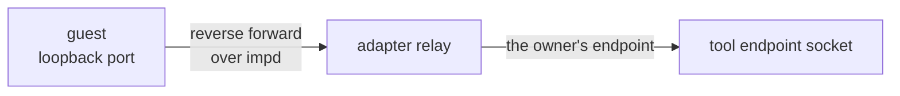

# Sandboxes

nixie runs untrusted work in sandboxes: the conversation's model loop, the memory checker, each
worker, each code run, the fetch sandbox and each coding session. A sandbox gets only the network
and the credentials its kind of work needs, and the caller names only that kind. nixie reaches
sandboxes through its own sandbox interface, under the
[own interfaces decision](../../decisions/0016-own-interfaces.md). The reference adapter runs each
sandbox as an [imp](../../glossary.md), a microVM that impd, imp's host daemon, runs. The test
sandbox runs each guest as a local process, so any module's tests can run a real guest.

[Tool calls](./tool-calls.md) covers the endpoint a sandbox's tool route reaches.
[Web fetch](./web-fetch.md) covers the fetch sandbox's lifetime and the fetcher that runs in it.
`modules/sandbox` holds the interface, the kinds, the sandbox records and the test sandbox, and
`adapters/sandbox-imp` is the one package that imports imp's client.

## Kinds of work

A sandbox spec holds the kind of work, the image, the owner, the egress, the grants, the tool route
and the limits. A grant is a credential that the sandbox runtime adds to requests for one host, so
the guest holds only a placeholder. The tool route is the guest's one way to reach nixie's tools.
The caller builds each spec through the spec builder, which sets the egress, the grants and the tool
route from the kind:

| Kind         | Egress    | Model credential | Other grants | Tool route |
| ------------ | --------- | ---------------- | ------------ | ---------- |
| conversation | None      | Yes              | No           | Yes        |
| checker      | None      | Yes              | No           | No         |
| worker       | None      | Yes              | No           | Yes        |
| code run     | None      | No               | No           | No         |
| fetch        | Public    | No               | No           | No         |
| coding       | Allowlist | Yes              | Yes          | Yes        |

The owner is the ID that crash recovery checks to decide whether the sandbox still has work. For a
model loop, the owner is the ID that the loop's tool calls run under, such as the conversation's ID
or a started task's ID. For other work, the owner is the task step or the tool call that the sandbox
belongs to.

Every grant is an exit for whatever the sandbox holds: a guest that can make an authenticated
request can carry its data out in it. Every adapter therefore checks a spec before it writes a
record or reaches its runtime:

- It refuses public egress with any grant.
- It refuses a grant beside any egress. A coding session is the one exception: it holds grants
  beside its allowlist.

A model loop's one credential, its model grant, reaches only the model's API, and the loop has no
other network.

## Records and recovery

Every create, grant, sleep, wake and destroy writes a sandbox record. The sandboxes
[projection](../../glossary.md) holds one row per sandbox that is not yet destroyed, with the
adapter that made it, its owner, its state and its spec.

An adapter records a create before it makes anything. A crash between the record and the sandbox
then leaves a row that recovery finds, and no sandbox exists without a row. A create that fails
removes what it made and records the sandbox destroyed. From a row's stored spec, an adapter builds
the in-process handle that reaches the sandbox, so an adapter in a later process can destroy what
the last process made. Crash recovery destroys every sandbox whose owner no longer runs
([leases and recovery](../core/leases-and-recovery.md#crash-recovery)). A spec holds each grant's
placeholders and never its credential, so a sandbox record never holds a credential.

### A started task's sandbox

Each task that the conversation starts runs in a worker sandbox of its own, on the conversation
image, with the limits of a system task's sandbox. The task's ID is the sandbox's owner. The
[nixie runner](../core/tasks.md#the-nixie-runner), which runs the steps of started tasks, creates
the sandbox at the task's first step. Its life follows the task:

1. When a step leaves the task waiting, the runner puts the sandbox to sleep, if its adapter can. A
   task that waits for days then holds no host memory.
2. The next step of the task wakes the sandbox.
3. Crash recovery keeps the sandbox while the task is not done or closed, so the task's session
   survives a restart of nixie. This covers a stopped or failed task too, because a restart of the
   task carries on in the same session.
4. When the task is done or closed, the runner destroys the sandbox.

A close of an idle task runs no step, so no step can tell the runner that the task ended. The runner
looks for done and closed tasks among the sandbox owners once when it starts, and again after each
record commit. A destroy that fails stays for the next look, and the other ended tasks' sandboxes go
at once.

A sandbox can still go missing, such as when the host loses the imp. The next step of the task then
creates a new sandbox, and the guest opens a new session from the log.

## The tool route

A sandbox with a tool route reaches nixie's tools over a reverse forward, and has no network route
to the host.

imp opens the forward from a fixed loopback port inside the guest, and impd binds the forward to
that one imp. The far end therefore depends only on which imp the connection came from, whatever the
guest claims. For each connection the guest opens, the adapter looks up the tool endpoint of the
sandbox's owner again and relays the connection to it, with backpressure both ways. When nixie
replaces an owner's endpoint, such as at a restart of the server, a long-lived sandbox's next
connection reaches the new one. A tool endpoint that is down fails one connection and leaves the
host process up. The guest sends the loopback port past the credential broker's proxy, which
[the imp adapter](#the-imp-adapter) describes, so tool calls never pass through it.

A sleep ends the forward inside the imp, and a wake does not restore it, so the adapter listens on
the forward again after each wake. impd can sleep an imp on its own when the imp is idle, and a call
that arrives during that sleep waits for it to end and then wakes the imp. Before a command starts
in a sandbox with a tool route, the adapter does these steps:

1. It asks impd to wake the imp. The wake waits out a sleep in progress.
2. It listens on the forward again, because the sleep ended the old one.
3. It starts the command. An idle sleep can begin between the wake and the command, so the command
   can wait out a second sleep.
4. It waits for impd's report that the command started, which comes after any such wake, and then
   listens on the forward again if the forward ended in the meantime.

The adapter also closes its own side of the forward before each sleep it asks for, and opens it
again after the wake.

## The imp adapter

Each sandbox is one imp, named by its random sandbox ID, and the adapter maps no egress, public
egress and an allowlist onto imp's matching egress policies.
[Names in impd](../deployment/impd-names.md) gives the rules for the names of the imps, the images
and the secrets.

- **Grants.** imp's credential broker adds each granted secret to requests from the host side, so a
  grant never adds a host to the imp's egress policy. The adapter stores each secret with the broker
  under its name, for one host and one header. When the broker already holds a secret under that
  name, the adapter leaves it as it is, because a live grant may use it. Before it writes anything,
  the adapter refuses a grant whose secret the broker would send to any host but its own one.
- **Public egress.** Public egress reaches the internet and nothing inside the deployment: not the
  host, not impd's API, not another sandbox. The deployment's operator lists the host's own
  addresses and the deployment's private address ranges, and the same lists go to impd and to nixie.
  The adapter refuses public egress when the list of host addresses is empty, or when impd cannot
  enforce public egress, because a public imp can reach any host address the list leaves out.
- **Credentials at start.** In an imp with a grant, a command starts only once impd has set the
  broker's environment variables for that boot: its proxy, its bypass list and its certificate. impd
  refuses a command whose environment replaces one of them.
- **Backups.** A sandbox's disk holds the user's conversation, so a copy of it in impd's backups
  would outlive a [forget](../../glossary.md). The adapter creates every imp with impd's backup
  opt-out, which holds for the imp's life, and refuses to create one on an impd that would ignore
  it. When the adapter reads an imp that impd still backs up, it marks the sandbox as retired. The
  sandbox's owner then replaces it with a new one, and the conversation's sandbox carries its
  session into the replacement.
- **Images.** impd's image eviction removes an unpinned image that no imp uses, and a token scoped
  to nixie's imps cannot pin one. An image can therefore go while no imp uses it, such as the fetch
  sandbox's image between fetches. Before each create, the adapter adds the sandbox's image again
  when impd no longer holds it, from the ref the server added it with at start.

## Running a command

A command runs in one of two forms:

- It runs to its exit. The adapter caps each output stream, and the result shows whether the cap cut
  the stream.
- It runs as a long-lived process, such as a model loop, that exchanges length-prefixed messages
  over stdin and stdout. A message past the caller's limit stops the process and ends the stream
  with an error, so a guest cannot make the host buffer more than the caller allows.

Files copy in and out by absolute guest path, and a path that climbs out of the guest fails. A copy
out of the guest is capped, so a guest cannot fill the host's memory.

The caller passes a command's environment as variables by name, and the adapter adds each grant's
placeholders. A stop sends SIGTERM once. After a grace period, imp's agent inside the guest kills
the command's whole cgroup, so no descendant process outlives the command.

## The test sandbox

The test sandbox runs each guest as a local child process with no isolation, so it is not a security
boundary: a guest reads and writes whatever nixie's user can, and reaches any network the host
reaches. It writes the same records and refuses the same specs as the imp adapter, but enforces no
egress and adds no grant. Each sandbox gets a directory of its own that stands in for the guest's
filesystem, and the tool route is a relay on a free loopback port.

Each command leads its own process group, so a stop kills the group. A descendant process that
leaves the group outlives the stop, where imp's cgroup kill would end it. The test sandbox refuses a
command on a sleeping sandbox, where imp would wake it, so a test that forgets a wake fails instead
of hanging.

A guest runs the source of its package from the workspace with nixie's own Bun, in place of its
image. A guest with a grant gets the grant's placeholders and the credential broker's variables from
nixie's own environment. When nixie itself runs in an imp whose broker adds the credential for the
grant's host, the guest's model calls therefore reach the model's API through that broker, and
neither nixie nor the guest holds the key.

The configuration's sandbox section selects the adapter, imp unless it names the test sandbox, and a
test sandbox needs no imp section and no impd token. Only a test build, which sets
`NIXIE_TEST_BUILD`, holds the test sandbox. The release build's configuration schema refuses it, the
bundler drops it and its imports from the release bundle, and the release build fails when the
bundle holds it, so a release can never run a guest without isolation.
