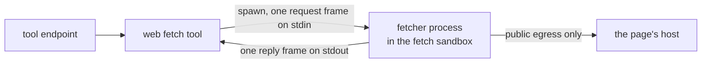

# Web fetch

The web fetch tool reads one public HTTPS page for the model and returns its text. nixie never
parses the page itself: a fetcher process inside the fetch sandbox resolves the host, fetches the
page and extracts its text, and nixie reads back one reply. The fetch sandbox has public egress and
no grants, and the sandbox adapter enforces public egress at the network layer, so the network layer
is the boundary that keeps a page away from internal addresses. The fetcher checks every address
again as a second layer, so a resolver trick fails twice, never once. [Sandboxes](./sandboxes.md)
covers the kinds of work and their egress, and [tool calls](./tool-calls.md) covers the endpoint
that runs the tool.

## The tool

The tool declares only the fetch effect and no destination, so the decision point's read-only rule
allows it and it runs direct, inside the turn. Its result holds the final URL after redirects, the
status code, the content type, the page's text and the truncated mark. Every field of the result is
outside content, because the page and every redirect along the way came from someone other than the
user. The result schema marks the status code and the truncated mark as endorsed types, because a
number and a boolean cannot carry the page's words, while a URL can carry text in its path. A
refused or failed fetch returns an error with its reason, which the model reads.

## The fetch sandbox

nixie keeps one long-lived fetch sandbox and creates it on the first fetch. Each fetch spawns a new
fetcher process, so nothing from one page's parse survives in memory for the next, and the fetcher
works inside a new temporary directory that it removes when the fetch ends. nixie talks to the
fetcher only over that process's stdin and stdout, one frame each way, each frame holding one line
of JSON in the format `libs/wire` defines. The request carries the URL, the fetch limits and the
ranges the deployment lists as internal; nothing else nixie holds reaches the sandbox.

Fetches run one at a time. nixie replaces the sandbox after a configured number of fetches, and
after any fetch that does not end in a page: a refusal, a failure the fetcher reports, a fetcher
that exits non-zero or sends no reply, a reply nixie cannot decode, or a fetcher that outlives the
fetch's time limit, which nixie stops. Every call nixie makes to the sandbox adapter has a time
limit as well, so a create or a destroy that never ends fails one fetch and never blocks the fetches
after it. Until a replacement, the fetches in one sandbox share a boundary: a page that compromises
the fetcher can see the URLs of later fetches and send them out over public egress. The URLs carry
no credential and every result is outside content, so the first build accepts that boundary. Every
fetch sandbox has the same owner, and a new one removes any fetch sandbox an earlier process left,
so a crash never leaves two.

## The fetcher

The fetcher's checks run on every hop, the first request and each redirect alike:

1. It accepts `https` only, and refuses every other scheme, `http` included. It drops any user name,
   password and fragment from the URL.
2. It resolves the host through the system resolver and checks every A and AAAA address returned.
   One address that is not public refuses the URL.
3. It connects to the address it checked, and sends the host name for TLS and in the `Host` header.
   The connection never asks DNS again, so a second answer cannot move the request, and the
   certificate must still match the host name.

A request carries no credential, cookie or stored header, and never goes through a proxy, because a
proxy resolves the host itself and would skip the pinned address. The fetcher refuses the non-public
IPv4 ranges, every IPv6 address outside global unicast, the IPv6 ranges kept for documentation, an
IPv6 address whose embedded IPv4 address is not public, and every range the deployment lists as
internal, whatever its class. The embedded forms it reads are IPv4-mapped, IPv4-compatible,
IPv4-translated, NAT64, 6to4 and Teredo.

Each fetch has 4 configurable limits: the body bytes read, the time for the whole call with its
redirects, the number of redirects, and the bytes of text returned. The body limit counts bytes
after a compressed body is decoded, so a small compressed body cannot expand past it. Reaching the
body limit or the text limit stops the read and marks the result truncated, and the text cut never
splits a character. Passing the time limit or the redirect limit fails the fetch.

An HTML page returns its readable text: the title, then the text outside scripts, styles and other
hidden elements, with a line break around each block. Another text type returns as it arrived, in
the charset its content type names, and a binary type returns no text, so the fetcher never reads
its body.

## The fetch image

The fetch image holds a minimal base with Bun and the fetcher bundled into one file, built from
`guests/fetch` with its Dockerfile. [The imp isolation tests](../../runbooks/imp-isolation-tests.md)
run the fetch sandbox on an imp host against the image: a public page succeeds, and a direct
connection to impd, the host's addresses or a tailnet address fails.
