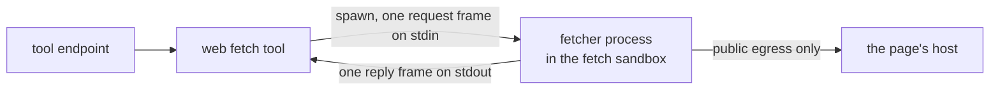

# Web fetch

The web fetch tool reads one public web page for the model and returns its text. nixie never parses
the page itself: a fetcher process inside the fetch sandbox resolves the host, fetches the page and
extracts its text, and nixie reads back one reply. The fetch sandbox has public egress and no
grants, and the sandbox adapter enforces public egress at the network layer, so the network layer is
the boundary that keeps a page away from internal addresses. The fetcher checks every address again
as a second layer, so a resolver trick fails twice, never once. [Sandboxes](./sandboxes.md) covers
the kinds of work and their egress, and [tool calls](./tool-calls.md) covers the endpoint that runs
the tool.

## The tool

The tool declares only the fetch effect and no destination, so the decision point allows it under an
allow rule on that effect, such as the starter rule `allow-reads`, and it runs direct, inside the
turn. Its result holds the final URL after redirects, the status code, the content type, the page
ID, the part number and the count of parts, the text of one part, the truncated mark and the blocked
reason, and `isCached`, which is true when the result is a stored copy. A fetched image reaches the
model as image content beside the result, as [web fetch images](./web-fetch-images.md) describes.

Every field of the result and every image is outside content, because the page and every redirect
along the way came from someone other than the user. The result schema marks the status code, the
part number, the count of parts, the truncated mark and `isCached` as endorsed types, because a
number and a boolean cannot carry the page's words, while a URL can carry text in its path. A
refused or failed fetch returns an error with its reason, which the model reads. When a site's bot
protection answers in place of the page, the result is a page with its status and a blocked reason,
so the model can tell the user why the fetch has no content instead of retrying.

A call names a page in one of these ways, and the tool refuses any other mix of keys:

| Call                                      | Fetches                                                                   | Returns                                       |
| ----------------------------------------- | ------------------------------------------------------------------------- | --------------------------------------------- |
| `url`, with an optional `part` or `find`  | unless the session stored the page inside `cache_ms`, or yes with `fresh` | the part named or found, else part 1          |
| `link`, with an optional `part` or `find` | the same as `url`                                                         | the same, for the page the link goes to       |
| `page`, with `part` or `find`             | no                                                                        | the part named or found, from the stored copy |

A `url` or `link` call takes an optional `fresh`, a boolean that is false when absent. A `page` call
with a `fresh` key, `false` included, is a tool error, because a `page` call never fetches. A call
never gives both `part` and `find`. [Pages and parts](#pages-and-parts) covers the page ID, `part`
and `find`.

## The steps of a call

A `url` or `link` call runs these 9 steps in `runPageFetch`, in this order:

| Step | Name     | What nixie does                                                                |
| ---- | -------- | ------------------------------------------------------------------------------ |
| 1    | Parse    | parses the call, and reads the link's target: the named URL                    |
| 2    | Rewrite  | calls `rewriteFetchURL` on the named URL: the sent URL                         |
| 3    | Scan     | refuses a sent URL that holds a secret                                         |
| 4    | Cache    | returns the session's stored copy of the sent URL, unless the call has `fresh` |
| 5    | Pause    | reads the pause of the sent URL's host                                         |
| 6    | Fetch    | calls `readPage` on the sent URL, which starts one sandbox                     |
| 7    | Set      | sets a pause from the reply                                                    |
| 8    | Fallback | runs the second pass                                                           |
| 9    | Store    | writes the page and its links in one transaction                               |

The named URL is the URL in the call's `url`, or the URL that its link ID stands for. The sent URL
is the URL that nixie sends to the fetcher: the rewritten URL when a [rule](#known-sites) matches
the named URL, and the named URL otherwise. The first pass is steps 3 to 7 on the sent URL of
step 2. The second pass is step 8: steps 3, 5, 6 and 7 once more, with the named URL as the sent
URL. It never runs step 4. A `page` call runs none of the steps.

Step 9 stores a row only for a page with text, never for an image. A stop of the server in steps 1
to 8 ends with a call record and no result record, and the sandbox module removes the fetch's
sandbox. Step 9 is one transaction, so a stop there stores the page whole or not at all.

## Known sites

A page of some sites carries more noise than content, so the tool fetches the site's raw or JSON
form of the same page. Before the fetch, `rewriteFetchURL` checks the URL against 5 rules:

| Rule                | Matches                                              | Fetches                                                                 |
| ------------------- | ---------------------------------------------------- | ----------------------------------------------------------------------- |
| `github-blob`       | `github.com/<owner>/<repo>/blob/<ref>/<path>`        | `raw.githubusercontent.com/<owner>/<repo>/<ref>/<path>`                 |
| `github-tree`       | `github.com/<owner>/<repo>/tree/<ref>/<path>`        | `api.github.com/repos/<owner>/<repo>/contents/<path>?ref=<ref>`         |
| `npm-package`       | `www.npmjs.com/package/<name>`, with `/v/<version>`  | `registry.npmjs.org/<name>/<version or latest>`, one version's document |
| `pypi-project`      | `pypi.org/project/<name>/`, with a version           | `pypi.org/pypi/<name>[/<version>]/json`                                 |
| `wikipedia-article` | `<lang>.wikipedia.org/wiki/<title>`, mobile host too | `<lang>.wikipedia.org/w/rest.php/v1/page/<title>/html`                  |

A URL matches a rule only when all of these hold:

- The host is exactly the rule's host. A Wikipedia host is `<lang>.wikipedia.org` or
  `<lang>.m.wikipedia.org`, where `<lang>` is not `www` or `m`.
- The URL names no explicit port, `:443` and `:80` included.
- The URL has no query string, except `?plain=1` on a `github-blob` URL.
- The path has the shape in the table, with no empty segment. `npm-package` and `pypi-project` allow
  one trailing slash.

The rewrite drops the fragment and any user name or password, and copies each path segment as the
URL holds it, with no decoding or encoding. A scoped npm name keeps its slash as `%2F`. A URL that
matches no rule, or that is no URL, is fetched as named. The tool never rewrites a root page of a
repository, an issue or a pull request.

The fallback fetches the named URL when the rewritten URL fails. It runs only when a rule rewrote
the URL and the first fetch returned a 404, or a rate limit: a 429, a 503, or a 403 whose headers
ask for a wait, each with no blocked reason, or when [the pause](#pauses) of the rewritten URL's
host is longer than a call waits. A 200, a refused or failed fetch and a blocked page never run it.
The fallback fetches the named URL as named and never runs twice, so its reply is the call's result,
a 404 or a rate limit included.

The tool stores the page of the one fetch that ends the call. After a fallback, only the named URL's
page is stored, never the body of the first fetch's 404 or rate limit. The result's `url` is the URL
the fetch ended at, so a rewritten fetch shows the rewritten URL. The tool's description says so.

## Pauses

A host that answers with a rate limit gets a pause, and nixie sends it no fetch until the pause
ends. The pauses live in a map from a host to the time its pause ends, in the memory of the server
process. A host is the `host` that the URL parser gives, lowercased and with any port.

Before a fetch, `runPageFetch` reads the pause of the sent URL's host. This happens in each pass,
before the fetch queue, so a wait never holds up a fetch of another host:

- With no pause, the fetch goes on.
- With a pause of `backoff_wait_ms` or less, the call waits out the pause and then fetches.
- With a longer pause, the call sends no request. A rewritten URL takes the fallback, and any other
  URL ends the call with a tool error,
  `<host> asked for a pause, so fetch it again in <seconds> seconds`, where `<seconds>` is the time
  left rounded up to a whole second. nixie stores nothing for it.

After a fetch, a reply with a status and no blocked reason sets a pause when its status is 429 or
503, or when it carries `retryAfterMs`. A 2xx reply that carries `retryAfterMs` returns and stores
its page, and pauses its host, with no fallback. The pause lasts `retryAfterMs`, or `backoff_ms`
when the reply names none, and never passes `backoff_cap_ms`. A `retryAfterMs` of 0 sets no pause,
and a new pause never shortens one that is set. A reply with a blocked reason sets no pause, because
a site's bot protection is not a rate limit.

The pause goes on the host of the reply's final URL. When the final host differs from the sent URL's
host, the pause goes on the sent host too. nixie never checks a redirect hop against the pauses, so
a redirect into a paused host costs one more rate-limit reply.

A rule that keeps the named URL's host, such as `pypi-project`, pauses that host with a rate-limit
reply on the rewritten URL. The fallback then waits out a short pause, or ends with the pause error
for a long one.

The `web_fetch` section of the deployment config holds the 3 keys, each a whole number of 0 or more:

| Key               | Default | Sets                                    |
| ----------------- | ------- | --------------------------------------- |
| `backoff_ms`      | 30000   | the pause when the reply names none     |
| `backoff_cap_ms`  | 300000  | the longest pause                       |
| `backoff_wait_ms` | 5000    | the longest pause that a call waits out |

nixie stores no pause in the database, so a restart drops every pause, which costs one more
rate-limit reply. A forget that ends a session clears every pause before the session's cleanup
finishes, because a host name can show what a forgotten conversation read. This covers the
conversation's cleanup, each task's cleanup and the reset of the conversations. The reader of a
skill's files takes no pause.

## The page cache

The cache is the session's page store, with no table of its own. Step 4 of the first pass returns
the stored copy of the sent URL when the session holds one that is fresh enough, so the call starts
no sandbox and writes nothing. The result is the page's stored view with `isCached` true, and every
other result has it false.

A stored page answers when all of these hold:

- It belongs to the call's session, and no forget has removed it.
- Its `fetch_url`, the sent URL of the pass that stored it, or its `url`, the URL the fetch ended
  at, equals the sent URL of the call. Both sides are compared as the URL parser prints them, with
  the fragment dropped. A sent URL that does not parse never hits, and a page stored before the
  `fetch_url` column existed hits only by its `url`.
- Its status is 200 to 299, and it has no blocked reason.
- It was stored less than `cache_ms` before now, by the log writer's clock, which wrote the time.

When several pages answer, the newest one is the result. After a second pass, the stored page's
`fetch_url` is the named URL, so the next call for the page that the rewritten URL named misses.

These rules hold for the step:

- Step 3 runs before step 4, so the scan refuses a URL that holds a secret even when a page for it
  is stored.
- Step 4 runs before step 5, so a stored page of a paused host still answers.
- The second pass never reads the cache.
- Two calls for one URL that run together both fetch, and each stores its page.
- The store limit and the forget apply to every stored page as before, so a page that left the store
  no longer answers.
- A `fresh` call skips step 4, and its page replaces the stored copy as the newest.

The `web_fetch` section of the deployment config holds the key, a whole number of 0 or more:

| Key        | Default | Sets                                                                     |
| ---------- | ------- | ------------------------------------------------------------------------ |
| `cache_ms` | 300000  | how long a stored page answers a url or link call; 0 turns the cache off |

## Link IDs

Each link in a page's text reads as a short ID that the conversation session numbers, such as
`[L12]`, so a link costs a few characters in place of its whole URL. A link that leaves the page's
host shows its host and the start of its path after the ID, such as `[L40 · example.org/docs/…]`, so
the model can tell where a link goes before it follows it. The `link_path_chars` value in the
deployment config's `web_fetch` section sets how many characters of the path show, and a longer path
ends in `…`. The cut never splits the escapes of one character. The tag never shows the query string
or the fragment, and shows no path for a link to the host's root. The tool fetches the page a link
ID names, and its result holds the URL the fetch ended at, as a fetch by URL does.

The session numbers each URL once, from a count of its own, so a URL keeps one ID across every page
the session fetches and every [search](./search.md) hit, and the IDs of two sessions are unrelated.
A new session's opening record keeps a random session key, each turn on that session hands the key
to its tool calls, and the link store keys each row by it. A compaction or a forget opens a new
session, so an ID from an earlier session fails with an error that tells the model to fetch the page
by its URL again. A call under the run's own token runs in no session, so the tool keys its links by
the run.

Link IDs are the one exception to the rule that every record the model sees takes a short ID from
the database library ([short IDs](../core/database.md#short-ids)). A link ID names a link, not a
record, and it lasts one session, so a count gives the shortest ID and no rebuild from the log needs
it.

The web fetch tool owns the link store and the page store, and the search tool writes only to the
link store. Each row holds a URL or a page's text, which can carry text the user forgets, so a
forget removes every link and every page on the conversation's thread
([forgetting and the live session](../memory/context.md#forgetting-and-the-live-session)). A fetch
can outlive the turn a forget aborted, so each turn hands its tool calls the newest session
invalidation its step saw beside the session key. Each tool writes its rows in the same transaction
that checks for a newer invalidation on the thread. When it finds one, it writes nothing and returns
an error, so neither tool writes a row after the cleanup removed the thread's rows.

## Pages and parts

The tool stores the whole text of each page it fetches, so the model can read a page longer than one
result without a new fetch. In one write transaction, the tool numbers every link on the page,
writes each link as its tag, cuts the text into parts, and stores the parts under a page ID from
`createShortID`, such as `tz4a98xxat`. The page store keys each row by the session key, so a page ID
lasts one session, as a link ID does. The tool refuses a page ID from an earlier session, one the
store removed and an invented one alike, with an error, and the model then fetches the page by its
URL again. The tool never returns another page in place of the one named.

The `text_bytes` value of the deployment config's `web_fetch` section sets the most UTF-8 bytes of
one part, its link tags included. The tool ends each part at the last line break within that limit,
else at the last space, else after the last whole character, and never inside a link tag. A tag
longer than a whole part shows as its ID alone, such as `[L12]`, and an ID longer than a whole part
shows nothing, so every tag fits in a part and the tool always finishes cutting. For the same
reason, the tool leaves out a character wider than a whole part, which only a limit under 4 bytes
meets.

`find` takes plain text. The tool returns the part where that text first appears, and up to 10
matches, each with its part number and about 50 characters of the page on each side. The tool
matches the text with a case-insensitive regular expression over the page as stored, and never
lowercases the page first: a lowercased `İ` grows from one code unit to two, which would move every
later match and could pick the wrong part. A match that runs into the next part counts in the part
it starts in. When the text never appears, the tool returns an error with the count of parts, such
as "0 matches in 7 parts of page tz4a98xxat".

The truncated mark means that the fetcher stopped before the page's end, at the body limit, or at
the image limit for an image ([the fetcher](#the-fetcher)), so no part holds that end. A page with
no text, such as a PDF, returns its URL, status and content type with no text, no page ID, no part
number and a count of 0 parts. An image returns the same, beside the image itself, as
[web fetch images](./web-fetch-images.md) describes.

When the tool stores a page, it removes these pages in the same transaction:

- every page of the thread's ended conversation sessions, which no call can reach again. A session's
  opening record keeps its key, and a thread runs one conversation session at a time, so the tool
  treats each key that an opening before the thread's newest one names as ended, and never the
  newest opening's key, which belongs to the live session. A call under a run's own token can run
  beside the live session and keys its pages by the run, which no opening names, so those pages stay
  until a forget or the store limit removes them;
- the session's oldest pages, until the session's pages fit the `page_store_bytes` value of the
  `web_fetch` section. The page just stored always stays, even when it alone passes that value.

A forget removes every page on the thread. `remove-web-fetch-pages.ts` in `modules/connectors` makes
every removal from the page store.

## The fetch sandbox

Each fetch runs in a fetch sandbox of its own. nixie creates a new sandbox from the fetch image,
spawns one fetcher process in it, and destroys the sandbox when the fetch ends, so a page that
compromises the fetcher sees only its own fetch and never the URL of another. The fetcher works
inside a new temporary directory that it removes when the fetch ends. nixie talks to the fetcher
only over that process's stdin and stdout, each frame holding one line of JSON in the format
`libs/wire` defines. An ungated fetch takes one frame each way. The request carries the URL, the
fetch limits and the ranges the deployment lists as internal; nothing else nixie holds reaches the
sandbox.

A page or image reply also carries `retryAfterMs`, the wait in milliseconds that the site's headers
ask for. The fetcher takes it from `Retry-After` on a 429, 503 or 403 reply, and from
`x-ratelimit-reset` on any reply whose `x-ratelimit-remaining` is `0`. When both headers give a
wait, the longer one wins. The field is null when neither header gives one. A reply from a fetcher
built before the field reads as null, so the server and the fetch image update in either order.

A gated fetch is a fetch whose caller passes a `scanHop` function to `readPage`. The request then
holds `hops: 'ask'`, which the wire writes as a redirect limit of 0 and a `hopGate` object that
holds the real limit. Before the fetcher resolves the host of each redirect, it sends a `hop` frame
with the URL and waits for a `hop-pass` frame. The server scans each hop with `scanHop` in
`gatePageHops` and sends the pass, or it stops the fetcher and returns a refusal, so the wire holds
no refusal frame. A fetch with no `scanHop` sends `hops: 'none'` and the same bytes as before, and a
`hop` frame on it fails the fetch. Every reply carries `isGated`, which is true when the fetcher
asked before each hop, and the fetch tool never passes it on to the model.

The server takes only the URL from a `hop` frame. It counts the hops itself, and takes the host that
sent each redirect from the URL before it. It reads one frame at a time, and the fetcher waits while
the scan runs. The fetch's one time limit covers every read, scan and pass. A gated fetch fails,
with the fetcher stopped, when the scan throws, when more hop frames arrive than the redirect limit,
when a frame does not decode or its URL does not parse, when the fetcher's output closes before its
reply, or when the time limit passes. The https try of an `http` URL is still hop 0 and asks
nothing.

**Why:** the scan runs on the server because nixie's secret values and rules never enter the
sandbox, and the open stream costs a redirect no new sandbox. The wire holds no refusal frame
because a fetcher that a hostile page has taken over could ignore a frame, but not a stop.

The server and the fetch image can be of different releases. A fetch image before the hop gate reads
a redirect limit of 0 and sends no hop frame, so it never follows an unscanned redirect, and the
server replaces the reason of its failed reply with one that names the older image. A server before
the hop gate sends no `hopGate`, so the new fetch image follows redirects as that server expects.
The web fetch tool gates every `url` and `link` fetch with [the secret scan](#the-secret-scan), so a
server of this release on a fetch image of an older release fails every page that redirects. Update
the fetch image with the server. The skill file reader gates none.

Fetches run one at a time, and the next fetch starts only once the last fetch's destroy ends, so no
fetcher ever runs beside another. nixie returns the reply as soon as the fetcher sends it and
destroys the sandbox after, which keeps the destroy off the reply's path.

A fetch that does not end in a page destroys its sandbox the same way: a refusal, a failure the
fetcher reports, a fetcher that exits non-zero or sends no reply, a reply nixie cannot decode, or a
fetcher that outlives the fetch's time limit, which nixie stops. Every call nixie makes to the
sandbox adapter has a time limit as well, so a create or a destroy that never ends fails one fetch
and never blocks the fetches after it.

Every fetch sandbox has the same owner. The first fetch after nixie starts removes every fetch
sandbox of that owner, which clears what an earlier process left. The next fetch after a failed
create or a destroy that fails or passes its time limit does the same, because a create can fail
after the runtime made the sandbox and then fail to remove it. A create that passes its time limit
makes no further adapter call, and nixie destroys a sandbox that the create still returns as soon as
it arrives.

## The secret scan

The tool refuses a URL that holds a secret, so a model that copies a token into a URL never sends it
to a site. [The secret scan](./secret-scan.md) covers the finder and its rules. The scan runs in 2
places, in each pass of a `url` or `link` call:

- Before the pause read and before any sandbox starts, `refuseFetchURL` scans the sent URL, which is
  the named URL after any [known-site](#known-sites) rewrite. This is hop 0.
- Inside the fetch, `makeHopScan` is the `scanHop` that [the fetch sandbox](#the-fetch-sandbox)
  passes to `gatePageHops`, so it scans the URL of each redirect before the fetcher resolves its
  host. The second pass numbers its hops from 1 again.

The finder tries the own values first, and then the public rules. nixie never sends an own value or
a rule to the sandbox, in any form, a hash included, because the sandbox reads hostile pages.

A refusal is a tool error, and the call ends: no sandbox starts for a refusal at hop 0, a refused
hop stops the fetcher, nothing is stored, and a refused hop never sets off the second pass. The
model reads one of 2 sentences:

- `the URL holds a secret (rule {rule}), so it was not fetched`, for the sent URL.
- `{host} redirected to a URL that holds a secret (rule {rule}), so it was not fetched`, for a hop,
  where `{host}` is the host that sent the redirect. When the finder matches that host name itself,
  the sentence reads `a site` in its place.

Each refusal also writes one `web_fetch.secret_refused` event to the server log, with the fields
`rule` and `hop` and no others. Neither the sentence nor the event repeats the URL or the secret,
and the event holds no host name, because a forget does not reach the server log. The call record
holds the refused URL as the model wrote it, as every tool's call record holds its input.

The user can type a URL that holds a secret, and the fetch then runs. The exemption decides this,
and `runPageFetch` builds one per call, which the scan of the sent URL and of each hop in both
passes share. It gives the same answer for every rule, `nixie-secret` included:

1. At hop 0, it asks whether a typed span of the thread's newest 50 messages holds the whole named
   URL, the URL before any rewrite. A pasted span never counts, because a paste can hold text
   someone else wrote, and neither does a message that a forget erased.
2. At a later hop, it gives the same answer under `secret_typed_url_covers` set to `redirects`, and
   false under `named_url`.

The exemption reads the messages at most once per call, across both passes, and only after a match,
so a fetch with no match reads none of the user's messages.

nixie shows no prompt about a refusal, because its target is no approval prompts. A public rule that
matches an ordinary URL therefore refuses that page on every call, and the log event is how the user
finds such a rule.

### The config keys

The `web_fetch` section of the deployment config takes 3 keys for the scan:

| Key                          | Values                             | Default                    |
| ---------------------------- | ---------------------------------- | -------------------------- |
| `secret_typed_url_covers`    | `named_url` or `redirects`         | `redirects`                |
| `secret_own_values`          | a list of secrets file entry names | every entry but `settings` |
| `secret_own_value_min_chars` | a whole number, 1 or more          | 8                          |

- `redirects` lets a typed URL's exemption cover every hop, because a site that redirects a typed
  URL with its token to its `www` host would fail under `named_url`. The exemption that
  `runPageFetch` builds is the one place to change when approval rules replace it.
- An empty `secret_own_values` list matches the public rules alone.
- A value shorter than `secret_own_value_min_chars` is left out, because a short value matches an
  ordinary URL by chance, and a site that redirects to a URL with its guess of an own value learns
  one yes or no per fetch.
- `modules/connectors` defines the entry names once, and a compile-time check in `apps/server` fails
  the build when they differ from the keys of the secrets file.

### What the scan leaves out

The scan covers only the sent URL and each hop. It never scans page content or a tool result, and
the skill file reader's fetches take no scan, because the reader builds each URL from a skill
source's repository and its commit and tree hashes, so the model never writes a URL into it.

## The fetcher

The fetcher's checks run on every hop, the first request and each redirect alike:

1. It accepts `http` and `https`, and refuses every other scheme. It drops any user name, password
   and fragment from the URL.
2. It resolves the host through the system resolver and checks every A and AAAA address returned.
   One address that is not public refuses the URL.
3. It connects to the address it checked, and sends the host name in the `Host` header, and over
   `https` for TLS too. The connection never asks DNS again, so a second answer cannot move the
   request, and an `https` certificate must still match the host name.

For an `http` URL that names no port, the fetcher tries `https` first, on the address it checked. It
fetches over `http` only when the `https` connection fails to open, such as on a refused connection
or a failed TLS handshake. The `https` try has a fifth of the time limit to open its connection, so
a host that drops packets to port 443 still gets its `http` fetch within the limit. Once the `https`
connection opens, an error or a missing answer fails the fetch, with no `http` try. A redirect goes
to the URL it names, `http` included, with no `https` try first, so a site that redirects from
`https` to `http` cannot loop. The reply's final URL shows the scheme that answered.

A request carries no credential, cookie or stored header, and never goes through a proxy, because a
proxy resolves the host itself and would skip the pinned address. The fetcher refuses the non-public
IPv4 ranges, every IPv6 address outside global unicast, the IPv6 ranges kept for documentation, an
IPv6 address whose embedded IPv4 address is not public, and every range the deployment lists as
internal, whatever its class. The embedded forms it reads are IPv4-mapped, IPv4-compatible,
IPv4-translated, NAT64, 6to4 and Teredo.

nixie runs the fetcher for 2 callers, the web fetch tool and the reader of a skill's files, and
sends each fetch these limits:

| Limit                                           | Web fetch tool         | Skill files                                                           |
| ----------------------------------------------- | ---------------------- | --------------------------------------------------------------------- |
| the body bytes read                             | the deployment config  | the file size limit of the [definitions repo](../core/definitions.md) |
| the body bytes of an image                      | the deployment config  | 0, since a skill holds only text                                      |
| the time for the whole call, redirects included | the deployment config  | the deployment config                                                 |
| the number of redirects                         | the deployment config  | the deployment config                                                 |
| the bytes of text returned                      | 3 times the body limit | the file size limit                                                   |

The fetcher asks for markdown first, with the header
`text/markdown, text/html;q=0.9, application/xhtml+xml;q=0.9, text/plain;q=0.8, */*;q=0.7`. A site
that answers `text/markdown` returns its text as sent, like any other text type, and the reply has
no link marks, so the page has no link IDs. A server of this release that runs an older fetch image
only lacks the header, so the server and the image roll out in either order.

The web fetch tool asks for text up to 3 times its body limit, because one body byte decodes to at
most 3 bytes of UTF-8 text, so its text stops only where the body does.

The body limit and the image limit count bytes after a compressed body is decoded, so a small
compressed body cannot expand past them. Reaching the body limit or the text limit stops the read
and marks the result truncated, and the text cut never splits a character. Passing the time limit or
the redirect limit fails the fetch.

The reply lists the target of each link mark the cut text keeps and no other. The targets have a
byte budget of their own, a fixed multiple of the text limit. From the first mark whose target would
pass that budget, the fetcher drops the mark of each link it has not yet listed and keeps the text,
so a page of long links still fits the reply's size limit. The budget never cuts the text and never
marks the result truncated. A host and path can run far longer than their mark, so nixie cuts the
text into parts only once each link reads as its tag ([pages and parts](#pages-and-parts)).

nixie sets the size limit of the fetcher's reply frame from the larger of 2 sizes, because a reply
holds text or an image, never both:

- the text limit and the link targets' budget, at the most bytes JSON escaping can make them;
- the image limit, written in base64.

The default `text_bytes` value, the most bytes of one part, sits under the tool-output limit that
the conversation guest sets for the Agent SDK's CLI, so every part reaches the model whole. The CLI
saves a result past its tool-output limit to a file, and the model has no tool to read a file. The
guest turns those files off, so the CLI cuts any longer result and keeps it inline.

### The page text

An HTML page returns its readable text: the title, then the text of the page's main content, outside
scripts, styles and other hidden elements, with a line break around each block. The main content is
the page's articles, else its main element, else the whole page without its own header and footer,
and the fetcher takes the next of those when one holds no text. The text of navigation and asides
never counts as main content, so site menus never come before the content. An article comes before
the main element because a site's main element often holds toolbars around the article.

The readable text marks where each link ends, so the model can follow a link to the next page. The
fetcher writes a mark after the text of each link in the main content and lists each mark's target,
resolved against the href of the page's first `<base>` element that has one, else the page's final
URL, beside the text, and nixie writes each mark as the link's ID. A mark is the link's index
between two private-use characters, and the fetcher strips both characters from the page's own text,
so a page cannot forge a mark. After the main content comes a list headed "Other links on this
page", which holds the links from the rest of the page, such as its navigation, asides, header and
footer. The list holds each target once, leaves out a target the main content shows, and stops at a
fixed count, so a page of menus cannot fill the text limit. The list comes last, so a page cut at
the text limit loses its list before its article. A link to the page itself, which the fetcher
compares against the page's final URL, to a fragment of it, or through a scheme other than `https`
and `http`, such as `javascript:`, keeps only its text and gets no mark, because the model has
nothing to fetch there.

Another text type returns as it arrived, in the charset its content type names. An `image/*` type
returns its body whole, within the image limit, for nixie to read
([web fetch images](./web-fetch-images.md)). Another binary type returns no text, so the fetcher
never reads its body. A 403 or 503 that carries Cloudflare's challenge header, or the markup of its
challenge page, sets the blocked reason. A challenge needs a browser that runs its script, so the
fetcher reports it rather than trying to pass it.

## The fetch image

The fetch image holds a minimal base with Bun and the fetcher bundled into one file, built from
`guests/fetch` with its Dockerfile. [The imp isolation tests](../../runbooks/imp-isolation-tests.md)
run the fetch sandbox on an imp host against the image: a public page succeeds, and a direct
connection to impd or the host's addresses fails.
