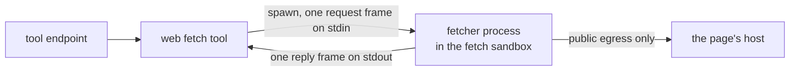

# Web fetch

The web fetch tool reads one public HTTPS page for the model and returns its text. nixie never
parses the page itself: a fetcher process inside the fetch sandbox resolves the host, fetches the
page and extracts its text, and nixie reads back one reply. The fetch sandbox has public egress and
no grants, and the sandbox adapter enforces public egress at the network layer, so the network layer
is the boundary that keeps a page away from internal addresses. The fetcher checks every address
again as a second layer, so a resolver trick fails twice, never once. [Sandboxes](./sandboxes.md)
covers the kinds of work and their egress, and [tool calls](./tool-calls.md) covers the endpoint
that runs the tool.

## The tool

The tool declares only the fetch effect and no destination, so the decision point's read-only rule
allows it and it runs direct, inside the turn. Its result holds the final URL after redirects, the
status code, the content type, the page's text, the truncated mark and the blocked reason. Every
field of the result is outside content, because the page and every redirect along the way came from
someone other than the user. The result schema marks the status code and the truncated mark as
endorsed types, because a number and a boolean cannot carry the page's words, while a URL can carry
text in its path. A refused or failed fetch returns an error with its reason, which the model reads.
When a site's bot protection answers in place of the page, the result is a page with its status and
a blocked reason, so the model can tell the user why the fetch has no content instead of retrying.

A call names the page by its URL or by the ID of a link that a page fetched earlier in the session
showed, and the tool refuses a call that gives both or neither.

## Link IDs

Each link in a page's text reads as a short ID that the conversation session numbers, such as
`[L12]`, so a link costs a few characters in place of its whole URL. A link that leaves the page's
site shows its host after the ID, such as `[L40 · example.org]`, so the model can tell where a link
goes before it follows it. The tool fetches the page a link ID names, and its result holds the URL
the fetch ended at, as a fetch by URL does.

The session numbers each URL once, from a count of its own, so a URL keeps one ID across every page
the session fetches, and the IDs of two sessions are unrelated. A new session's opening record keeps
a random session key, each turn on that session hands the key to its tool calls, and the link store
keys each row by it. A compaction or a forget opens a new session, so an ID from an earlier session
fails with an error that tells the model to fetch the page by its URL again. A call under the run's
own token runs in no session, so the tool keys its links by the run.

Link IDs are the one exception to the rule that every record the model sees takes a short ID from
the database library ([short IDs](../core/database.md#short-ids)). A link ID names a link, not a
record, and it lasts one session, so a count gives the shortest ID and no rebuild from the log needs
it.

The link store belongs to the web fetch tool alone. Each row holds a URL, and a URL can carry text
the user forgets, so a forget removes every link on the conversation's thread
([forgetting and the live session](../memory/context.md#forgetting-and-the-live-session)). A fetch
can outlive the turn a forget aborted, so each turn hands its tool calls the newest session
invalidation its step saw beside the session key. The tool numbers a page's links in the same
transaction that checks for a newer invalidation on the thread, and it numbers none and returns an
error when it finds one, so no row reaches the store after the cleanup removed the thread's links.

## The fetch sandbox

Each fetch runs in a fetch sandbox of its own. nixie creates a new sandbox from the fetch image,
spawns one fetcher process in it, and destroys the sandbox when the fetch ends, so a page that
compromises the fetcher sees only its own fetch and never the URL of another. The fetcher works
inside a new temporary directory that it removes when the fetch ends. nixie talks to the fetcher
only over that process's stdin and stdout, one frame each way, each frame holding one line of JSON
in the format `libs/wire` defines. The request carries the URL, the fetch limits and the ranges the
deployment lists as internal; nothing else nixie holds reaches the sandbox.

Fetches run one at a time, and the next fetch starts only once the last fetch's destroy ends, so no
fetcher ever runs beside another. nixie returns the reply as soon as the fetcher sends it and
destroys the sandbox after, which keeps the destroy off the reply's path.

A fetch that does not end in a page destroys its sandbox the same way: a refusal, a failure the
fetcher reports, a fetcher that exits non-zero or sends no reply, a reply nixie cannot decode, or a
fetcher that outlives the fetch's time limit, which nixie stops. Every call nixie makes to the
sandbox adapter has a time limit as well, so a create or a destroy that never ends fails one fetch
and never blocks the fetches after it.

Every fetch sandbox has the same owner. The first fetch after nixie starts removes every fetch
sandbox of that owner, which clears what an earlier process left. The next fetch after a failed
create or a destroy that fails or passes its time limit does the same, because a create can fail
after the runtime made the sandbox and then fail to remove it. A create that passes its time limit
makes no further adapter call, and nixie destroys a sandbox that the create still returns as soon as
it arrives.

## The fetcher

The fetcher's checks run on every hop, the first request and each redirect alike:

1. It accepts `https` only, and refuses every other scheme, `http` included. It drops any user name,
   password and fragment from the URL.
2. It resolves the host through the system resolver and checks every A and AAAA address returned.
   One address that is not public refuses the URL.
3. It connects to the address it checked, and sends the host name for TLS and in the `Host` header.
   The connection never asks DNS again, so a second answer cannot move the request, and the
   certificate must still match the host name.

A request carries no credential, cookie or stored header, and never goes through a proxy, because a
proxy resolves the host itself and would skip the pinned address. The fetcher refuses the non-public
IPv4 ranges, every IPv6 address outside global unicast, the IPv6 ranges kept for documentation, an
IPv6 address whose embedded IPv4 address is not public, and every range the deployment lists as
internal, whatever its class. The embedded forms it reads are IPv4-mapped, IPv4-compatible,
IPv4-translated, NAT64, 6to4 and Teredo.

Each fetch has 4 configurable limits: the body bytes read, the time for the whole call with its
redirects, the number of redirects, and the bytes of text returned. The body limit counts bytes
after a compressed body is decoded, so a small compressed body cannot expand past it. Reaching the
body limit or the text limit stops the read and marks the result truncated, and the text cut never
splits a character. Passing the time limit or the redirect limit fails the fetch.

The reply lists the target of each link mark the cut text keeps and no other. The targets have a
byte budget of their own, a fixed multiple of the text limit, and the text stops before the first
mark whose target would pass it, so a page of long links still fits the reply's size limit, which
nixie sets from both budgets. A host can run far longer than its mark, so nixie applies the text
limit again once each link reads as its ID and host, and marks a result it cuts there truncated.

The default text limit sits under the tool-output limit that the conversation guest sets for the
Agent SDK's CLI, so a long page reaches the model as its start, marked truncated. The CLI saves a
result past its tool-output limit to a file, and the model has no tool to read a file. The guest
turns those files off, so the CLI cuts any longer result and keeps it inline.

### The page text

An HTML page returns its readable text: the title, then the text of the page's main content, outside
scripts, styles and other hidden elements, with a line break around each block. The main content is
the page's articles, else its main element, else the whole page without its own header and footer,
and the fetcher takes the next of those when one holds no text. The text of navigation and asides
never counts as main content, so site menus never come before the content. An article comes before
the main element because a site's main element often holds toolbars around the article.

The readable text marks where each link ends, so the model can follow a link to the next page. The
fetcher writes a mark after the text of each link in the main content and lists each mark's target,
resolved against the page's final URL, beside the text, and nixie writes each mark as the link's ID.
A mark is the link's index between two private-use characters, and the fetcher strips both
characters from the page's own text, so a page cannot forge a mark. After the main content comes a
list headed "Other links on this page", which holds the links from the rest of the page, such as its
navigation, asides, header and footer. The list holds each target once, leaves out a target the main
content shows, and stops at a fixed count, so a page of menus cannot fill the text limit. The list
comes last, so a page cut at the text limit loses its list before its article. A link to the page
itself, to a fragment of it, or through a scheme other than `https` and `http`, such as
`javascript:`, keeps only its text and gets no mark, because the model has nothing to fetch there.

Another text type returns as it arrived, in the charset its content type names, and a binary type
returns no text, so the fetcher never reads its body. A 403 or 503 that carries Cloudflare's
challenge header, or the markup of its challenge page, sets the blocked reason. A challenge needs a
browser that runs its script, so the fetcher reports it rather than trying to pass it.

## The fetch image

The fetch image holds a minimal base with Bun and the fetcher bundled into one file, built from
`guests/fetch` with its Dockerfile. [The imp isolation tests](../../runbooks/imp-isolation-tests.md)
run the fetch sandbox on an imp host against the image: a public page succeeds, and a direct
connection to impd or the host's addresses fails.
