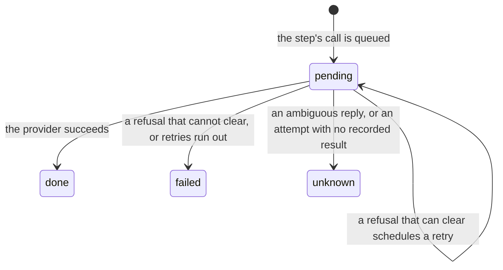

# Actions

An action is an allowed tool call whose effects reach outside nixie, such as a send, a write or a
spend. It never runs inside the model's turn. It goes onto a durable queue, a separate runner
attempts it against its provider, and its outcome becomes a record in the task's inbox. The queue
exists so that a crash at any moment can never make an action happen twice, under
[0021](../../decisions/0021-action-outcomes.md): an action that may have reached its provider is
marked unknown, never tried again blind. `modules/actions` owns the queue. An action is claimed
through the same leases as a task step ([leases and recovery](./leases-and-recovery.md)), and
[tool calls](../connectors/tool-calls.md) covers how a call reaches the queue.

## Outcomes

The actions projection holds each action's outcome, its attempt count, whether an attempt is open,
and the time of its next attempt, so a restart resumes the retry schedule where it stopped. Done,
failed and unknown are final. A final outcome is a record on the task's thread, so it lands in the
task's inbox and wakes the task. Its erasable fields hold the connector's result or the provider's
reason. An unknown action stays unknown, because nothing reconciles it with the provider.

## Queuing a call

The queue takes only a call that the [decision point](../policy/decision-point.md) allowed, under
the claim of the step that made it. The decision point's read-only rule denies every call with an
outside effect in a release build, so the only allowed call that reaches the queue is the crash
tests' send tool, in a test build. The queue's transaction checks that step's lease first, so a
runner that lost its lease queues nothing. A guest can outlive its step's lease, so the queue also
refuses a call whose step run identity is not the task's current claim. Without that check, a call
from the guest of a step that lost its lease would queue under the claim of the runner that took the
task over and pass its lease check. Each action gets a random ID, which is both its queue key and
the idempotency key the connector sends to the provider. The call's arguments sit in the record's
erasable fields, and the decision sits on its envelope.

A step that crashed is run again from its start, and the rerun makes the same tool calls. Each call
arrives with an action hash that its caller builds from the call, and the queue compares calls by
that hash alone, never by their arguments. A call whose action hash matches an earlier action of the
same task returns that action and queues nothing, when the earlier action came from the same step or
is still pending or unknown. A later step that repeats a call whose action is done or failed queues
a new action, because the model asked for it again. The same action can then never run twice,
however many times its step reruns.

## Attempts

An attempt runs in three stages, each committed under the action's lease:

1. The runner records the attempt's start.
2. It calls the connector, with the action ID as the idempotency key, and renews the lease while the
   call runs.
3. It records the result and the outcome together, and frees the lease.

A claim that finds an attempt started with no result recorded marks the action unknown and calls no
provider. The call may have reached the provider before the crash, so a second attempt could repeat
it. Recovery does the same for every such action before any runner starts. A claimed action whose
tool has no connector, or whose arguments are gone because their key was forgotten, fails without an
attempt.

The connector's reply picks the outcome:

| Reply                                | Outcome | Wakes the task |
| ------------------------------------ | ------- | -------------- |
| Success                              | done    | Yes            |
| A refusal that cannot clear          | failed  | Yes            |
| A refusal that can clear             | pending | No             |
| An ambiguous reply, or a thrown call | unknown | Yes            |

A thrown call counts as ambiguous, because a timeout or a dropped connection may have come after the
provider acted.

## Retries

A refusal that can clear, such as a rate limit, schedules the next attempt on a backoff, or later
when the provider gives a retry time. A connector can set its own schedule. A refusal on the last
attempt fails the action, with retries exhausted as its reason. The schedule rides out a rate limit
or a short outage, and an action still refused after it needs the user more than it needs another
attempt.

## What the model sees

The model's turn waits a bounded time for the outcome, then sees one of four views: done with the
connector's result, failed with the reason, pending with the action ID, or unknown with a message
that says the user was asked whether it happened. The
[actions design](../../design/platform/core/actions.md) covers how the user's answer settles an
unknown action. A result whose key was forgotten reads as no result, never as an empty success. The
model has no tool that retries an action or sets an outcome, so only the queue settles one.

Action attempts run in a runner pool of their own, apart from the task runners, so a send goes out
while every task runner is busy with a long turn.
