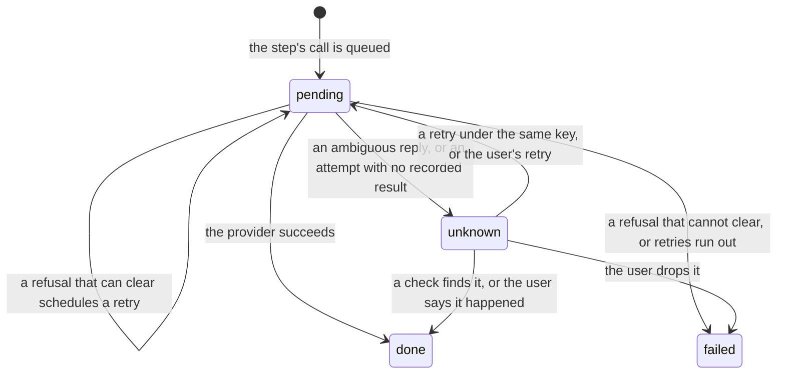

# Actions

An action is an allowed tool call whose effects reach outside nixie, such as a send, a write or a
spend. It never runs inside the model's turn. It goes onto a durable queue, a separate runner
attempts it against its provider, and its outcome becomes a record in the task's inbox. The one
exception is a call that you approved to a tool that runs inside the turn, which the task's next
step runs ([below](#approved-actions)). The queue exists so that a crash at any moment can never
make an action happen twice: an action that may have reached its provider is marked unknown, and
nixie settles it only by a retry under the same key, a check with the provider, or the user's
answer, never by a blind second attempt. `modules/actions` owns the queue. An action is claimed
through the same leases as a task step ([leases and recovery](./leases-and-recovery.md)), and
[tool calls](../connectors/tool-calls.md) covers how a call reaches the queue.

## Outcomes

The actions projection holds each action's outcome, its attempt count, whether an attempt is open,
the time of its next attempt and the time of its next reconcile step, so a restart resumes both
schedules where they stopped. Done and failed are final, and unknown is final until the user answers
it. An outcome record is a record on the task's thread, so it lands in the task's inbox and wakes
the task. Its erasable fields hold the connector's result or the provider's reason. Both are outside
text, so the outcome's message puts a done action's result inside a
`<tool-result source="untrusted">` block and a failed action's reason inside a block of its own.
Queuing, a release and an attempt's start wake nothing, so the outcome is the one message the task
gets about an action. An action that runs in the step also needs a wake that starts the step, which
[approved actions](#approved-actions) covers.

An unknown outcome writes no outcome record while nixie reconciles it, so the task is not woken for
a question that nixie may settle itself. Only an unknown outcome that goes to the user writes one.

### Cancelled actions

A stop of the task cancels each of its actions that is pending and has not started an attempt. The
actions projection folds the stop record into those actions, so a cancel writes no record of its own
and wakes nothing. The cancel marks the action with the stop's sequence and leaves its status as it
was, so the release before reads the actions table unchanged. One check decides whether an action is
cancelled, and every reader of the queue applies it: a runner never claims a cancelled action, an
attempt start refuses one that a stop cancelled after its claim, a later call of the same tool
queues a new action, and the model reads the action as cancelled by the stop. The tool result record
keeps the cancel under the failed outcome, because the release before refuses an outcome its codec
does not list. The API reads that failed result through the same check and shows it as cancelled, so
the thread view shows the cancel and never a failure. A rerun of the step that the stop ended gets
the cancelled action back, so a restart never sends it.

The reads the API serves apply the same check. The task list counts each task's queued, started and
cancelled actions, and the action read lists the queued actions that a stop would cancel apart from
the started ones that would run on. A stop record on a thread lists the actions it cancelled, found
by the stop's sequence on each action, so the view shows each stop with what it cancelled.

## Queuing a call

The queue takes only a call that the [decision point](../policy/decision-point.md) allowed, under
the claim of the step that made it. The release build's rules in code allow only the queue check's
call, and a call with an outside effect needs an allow rule from the definitions or your approval,
so the queue takes a call only on one of those. A test build adds the crash tests' send tool. The
queue's transaction checks that step's lease first, so a runner that lost its lease queues nothing.
A guest can outlive its step's lease, so the queue also refuses a call whose step run identity is
not the task's current claim. Without that check, a call from the guest of a step that lost its
lease would queue under the claim of the runner that took the task over and pass its lease check.
Each action gets a random ID, which is both its queue key and the idempotency key the connector
sends to the provider. An action that your approval queues takes the proposal's ID, so the approval
and the action name each other. The call's arguments sit in the record's erasable fields, and the
decision sits on its envelope.

A step that crashed is run again from its start, and the rerun makes the same tool calls. Each call
arrives with an action hash that its caller builds from the call, and the queue compares calls by
that hash alone, never by their arguments. A call whose action hash matches an earlier action of the
same task returns that action and queues nothing, when the earlier action came from the same step or
is still pending or unknown. A later step that repeats a call whose action is done or failed queues
a new action, because the model asked for it again. The same action can then never run twice,
however many times its step reruns.

The action hash covers the tool, the arguments, the destinations and the deadline, and is the same
hash that the approval binds. A repeat of a call whose action is pending or unknown returns that
action's status and never queues, so a model that asks again cannot start a second send.

## Deadlines

A tool can declare a deadline for a call: its connector's `resolveDeadline` reads the time after
which the effect must not start, such as the end of a booking window. The host resolves it when the
call arrives, and the deadline is part of the action hash. A proposal for the call lapses at the
earlier of its usual lapse and the deadline. An approval after the deadline fails the action with
`deadline_passed`, and so does an attempt that would start after it. The web digest offers no defer
time past a row's deadline.

## Approved actions

An approval queues the action once. The approved proposal's ID becomes the action's ID, and the
proposal row's `usedBy` names it, so a second tap on the same approval finds the action and queues
nothing. An approval that queues or releases an action wakes nothing and renders no message: the
task hears of it once, from the action's outcome, whose message adds the time of the approval. A
decline still lands in the task's inbox as a message with the user's reason, and closes an action
that was held for the proposal, as a lapse does.

Approving a call to a tool that runs inside the turn, such as `worker.run`, queues an action too,
flagged to run in the step. The action runner never claims it, because only a step has the turn's
session, its hold on the turn's budget and its task run's bounds. Because the approval wakes
nothing, the approval also writes a `task.wake` record that names the action, which renders no
message and starts the task's next step. That step runs the action before its model turn, under the
step's lease, and the turn reads the outcome with its result. The result is a second `tool_result`
record under the call's `tool_called`, and the action's `action.outcome` record names it without
copying it. A tool can record less than it returns, such as the IDs of the entries it read, so the
turn reads the full reply, which the step keeps in memory. A later turn reads that reply too when
its batch ends before the outcome, and after a restart a turn reads what the result record kept. The
result takes the content sources of the variant that the call picked.

The step runs such an action by the same rules as an attempt:

- It decides the call again with the [policy check](#policy-before-each-attempt), and a deny fails
  the action with `rule_denied`.
- It refuses arguments that differ from the approved operation: the hash of the stored call must
  equal the action's hash.
- It records the attempt's start in its own transaction before the tool runs. A later step that
  finds an attempt with no result marks the action unknown with `attempt_without_result` and runs no
  tool, so the call never runs twice. Your retry returns the action to pending and wakes the task,
  and the next step runs it again.
- A tool can mark its result as a refusal with a code, when it changed nothing and the result says
  why. The action then fails with `refused`, and its outcome's message gives the code. The turn
  still reads the tool's result, which tells the model what it needs to retry. `task.define`,
  `task.undefine` and the reminder tools mark their refusals this way.
- A task with such an action waiting never goes to waiting itself: its next step runs the action,
  even with no message in its inbox.

An approval answered before a release that runs these actions queued nothing for such a call, and it
never runs.

## Policy before each attempt

An attempt decides the call again before it starts, from the stored call, against the rules in force
now and at the attempt's time. This is the same decision point the call went through, and the
[policy docs](../policy/decision-point.md) cover it.

- A deny fails the action with `rule_denied` and names the rule.
- An ask on an action that you approved holds the action and reproposes it only when the ask comes
  from an always-ask rule and the action is routine. Any other ask on an approved action goes ahead,
  because your approval stands.
- An ask on an action that a rule allowed writes a proposal under the action's ID and holds the
  action until you answer. Your approval releases the held action, and a decline closes it.
- A change in the call's destinations fails the action with `destinations_changed`, and the
  connector can fail an attempt with the same reason.

## Attempts

An attempt runs in three stages, each committed under the action's lease:

1. The runner records the attempt's start.
2. It calls the connector, with the action ID as the idempotency key, and renews the lease while the
   call runs.
3. It records the result and the outcome together, and frees the lease.

A claim that finds an attempt started with no result recorded marks the action unknown and calls no
provider, and [reconciliation](#reconciling-an-unknown-outcome) takes it from there. The call may
have reached the provider before the crash, so a second attempt could repeat it. Recovery does the
same for every such action before any runner starts. A runner claims no action of a paused or closed
[task](./tasks.md#pause-stop-and-close) before its first attempt, so a pause holds the task's queued
actions, and an action with a started attempt runs on to its outcome. A claimed action whose tool
has no connector (a tool that runs inside the turn has none, and its action is not claimed), or
whose arguments are gone because their key was forgotten, fails without an attempt.

Pausing nixie as a whole bars attempts too. The attempt start checks, in the transaction that would
record it, whether nixie is paused and the action's task is not on the exemption list. If so, it
records nothing, resets the lease and calls no provider, so the action stays pending until a resume
or an exemption lets a claim take it. A paused action does not hide an action with an earlier retry
time.

The connector's reply picks the outcome:

| Reply                                | Outcome | Wakes the task |
| ------------------------------------ | ------- | -------------- |
| Success                              | done    | Yes            |
| A refusal that cannot clear          | failed  | Yes            |
| A refusal that can clear             | pending | No             |
| An ambiguous reply, or a thrown call | unknown | Yes            |

A thrown call counts as ambiguous, because a timeout or a dropped connection may have come after the
provider acted.

## Retries

A refusal that can clear, such as a rate limit, schedules the next attempt on a backoff, or later
when the provider gives a retry time. A connector can set its own schedule. A refusal on the last
attempt fails the action, with retries exhausted as its reason. The schedule rides out a rate limit
or a short outage, and an action still refused after it needs the user more than it needs another
attempt.

## Reconciling an unknown outcome

A connector declares how an unknown outcome can be settled, and each declaration is one of three.

| Declaration       | Step                                                                     |
| ----------------- | ------------------------------------------------------------------------ |
| `idempotency_key` | Retry at once under the same key while the provider still keeps the key. |
| `check`           | Ask the provider, after its trust time, whether the effect happened.     |
| `none`            | Bring the outcome to the user.                                           |

A check answers found, not found or inconclusive. Found settles the action as done with the check's
result. Not found schedules a retry, unless the connector declares `onNotFound: 'ask'`. Inconclusive
goes to the user. The third unknown outcome in a row goes to the user whatever the connector
declares, because three in a row point at a fault at the provider that another attempt will not
clear. A key the provider no longer keeps goes to the user too. Each check writes a record of its
answer.

An outcome that goes to the user is an `unknown` outcome record that names the reason, and the
approvals digest lists it before every other group, oldest first. The user answers with one of 3
choices, each recorded with the identity that gave it:

- It happened settles the action as done with no connector result.
- Drop fails the action with `dropped`.
- Retry returns the action to pending under the same ID. A retry of an action that always asks or
  lifts needs a [passkey](../policy/passkeys.md), because it may send again.

A forgotten argument key leaves the item listed with no fields.

## What the model sees

The model's turn waits a bounded time for the outcome, reading the action again after each commit on
the writer's commit bus, then sees one of four views: done with the connector's result, failed with
the reason, pending with the action ID, or unknown with a message that says the user was asked
whether it happened. While nixie reconciles an action, the model sees it as pending, and the unknown
view appears only after the action reaches the user. A result whose key was forgotten reads as no
result, never as an empty success. The model has no tool that retries an action or sets an outcome,
so only the queue and the user settle one.

Action attempts run in a claim pool of their own, apart from the task runners, so a send goes out
while every task runner is busy with a long turn.

## The queue check

Each start of nixie runs one action end to end against a real connector, so a deploy proves the
queue before any feature depends on it. The queue check is a system task that each start wakes. Its
step calls the log-only connector's tool through the decision point and the queue, as a model's call
would go, and reads the outcome when it lands in the inbox. The call takes the sequence of the
newest wake in the inbox as its one argument, so each start's call hashes to an action of its own.
An action that a crash left unknown therefore never stands in for a later start's check, and a rerun
of the step on the same inbox matches the action it queued. The log-only connector writes one line
to the server log with the action ID and the attempt, so no text the model or the user chose reaches
the log. Only the queue check's tool list holds that tool, so the scope stage denies it to every
other run.
