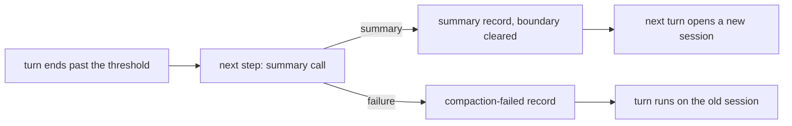

# Compaction

nixie compacts the conversation's session itself, between turns, and never inside one. When a turn
ends with its context past a share of the window, the next step asks the model for a summary against
fixed criteria, commits the summary to the event log, and clears the session boundary. The turn
after it opens a new session with the summary in its opening and no recent turns. The event log
therefore holds everything a new session opens with, and every forget reaches the summary as it
reaches the rest. [Session opening](./session-opening.md) covers the builder that reads the summary,
[conversation turns](./conversation-turns.md) covers the turn and the fork on each resume, and
[memory in context](../memory/context.md#forgetting-and-the-live-session) covers the session cleanup
that a forget runs. [0045](../../decisions/0045-session-opening-and-compaction.md) records the
choice.

The guest turns the CLI's auto-compaction off on every query, so nixie's compactor is the only way a
session shrinks, and every summary the model sees is one the event log holds.

## The compaction step

1. Each turn-ended record holds the context size and the window. A turn that ends at or past the
   threshold, a share of the window that the deployment configuration sets, asks its task to
   continue, so the compaction runs at once rather than with the user's next message.
2. A step whose session's last turn ended past the threshold runs the compaction before it takes the
   inbox, so a message that lands meanwhile waits for one model call.
3. The guest forks the session at its committed boundary, as a turn does, and runs the compaction
   instruction as one model call with no tools, so the summary cannot act. The tools are part of the
   cached prefix, so the call writes its cache afresh rather than reading the turn's.
4. The step commits the summary record and clears the session boundary in one transaction, and goes
   back to waiting. An unread inbox makes the task ready again, and the next turn opens a new
   session whose kind of start reads "after a compaction".

The step writes nothing before its commit, and the summary call leaves the session on disk as it
was. A rerun after a crash therefore forks from the same boundary, writes the summary again, and
only one copy commits.

## The instruction

The instruction tells the model that nixie closes the session, what the next session opens with, and
that the memory store and the event log keep everything. It asks for a summary written to itself, in
its own words, of the open threads, the decisions settled with their reasons, the outside events
that still matter, its own state and tone, and the user's recurring phrases word for word. It asks
the model to cite a longer passage by its event ID, to mark what it is unsure of, and to state no
fact about the user as settled, because the next session trusts the summary and a summary never
becomes memory. The text lives in the code beside its renderer, because its wording is tuned against
the model.

The model cannot count its own tokens, so the instruction gives a word target that nixie derives
from the token cap in the deployment configuration. The step counts the reply with the counter that
the rebuild budget uses. A summary over the cap gets one request, in the summary's own fork, to cut
it to the cap. A summary still over the cap commits with its size in the record, because a long
opening costs less than a failed compaction, and a failed cut request keeps the first summary.

## Failure and overflow

A failed compaction never blocks the inbox. The step commits a compaction-failed record with the
error and the count of failures in a row, in place of the summary. When the inbox holds messages,
the same step runs the turn on the old session and tries no second compaction. The next step tries
the compaction first again, because the session's last turn still ended past the threshold. Turns
therefore go on while the session stays inside the window, and a turn that overflows it fails like
any other step, so a broken compactor stops the conversation where the user sees it. The client
shows a notice from the first failure until a summary commits or a new session opens.

A turn can grow past the window on its own, such as from large tool results. The guest detects the
overflow on the result's terminal reason, which the CLI sets when it refuses the call and the model
API sets when it does, because no other failure gives either value. The step then compacts the
session from the last committed boundary, commits the summary with the overflow as its trigger, and
leaves the turn's messages unread, so the next step runs them on the new session. A turn that
overflows a new session fails for good. The CLI refuses a call below the model's own window and
ignores the profile's context cap once auto-compaction is off, so the threshold sits under the
window the CLI assumes.

## The summary record

The step commits each summary as a `model.session_summarized` record on the conversation's thread.
Its erasable fields hold the summary text, under a key that belongs to this record alone. Its
payload holds the last sequence the session covered, which the opening's builder reads, the boundary
it summarized, the trigger, the context size before the compaction, the summary's own size and
whether it took a cut request. It holds the model ID and the profile's ID from the profile nixie
gave the step, as every record of model output does.

A summary reaches the next session's opening and the client's live view, and nothing else. It never
becomes memory, and per-turn retrieval, the recall tools and the log-read tool never return it,
because the model wrote it from an untrusted conversation. A new summary leaves the older ones in
place, and the builder reads only the newest that is still readable.

## Forgetting

Every forget runs the session cleanup, and the cleanup deletes the key of every summary on the
conversation's thread after it commits the session-invalidated record and before it purges the
guest's transcripts. nixie cannot tell which summary holds the forgotten text without reading each
one, so it erases them all. The next session then opens as a rebuild with no summary, and its status
says that the forget erased the summary of earlier sessions.

A compaction that started before the forget can commit its summary after the cleanup erased the
others. The step that opens the rebuilt session therefore deletes every summary key again before it
builds the opening, so a late summary never reaches the model.
