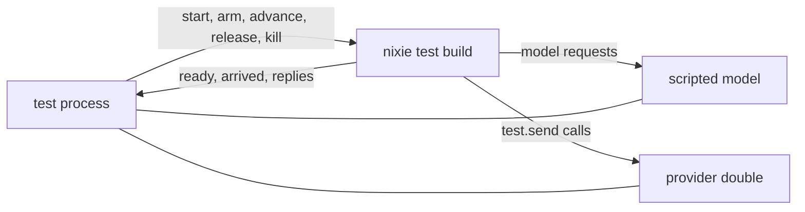

# Crash tests

A crash test runs nixie as a child process, holds one of its runners at a named fault point, kills
the process with `SIGKILL`, and starts it again on the same data directory. When the scenario ends,
the test checks the event log and the projections against one oracle. Every test ends with the same
oracle, so each one proves the same thing: a crash at that point loses nothing and repeats nothing.
The suites live in the server's `e2e/` folder, `apps/server/e2e/`. The harness that spawns nixie
lives in the server's test utilities, and the parts it builds on, such as the crash harness and the
doubles, live in `libs/testing`. [Leases and the restart sweep](./leases-and-restart-sweep.md)
covers the fault points and the restart sweep that each start runs. [Actions](./actions.md) covers
the action queue whose repeats the tests look for.

## The test build

The child process runs a test build of nixie: the same modules a release composes, with the test
pieces behind the test-build flag switched on ([code layout](../code-layout.md#test-builds)). It
runs from the test bundle that `bun run test:bundles` builds once for each set of sources, so a
start pays for no transpile. The bundle keeps each module's source folder, so its guests start from
their source as they do in an unbundled run. It writes the real event log, runs the real restart
sweep, task runners, action runners and tool endpoint, and runs each conversation turn through the
real Agent SDK. The SDK runs in a guest that the process sandbox adapter starts as a local child, so
CI needs no `/dev/kvm` and no imp. Beside the fault points that later sections list, the test build
adds these test-only parts:

- The test connector declares one queued action, `test.send`, which the test rule allows. The
  release build's rules in code hold no such rule, so no release build can queue it.
- A test task kind sets a durable timer on its first step, records which inbox entries each step
  read, and finishes when its inbox holds a finish request, so a test can see a wake-up, a timer
  fire and a task that stays done.
- A harness link connects the process to the test over an IPC channel.
- A fake speech layer stands in for the speech provider when the config holds a `voice` section. The
  harness operations `placeHarnessCall`, `emitSpeech` and `readSpeechCalls` start a call as the user
  and play the provider, so a test hands a request off with no device.
- The process kills every guest it started before it exits on its own, as on a graceful stop or a
  stale writer epoch. A guest leads its own process group and would otherwise outlive nixie, which a
  host that loses nixie never allows.

The release build also drops these test-only paths:

- `NIXIE_TEST_ATC_URL` points the coding runner at a double of atc-gateway, because the
  configuration accepts only an `https` URL.
- `NIXIE_TEST_GOOGLE_URL` points the browser at the authorize page of a fake Google, which the fake
  serves on a plain HTTP loopback site. `NIXIE_TEST_GOOGLE_API_URL` holds the URL of the fake's
  HTTPS site, and `NIXIE_TEST_GOOGLE_API_CA` holds the self-signed certificate that site serves. The
  credential store sends each token, revoke and API request for a `.google.test` host to that site.
- The OAuth client accepts an `http` loopback origin, so a local run can register one.

The server's action queue bridge, which the test build composes like any other part, maps the thread
of a running step to that step's claim. It queues each allowed call under that claim with the
[action hash](actions.md#queuing-a-call) of the call. The bridge sorts every object's keys before it
hashes, so a rerun that sends the same arguments in another key order matches the action it queued.

## The harness link

The test drives the child, and the child answers, over one channel. The link inside nixie has these
parts:

- **The clock.** Every lease, timer, retry delay and poll in the child reads one test clock. It
  starts at the time the test passes and moves only when the test asks it to advance. The test
  carries the clock's time from one process to the next, so a restart never moves time backwards. No
  test sleeps to let time pass.
- **The work tracker.** The test can have an advance wait until the runners settle, and then knows
  that they finished the work the advance made due. Each claim and run of a claim pool counts as
  work, and so do each lease renewal and each read that turns a commit into a wake of the pools, so
  a runner that another runner wakes keeps the advance waiting. A runner held at a fault point
  counts as settled, because only the test moves it on. Work that waits on a reply the test holds
  back, such as a gated provider call, never settles, and the advance reports that it did not
  settle.
- **The fault points.** The test arms a fault point at start, or later over the channel. An arm can
  name the kind of work, its ID, and how many times it holds. A runner that reaches an armed point
  reports its arrival and waits. Other runners carry on. The test then releases the runner or kills
  the process.
- **Operations.** The test build registers operations that the test calls by name, such as sending a
  message to a thread or creating a task. The stale-writer test uses one that closes the process's
  writer-lock descriptor without stopping it, as a bug would. Another writes a note and starts its
  forget as a tool call does, so the forget's session cleanup runs beside the test's other work.

A kill sends `SIGKILL` to the process and to every descendant, so a conversation guest dies with the
nixie process that started it, as it does when a host reboots.

## The doubles

The scripted model and the provider double run in the test process, outside the process the test
kills, so their records survive every kill.

The scripted model serves the Messages API from a script that each test writes, such as "call
`test.send` with these arguments, then end the turn". It records every request. A reply can wait on
a gate that the test opens, which holds a turn mid-flight for the graceful-stop tests.

The provider double records every `test.send` call with its idempotency key. The test scripts each
reply: a success, a refusal that can clear with an optional delay, a refusal with no effect, or a
dropped connection. A reply can wait on a gate. With no reply left in its script, the double refuses
the call, so an unplanned call fails its test.

## The oracle

Each start of nixie holds at the end of its restart sweep, before any runner claims work, while the
test reads the leases and the tasks that the sweep left. After the last kill, the oracle runs the
restart sweep once more in the test process, as a last restart, then checks:

- Each step key has at most one commit, and one step queues each call it makes as one action.
- Each provider call carries the idempotency key of an action's attempt, and no action has more
  calls than it has attempts.
- No task holds a lease after any start's restart sweep.
- After any start's restart sweep, no task is running, and no waiting task has unread input.
- A task that reached an end state keeps it in every later read.
- Every projection table, rebuilt from the log, equals the live one.

A test asserts that every list the oracle returns is empty. The scenario's own checks, such as the
retry delays or the unknown outcome after a kill between an attempt record and its result, sit
beside the oracle in the test, as do the erasure checks that the section on the erasure runner
lists.

## Fault points of the record forget

A forgotten record can leave evidence quotes in memory items. The evidence purge of a
[record forget](../memory/store.md#the-evidence-purge) removes them, and it holds at 5 fault points,
one for each row of its kill table. Each point sits behind the test-build flag. A test arms a point,
makes the forget or the purge reach it, stops nixie there and starts it again, and checks that the
purge finishes and the current text of each item still reads. `recover-record-forget-purge.test.ts`
does this. The next section covers the erasure runner.

| Fault point                 | Reached                                                   |
| --------------------------- | --------------------------------------------------------- |
| `record.forget.started`     | after the forget's first transaction, before any key goes |
| `memory.purge.keys_created` | after an item's new keys, before its closing commit       |
| `memory.purge.closed`       | after the closing commit, before the key deletes          |
| `memory.purge.keys_removed` | after the key deletes, before `memory.evidence_purged`    |
| `record.forget.purged`      | after every item's purge, before `record.forgotten`       |

Beside the oracle, this suite checks one more case. It starts the previous release on the data after
each kill, and checks that it finishes the purge too, so a rollback by one release in the middle of
a record forget loses nothing. The case covers only the record forget: a memory item forgets through
the erasure runner, and a release before that runner cannot open the data, as
[forgetting](../memory/store.md#forgetting) says. The case runs the previous release's test build,
which the e2e lane builds from the release's tag, because the release build stops at the parts of a
start that need a real sandbox.

## Fault points of the erasure runner

The [erasure runner](../memory/store.md#forgetting) forgets each of the 8 kinds in
`erasableKindSchema`, such as a memory item, a note or a connection's credential. It holds at 6
fault points behind the test-build flag, in the order of its steps. `recover-erasure.test.ts` arms
each point but `erasure.revoked` for a note and for a memory item.
`recover-connection-forget.test.ts` arms `erasure.begun` and `erasure.revoked` for a connection's
forget. No test arms them for a moment. A test arms a point, makes the forget reach it, stops nixie
there and starts it again. The test then checks these beside the oracle, which does not know about
erasures:

- The erasure finishes.
- None of the target's encryption keys remains in the key store. These are the keys of its
  [key family](../memory/store.md#forgetting), which `erasure.started` names, and deleting them is
  what makes the target unreadable.
- `erasure.finished` follows `erasure.started`.

| Fault point                   | Reached                                                                                                    |
| ----------------------------- | ---------------------------------------------------------------------------------------------------------- |
| `erasure.begun`               | after `erasure.started` commits, and when a run of the open erasure begins, before any sandbox or key goes |
| `erasure.sandboxes_destroyed` | after the code sandboxes, before each target's revoke                                                      |
| `erasure.revoked`             | once every pending target is revoked, before the keys                                                      |
| `erasure.keys_removed`        | after the key deletes, before the session cleanup                                                          |
| `erasure.cleaned`             | after the session cleanup, before the turn inputs                                                          |
| `erasure.turn_inputs_removed` | after the turn inputs, before `erasure.finished`                                                           |

## Fault point of a credential refresh

`credential.refresh.token_saved` sits behind the test-build flag, in the credential database
backend, after the commit of the transaction that saves a refreshed token and its
`credential.refresh_saved` record. `recover-credential-refresh.test.ts` arms it, kills nixie there,
and checks that the restart finds the token and the record together and leaves the credential
active. See [credentials](../connectors/credentials.md#refresh).

## Fault point of a live reply

`turn.reply.after` sits behind the test-build flag, after the transaction that writes a live
`model.reply`. A test arms it, kills nixie there, starts nixie again, and checks that the crash
sweep wrote a `model.reply_voided` record for the reply, and that the rerun's model request holds
none of its text. `recover-reply-voided.test.ts` does this, and checks the same void after a failed
attempt that did not crash.

`time.now.running` sits behind the same flag, inside the `time.now` tool, so it holds a tool call
that is executing. A journey arms it to land an owner message, and to reload the page, while a call
is open, and then releases it.

`session.checked` sits behind the same flag, right after a session token passes its check in the
API. A unit test of the page form of `live.follow` sets a handler that revokes the session there,
and checks that the stream still ends with `UNAUTHORIZED`.

## The graceful stop

`sigterm.grace` sits behind the test-build flag, in the claim pool's stop, after the stop begins and
while a step is still running. The graceful-stop suite, `stop-graceful.test.ts`, holds the stop
there, sends `SIGTERM`, and advances the clock through the grace. It checks that a step which ends
inside the grace commits once, and that a step still running at the deadline is left to the next
start's restart sweep. Another test holds a turn at `turn.reply.after` and calls the harness
operation that writes a note and starts its forget. The forget's session cleanup then waits on a
turn that never ends. The test checks that nixie still exits with code 0 once the grace has passed
and that no `model.session_cleanup_completed` record exists. A shutdown ends the cleanup's waits, so
a stalled turn cannot hold the stop.

The next start runs that cleanup again. The rerun of an aborted turn answers only the messages that
the turn's kept reply had not read, as [Conversation turns](./conversation-turns.md) explains. The
conversation runner's unit tests cover that rerun, and no crash test does.

## Coverage

The [crash tests design](../../design/platform/core/crash-tests.md#slice-1-tests) lists the slice 1
tests and their variants. Each test is one `recover-*.test.ts` file in `apps/server/e2e/`. Two
variants wait on parts that nixie does not have. The wake-up from a trigger event needs a trigger
source, and the second writer that runs the restore command needs that command.
