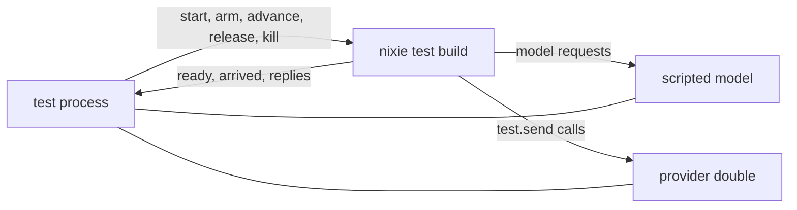

# Crash tests

A crash test runs nixie as a child process, holds one of its runners at a named fault point, kills
the process with `SIGKILL`, and starts it again on the same data directory. When the scenario ends,
the test checks the event log and the projections against one oracle. Every test ends with the same
oracle, so each one proves the same thing: a crash at that point loses nothing and repeats nothing.
The suites live in the root `e2e/` folder, and the harness parts live in `libs/testing`.
[Leases and recovery](./leases-and-recovery.md) covers the fault points and the recovery that a
restart runs. [Actions](./actions.md) covers the action queue whose repeats the tests look for.

## The test build

The child process runs a test build of nixie: the same modules a release composes, with the test
pieces behind the test-build flag switched on
([code layout](../../design/platform/code-layout.md#test-builds)). It writes the real event log,
runs the real recovery, task runners, action runners and tool endpoint, and runs each conversation
turn through the real Agent SDK. The SDK runs in a guest that the process sandbox adapter starts as
a local child, so CI needs no `/dev/kvm` and no imp. The test-only parts are four:

- The test connector declares one queued action, `test.send`, which the test rule allows. The
  production rule set stays read-only, so no release build can queue it.
- A test task kind sets a durable timer on its first step and records which inbox entries each step
  read, so a test can see a wake-up and a timer fire.
- The action queue bridge maps the thread of a running step to that step's claim, and queues each
  allowed call under it with an action hash built from the tool and its arguments. The bridge sorts
  every object's keys before it hashes, so a rerun that sends the same arguments in another key
  order matches the action it queued.
- A harness link connects the process to the test over an IPC channel.

## The harness link

The test drives the child through one channel, and the child answers on the same channel. The link
inside nixie owns three things:

- **The clock.** Every lease, timer, retry delay and poll in the child reads one test clock. It
  starts at the time the test passes and moves only when the test asks it to advance. An advance can
  wait until every sleeper it woke has slept again, so the test knows that the runners finished the
  work that the advance made due. The test carries the clock's time from one process to the next, so
  a restart never moves time backwards. No test sleeps to let time pass.
- **The fault points.** The test arms a fault point at start, or later over the channel. An arm can
  name the kind of work, its ID, and how many times it holds. A runner that reaches an armed point
  reports its arrival and waits. Other runners carry on. The test then releases the runner or kills
  the process.
- **Operations.** The test build registers operations that the test calls by name, such as sending a
  message to a thread or creating a task. The stale-writer test uses one that closes the process's
  writer-lock descriptor without stopping it, as a bug would.

A kill sends `SIGKILL` to the process and to every descendant, so a conversation guest dies with the
nixie process that started it, as it does when a host reboots.

## The doubles

The scripted model and the provider double run in the test process, outside the process the test
kills, so their records survive every kill.

The scripted model serves the Messages API from a script that each test writes, such as "call
`test.send` with these arguments, then end the turn". It records every request. A reply can wait on
a gate that the test opens, which holds a turn mid-flight for the graceful-stop tests.

The provider double records every `test.send` call with its idempotency key. The test scripts each
reply: a success, a refusal that can clear with an optional delay, a refusal with no effect, or a
dropped connection. A reply can wait on a gate. With no reply left in its script, the double refuses
the call, so an unplanned call fails its test.

## The oracle

The oracle runs recovery once more in the test process after the last kill, then checks:

- Each step key has at most one commit, and each action ID has at most one queue entry.
- Each provider call carries the idempotency key of an attempt that an action made.
- No task holds a lease.
- A running or waiting task with unread input and no hold is `ready`.
- A task in an end state keeps it.
- Every projection table, rebuilt from the log, equals the live one.

A test asserts that every list the oracle returns is empty. The scenario's own checks, such as the
retry delays or the unknown outcome after a kill between an attempt record and its result, sit
beside the oracle in the test.

## Coverage

The [crash tests design](../../design/platform/core/crash-tests.md#slice-1-tests) lists the slice 1
tests and their variants. Each test is one file under `e2e/crash/`. Two variants wait on parts that
nixie does not have. The wake-up from a trigger event needs a trigger source, and the second writer
that runs the restore command needs that command.
