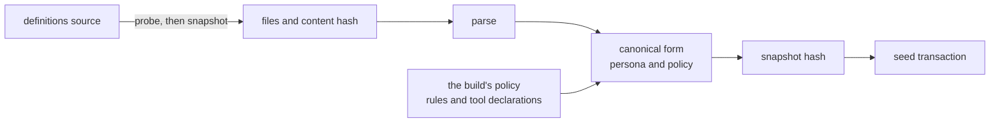

# The definitions

The definitions are the user's own configuration of nixie: the persona, jobs, rules and skills, kept
outside the nixie repo in a definitions source such as a git repo or a local directory. nixie reads
them as a snapshot of files, parses what it applies, and seeds them into the database under a
snapshot hash. Every record in the [event log](./event-log.md) carries the snapshot hash of the
definitions in force when it was written, so a replay of any decision can read exactly the persona
and policy it ran under, as [0013](../../decisions/0013-definition-versioning.md) requires.
`modules/definitions` owns sources, the seed and the snapshot hash. The seed applies only the
persona, and the [skills design](../../design/platform/skills.md) and the
[rules design](../../design/platform/policy/rules.md) cover the files it reads but does not apply.

A snapshot has two hashes, and they answer different questions. The content hash covers the source
files, so the same files give the same hash from any source. The snapshot hash covers the
definitions in force, which include the build's policy as well as the files, so the same files under
two releases can give two snapshot hashes.

## Sources

A source has a probe and a snapshot. The probe returns a token that changes when the definitions
change, so a poll takes a snapshot only on a token that has not seeded yet. A snapshot holds the
files by path relative to the definitions root, a revision, the content hash, and the paths the
source skipped. The local path source is the one source built, and it lives in the module because it
reaches nothing outside nixie. A directory has no commit, so the path source uses the content hash
as both its revision and its probe token.

A source reads only the known definitions paths: the manifest and the persona at the root, and the
jobs, rules and skills folders. It skips every other entry at the root by name, without reading or
entering it, so that entry never enters the content hash, never has to parse, and never counts
towards the size limits. A definitions repo can then hold its own docs and scripts, and editing a
readme never makes a new definitions version. The snapshot still lists every skipped root entry, so
a misnamed folder such as `rule/` shows in the seed's record instead of its rules going unread
without a trace.

Within the known paths, every source applies one filter. It skips every path with a part that starts
with a dot, such as `.git`. It keeps every file under `skills/`, whatever its extension, because a
skill brings its scripts. It keeps only markdown, YAML and JSON files under `jobs/` and `rules/`.
Every kept file must decode as UTF-8 text, so a binary file under `skills/` fails the snapshot. A
snapshot past the per-file or the total size limit fails too, and its error lists the files at
fault.

The path source never follows a link out of the root: a symlink that stays inside the root is
skipped, and one that leads outside it, or resolves nowhere, fails the snapshot. A file can change
between the walk and the read, so the source checks each kept file again when it opens it and
refuses one that turned into a link. No file from outside the definitions ever reaches the seed.

The content hash covers a format version line, then each file in path order with its path, its byte
length and its own hash. Every source turns CRLF line endings into LF before it hashes, and git
metadata, mode bits and file times never enter the hash. A git commit and a checkout of it, on any
platform, therefore give the same hash. A run that read one set of definitions from a git commit and
from a local directory got one hash from both, and a persona file saved with CRLF endings hashed the
same as its LF copy once normalised. Without that step a Windows checkout with `core.autocrlf` on
would give the commit a second hash.

## The definitions format

The manifest holds the definitions format version. A release reads its own format and the one before
it, and refuses any other, because an image upgrade and a definitions change land in separate repos,
in either order. The persona must be UTF-8 text and not blank. The seed applies no other file, and
lists each one in its record as unapplied. Each unapplied YAML or JSON file must still parse, so a
broken rule file fails the snapshot before rules ever apply, and the error lists each file with its
fault.

nixie owns the format, and each release publishes the manifest's rules as a JSON Schema, the
`definitions-manifest.schema.json` asset, so a definitions repo checks its manifest against the
formats a release reads without a copy of nixie. The seed parses the manifest with the same schema
that the published one comes from, and a test fails when the committed file differs from it. The
published schema covers the manifest alone, so only the seed checks the persona and the other files.

## The snapshot hash

The snapshot hash is the hash of one canonical form of the definitions in force. The persona enters
that form by its own hash, its persona version, after nixie normalises it to Unicode NFC with LF
line endings, no byte order mark and exactly one final newline. Trailing spaces stay, because two of
them end a markdown line with a break. The policy enters as the rules sorted by ID and the tool
declarations sorted by name, each tool's effects sorted and without duplicates. Every object
serialises as canonical JSON, with sorted keys and no whitespace, so the same definitions always
give the same bytes.

The policy holds the fixed rule and every tool declaration in the build's registry. The fixed rule
decides by a tool's declared effects ([the decision point](../policy/decision-point.md)), so a
replay needs the declarations that were in force. A release that changes a tool declaration
therefore changes the snapshot hash over the same files. A probe token follows the files alone, so
the change enters with the next seed the release runs, which compares the snapshot hash as well as
the revision.

## Seeding

A seed reads and parses a snapshot, builds its snapshot hash, and writes four things in one write
transaction: the persona under its persona version, the snapshot under its snapshot hash, a seed
record, and a seed row that ties the source and its revision to both hashes. A persona or a snapshot
seen before keeps its first row. The definitions in force are the newest seed, and every record
takes its snapshot hash from it.

| Result    | When                                                                      | Writes  |
| --------- | ------------------------------------------------------------------------- | ------- |
| Seeded    | The source, revision, content hash or snapshot hash differs from the last | 4 rows  |
| Unchanged | The newest seed holds the same source, revision and both hashes           | Nothing |
| Refused   | The snapshot failed to read, parse or validate                            | Nothing |

A refused seed comes back as a value with its error and the definitions still in force, never as a
throw, so the caller reports the refusal while the last good seed keeps serving. A half-applied seed
would leave definitions from two revisions in force at once. A failure inside the transaction, such
as a projection's fold, therefore rolls the whole seed back and throws. The caller runs one seed at
a time, because two overlapping seeds could commit an older revision after a newer one.
