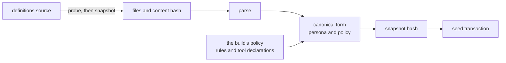

# The definitions

The definitions are the user's own configuration of nixie: the persona, task definitions, rules and
skills, kept outside the nixie repo in a definitions source such as a git repo or a local directory.
nixie reads them as a snapshot of files, parses what it applies, and seeds them into the database
under a snapshot hash. Every record in the [event log](./event-log.md) carries the snapshot hash of
the definitions in force when it was written, so a replay of any decision can read exactly the
persona and policy it ran under. `modules/definitions` owns sources, the seed and the snapshot hash.
The seed applies the persona, the skills and the task definitions, and the
[rules design](../../design/platform/policy/rules.md) covers the rule files it reads but does not
apply.

A snapshot has two hashes, and they answer different questions. The content hash covers the source
files, so the same files give the same hash from any source. The snapshot hash covers the
definitions in force, which include the build's policy as well as the files, so the same files under
two releases can give two snapshot hashes.

## Sources

A source has a probe and a snapshot. The probe returns a token that changes when the definitions
change, so a poll takes a snapshot only on a token that has not seeded yet. A snapshot holds the
files by path relative to the definitions root, a revision, the content hash, and the paths the
source skipped. The local path source is the one source built, and it lives in the module because it
reaches nothing outside nixie. A plain directory has no commit, so the path source uses the content
hash as both its revision and its probe token.

A git-sync sidecar checks each commit of the definitions repo out as a linked git worktree, and the
path source reads that commit from the files git keeps beside the checkout, without running git.
When the root resolves to a linked worktree with a detached HEAD, whose `HEAD` file holds a commit
ID in place of a branch name, that commit becomes the revision. The source names the repo by the
origin URL in the repo's git config, with any user name, password, query and fragment removed,
because a sync can carry its credential in that URL. The probe token joins the commit and the repo
to the content hash, so a new commit or a new origin over the same files seeds again. A checkout on
a branch, or a directory with no git file, keeps the content hash as its revision and names no repo.

A source reads only the known definitions paths: the manifest, `nixie.yaml`, and the persona at the
root, and the `budgets`, `effects`, `prompts`, `rules`, `skills` and `tasks` folders. It skips every
other entry at the root by name, without reading or entering it, so that entry never enters the
content hash, never has to parse, and never counts towards the size limits. A definitions repo can
then hold its own docs and scripts, and editing a readme never makes a new definitions version. The
snapshot still lists every skipped root entry, so a misnamed folder such as `rule/` shows in the
seed's record instead of its rules going unread without a trace.

Within the known paths, every source applies one filter. It skips every path with a part that starts
with a dot, such as `.git`. It keeps every file under `skills/`, whatever its extension, because a
skill brings its scripts. It keeps only `.yaml`, `.md` and `.ts` files under `tasks/`, and only
markdown, YAML and JSON files under `effects/`, `prompts/` and `rules/`. Every kept file must decode
as UTF-8 text, so a binary file under `skills/` fails the snapshot. A snapshot past the per-file or
the total size limit fails too, and its error lists the files at fault.

The path source never follows a link out of the root: a symlink that stays inside the root is
skipped, and one that leads outside it, or resolves nowhere, fails the snapshot. A file can change
between the walk and the read, so the source checks each kept file again when it opens it and
refuses one that turned into a link. No file from outside the definitions ever reaches the seed.

The content hash covers a format version line, then each file in path order with its path, its byte
length and its own hash. Every source turns CRLF line endings into LF before it hashes, and git
metadata, mode bits and file times never enter the hash. A git commit and a checkout of it, on any
platform, therefore give the same hash, and a persona file saved with CRLF endings hashes the same
as its LF copy. Without the CRLF step, a Windows checkout with `core.autocrlf` on would give the
commit a second hash.

## The definitions format

The manifest holds the definitions format version. A release reads its own format and the one before
it, and refuses any other, because an image upgrade and a definitions change land in separate repos,
in either order. The persona must be UTF-8 text and not blank. From format 2, the seed applies each
skill under `skills/`. From format 3, it applies the prompt overrides in the manifest's `prompts:`
map, as [prompts](prompts.md#overrides-from-the-definitions) describes, and format 2 leaves that map
and its files unapplied. Format 3 also applies each `rules/*.yaml` file as a rules file, as
[rules in force](../policy/rules.md#rules-in-force) describes, except a file that the `prompts:` map
names as a prompt part. Format 3 therefore refuses a repo whose existing rule files fail the
[rule format](../policy/rules.md#the-rule-format), and the error lists each file with its fault. The
seed applies each folder under `tasks/` as a [task definition](#task-definitions) from format 4, and
lists the `tasks/` files of an older format as unapplied. From format 5, it applies each
`budgets/*.yaml` file as [budgets](../policy/budgets.md#the-budget-format), and lists those files of
an older format as unapplied. The prompt and task exports raise the manifest's `format` line to the
format they need, as [prompts](prompts.md) and
[the export of task definitions](#the-export-of-task-definitions) describe. The seed applies no
other file, and lists each one in its record as unapplied. Each unapplied YAML or JSON file must
still parse.

nixie owns the format, and each release publishes the manifest's rules as a JSON Schema, the
`definitions-manifest.schema.json` asset, so a definitions repo checks its manifest against the
formats a release reads without a copy of nixie. The seed parses the manifest with the same schema
that the published one comes from, and a test fails when the committed file differs from it. After a
change to the manifest's rules, `bun run --cwd modules/definitions manifest-schema` rewrites the
committed file. The published schema covers the manifest alone, including the prompts and parts that
a `prompts:` map may name, so only the seed checks the persona, the other files, that each listed
skill exists and that each prompt override reads only the paths its prompt accepts.

## Skills

A skill is a folder under `skills/` in the
[Agent Skills format](https://agentskills.io/specification), whose `SKILL.md` opens with YAML
frontmatter. The seed refuses the whole snapshot when any skill fails one of its checks, and the
error lists each file with its fault:

1. The `SKILL.md` frontmatter follows the format's rules for its name, description, compatibility
   and metadata fields, and its name matches the folder's name. The seed ignores the fields the
   format leaves to each product, and keeps `allowed-tools` only to show it, because a skill grants
   nothing.
2. Every file is UTF-8 text within the size limits, which the filter checks for every source.
3. No file holds an invisible or bidirectional control character, such as a tag character, a
   zero-width space or a right-to-left override, because such a character hides text from the person
   who reviews the skill. Tab, line feed and carriage return stay, and so do the emoji variation
   selectors.
4. A vendored skill's files hash to the content hash in its entry in `skills/skills.lock.json`, and
   every entry matches a skill folder.

A skill's content hash is the content hash over its own folder, with each path relative to that
folder, so the user computes it by hand from a checkout with the snippet in
[vendoring a skill](../../guides/vendoring-a-skill.md). A skill with a lock entry is vendored, and
any other skill is the user's own. Each skill version lives under its content hash with its
frontmatter and its files, and the version stays after a later seed changes the skill, so a task
pinned to it keeps reading it. A new or changed skill applies with the seed, with no confirmation,
because a skill widens nothing. The seed's record lists the skills it added, changed and removed
against the definitions it replaced, as the skill notice.

The seed stores the conversation's skill list from the manifest's `skills` field, and the list holds
every skill when the field is unset. A listed name with no skill folder fails the snapshot, because
a misspelled name would otherwise drop a skill without a trace. The list enters the snapshot hash
beside the skills.

### Skills that nixie wrote

A skill that nixie wrote goes into force when the user approves it, or at once under an allow rule
that names `skill_write`, as [writes under a rule](./skills.md#writes-under-a-rule) describes,
before the user's definitions hold it. The store of written skills keeps one row for each approval
or rule that applied a skill: the version, an approval ID, the ID of the proposal or of the write
under a rule, and the version of the skill in the user's definitions when it applied, which is the
base. Each seed lays every written skill in force over the skills it parsed, so the written version
replaces the definitions' version, or joins the skills when the definitions lack it. A new written
skill joins the conversation's skill list, because the conversation wrote it, and a written version
of an existing skill keeps that skill's place on the list. The snapshot hash covers the result with
each written skill's origin as nixie and the approval that applied it, so every record names the
skills that nixie wrote, and a version that a later approval brings back gets a snapshot of its own.

The seed compares each written skill with the definitions' version of it:

- **The definitions hold the written version.** The user merged it, so the seed marks the written
  skill adopted and the skill's origin becomes the definitions. The written skill's row records the
  definitions' version and its origin, and the export closes on its next run. Every seed checks each
  adopted skill for that record, so an adoption that lacks it gets it at the next seed. An approval
  of the version the definitions already hold is adopted at its own seed, which records the adoption
  though the skills in force stay the same.
- **The definitions hold the base, or lack a new skill.** The written skill stays in force.
- **The definitions hold another version.** The user changed the skill before the written version
  reached the definitions. The written skill stays in force, and its row keeps the definitions'
  version beside the base, which shows the conflict. The user resolves it through the skill host
  commands: keeping nixie's version makes the definitions' version its base, and keeping the
  definitions' version retires nixie's. Each choice is a record.

An approval or a retirement takes effect at once through a seed of the definitions in force: it
reads the user's skills back from the seed in force and lays the written skills over them again,
without a fresh snapshot from the source. The store keeps the change when that seed fails, and the
definitions poll seeds again while the store and the snapshot in force disagree, even on an
unchanged source. A second approved version of a written skill supersedes the first and keeps its
base. Each state change goes through one transition table, in which only a written skill in force
moves, once: to adopted, superseded or retired.

#### The export to the definitions repo

nixie exports each written skill in force to the user's definitions repo as a pull request, and the
user merges it. The export runs at start, after each approval and each choice on a conflict, and on
a fixed interval that retries a failed export. Each skill has one branch, which the export builds
again on the base branch's newest commit, so a later approval of the same skill updates the open
pull request. Each export pins that commit once and reads the skill's folder at it, so the change
writes the skill's folder and removes each file that the folder holds at that commit and the written
version lacks. It also removes a vendored skill's lock entry, so the seed after the merge reads the
folder as the user's own skill and marks the written skill adopted.

The export serves any kind of approved change, and nixie registers 4 kinds: a written skill, an
approved [prompt override](./prompts.md), the
[runtime rule changes](../policy/rules.md#the-rule-export), and the
[runtime task definition changes](#the-export-of-task-definitions). Each change kind reads the
approvals due for export and the exports to close, builds the branch, files, title and body of each
pull request, and stores the state of its own exports. The export run marks, records and closes an
export the same way for every kind. When the close of an export fails, the run skips any export due
on the same branch until a later run closes it.

Every export run closes the export of each approval that left force, whether a seed adopted it, a
later approval superseded it, or the user retired it. Export runs never overlap, so a seed and an
approval change only the written skill's state and leave its export to the next run. An export
checks that its approval is still in force in the transaction that marks it in flight and in the one
that records its pull request, and closes at once when it is not. A retired skill's pull request
closes. An adopted skill's pull request usually merged, so the run closes only an open one on the
skill's branch. A superseded approval leaves its pull request open, because the approval after it
exports on the same branch. The export run never closes a pull request while the export of another
approval records that pull request as open.

A choice on a conflict changes the export. Keeping nixie's version gives the skill a new base, and
the export builds the pull request again on it. Keeping the definitions' version retires the skill,
and the export closes its pull request. The export records itself before it writes to the repo, so
when an export run stops before it records the pull request it opened, the close finds that pull
request by the skill's branch. A new skill joins the conversation's list through the overlay alone,
so when the manifest lists the conversation's skills, the pull request asks the user to add the
skill to that list. The seed refuses definitions at format 1, so it never adopts a skill merged into
them. When the manifest holds format 1, the pull request tells the user to move it to format 2 with
the merge.

The export runs only when the configuration names the definitions repo on GitHub. It writes through
GitHub's REST API with a fine-grained token that holds contents and pull-requests write on that one
repo, and the token lives in the secrets file under `definitions_export_token`. A configuration that
names the repo without the token stops nixie at start. Without the repo, a written skill stays in
force over the definitions until the user copies it into them.

Two optional templates under `definitions.export` set the export's text: `title` for the commit
subject and the pull request's title, and `message` for the commit body and the pull request's body.
The export fills each `{name}` placeholder with its value: `{skill}`, `{operation}` (`add` or
`update`), `{agent}` and `{owner}` (the configured names of the agent and the user), and
`{approval}` and `{proposal}` (their IDs). The message template takes `{notes}` too, which holds the
notes that the export writes without a template. nixie refuses a configuration whose template holds
any other placeholder, and names that placeholder. Without a message template, the commit holds the
title alone and the pull request's body holds the notes.

## Task definitions

A task definition is a folder `tasks/<id>/`. Its name is the definition ID, 1 to 64 characters from
`a-z`, `0-9` and `-`. The folder holds a required `task.yaml`, an optional `instructions.md`, and
one step file, a `.ts` file that `step.file` names. The seed never runs a step file, and it hashes
the file.

`task.yaml` holds the keys of the `task.start` input of the sandbox runner (`name`, `brief`,
`model`, `persona`, `memory`, `log`, `tools`, `report`, `reportShape`, `limits`) and these keys of
the definition:

| Key            | Value                                                                             | Default |
| -------------- | --------------------------------------------------------------------------------- | ------- |
| `enabled`      | boolean                                                                           | `true`  |
| `trigger`      | `{ schedule }` or `{ at }`, as the contract library's `Trigger` type defines them | none    |
| `context`      | `fresh` or `continuing`                                                           | `fresh` |
| `wakeable`     | boolean                                                                           | `false` |
| `step`         | `{ file, api: 1 }`                                                                | none    |
| `destinations` | a list of destination patterns, as a rule's `destinations` list takes them        | `[]`    |
| `maxCalls`     | a map from a listed tool name to a whole-number cap of 1 or more                  | `{}`    |

The parser takes the decoded texts of the files and never reads the source. For each folder, it
checks in this order:

1. The folder: a bad ID or a missing `task.yaml`.
2. The YAML: text that is not YAML, or not a mapping.
3. The unknown fields. A key that no schema of `task.yaml` knows, at any depth, skips the
   definition: the seed loads no part of it, lists its files as unapplied, and logs a warning that
   names the definition and the dotted path of the field. A `runner` key, or a trigger that holds
   only `log` or `poll`, is an unknown field.
4. Every other fault, which refuses the seed.

A definition may name a tool in `tools` by nixie's own name, such as `web_fetch`, or by the
[SDK name](../connectors/tool-calls.md#tool-names) the model sees, such as `mcp__nixie__web_fetch`.
The parser drops a name that is neither a registered tool nor the SDK name of one, with a warning,
before it takes the hash. The parsed `task.yaml`, which the hash covers, lists the base tools that
every task holds first: `tasks.list`, `task.message` and `task.report`. Then it lists each kept tool
under nixie's own name. To check each name, the parser takes the registered tool names from the
server. It also runs the server's check of a start: the sandbox runner's plan, with the bounds of
the conversation's `task.start`. A definition in `tasks/` may list any registered tool except a
conversation tool, which [changes from the conversation](#changes-from-the-conversation) describes,
and a memory tool unless its `memory` is `read`.

One fault refuses the whole seed, and the definitions of the last accepted seed stay in force. The
refusal is a `TaskSeedRefusedError`, a kind of definitions parse error. Its `problems` field, which
every definitions parse error has, and its own `faults` field both list each file's path with its
fault code:

| Code                | Path              | Cause                                                                                                 |
| ------------------- | ----------------- | ----------------------------------------------------------------------------------------------------- |
| `bad_id`            | the folder        | an ID outside the pattern                                                                             |
| `missing_task_yaml` | the folder        | a folder with no `task.yaml`                                                                          |
| `unnamed_step_file` | the `.ts` file    | a `.ts` file that `step.file` does not name                                                           |
| `bad_slot`          | `instructions.md` | a slot that the `task` prompt does not accept, which includes every `trigger.*` and `inputs.*` slot   |
| `target_removed`    | `task.yaml`       | a `target` key, which no definition reads, because every definition runs as a task; delete the line   |
| `bad_schedule`      | `task.yaml`       | a trigger that breaks a rule of `Schedule`                                                            |
| `at_without_offset` | `task.yaml`       | an `at` date-time with no offset or `Z`                                                               |
| `start_refused`     | `task.yaml`       | start keys that fail the start schema, or a start that the check refuses                              |
| `bad_max_calls`     | `task.yaml`       | a cap below 1, or a cap on a tool that `tools` lacks                                                  |
| `bad_definition`    | `task.yaml`       | text that is not a mapping, a wrong value in a key of the definition, or a step file the folder lacks |

A file directly under `tasks/`, a nested folder, and any `.yaml` or `.md` file other than
`task.yaml` and `instructions.md` belong to no definition, and the seed lists them as unapplied
without reading them, so a malformed one is no fault.

The definition hash covers the folder name, the parsed `task.yaml` with the defaults filled, as
canonical JSON, the hash of `instructions.md` after the same normalisation as the persona, and the
hash of the step file. Two folders with the same content hash differently, because the folder name
is in the hash. A comment in `task.yaml` leaves the hash unchanged, and an edit of `instructions.md`
changes it. The form omits the start keys that a file leaves out, so nothing from the configuration
enters the hash.

The seed stores each accepted version in `task_definition_versions`, keyed by its hash, with its
form and its files. nixie never deletes a row. `readDefinitionVersion` reads one by hash, and fills
each start key the file omits with the value that a `task.start` leaving out that key gets: no
model, no profile, the default persona, memory `none`, the task's own log (`own`), and the default
tools. When the version lists `tools`, the reader puts the base tools first. A version that an older
parser stored can list only its own tools, or the SDK names of tools. The base tools reach its task
runs from the reader, and the [tool endpoint](../connectors/tool-calls.md) maps each SDK name to
nixie's own when a task run starts.

## The task of a definition

Each enabled definition has one task, which `task.definition_set` binds to the definition. The seed
creates it in the seed's own transaction, with a `task.created` record that has no starter, and the
record `task.definition_set` then holds the definition ID and the hash in force. A seed that changes
the hash writes the record again. A seed that drops the definition or disables it writes it with a
null hash, and the task stays: its history and any open task run outlive the definition. A task
never closes, so the close control of a definition's task gets `definition_task_never_closes`.

At every accepted seed, the same transaction also arms each definition that holds a trigger, and
leaves out a spent one-shot, as [Triggers](./triggers.md#which-definitions-can-fire) describes.

A fire opens a task run. The trigger core writes a `trigger.fired` record on the task's thread, with
the hash that the fire pins. The next claim opens a task run for it, and the record
`task.run_opened` holds the hash, the fire's dedupe key as the trigger key, the report mode and
target, the report shape, and the limits of the version's file over the defaults. An idle task run
ends with the cause `no_report` when a fire arrives, and the new task run opens in the same
transaction. A task that is paused, stopped, failed or held at a limit holds the fire, and a task
that works or has a fire waiting answers `still_running`. The trigger core reads that answer with
`readDefinitionTaskInTransaction`.

When a task run ends at a limit, stopped or failed, a raise of the task's limits or a restart opens
a task run that carries the ended one, as [limits](./started-tasks.md#limits) describes. A task run
and every task run that carries it on, directly or through others, form one piece of work.

The first input of a definition's task run holds a `trigger` block before its report shape:
`<input name="trigger">` with one sentence that gives the time the task run was scheduled for, the
time it started, whether it is a catch-up and the skipped times, then the zone those times are in.
The block comes from the fire that opened the first task run of the piece of work, so a carried task
run shows the same block when its session is rebuilt. A schedule's zone is its own IANA zone. A
schedule with the zone `owner`, and an `at` trigger, take the zone of the user's newest message
recorded before the fire, else the configured default zone. A task run that a message opened has no
`trigger` block, and neither has a task run that a stored `trigger.fired` record of the kind `poll`
opened, a kind that no trigger writes.

Each task run of a definition gets a `since` block among its run blocks. It holds the start of the
previous task run, or the time the definition was first enabled when there is none, and the start of
this task run. A carried task run counts from the start of the first task run of its piece of work,
so each task run reads from where the previous one's read ended. A scheduled task passes the first
time as the `from` of `log.read` and the second as its `to`. A rebuilt session renders the block
again, and a resumed session of a carried task run renders none.

A definition's task run has a brief with no record: the `brief` of the version that the task run
pins, which the model reads in an envelope from the label `task definition: {name}`, last in the
first message's preamble, as [the session opening](./session-opening.md#the-brief) describes. The
`trigger.fired` record that opened the task run renders no text on the task's own thread, because
the `trigger` block already tells the model, and the step that opens the task run marks the record
read itself, so the guest need not report it. A fire that lands during a turn stays unread for the
step that opens its task run. A `task.message` call that passes the brief ID as `replyTo` gets the
refusal for an unknown message ID, because the ID names no message.

A definition never fires into the conversation. A reminder does, as [reminders](./reminders.md)
describes.

The sandbox runner reads the version that the open task run pins, else the newest task run, else the
hash in force. The version gives the persona, the memory, the log, the tools and the model. A
version with memory `read` also gets each memory tool that only reads, as a `task.start` with memory
`read` gives it, and the version's form never lists those tools. A version that names no model runs
on the profile of the model role `task`, and a version that names a selectable model runs on that
model's profile. A task's [tool endpoint](../connectors/tool-calls.md#one-endpoint-per-run), through
which its model loop calls tools, keeps the tool list of the version it started with and can serve
several task runs. A task run that pins another hash than the task's endpoint started with therefore
gets a new endpoint, so the tool list of a version applies from its first task run.

Under `context: fresh`, each piece of work opens a session of its own: a carried task run resumes
the session of the task run it carries, and any other task run starts one. Under `continuing`, each
step resumes the session that the task last kept.

## The runtime layer of task definitions

nixie holds changes of task definitions that no repo commit made, such as a definition the
conversation creates. Each change is a runtime change, and it lies over the repo's definitions until
a seed reads the same version in the repo, the user ends it, or nixie retires it. Nothing stores the
list of definitions in force. Each read lays the runtime changes in force over the repo's task list
of the last accepted seed, so the repo's version stays recoverable underneath.

Two projections hold the layer, and a fold writes each row from its records:

| Table                      | Row                            | Records folded                                                                                      |
| -------------------------- | ------------------------------ | --------------------------------------------------------------------------------------------------- |
| `runtime_task_definitions` | one runtime change             | `definition.changed`, `definition.settled`, `definition.repo_moved`, `definition.conflict_resolved` |
| `task_definition_exports`  | one export of task definitions | `definition.export_moved`                                                                           |

A change is `in_force`, then moves once to `superseded`, `adopted` or `retired`, as
`canMoveRuntimeChange` allows. A partial unique index holds each definition to one change in force,
and a move the table forbids throws in the fold. `definition.changed` sits on the conversation's
thread and holds the version in an erasable field. A fold reads no erasable field, so the writer of
the change stores the version in `task_definition_versions` in the same transaction. A forget of
`definition.changed` is refused, so the key of a version stays until the log goes.

The seed record carries the repo's own task list, which the snapshot's list cannot give: the
snapshot lists the definitions in force, runtime ones included, with origin `nixie` and the change
ID. A seed of the definitions in force, which takes no fresh snapshot from the source, reads the
repo's list from the seed record of those definitions. When that seed record holds no list, the seed
takes the snapshot's entries with origin `definitions` in its place.

At each seed, for each runtime change in force:

- When the repo holds the change's version, the seed writes `definition.settled` as `adopted`. An
  undefine counts as held when the repo lacks the definition.
- When the repo holds another version than the one the change last read, the seed writes
  `definition.repo_moved`. A seed that finds the same version again writes nothing.
- A change whose base differs from the repo's version is a conflict. nixie stores no flag, because
  the base and the repo's version in the row show it, and the change stays in force.
- A change whose version has no readable body leaves the definition out of force, and the row stays.

A change with a null hash, an undefine, removes the definition from the list even when the repo
holds it.

`requestDefinitionChange` and `undoDefinitionChange` make a change. One pure decision,
`pickDefinitionMove`, covers a define, an undefine and an undo, so every caller meets the same
refusals. An undefine and an undo first run the seed of the definitions source, and go on with the
repo version last read when that seed fails. In one write transaction the function then decides the
move, writes `definition.changed` and runs `seedInForceInTransaction`, the body of the in-force
seed, so the seed's hooks bind the task and arm the trigger at the commit. A seed that refuses
throws, and the transaction leaves no record. After the commit the function wakes the export without
waiting for it. A fire written before the change keeps the hash it holds, because a record never
changes.

`nixie definitions resolve <id> --keep nixie|repo` ends a conflict. `nixie` moves the base to the
repo's version. `repo` retires the change, and the seed in the same transaction puts the repo's
version in force at the commit. Both write `definition.conflict_resolved`. A definition with no
conflict answers `NOT_FOUND`.

The `retireOneShot` that the server gives the trigger core also writes `definition.settled` as
`retired`, with a null hash and the cause the core passes, when the spent one-shot has a runtime
change in force.

### The export of task definitions

The export puts every runtime change in force into one pull request on the branch `nixie/tasks`,
except a one-shot and a change whose version is unreadable. A one-shot retires after it fires, so
the user's definitions never keep it. An unreadable version has lost its files, and the seed already
leaves that definition out of force.

The ID of an export hashes the branch, each exported change's ID with its base and definitions
hashes, the count of changes that left force, and the snapshot hash in force. A new change, an undo,
an adoption, a resolved conflict or a seed of another snapshot therefore starts a new export, which
rewrites the same pull request and closes the one before.

A defined version writes each file of its version at its path under `tasks/<id>/`, byte for byte,
and deletes each path that the folder holds at the pinned commit and the version lacks. An undefine
deletes every file that the folder holds. The export writes and deletes only paths under
`tasks/<id>/` of its own definitions, and it throws on a version that holds any other path.

When the repo's manifest reads a readable format below the current one, the export sets the
manifest's `format` line to the current format in the same commit that writes the task folders. It
edits only that line, so the trailing comment, the line endings and every other key stay. The pull
request body says that the format was raised.

A raise must never apply a file nobody reviewed, because an `effects/` file can change which rules
match. Before it raises, the export parses the repo under the old and the current format, leaving
out the task folders it rewrites. Each file that the old format leaves unapplied and the current
format applies blocks the raise, and so does a `prompts:` map that format 2 ignores. An `effects/`
file and a task folder written by hand both block it.

The export fails, calls `onError` and opens no pull request when:

- the repo's manifest reads a format that this release cannot read, either older or newer than the
  formats it reads;
- the manifest's format line is not one that the export can edit, such as a format written in flow
  style (`{format: 3}`);
- a file blocks the raise; the error lists each such file, and tells the user to review them and
  raise the format by hand, or remove them;
- the seed's parse of the changed repo refuses a task folder;
- no file of the change differs from the repo, because the repo already holds the changes and the
  next seed adopts them.

A failed export keeps its attempt mark, so the next run retries it. When no exported change is left,
each open export closes its pull request on the branch, and a merged pull request stays. A pull
request that the user closes by hand opens again at the next export.

### Changes from the conversation

The conversation holds 3 tools for definitions. `task.define` and `task.undefine` have the effect
`schedule`, and `tasks.definitions` has the effect `read`. A task's tool list never holds any of
them: a `task.start` that names one is refused with `conversation_tools`, because the start bounds
list them as conversation tools. The [reminder tools](./reminders.md#tools) and `tasks.runs`, which
[tasks](./tasks.md) describes, are conversation tools too.

- **`task.define`** takes a name, a brief and a trigger, and returns the ID, the trigger in words,
  the next fire and the short ID of the change. A schedule has a zone, and an `at` may hold no
  offset. The tool reads the user's zone and gives that `at` the zone's offset at that time before
  it calls `requestDefinitionChange`. A refusal comes back as `refused` with the code and what the
  model needs to retry. A change that leaves out `model`, `persona`, `memory`, `tools` or `report`
  puts each back to its default.
- **`task.undefine`** takes a definition ID and answers the same way.
- **`tasks.definitions`** lists every definition with its trigger in words and its next fire, and
  marks a disabled, spent, removed or unreadable one as not in force. A definition from the repo
  whose version names no tools lists the default task tools.

A define over a definition whose version has an `instructions.md` file, a step file or a file-only
key off its default (`context`, `wakeable`, `maxCalls`, `step`, `reportShape`, `log`,
`destinations`) refuses with `FILE_ONLY_KEYS`. `requestDefinitionChange` reads the version in force
inside its transaction and gives `pickDefinitionMove` a boolean for it. The check applies to a
define only, so an undefine of such a definition goes through. The define refusals come in this
order: `NOT_FOUND`, `ID_TAKEN`, `FILE_ONLY_KEYS`, `UNCHANGED`, `ONE_SHOT_OVER_REPO`.

No fixed rule names `task.define` or `task.undefine`, so the decision point treats them like any
tool of the `schedule` effect with no destination. The user's own request allows a call at the
consent stage, stage 8 of [the decision point's stages](../policy/decision-point.md#the-stages), and
any other call asks at stage 9, the no-rule stage.

Each change shows in the conversation as a notice that carries an undo. A notice is not stored.
`readDefinitionNotices` builds it for the `definition.changed` records that a read returns, from the
change's row, its version, the definitions in force and the spent one-shots, and renders the trigger
in the user's zone at read time. The notice's `next` field gives the next fire, and it is null
unless all of these hold:

- the change is `in_force` or `adopted`;
- the change's version is the one in force;
- that version is enabled;
- its one-shot, if it has one, is not spent.

An undo undoes the change as `undoDefinitionChange` decides, and runs a client action in the same
write transaction, so a refused undo stores no client action and a retry with the same ID gets the
first result.

## The snapshot hash

The snapshot hash is the hash of one canonical form of the definitions in force. The persona enters
that form by its own hash, its persona version, after nixie normalises it to Unicode NFC with LF
line endings, no byte order mark and exactly one final newline. Trailing spaces stay, because two of
them end a markdown line with a break. Each skill enters by its name, its content hash and whether
it is vendored, sorted by name, so a change to any skill gives a new snapshot hash. Each task
definition enters as its ID, its definition hash and its origin, sorted by ID, whether or not it is
enabled. The policy enters as the rules sorted by ID and the tool declarations sorted by name, each
tool's effects sorted and without duplicates. Every object serialises as canonical JSON, with sorted
keys and no whitespace, so the same definitions always give the same bytes.

The policy holds the rules in code, the rules in force and every tool declaration in the build's
registry. A rule enters with its revision, as [rules in force](../policy/rules.md#rules-in-force)
describes, so an edit to a rule changes the snapshot hash. The time a rule last decided a call lives
in its own table, so it never enters the hash. The rules in code are the queue check rule, which
allows `actions.log` alone, and in a test build the test rule. A rule decides by a tool's declared
effects ([the decision point](../policy/decision-point.md)), so a replay needs the declarations that
were in force. A release that changes a tool declaration therefore changes the snapshot hash over
the same files. A probe token follows the source alone, so the change enters with the next seed the
release runs, which compares the snapshot hash as well as the revision.

A migration that rewrites a stored form keeps the snapshot's hash, because the hash names the
snapshot in every record and in copies outside the database, and nothing recomputes it from the
stored form.

## Seeding

A seed reads and parses a snapshot, builds its snapshot hash, and writes in one write transaction:
the persona under its persona version, the snapshot under its snapshot hash with its list of skills,
each skill version under its content hash, a seed record, and a seed row that ties the source, the
repo it names and its revision to both hashes. A persona, a snapshot or a skill version seen before
keeps its first row. The definitions in force are the newest seed, and every record takes its
snapshot hash from it.

| Result    | When                                                                                                                                                                                                                                                             | Writes                                            |
| --------- | ---------------------------------------------------------------------------------------------------------------------------------------------------------------------------------------------------------------------------------------------------------------- | ------------------------------------------------- |
| Seeded    | The source, repo, revision, content hash or snapshot hash differs from the last, a written skill, a runtime rule change or a runtime task change becomes adopted, a runtime task change finds a new repo version, or a pending rule change proposal is withdrawn | The rows                                          |
| Unchanged | The newest seed holds the same source, repo, revision and both hashes, no written skill or runtime change becomes adopted, no runtime task change finds a new repo version, and no pending rule change proposal is withdrawn                                     | Only the record of an adopted skill that lacks it |
| Refused   | The snapshot failed to read, parse or validate                                                                                                                                                                                                                   | Nothing                                           |

A task definition that holds a fault refuses the seed too. A refused seed comes back as a value with
its error and the definitions still in force, never as a throw, so the caller reports the refusal
while the last good seed keeps serving. A half-applied seed would leave definitions from two
revisions in force at once. A failure inside the transaction, such as a projection's fold, therefore
rolls the whole seed back and throws. The caller runs one seed at a time, because two overlapping
seeds could commit an older revision after a newer one.

A seed's rules reach running tasks at once, because every tool call reads the rules in force at the
call. A task keeps the skill versions it started with until a reload moves it on, as
[the pin](./skills.md#the-pin) describes.
