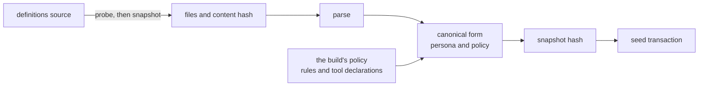

# The definitions

The definitions are the user's own configuration of nixie: the persona, jobs, rules and skills, kept
outside the nixie repo in a definitions source such as a git repo or a local directory. nixie reads
them as a snapshot of files, parses what it applies, and seeds them into the database under a
snapshot hash. Every record in the [event log](./event-log.md) carries the snapshot hash of the
definitions in force when it was written, so a replay of any decision can read exactly the persona
and policy it ran under, as [0013](../../decisions/0013-definition-versioning.md) requires.
`modules/definitions` owns sources, the seed and the snapshot hash. The seed applies the persona and
the skills, and the [rules design](../../design/platform/policy/rules.md) covers the rule files it
reads but does not apply.

A snapshot has two hashes, and they answer different questions. The content hash covers the source
files, so the same files give the same hash from any source. The snapshot hash covers the
definitions in force, which include the build's policy as well as the files, so the same files under
two releases can give two snapshot hashes.

## Sources

A source has a probe and a snapshot. The probe returns a token that changes when the definitions
change, so a poll takes a snapshot only on a token that has not seeded yet. A snapshot holds the
files by path relative to the definitions root, a revision, the content hash, and the paths the
source skipped. The local path source is the one source built, and it lives in the module because it
reaches nothing outside nixie. A directory has no commit, so the path source uses the content hash
as both its revision and its probe token.

A source reads only the known definitions paths: the manifest and the persona at the root, and the
jobs, rules and skills folders. It skips every other entry at the root by name, without reading or
entering it, so that entry never enters the content hash, never has to parse, and never counts
towards the size limits. A definitions repo can then hold its own docs and scripts, and editing a
readme never makes a new definitions version. The snapshot still lists every skipped root entry, so
a misnamed folder such as `rule/` shows in the seed's record instead of its rules going unread
without a trace.

Within the known paths, every source applies one filter. It skips every path with a part that starts
with a dot, such as `.git`. It keeps every file under `skills/`, whatever its extension, because a
skill brings its scripts. It keeps only markdown, YAML and JSON files under `jobs/` and `rules/`.
Every kept file must decode as UTF-8 text, so a binary file under `skills/` fails the snapshot. A
snapshot past the per-file or the total size limit fails too, and its error lists the files at
fault.

The path source never follows a link out of the root: a symlink that stays inside the root is
skipped, and one that leads outside it, or resolves nowhere, fails the snapshot. A file can change
between the walk and the read, so the source checks each kept file again when it opens it and
refuses one that turned into a link. No file from outside the definitions ever reaches the seed.

The content hash covers a format version line, then each file in path order with its path, its byte
length and its own hash. Every source turns CRLF line endings into LF before it hashes, and git
metadata, mode bits and file times never enter the hash. A git commit and a checkout of it, on any
platform, therefore give the same hash. A run that read one set of definitions from a git commit and
from a local directory got one hash from both, and a persona file saved with CRLF endings hashed the
same as its LF copy once normalised. Without that step a Windows checkout with `core.autocrlf` on
would give the commit a second hash.

## The definitions format

The manifest holds the definitions format version. A release reads its own format and the one before
it, and refuses any other, because an image upgrade and a definitions change land in separate repos,
in either order. The persona must be UTF-8 text and not blank. From format 2, the seed applies each
skill under `skills/`, and format 1 leaves those files unapplied, because a format 1 repo was
written before the seed checked a skill. The seed applies no other file, and lists each one in its
record as unapplied. Each unapplied YAML or JSON file must still parse, so a broken rule file fails
the snapshot before rules ever apply, and the error lists each file with its fault.

nixie owns the format, and each release publishes the manifest's rules as a JSON Schema, the
`definitions-manifest.schema.json` asset, so a definitions repo checks its manifest against the
formats a release reads without a copy of nixie. The seed parses the manifest with the same schema
that the published one comes from, and a test fails when the committed file differs from it. The
published schema covers the manifest alone, so only the seed checks the persona, the other files and
that each listed skill exists.

## Skills

A skill is a folder under `skills/` in the
[Agent Skills format](https://agentskills.io/specification), whose `SKILL.md` opens with YAML
frontmatter. The seed refuses the whole snapshot when any skill fails one of its checks, and the
error lists each file with its fault:

1. The `SKILL.md` frontmatter follows the format's rules for its name, description, compatibility
   and metadata fields, and its name matches the folder's name. The seed ignores the fields the
   format leaves to each product, and keeps `allowed-tools` only to show it, because a skill grants
   nothing.
2. Every file is UTF-8 text within the size limits, which the filter checks for every source.
3. No file holds an invisible or bidirectional control character, such as a tag character, a
   zero-width space or a right-to-left override, because such a character hides text from the person
   who reviews the skill. Tab, line feed and carriage return stay, and so do the emoji variation
   selectors.
4. A vendored skill's files hash to the content hash in its entry in `skills/skills.lock.json`, and
   every entry matches a skill folder.

A skill's content hash is the content hash over its own folder, with each path relative to that
folder, so the user computes it by hand from a checkout with the snippet in
[vendoring a skill](../../guides/vendoring-a-skill.md). A skill with a lock entry is vendored, and
any other skill is the user's own. Each skill version lives under its content hash with its
frontmatter and its files, and the version stays after a later seed changes the skill, so a task
pinned to it keeps reading it. A new or changed skill applies with the seed, with no confirmation,
because a skill widens nothing. The seed's record lists the skills it added, changed and removed
against the definitions it replaced, as the skill notice.

The seed stores the conversation's skill list from the manifest's `skills` field, and the list holds
every skill when the field is unset. A listed name with no skill folder fails the snapshot, because
a misspelled name would otherwise drop a skill without a trace. The list enters the snapshot hash
beside the skills.

### Skills that nixie wrote

A skill that nixie wrote goes into force when the user approves it, before the user's definitions
hold it. The store of written skills keeps one row for each approval that applied a skill: the
version, the approval's ID, and the version of the skill in the user's definitions when the approval
applied it, which is the base. Each seed lays every written skill in force over the skills it
parsed, so the written version replaces the definitions' version, or joins the skills when the
definitions lack it. A new written skill joins the conversation's skill list, because the
conversation wrote it, and a written version of an existing skill keeps that skill's place on the
list. The snapshot hash covers the result with each written skill's origin as nixie and the approval
that applied it, so every record names the skills that nixie wrote, and a version that a later
approval brings back gets a snapshot of its own.

The seed compares each written skill with the definitions' version of it:

- **The definitions hold the written version.** The user merged it, so the seed marks the written
  skill adopted and the skill's origin becomes the definitions. An approval of the version the
  definitions already hold is adopted at its own seed, which records the adoption though the skills
  in force stay the same.
- **The definitions hold the base, or lack a new skill.** The written skill stays in force.
- **The definitions hold another version.** The user changed the skill before the written version
  reached the definitions. The written skill stays in force, and its row keeps the definitions'
  version beside the base, which shows the conflict. The user resolves it through the skill host
  commands: keeping nixie's version makes the definitions' version its base, and keeping the
  definitions' version retires nixie's. Each choice is a record.

An approval or a retirement takes effect at once through a seed of the definitions in force: it
reads the user's skills back from the seed in force and lays the written skills over them again,
without a fresh snapshot from the source. The store keeps the change when that seed fails, and the
definitions poll seeds again while the store and the snapshot in force disagree, even on an
unchanged source. A second approved version of a written skill supersedes the first and keeps its
base. Each state change goes through one transition table, in which only a written skill in force
moves, once: to adopted, superseded or retired.

#### The export to the definitions repo

nixie exports each written skill in force to the user's definitions repo as a pull request, and the
user merges it. The export runs at start, after each approval and each choice on a conflict, and on
a fixed interval that retries a failed export. Each skill has one branch, which the export builds
again on the base branch's newest commit, so a later approval of the same skill updates the open
pull request. The change writes the skill's folder and removes each file that the version it
replaces held and the written version lacks. It also removes a vendored skill's lock entry, so the
seed after the merge reads the folder as the user's own skill and marks the written skill adopted.

A choice on a conflict changes the export. Keeping nixie's version gives the skill a new base, and
the export builds the pull request again on it. Keeping the definitions' version retires the skill,
and the export closes its pull request. A new skill joins the conversation's list through the
overlay alone, so when nixie.yaml lists the conversation's skills, the pull request asks the user to
add the skill to that list.

## The snapshot hash

The snapshot hash is the hash of one canonical form of the definitions in force. The persona enters
that form by its own hash, its persona version, after nixie normalises it to Unicode NFC with LF
line endings, no byte order mark and exactly one final newline. Trailing spaces stay, because two of
them end a markdown line with a break. Each skill enters by its name, its content hash and whether
it is vendored, sorted by name, so a change to any skill gives a new snapshot hash. The policy
enters as the rules sorted by ID and the tool declarations sorted by name, each tool's effects
sorted and without duplicates. Every object serialises as canonical JSON, with sorted keys and no
whitespace, so the same definitions always give the same bytes.

The policy holds the fixed rule and every tool declaration in the build's registry. The fixed rule
decides by a tool's declared effects ([the decision point](../policy/decision-point.md)), so a
replay needs the declarations that were in force. A release that changes a tool declaration
therefore changes the snapshot hash over the same files. A probe token follows the files alone, so
the change enters with the next seed the release runs, which compares the snapshot hash as well as
the revision.

## Seeding

A seed reads and parses a snapshot, builds its snapshot hash, and writes in one write transaction:
the persona under its persona version, the snapshot under its snapshot hash with its list of skills,
each skill version under its content hash, a seed record, and a seed row that ties the source and
its revision to both hashes. A persona, a snapshot or a skill version seen before keeps its first
row. The definitions in force are the newest seed, and every record takes its snapshot hash from it.

| Result    | When                                                                                                          | Writes   |
| --------- | ------------------------------------------------------------------------------------------------------------- | -------- |
| Seeded    | The source, revision, content hash or snapshot hash differs from the last, or a written skill becomes adopted | The rows |
| Unchanged | The newest seed holds the same source, revision and both hashes, and no written skill becomes adopted         | Nothing  |
| Refused   | The snapshot failed to read, parse or validate                                                                | Nothing  |

A refused seed comes back as a value with its error and the definitions still in force, never as a
throw, so the caller reports the refusal while the last good seed keeps serving. A half-applied seed
would leave definitions from two revisions in force at once. A failure inside the transaction, such
as a projection's fold, therefore rolls the whole seed back and throws. The caller runs one seed at
a time, because two overlapping seeds could commit an older revision after a newer one.
