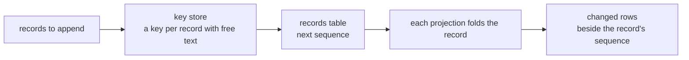

# The event log

Everything nixie does becomes a record in one append-only table, and nothing changes a record once
it is written. The tables the rest of nixie reads, such as the tasks table or the actions table, are
projections: each one folds the log a record at a time, inside the transaction that appends the
record. The log is therefore the source of truth, and dropping every projection and folding the log
again from the first record gives the same rows. `modules/log` owns the log, under
[0001](../../decisions/0001-durable-layer.md). [Erasable fields](./erasable-fields.md) covers how a
record's free text is encrypted and forgotten, and [the database](./database.md) covers the writer
every append goes through.

## What a record holds

A record has three parts. The envelope holds what a replay or an audit reads without any free text:
the sequence, the time, the kind, the thread, the step key, the parent record, the source of
content, the decision, the prompt cause, the definitions in force and the approval. The payload
holds the kind's structured data, such as IDs, counts, hashes and states. The erasable fields hold
the kind's free text, encrypted under a key of the record's own.

- **Sequence.** SQLite allows one writer, so the sequence grows in commit order, and a reader that
  asks for the records after a sequence misses none.
- **Thread.** A record belongs to the conversation, a task, or no thread at all. A task's inbox is
  the records of certain kinds on its thread ([tasks](./tasks.md#the-inbox)).
- **Step key.** The step key is unique across the log, so a task step commits once even when two
  runners race to commit it.
- **Definitions.** Every record carries the snapshot hash of the definitions in force, and the log
  refuses a batch with a record that lacks one before it writes any key or row. A replay of a
  decision needs the definitions it was made under ([the definitions](./definitions.md)).
- **Corrections.** Triggers refuse every update and delete on the table. A correction is a new
  record whose parent is the record it corrects.

## Appending

A batch of records commits in one write transaction, behind the writer epoch check. A module can
also append inside a write transaction it already holds, so its own rows and the records that
describe them commit together, as the [definitions seed](./definitions.md#seeding) does. Each
record's free text is encrypted under a fresh key, and the key commits to the key store before the
record commits, so a failed write leaves an unused key and never a record without its key.

## Projections

A projection is a table with a fold: a function that applies one record to the table and returns the
keys of the rows it changed. A fold reads the envelope and the payload, and never the erasable
fields, so a fold after a record's text is forgotten gives the same rows as the fold before it.
Every projection folds each record inside that record's transaction, in a fixed order, because a
later projection may read what an earlier one wrote, and a failed fold rolls back the whole batch.

For each record, the log keeps every row the record changed as it stood after that record, beside
the record's sequence, with a null for a row the record removed. A reader that catches up later
therefore gets the rows as of each record, never the current rows under an older sequence. The log
owns one projection of its own, one row per thread. Each module defines its own projections, and the
server adds them to the log's list when it builds the log.

A rebuild empties every projection and the changed rows, then folds the log from the first record,
all in one write transaction, so no reader sees a half-built table. The fold reads only what the
record holds, never the clock or another table, which is why a rebuild gives the live rows.

## Reading by sequence

A read returns the records after a sequence, oldest first, each with its decrypted erasable fields
and the projection rows it changed. A reader that applies a record and its rows together, then moves
its cursor, stays consistent at every step. A record whose key is gone reads as shredded, and one
whose key or ciphertext fails to decrypt reads as unreadable, both with the envelope intact, so
neither stops a reader at its sequence.

A subscription yields the same entries, then waits for one of three wakes:

- **A change to the database's write-ahead log.** SQLite writes a commit's frames before it
  publishes the commit, so the subscription rechecks a few times on a short backoff after each
  change.
- **A poll.** It catches a change the watcher misses, and covers a filesystem that cannot watch.
- **The abort signal.** It ends the subscription and stops the watcher and the poll at once.

The subscription marks every earlier wake as seen before each read, never after, so a commit that
lands while a read runs wakes the next read at once.
