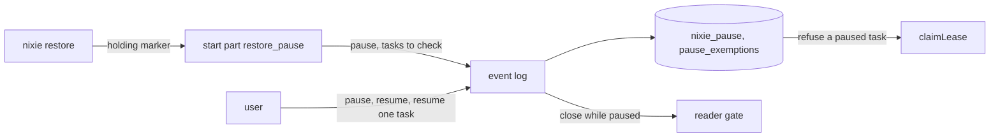

# Pausing nixie

The user can pause all of nixie at once. While nixie is paused, no task takes a step and no action
starts an attempt. Messages, notices and action outcomes still land, and each waits until a resume.
The user can resume one task while the rest stay paused, such as the conversation, to talk to the
assistant while checking the rest. A restore starts nixie paused, with a list of the tasks to check.

## The pause and its records

nixie is paused exactly while the one-row table `nixie_pause` holds its row, with a cause of
`restore`, `owner` or `spending`. A `restore` pause carries the recovery ID of its restore, and no
other cause carries one. `pause_exemptions` lists the tasks that run while nixie is paused, and
`recoveries` holds one row per restore. All 3 tables are projections of 4 record kinds, so a
projection rebuild gives the same rows:

| Record                | Does                                                                        |
| --------------------- | --------------------------------------------------------------------------- |
| `nixie.paused`        | sets the `nixie_pause` row, with the cause and `by`, and empties exemptions |
| `nixie.resumed`       | deletes the `nixie_pause` row and every exemption                           |
| `nixie.task_exempted` | adds one task to `pause_exemptions`                                         |
| `recovery.started`    | adds the `recoveries` row, with the restore's times and the tasks to check  |

The 4 kinds go on no thread, so the record stream never carries them and a thread reader of an
earlier release never meets them. The [API](../channels/api.md#pausing-nixie) gives the client a
signed-in read of the pause state for that reason.

- nixie stores the pause only in `nixie_pause`, never as a task state, a lease or a far
  `claimable_at`. A pause, a resume and an exemption change none of them. A task the user paused
  stays paused after nixie resumes, and a task's own resume never resumes nixie.
- A pause while nixie is paused replaces the cause, except a `spending` pause, which never replaces
  another cause. A resume while nixie is not paused writes nothing.
- An exemption needs nixie to be paused, and a second one for the same task writes nothing new.
- Only the user pauses or resumes nixie, or resumes one task: through the API, a host command or the
  web client. No tool does any of these. The one exception is the
  [hard spending stop](../policy/spending-stop.md), which pauses with the cause `spending` and a
  `by` of null, and resumes only that pause.
- The pause lives in the log module, which the tasks module, the trigger core and the backup
  schedule each import already. `readPause` returns the cause and the recovery ID, or null.

## What a pause stops

Every task is paused while nixie is paused, except a task in `pause_exemptions`. A task created
while nixie is paused is paused too, such as a task that an exempt task starts. Records still land
on each task's thread, and every task control works. nixie takes no step that reads them until the
resume, or until the user resumes that task, which then takes its inbox as it stands.

- `claimLease` refuses a candidate whose task is paused, in the transaction that would write the
  lease. The refusal covers every claim: by any runner, for a retry, by the start part `recovery`,
  and for an action that started an attempt before a backup. A refused claim writes nothing.
- Each candidate query filters with `buildPauseCheck`, so a paused task at the head of the order
  never hides an exempt task's work behind it. Under `NIXIE_TEST_BUILD`, `claimLease` throws when a
  candidate query returns paused work.
- The attempt start reads `probeTaskPaused` in the transaction that writes the attempt record, so a
  pause between a claim and its attempt starts no attempt. The action stays pending until a resume.
- When nixie pauses on a running server, a step that holds a lease runs to its commit, and a started
  attempt runs to its outcome. Nothing new starts after either.
- While nixie is paused, each task reads as paused in the client, and its resume exempts it, as
  [pause, stop and close](tasks.md#pause-stop-and-close) describes.

A schedule still fires into a paused task: the trigger core reads no pause.

## The reader gate

Every pause closes the database to a release that does not know the pause, so that release never
runs the tasks the pause holds. The gate is the stored `oldest_reader` value, never the schema's
`oldestReader`: a raised schema value would stop the earlier release from reading the database
again, paused or not.

- The transaction that pauses nixie calls `closeToOlderReaders`, which saves the stored value in
  `open_oldest_reader` and raises `oldest_reader` to `pauseMigrationVersion`. The resume calls
  `reopenToOlderReaders` in its own transaction.
- A migration that runs while the gate is closed writes the value it would give `oldest_reader` to
  `open_oldest_reader`, and never lowers `oldest_reader`.
- `syncPauseGate` runs at each start, after the migrations. It reopens a closed gate when nixie is
  not paused, and closes an open one when it is, such as after a projection rebuild.
- While nixie is paused, a release without the pause refuses to start with `SchemaTooNewError`.

## The pause after a restore

The restore ends by writing its marker in the state `holding`, with the recovery ID, the restore's
time and the time of the newest record in the backup. Its steps are in
[backup and restore](../deployment/host-commands.md#backup-and-restore). The restore writes nothing
into the restored database, because the backup's schema can predate the pause tables and the
migrations run only at a start. So the next start pauses nixie:

1. `startWriter` starts for the server on `holding`, and the migrations run.
2. The start part `restore_pause` runs after `first_seed`, so the first seed's tasks are paused with
   the rest. `installRestorePause` writes `recovery.started`, then `nixie.paused` with the cause
   `restore`, then a `recovery.notice` on the conversation's thread, in one transaction. It then
   removes the marker.
3. The start part `recovery` runs, then the runners.

`toCheck` lists every task that was running at the backup, and every task that owns an action with
no outcome, the conversation included. A done, stopped or closed task can own one, because a started
attempt runs on to its outcome. The install reads each task's row before the start part `recovery`
moves a running task. An existing `recoveries` row for the recovery ID makes the install write
nothing, so a repeated install never pauses nixie again after the user resumed.

| A kill lands                              | The next start                                                          |
| ----------------------------------------- | ----------------------------------------------------------------------- |
| before the restore writes `holding`       | every build refuses on `replacing`; the user runs the restore again     |
| after the restore, through the migrations | an earlier release refuses on the marker; this one starts again         |
| before the pause commits                  | starts again from step 1                                                |
| at `recovery.pause.committed`             | finds the `recoveries` row, writes nothing, and removes the marker      |
| at `recovery.pause.marker_cleared`        | claims nothing paused; an earlier release refuses with the gate's error |

Every restore starts nixie paused, and `nixie restore` has no flag that skips it. After a restore,
the web client lists the tasks to check beside the resume control while the pause's cause is
`restore`. Each resume acts at once, with no confirm step.
