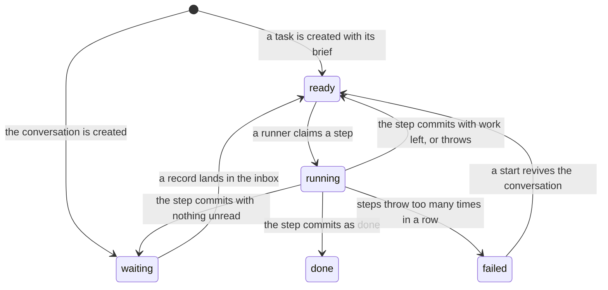

# Tasks

A task is a durable piece of work that runs one step at a time, and its whole history is records on
its own thread of the [event log](./event-log.md). A step reads the task's unread inbox, does its
work, such as one model turn, and commits its records and the task's next state in one transaction.
A crash between the start of a step and its commit loses nothing that committed, and the next claim
runs the same step again under the same step key. The conversation is itself a task, with a fixed
ID, that waits for the user's messages, under
[0018](../../decisions/0018-the-conversation-and-tasks.md). `modules/tasks` owns tasks, their inbox
and their timers. [Leases and recovery](./leases-and-recovery.md) covers how a runner claims a step
and what a restart does, and the [tasks design](../../design/platform/core/tasks.md) covers the
states and waits that are not built.

## States

A task's row in the tasks projection holds its state, and every change of state is a record on the
task's thread, so a rebuild of the projection gives the live rows. The code reaches five of the
eight states in the design. The table's state check lists all eight, because SQLite changes a check
only by rebuilding the table, and a migration never changes a released one. A running task whose
runner died stays running until a claim or recovery takes it back
([leases and recovery](./leases-and-recovery.md)).

## The inbox

A task's inbox is the records on its thread whose kind is input for it: a message from the user, a
fired timer, or an action's outcome. A step's own records share the thread and stay out of the
inbox. Each inbox record raises the task's last inbox sequence, and a waiting task becomes ready in
the same transaction, through the tasks projection's fold. The same fold ends the conversation's
retry wait, so the user's next message gets a try at once. nixie refuses inbox input for a task that
does not exist or has finished, because a finished task never runs again, so the input would stay
unread.

A step reports the inbox sequences it read, and its commit moves the read cursor over the contiguous
run of them, oldest first. A record read past a gap stays unread, so a step that crashed before its
commit, or skipped a record, sees the rest again.

## Steps

The server supplies the step function, and the tasks module runs it. A claim takes a task's lease
and records the step's start, with a step key made of the task's ID and the number of the step. The
number counts committed steps, so a rerun of an interrupted step keeps its key, and the claim first
records the lost step as interrupted. A step that runs a model turn can return the session boundary
it reached, the last entry of the Agent SDK session, and the commit stores it on the step's record.
The next step receives the boundary of the last commit, and
[conversation turns](./conversation-turns.md#resume-and-fork) covers how a turn forks the session
there.

A step commit writes the step's records, the moved read cursor, any timers the step asked for, and
the task's next state, all in one transaction that checks the step's lease first and frees it last.
The commit record carries the step key, which the log holds unique, so a second commit for the same
step fails and changes nothing. The next state is ready when the step asked to continue or input
arrived while it ran, done when the step returned done, and waiting otherwise. Input that arrived
during a step makes the task ready whatever the step chose, because that input still needs a step to
read it.

A step that throws records its error and frees the lease, and the task waits a retry delay before
its next claim. The error's message is free text, so the record keeps it in its erasable fields,
where the web UI shows it on the failed step and a forget can reach it. After too many errors in a
row, the task fails. A commit that refuses the step's result, such as a timer due at no time, counts
as a step error too. A lost lease or a stale writer counts as no error at all: the runner stops and
commits nothing, because another runner or another process owns the work now.

The conversation never fails, under [0018](../../decisions/0018-the-conversation-and-tasks.md),
because every deployment needs it to answer. Its wait before each retry doubles with each error in a
row up to a cap, so a long outage costs one try per cap and a reply follows soon after the cause
clears. Each error record holds the errors in a row, the limit at which another task fails, and the
retry time. Once the conversation's errors reach that limit, the server marks the conversation imp
unready and the web UI says that nixie is failing to answer; the next turn that commits clears both.
A start makes a failed conversation ready again with its errors cleared, because a failed task never
wakes and the conversation must.

## Timers

A step asks for timers in its result, and its commit sets them. A timer runner in the task pool
fires each due timer in its own transaction, with a record on the task's thread that holds both the
due time and the fire time, so a timer that fell due while nixie was down fires late and its record
shows by how much. The transaction checks the timer again before it fires it, so two passes never
fire a timer twice. The fired record lands in the task's inbox and wakes the task.

Every wait, lease and timer reads one clock that the caller passes in, so a crash test sets and
advances time instead of sleeping.
