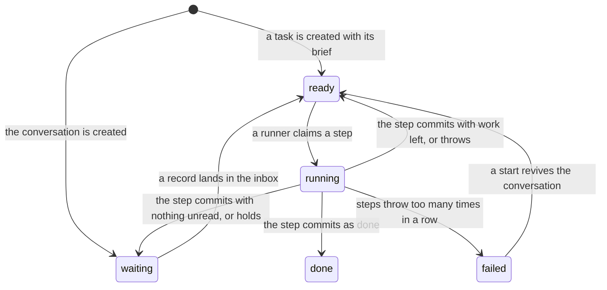

# Tasks

A task is a durable piece of work that runs one step at a time, and its whole history is records on
its own thread of the [event log](./event-log.md). A step reads the task's unread inbox, does its
work, such as one model turn, and commits its records and the task's next state in one transaction.
A crash between the start of a step and its commit loses nothing that committed, and the next claim
runs the same step again under the same step key. The conversation is itself a task, with a fixed
ID, that waits for the user's messages, under
[0018](../../decisions/0018-the-conversation-and-tasks.md). `modules/tasks` owns tasks, their inbox
and their timers. [Leases and recovery](./leases-and-recovery.md) covers how a runner claims a step
and what a restart does, and the [tasks design](../../design/platform/core/tasks.md) covers the
states and waits that are not built.

## States

A task's row in the tasks projection holds its state, and every change of state is a record on the
task's thread, so a rebuild of the projection gives the live rows. The code reaches five of the
eight states in the design. The table's state check lists all eight, because SQLite changes a check
only by rebuilding the table, and a migration never changes a released one. A running task whose
runner died stays running until a claim or recovery takes it back
([leases and recovery](./leases-and-recovery.md)).

## The inbox

A task's inbox is the records on its thread whose kind is input for it: a message from the user, a
fired timer, an action's outcome, a message from another task, or a message the user moved. A step's
own records share the thread and stay out of the inbox. Each waking inbox record raises the task's
last inbox sequence, and a waiting task becomes ready in the same transaction, through the tasks
projection's fold. A task message that did not wake its receiver is the one inbox record that wakes
nothing, as [task messages](#task-messages) describes. The same fold ends the conversation's retry
wait, so the user's next message gets a try at once. nixie refuses inbox input for a task that does
not exist or has finished, because a finished task never runs again, so the input would stay unread.

A step reports the inbox sequences it read, and its commit moves the read cursor over the contiguous
run of them, oldest first. A record read past a gap stays unread, so a step that crashed before its
commit, or skipped a record, sees the rest again. A `log_reset` record on a task's thread moves the
read cursor to itself, so a message still unread at a
[reset of the conversation](./event-log.md#resetting-the-conversation) never starts a turn.

## Steps

The server supplies the step function, and the tasks module runs it. A claim takes a task's lease
and records the step's start, with a step key made of the task's ID and the number of the step. The
number counts committed steps, so a rerun of an interrupted step keeps its key, and the claim first
records the lost step as interrupted. A step that runs a model turn can return the session boundary
it reached, the last entry of the Agent SDK session, and the commit stores it on the step's record.
The next step receives the boundary of the last commit, and
[conversation turns](./conversation-turns.md#resume-and-fork) covers how a turn forks the session
there.

A step commit writes the step's records, the moved read cursor, any timers the step asked for, and
the task's next state, all in one transaction that checks the step's lease first and frees it last.
The commit record carries the step key, which the log holds unique, so a second commit for the same
step fails and changes nothing. The next state is ready when the step asked to continue or input
arrived while it ran, done when the step returned done, and waiting otherwise. Input that arrived
during a step makes the task ready whatever the step chose, because that input still needs a step to
read it. One exception: a step that holds its inbox commits the task as waiting with its input
unread, because no step can read that input yet, and a ready task would only loop through empty
steps. The next waking record makes the task ready again, as [started tasks](#started-tasks)
describes.

A step that throws records its error and frees the lease, and the task waits a retry delay before
its next claim. The error's message is free text, so the record keeps it in its erasable fields,
where the web UI shows it on the failed step and a forget can reach it. After too many errors in a
row, the task fails. A commit that refuses the step's result, such as a timer due at no time, counts
as a step error too. A lost lease or a stale writer counts as no error at all: the runner stops and
commits nothing, because another runner or another process owns the work now.

The conversation never fails, under [0018](../../decisions/0018-the-conversation-and-tasks.md),
because every deployment needs it to answer. Its wait before each retry doubles with each error in a
row up to a cap, so a long outage costs one try per cap and a reply follows soon after the cause
clears. Each error record holds the errors in a row, the limit at which another task fails, and the
retry time. Once the conversation's errors reach that limit, the server marks the conversation turns
part of its readiness report as failing, an advisory part that never takes nixie out of routing, and
the web UI says that nixie is failing to answer; the next turn that commits clears both. A start
makes a failed conversation ready again with its errors cleared, because a failed task never wakes
and the conversation must.

## Task messages

A task message is a record that one task writes to another task's thread through the message tool,
and the list tool shows each task the others it can message. The directory names each task, gives
its brief, and says whether a message wakes it. The server builds its fixed part from its config,
and each tool call and each conversation step adds the [started tasks](#started-tasks) to it from
the log, so a task the conversation started a moment ago takes messages at once. The conversation
wakes for a message. The memory writer and consolidator run on their own schedule, so a message to
either waits unread until its next scheduled session reads it, and that session marks it read. The
message tool refuses a message to the sender itself, to a task outside the directory or one that has
finished, a reply to an unknown message, and an on-behalf-of ID that is not one of the user's
messages, with the refusal as the tool's answer. The record's body is erasable.

A message write checks the sender's lease in its own transaction, as a step commit does. The tool
call carries the run ID of the step that made it, and the write refuses the call when the task has
started another step, its lease has moved to another generation, or the lease has expired. A step
that lost its task therefore wakes nobody and changes no wait. The memory writer and consolidator
open each session under a token for the step that runs it, so their calls carry that run ID too.

Each step carries a hop count and the cause that woke it, which the claim works out from the unread
waking records and stores on the step's start. A step woken by the user, a timer or an outside event
is hop 0, a step woken by task messages takes the lowest hop among them, and a step with no new
input carries the hop of the step before. A message is its step's hop plus 1. A message past the hop
limit, a setting of the tasks config, is delivered but wakes nobody, and the tool tells the sender
so in a note. The first such message in a step also writes an exchange notice on the sender's
thread, which names both tasks, the count, and which of them waits on the other, for the user to
see.

A message that wakes nobody starts no step, and it never counts as unread work for the read cursor's
step result, so a waiting message does not loop its receiver through empty steps. A receiver that is
asleep reads it at its next wake. The messages that the hop limit held arrive under a summary line
per sender, which counts them and says whether a reply would wake the sender; a message sent without
a wake gets no summary line. A conversation turn that is already running receives it at once, as it
receives every inbox record that lands during the turn, so the read cursor never meets a gap. That
turn keeps the hop it was claimed with, so a reply from it wakes the sender only when the turn's own
hop allows.

A task-messages projection keeps one row per message with its wait state, and one declared table
holds the moves between wait states. A question or a request to a task that wakes for messages opens
a wait, so its sender waits on the receiver, and any other message has none. A question or a request
to the memory writer or consolidator opens no wait, because neither task finishes, so its wait would
stay open until a reply that may never come. The tool's note tells the sender that a reply, if any,
arrives as a new message. The message record holds whether the message opens a wait, so a rebuild of
the projection keeps each wait as it was. A record that lacks that field opens a wait for every
question and request.

A reply that names the question answers that wait. A step that commits as done, or a task that
fails, releases every open wait that names the task. Only an open wait moves, so an answered wait
stays answered when its task finishes. The list tool reads the newest open wait as the task it waits
on.

[Conversation turns](./conversation-turns.md) covers the block that shows a task message to the
model, and [memory writes](../memory/writes.md) covers why the content gate never takes its body as
the user's words.

## Started tasks

The conversation starts a task through the start tool, with a name and a brief, when the user asks
for work that no listed task covers. The start checks the step's lease as a message write does, and
writes the task's creation record in the ready state under a [short ID](./database.md#short-ids),
with the name and brief in its erasable fields. The creation record holds which task started it, and
the tasks projection keeps that on the task's row, so the directory finds every started task. A
forget of the name leaves the task listed under its ID.

No runner runs a started task, so the server runs a holding step for it. The holding step writes
nothing, marks nothing read, and holds the task, so the task waits with every message unread and
never fails. Each later message to it wakes it into one more holding step. The start tool's note
tells the model to tell the user that the task is queued.

### Routing records

Each start from the conversation, and each conversation message to another task, writes a routing
record on the conversation's thread. The record names the task and the user's messages that the work
came from: the on-behalf-of IDs of the message, or, when the message lists none, the conversation's
unread user messages. A message-routes projection keeps one row per routed user message with the
task it went to, and a later route of the same message replaces the row. The tool's note tells the
model to say in its reply where the work went, and the [client](../channels/client.md#routing-marks)
shows each route beside the user's message.

### Moving a misrouted message

The user moves a misrouted message to another task, or to a new one, through one checked action of
the [API](../channels/api.md). One transaction checks the move, writes a correction record on the
message's thread, and writes a moved-message record into the inbox of the task that gains the
message. The task that lost it gets a moved-message record as well, unless that task has finished.
The correction record replaces the message's row in the message-routes projection. A move refuses a
record that is not the user's message on that thread, a task that does not exist or has finished,
and a move to the task that holds the message already. A move to a new task creates it, started by
the user. Only the gaining task wakes, and
[conversation turns](./conversation-turns.md#inbox-records-as-messages) covers what each side reads.

## Timers

A step asks for timers in its result, and its commit sets them. A timer runner in the task pool
fires each due timer in its own transaction, with a record on the task's thread that holds both the
due time and the fire time, so a timer that fell due while nixie was down fires late and its record
shows by how much. The transaction checks the timer again before it fires it, so two passes never
fire a timer twice. The fired record lands in the task's inbox and wakes the task.

Every wait, lease and timer reads one clock that the caller passes in, so a crash test sets and
advances time instead of sleeping. The clock lives in a lib below the log, and the writer carries
it, so a record's time, a definitions seed's time, each wait between start retries and the checker's
timeout read the same clock as the tasks.
