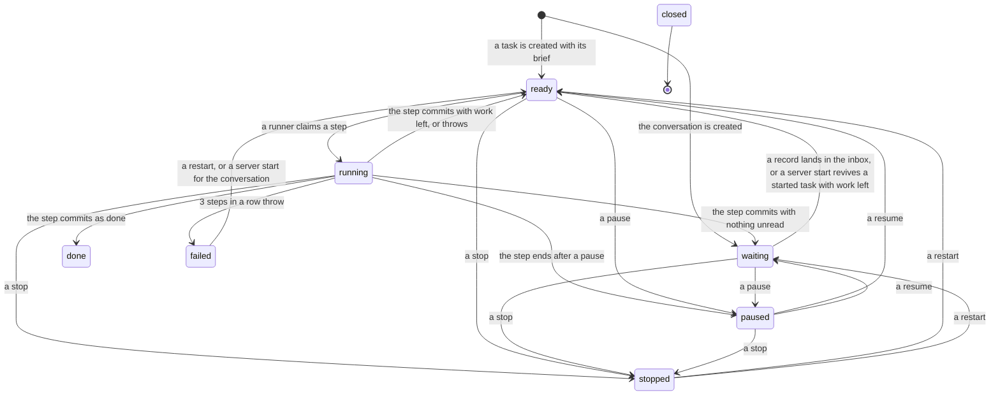

# Tasks

A task is a durable piece of work that runs one step at a time, and its whole history is records on
its own thread of the [event log](./event-log.md). A step reads the task's unread inbox, does its
work, such as one model turn, and commits its records and the task's next state in one transaction.
A crash before the commit leaves the task as it was, and the next step runs that work again. The
conversation is itself a task, with a fixed ID, that waits for the user's messages, under the
[conversation and tasks decision](../../decisions/0018-the-conversation-and-tasks.md). The tasks
module owns tasks, their inbox and their timers.

[Leases and recovery](./leases-and-recovery.md) covers how a runner claims a step and what a restart
does, and the [tasks design](../../design/platform/core/tasks.md) covers the states and waits that
are not built. The [glossary](../../glossary.md) defines a task run and a lease.

## States

A task's row in the tasks [projection](../../glossary.md) holds its state, and every change of state
is a record on the task's thread, so a rebuild of the projection gives the live rows. Every state
but closed can move to closed, which the diagram leaves out, as
[pause, stop and close](#pause-stop-and-close) describes. A running task whose runner died stays
running until a claim or recovery takes it back ([leases and recovery](./leases-and-recovery.md)).

## The inbox

A task's inbox is the records on its thread whose kind is input for it: a message from the user, a
fired timer, an action's outcome, a message from another task, or a message the user moved. A step's
own records share the thread and stay out of the inbox.

Every inbox record wakes the task, except a task message in one of these cases, which
[task messages](./task-messages.md) explains:

- its receiver runs only on its schedule, as the memory writer does;
- its sender sent it with no wake;
- the hop limit held it back.

The tasks projection keeps the sequence of the newest waking record on the task's row, and a waiting
task becomes ready in the same transaction that writes the record. The same write ends the
conversation's retry wait, so the user's next message gets a try at once.

nixie refuses inbox input for a task that does not exist or has finished, which means done, failed
or closed, because no step would read the input. A done or closed task never runs again. A failed
task refuses input until a restart returns it to ready.

A step reports the inbox sequences it read. Its commit moves the read cursor forward over them,
oldest first, and stops at the first sequence the step did not read. A record past that gap stays
unread, so a step that skipped a record sees it and the records after it again. A `log_reset` record
on a task's thread moves the read cursor up to itself, so a message still unread at a
[reset of the conversation](./event-log.md#resetting-the-conversation) never starts a turn.

## Steps

The server supplies the step function, and the tasks module runs it. A claim takes a task's lease
and records the step's start, with a step key made of the task's ID and the number of the step. The
number counts committed steps, so the step after a crash keeps the key of the step the crash lost,
and the claim first records that lost step as interrupted. A step that runs a model turn can return
the session boundary it reached, the last entry of the Agent SDK session, and the commit stores it
on the step's record. The next step receives the boundary of the last commit, and
[conversation turns](./conversation-turns.md#resume-and-fork) covers how a turn forks the session
there.

A step commit writes the step's records, the moved read cursor, any timers the step asked for, and
the task's next state, all in one transaction that checks the step's lease first and frees it last.
The commit record carries the step key, which the log holds unique, so a second commit for the same
step fails and changes nothing. The next state is ready when the step asked to continue or input
arrived while it ran, done when the step returned done, and waiting otherwise. Input that arrived
during a step makes the task ready whatever the step chose, because that input still needs a step to
read it.

A step that throws records its error and frees the lease, and the task waits a retry delay before
its next claim. The error's message is free text, so the record keeps it in its
[erasable fields](./erasable-fields.md), where the web UI shows it on the failed step and a forget
can erase it. After 3 errors in a row, the task fails. A commit that refuses the step's result, such
as a timer with an invalid due time, counts as a step error too.

A lost lease counts as no error, and neither does a process that lost the writer lock. The runner
stops and commits nothing, because another runner or another process owns the work now.

Step errors never fail the conversation, under the
[conversation and tasks decision](../../decisions/0018-the-conversation-and-tasks.md), because every
deployment needs it to answer. Its wait before each retry doubles with each error in a row, up to a
cap. Each error record holds the count of errors in a row, the count at which any other task would
fail, and the retry time. Once the conversation's count reaches that limit, the server reports the
conversation's turns as failing in its readiness report, and the web UI says that nixie is failing
to answer. That part of the report is advisory, so a deployment never stops sending requests to
nixie for it. The next turn that commits clears both. A server start makes a conversation in the
failed state ready again with its errors cleared, because a failed task never wakes.

## Pause, stop and close

The user controls a task with 6 [checked actions](../channels/api.md) of the API: pause, resume,
stop, restart, close and interrupt. Each one writes its own record on the task's thread. The tasks
module checks each control against a transition table of the task's states, so a refused control
writes nothing and returns the state it met.

While a step runs, its runner watches the task's thread for controls, so a stop or an interrupt
reaches the step at once.

- **Pause** of a ready or waiting task pauses it at once. A pause of a running task records a pause
  request, and the step runs on: its commit, its error or the recovery of its lease then pauses the
  task in the same transaction. A paused task keeps the state it left, ready or waiting, and no
  runner claims it. A step that commits as done finishes the task, because a pause keeps only work
  that remains. A step error that uses up the task's tries fails the task, and the pause request
  ends with the step, so only a restart runs the task again.
- **Resume** of a paused task returns it to the state it left, or to ready when waking input arrived
  while it was paused. A resume of a running task withdraws its pause request. A resume refuses a
  started task that its [limit](./started-tasks.md#limits) holds.
- **Stop** ends the current task run. It frees the lease, so the running step's commit fails as a
  lost lease, and the runner aborts the step at once. A stop withdraws the task's pending timers, so
  they never fire, and releases each message wait that the task has open on another task. A stopped
  task takes inbox input and leaves it unread.
- **Restart** of a stopped task returns it to the ready or waiting state that the task saved when it
  last left one of them, the state that a pause keeps. A task paused before the stop therefore comes
  back ready or waiting, never paused. A restart of a failed task returns it to ready. Either goes
  to ready when waking input waits unread. The next step resumes the session from the last committed
  step, as a step after a crash does. A restart refuses a started task that its limit holds, as a
  resume does.
- **Close** ends a task for good, from any state but closed. It frees the lease, withdraws the
  pending timers and releases every message wait that names the task, on either side, and the inbox
  refuses later input. The conversation refuses a close, because every deployment needs it to
  answer, but it takes a stop and a restart.
- **Interrupt** of a running task records the step it interrupts, and the runner fires the step's
  interrupt signal. A conversation turn then ends at the last entry of its Agent SDK session and
  commits as usual, as [conversation turns](./conversation-turns.md#interrupts) describes. A step
  that runs no model has no turn to end, and commits when it would have.

While a task is paused or closed, nixie claims none of its [actions](./actions.md) that have not
started an attempt, so a pause keeps the queued actions with the task. A stop
[cancels](./actions.md#cancelled-actions) each queued action that has not started an attempt, so a
restart never sends it, and an action with a started attempt runs on to its outcome.

## Task messages

One task reaches another with a task message on the receiver's thread. A message wakes its receiver
except in the cases that the [inbox](#the-inbox) lists, and a question or a request can open a
message wait on the receiver. [Task messages](./task-messages.md) covers the tools, the hop limit
and the waits.

## Started tasks

The conversation starts a task through the start tool when the user asks for work that no listed
task covers. [Started tasks](./started-tasks.md) covers the start and its options, the nixie runner
that runs a started task's steps, its limits, and the routing records and moves that send it the
user's messages.

## Timers

A step asks for timers in its result, and its commit sets them. A timer runner beside the task
runners fires each due timer in its own transaction, with a record on the task's thread that holds
both the due time and the fire time. A timer that fell due while nixie was down therefore fires
late, and its record shows by how much. The transaction checks the timer again before it fires it,
so a timer never fires twice. The fired record lands in the task's inbox and wakes the task.

Every wait, lease and timer reads one clock that the caller passes in, so a crash test sets and
advances time instead of sleeping. The log's writer carries the same clock, so every record's time
comes from it too.
