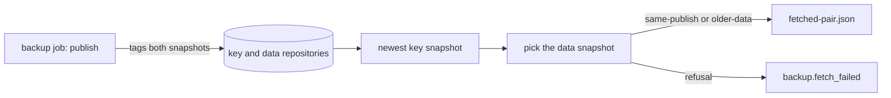

# The backup pair

A restore on a new host needs a backup pair: one key snapshot from the key repository, and one data
snapshot from the data repository whose records that key snapshot can decrypt. `nixie-backup fetch`
picks the pair from the tags that the backup job writes on each snapshot. This doc gives the tag
rules and the pick. [Backups](backups.md) covers the parts this doc builds on: the snapshot sets
that nixie stages, the backup job that publishes each set to the 2 restic repositories, the set's
receipt, and the restore note. [0017](../../decisions/0017-publish-numbers-are-snapshot-tags.md)
records why the backup job keeps its count in the tags.

Each publish writes the key snapshot first, then the data snapshot. A key snapshot covers a data
snapshot when it holds the key of every record in that data snapshot, so a restore of the 2 together
reads every record. Every snapshot ID in a tag, a file, a log line or a message is restic's full ID,
never the short form that restic prints by default.

## Tags

| Tag               | On             | Holds                                                                      |
| ----------------- | -------------- | -------------------------------------------------------------------------- |
| `set-<n>`         | both snapshots | the sequence of the set that the publish ships                             |
| `kind-<kind>`     | both snapshots | the set's kind, as its manifest gives it                                   |
| `publish-<n>`     | both snapshots | the publish number: one above the highest in either repository             |
| `legacy-set-<n>`  | key snapshot   | the `set-` number of the last key snapshot that had no publish number      |
| `proven-from-<n>` | key snapshot   | the lowest publish number of a data snapshot that this key snapshot covers |

A tag that does not parse reads as absent. A snapshot with no `publish-` tag is unnumbered. The
repositories hold unnumbered snapshots from releases before publish numbers.

The backup job picks the 2 key-only tags of each new key snapshot by the first of these rules that
applies:

1. The staging folder holds a restore note whose key snapshot ID is null, or is not the ID of the
   newest key snapshot. The new key snapshot takes `proven-from-` with its own publish number, and
   no `legacy-set-`. Its keys came from a restore, so it covers no earlier data snapshot. A restore
   note that does not parse reads as one with a null ID.
2. The key snapshot it replaces is unnumbered, while either repository holds a publish number. The
   new key snapshot takes `proven-from-` with its own publish number, and no `legacy-set-`.
3. The key snapshot it replaces is unnumbered, and neither repository holds a publish number. The
   new key snapshot takes `legacy-set-` with the replaced snapshot's `set-` number, and no
   `proven-from-`.
4. The key snapshot it replaces is numbered. The new key snapshot copies its `legacy-set-` and
   `proven-from-`.

The first key snapshot of an empty key repository takes neither tag.

`nixie restore` writes the restore note, and the next publish reads it and removes it. A restore
takes nixie's set table back to the restored data, and that table holds no publish number, so nixie
can stage a `set-` number that the data repository already holds. The pick therefore compares
publish numbers wherever both snapshots have one.

## The newest key snapshot

Each publish replaces the newest key snapshot, and each fetch restores it. To find it, the backup
job:

1. drops each unnumbered key snapshot whose `set-` number another key snapshot holds in
   `legacy-set-`;
2. takes the highest publish number, when every key snapshot left is numbered;
3. otherwise takes the latest by restic's time.

## The pick

With no key snapshot, the pick refuses with `no-key-snapshot`.

The operator can name a data snapshot with `--data-snapshot`. With none named, the pick takes the
default data snapshot:

- Under a numbered key snapshot, it takes the data snapshot with the same publish number. With none,
  it refuses with `no-data-of-publish`. With more than one, it refuses with `duplicate-publish`.
- Under an unnumbered key snapshot, it takes the latest unnumbered data snapshot by restic's time
  with the same `set-` number. With none, it refuses with `no-data-of-publish`.

The message of `no-data-of-publish` holds the ID of the data snapshot with the highest publish
number that the key snapshot covers, so the operator can pass that ID with `--data-snapshot`.

A named data snapshot that the data repository lacks gives `no-such-data-snapshot`. The pick rates a
named data snapshot that the repository holds by this table, where `legacy-set-` and `proven-from-`
are the tags of the key snapshot. For 2 unnumbered snapshots, `same-publish` means the same `set-`
number.

| Key snapshot | Named data snapshot | Condition                                                | Result                 |
| ------------ | ------------------- | -------------------------------------------------------- | ---------------------- |
| numbered     | numbered            | the same publish number                                  | `same-publish`         |
| numbered     | numbered            | a higher publish number                                  | `data-newer-than-keys` |
| numbered     | numbered            | a lower publish number, below `proven-from-`             | `data-unproven`        |
| numbered     | numbered            | a lower publish number, otherwise                        | `older-data`           |
| numbered     | unnumbered          | `set-` at or below `legacy-set-`, with no `proven-from-` | `older-data`           |
| numbered     | unnumbered          | otherwise                                                | `data-unproven`        |
| unnumbered   | unnumbered          | the same `set-` number                                   | `same-publish`         |
| unnumbered   | unnumbered          | a lower `set-` number                                    | `older-data`           |
| unnumbered   | unnumbered          | a higher `set-` number                                   | `data-newer-than-keys` |
| unnumbered   | numbered            | any                                                      | `data-unproven`        |

`same-publish` and `older-data` give a pair, and every other result refuses. The pick accepts an
older unnumbered data snapshot under an unnumbered key snapshot on its `set-` number alone. Before
the first numbered publish, the repositories hold no other evidence, and a refusal would leave no
older data snapshot to restore.

## When a publish or a fetch stops

- **A publish stops after its key snapshot and before its data snapshot.** The set has no receipt,
  and the next job run publishes it again under the next number. When the host is lost in that
  window, the default fetch refuses with `no-data-of-publish`, and the operator passes the ID from
  its message with `--data-snapshot`.
- **A publish stops after its key snapshot and before it removes the replaced key snapshot.** The
  key repository holds 2 key snapshots, and the newest is the one with the higher publish number.
  When this is the first numbered publish, its `legacy-set-` tag holds the replaced snapshot's
  `set-` number, so the backup job drops the replaced snapshot when it looks for the newest.
- **A publish stops before it removes the restore note.** The next publish reads the note again and
  takes `proven-from-` with its own number. The pick then refuses more data snapshots, never fewer.
- **A publish runs during a fetch.** The fetch lists the key repository again after it restores the
  pair. The second list shows the new key snapshot, so the fetch empties its directory and picks
  again, as [Backups](backups.md#fetching-the-backup-pair) describes.
- **A publish runs after the fetch and before the restore.** The restore then writes a note whose
  key snapshot ID is not the newest, so the next publish takes `proven-from-` with its own number.
- **A restore reads a `nixie backup --to` directory.** That directory holds no fetched pair, so the
  restore writes a note with a null key snapshot ID, and the next publish makes every earlier data
  snapshot `data-unproven`.

## An older-data pair and a forget

A [memory forget](../memory/store.md#forgetting) or a record forget deletes the forgotten item's
key, and the next publish removes every older key snapshot. An `older-data` pair restores an older
data snapshot with the newest key snapshot. An item forgotten after that data snapshot was written
has records in the restored data but no key, so it stays unreadable. The restored data holds no
record of that forget, so nixie never runs it again, and `nixie restore` takes no option to run it.
A record with no key proves no forget, because a conversation reset, a log reset, an
[evidence purge](../memory/store.md#the-evidence-purge) and the key cleanups also delete keys.
[An older data copy and a purge](backups.md#an-older-data-copy-and-a-purge) covers what an evidence
purge in the gap does to an item's text.

`nixie backup --to <directory>` writes a copy of both databases that holds its own keys, so a
restore from it brings back the key of an item forgotten after the copy.
[A forget's backup state](backups.md#a-forgets-backup-state) reads only the sets that the backup job
ships, so it never covers such a directory.
