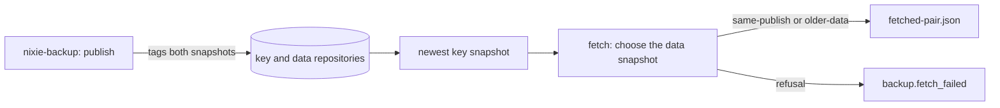

# The backup pair

A restore on a new host needs a backup pair: one key snapshot from the key repository, and one data
snapshot from the data repository whose records that key snapshot can decrypt. The backup job tags
each snapshot it writes, and `nixie-backup fetch` reads those tags to choose a pair. This doc gives
the tag rules and how the fetch chooses.

The doc uses these terms from [Backups](backups.md):

- **set:** one copy of nixie's 2 databases that nixie stages for the backup job, numbered by a
  sequence in nixie's set table;
- **staging folder:** the folder of nixie's data volume where nixie writes each set and the backup
  job reads it;
- **receipt:** the file the backup job writes into a set once it has shipped it;
- **restore note:** `restore-note.json`, which `nixie restore` writes into the staging folder. It
  holds the ID of the key snapshot that the restore used, or null for a restore from a
  `nixie backup --to` directory.

`nixie-backup` is the backup job's program. Its publish ships each set, and its `fetch` command
copies a pair out of the repositories, so both use the rules below.
[0017: publish numbers](../../decisions/0017-publish-numbers-are-snapshot-tags.md) records why the
backup job keeps these numbers in tags.

When the fetch finds a pair, it writes `fetched-pair.json` for `nixie restore`. When it refuses, it
logs `backup.fetch_failed` with the refusal, as
[fetching the backup pair](backups.md#fetching-the-backup-pair) describes.

## Publish numbers and tags

Each publish writes the key snapshot first, then the data snapshot. It numbers the publish one above
the highest `publish-<n>` tag in either repository. A key snapshot covers a data snapshot when it
holds the key of every record in that data snapshot. Every snapshot ID in a tag, a file, a log line
or a message is restic's full ID, never the short form that restic prints by default.

| Tag               | On             | Holds                                                                                             |
| ----------------- | -------------- | ------------------------------------------------------------------------------------------------- |
| `set-<n>`         | both snapshots | the sequence of the set that the publish ships                                                    |
| `kind-<kind>`     | both snapshots | the set's kind, as its manifest gives it                                                          |
| `publish-<n>`     | both snapshots | the publish number                                                                                |
| `legacy-set-<n>`  | key snapshot   | the `set-` number of the unnumbered key snapshot that the first numbered publish replaced         |
| `proven-from-<n>` | key snapshot   | the lowest publish number of a data snapshot that this key snapshot covers; absent means no limit |

A tag that does not parse reads as absent. A snapshot with no `publish-` tag is unnumbered. A backup
job of a release that does not number its publishes writes only unnumbered snapshots.

A restore takes nixie's set table back to the restored data, so nixie can stage a set whose sequence
the data repository already holds. Wherever both snapshots are numbered, the fetch therefore
compares publish numbers, never `set-` numbers.

## The key-only tags of a new key snapshot

The backup job gives each new key snapshot its `legacy-set-` and `proven-from-` tags by the first of
these rules that holds:

1. **The staging folder holds a restore note whose key snapshot ID is null, or is not the ID of the
   newest key snapshot.** The new key snapshot takes `proven-from-` with its own publish number, and
   no `legacy-set-`. Its keys came from a restore of another key snapshot, so it covers no data
   snapshot from before it. A restore note that does not parse reads as one with a null ID.
2. **The key snapshot it replaces is unnumbered, while either repository holds a publish number.**
   The new key snapshot takes `proven-from-` with its own publish number, and no `legacy-set-`. A
   release that does not number its publishes ran after a numbered one, so the backup job cannot
   tell which numbered data snapshots the replaced keys cover.
3. **The key snapshot it replaces is unnumbered, and neither repository holds a publish number.**
   This is the first numbered publish. The new key snapshot takes `legacy-set-` with the replaced
   snapshot's `set-` number, and no `proven-from-`.
4. **The key snapshot it replaces is numbered.** The new key snapshot copies that snapshot's
   `legacy-set-` and `proven-from-`.

Rule 1 applies to an empty key repository too. Without a restore note, the first key snapshot of an
empty key repository takes neither tag, even when the data repository holds a publish number. The
live key store still holds the keys of the data snapshots that the retention keeps, so a
`proven-from-` tag would mark them unrestorable for no reason. The job never empties the key
repository itself, because a withdrawn set removes only its own key snapshot. The next publish after
a restore reads the restore note and removes it.

## The newest key snapshot

Each publish replaces the newest key snapshot, and `nixie-backup fetch` restores it. Both find it
the same way:

1. They drop each unnumbered key snapshot whose `set-` number another key snapshot holds in
   `legacy-set-`. A first numbered publish that stopped before it removed the snapshot it replaced
   leaves that snapshot behind, and this step skips it.
2. When every key snapshot left is numbered, they take the highest publish number.
3. Otherwise, they take the latest by restic's time.

## Choosing the data snapshot

With no key snapshot, `nixie-backup fetch` refuses with `no-key-snapshot`.

The operator can name a data snapshot with `--data-snapshot`. With none named, the fetch takes the
default data snapshot:

- Under a numbered key snapshot, it takes the data snapshot with the same publish number. With none,
  it refuses with `no-data-of-publish`. With more than one, it refuses with `duplicate-publish`.
- Under an unnumbered key snapshot, it takes the latest unnumbered data snapshot by restic's time
  with the same `set-` number. With none, it refuses with `no-data-of-publish`.

The message of `no-data-of-publish` holds the ID of the best data snapshot that the table below
rates `same-publish` or `older-data`: the highest publish number, then the latest by restic's time.
The operator can pass that ID with `--data-snapshot`. With no such data snapshot, the message says
that none can go with the key snapshot.

A named data snapshot that the data repository lacks gives `no-such-data-snapshot`. The fetch rates
a named data snapshot that the repository holds by this table. In it, `legacy-set-` and
`proven-from-` are the key snapshot's tags, and for 2 unnumbered snapshots, `same-publish` means the
same `set-` number.

| Key snapshot | Named data snapshot | Condition                                                | Result                 |
| ------------ | ------------------- | -------------------------------------------------------- | ---------------------- |
| numbered     | numbered            | the same publish number                                  | `same-publish`         |
| numbered     | numbered            | a higher publish number                                  | `data-newer-than-keys` |
| numbered     | numbered            | a lower publish number, below `proven-from-`             | `data-unproven`        |
| numbered     | numbered            | a lower publish number, otherwise                        | `older-data`           |
| numbered     | unnumbered          | `set-` at or below `legacy-set-`, with no `proven-from-` | `older-data`           |
| numbered     | unnumbered          | otherwise                                                | `data-unproven`        |
| unnumbered   | unnumbered          | the same `set-` number                                   | `same-publish`         |
| unnumbered   | unnumbered          | a lower `set-` number                                    | `older-data`           |
| unnumbered   | unnumbered          | a higher `set-` number                                   | `data-newer-than-keys` |
| unnumbered   | numbered            | any                                                      | `data-unproven`        |

`same-publish` and `older-data` give a pair, and the fetch refuses every other result. The fetch
accepts an older unnumbered data snapshot under an unnumbered key snapshot on its `set-` number
alone. With no numbered publish yet, the repositories hold no other evidence, and a refusal would
leave no older data snapshot to restore.

## When a publish or a fetch stops

- **A publish stops after its key snapshot and before its data snapshot.** The set has no receipt,
  and the next job run publishes it again under the next number. When the host is lost in that
  window, the default fetch refuses with `no-data-of-publish`, and the operator passes the ID from
  its message with `--data-snapshot`.
- **A publish stops after its key snapshot and before it removes the replaced key snapshot.** The
  key repository holds 2 key snapshots, and the newest is the one with the higher publish number.
  After a first numbered publish, the first step of
  [the newest key snapshot](#the-newest-key-snapshot) skips the unnumbered one.
- **A publish stops before it removes the restore note.** The next publish reads the note again and
  takes `proven-from-` with its own number. The fetch then refuses more data snapshots than it would
  with the note gone, and never accepts one it would refuse, so the stop is safe.
- **A publish runs during a fetch.** The fetch lists the key repository again after it restores the
  pair. The second list shows the new key snapshot, so the fetch empties its directory and chooses
  again.
- **A publish runs after the fetch and before the restore.** The restore then writes a note whose
  key snapshot ID is not the newest, so the next publish takes `proven-from-` with its own number.
- **A restore reads a `nixie backup --to` directory.** The restore writes a note with a null key
  snapshot ID, so the next publish makes every earlier data snapshot `data-unproven`.

## An older-data pair and a forget

An `older-data` pair restores an older data snapshot with the newest key snapshot. A
[memory forget](../memory/store.md#forgetting) or a
[record forget](../channels/api.md#forgetting-a-record) deletes the forgotten item's key, and the
next publish removes every older key snapshot. An item forgotten after the restored data snapshot
was written therefore has records in the restored data but no key, so it stays unreadable. The
restored data holds no record of that forget, so nixie never runs it again, and `nixie restore`
takes no option to run it. A record with no key proves no forget, because other cleanups delete keys
too, such as a conversation reset, a log reset and an
[evidence purge](../memory/store.md#the-evidence-purge).
[An older data copy and a purge](backups.md#an-older-data-copy-and-a-purge) covers what an evidence
purge in the gap does to an item's text.

`nixie backup --to <directory>` writes a copy of both databases that holds its own keys, so a
restore from it brings back the key of an item forgotten after the copy. nixie reports
[a forget's backup state](backups.md#a-forgets-backup-state) from the sets that the backup job
ships, so that state never covers such a directory.
