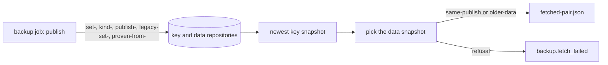

# The backup pair

A restore needs 2 copies that belong together: a key copy from the key repository, and a data copy
from the data repository whose records that key copy can read. The backup job marks each publish
with tags, so that `nixie-backup fetch` can pick a pair that fits. [Backups](backups.md) covers the
publish and the fetch, and this doc gives the tag rules and the pick.
[0017](../../decisions/0017-publish-numbers-are-snapshot-tags.md) records why the numbers live in
the tags.

## Tags

One function in the backup job formats every tag, and one parses them. A tag that does not parse
reads as absent. Every snapshot ID in a tag, a file, a log line or a message is restic's full ID.

| Tag               | On             | Holds                                                                       |
| ----------------- | -------------- | --------------------------------------------------------------------------- |
| `set-<n>`         | both snapshots | the set's sequence                                                          |
| `kind-<kind>`     | both snapshots | the set's kind                                                              |
| `publish-<n>`     | both snapshots | the publish number                                                          |
| `legacy-set-<n>`  | key snapshot   | the `set-` number of the last key snapshot with no publish number           |
| `proven-from-<n>` | key snapshot   | the lowest publish number of a data snapshot that this key copy vouches for |

A key snapshot copies `legacy-set-` and `proven-from-` from the key snapshot it replaces. The first
key snapshot with a publish number takes `legacy-set-` with the `set-` number of the one it
replaces.

A key snapshot takes `proven-from-` with its own number, and copies no tag, in 2 cases:

- Staging holds a restore note whose key snapshot ID is null, or is not the newest key snapshot's
  ID. The key copy then holds keys restored from somewhere else, so it vouches for no earlier data
  copy. A restore note that does not parse reads as one with a null ID.
- The key snapshot it replaces has no publish number, while either repository holds one.

When both cases hold, the first one wins, and the key snapshot takes no `legacy-set-`.

nixie's set table holds no publish number, so a `set-` number can repeat in the data repository
after a restore. The pick therefore compares publish numbers wherever both snapshots have one.

## The newest key snapshot

The publish replaces the newest key snapshot, and the fetch restores it. To find it, the backup job:

1. drops each key snapshot with no publish number whose `set-` number another key snapshot holds in
   `legacy-set-`;
2. takes the highest publish number when every key snapshot left has one;
3. otherwise takes the latest by restic's time.

## The pick

With no key snapshot, the pick refuses with `no-key-snapshot`.

With no data snapshot named, the pick takes the data snapshot with the key snapshot's publish
number. With none, it refuses with `no-data-of-publish`, and its message holds the ID of the data
snapshot with the highest publish number that the key copy vouches for, so the operator can pass
that ID with `--data-snapshot`. With more than one, it refuses with `duplicate-publish`. Under a key
snapshot with no publish number, it takes the latest data snapshot by restic's time that has no
publish number and the same `set-` number.

A named data snapshot that the data repository lacks gives `no-such-data-snapshot`. For one it
holds, the pick rates the pair by this table:

| Key snapshot      | Named data snapshot | Condition                                                        | Result                 |
| ----------------- | ------------------- | ---------------------------------------------------------------- | ---------------------- |
| publish number    | publish number      | the same publish number                                          | `same-publish`         |
| publish number    | publish number      | a higher publish number                                          | `data-newer-than-keys` |
| publish number    | publish number      | a lower publish number, below `proven-from`                      | `data-unproven`        |
| publish number    | publish number      | a lower publish number, otherwise                                | `older-data`           |
| publish number    | no publish number   | `set-` at or below `legacy-set`, and no `proven-from` on the key | `older-data`           |
| publish number    | no publish number   | otherwise                                                        | `data-unproven`        |
| no publish number | no publish number   | the same `set-` number                                           | `same-publish`         |
| no publish number | no publish number   | a lower `set-` number                                            | `older-data`           |
| no publish number | no publish number   | a higher `set-` number                                           | `data-newer-than-keys` |
| no publish number | publish number      | any                                                              | `data-unproven`        |

`same-publish` and `older-data` give a pair, and every other result refuses. A data snapshot with no
publish number under a key snapshot with no publish number passes on its `set-` number alone. Until
the first numbered publish, a refusal there would leave no older copy to restore.

## When a publish or a fetch stops

- A publish that stops between its 2 snapshots leaves the set with no receipt, and the next job run
  publishes it under the next number. When the host is lost in that window, the default fetch
  refuses with `no-data-of-publish`, and the operator passes the ID that its message holds with
  `--data-snapshot`.
- A publish that stops after its key snapshot, and before it removes the replaced one, leaves 2 key
  snapshots. The pick takes the higher publish number.
- When the first numbered publish stops between those 2 writes, its `legacy-set-` tag makes the pick
  drop the replaced key snapshot.
- A publish that stops before it removes the restore note leaves the note for the next publish,
  which sets `proven-from` again. The fetch then refuses more data snapshots, never fewer.
- A publish during a fetch changes the fetch's second list, and the fetch picks again.
- A publish after the fetch and before the restore leaves a restore note whose key snapshot ID is
  not the newest, so the next publish sets `proven-from`.
- A restore from a `nixie backup --to` directory writes a note with a null key snapshot ID, so every
  data snapshot from before the restore becomes `data-unproven`.
- A backup job of a release without publish numbers writes none of the `publish-`, `legacy-set-` and
  `proven-from-` tags. The pick reads its snapshots as unnumbered, ordered by restic's time.

## An older-data pair and a forget

An `older-data` pair restores a data copy with the newest key copy, which lacks every key that a
forget deleted after the data copy was made. An item forgotten in that gap stays unreadable after
the restore, and nixie never finishes its forget. `nixie restore` takes no option to finish it: a
record with no key proves no forget, because a conversation reset, a log reset, an evidence purge
and the key cleanups also delete keys. [Backups](backups.md#an-older-data-copy-and-a-purge) covers
what an evidence purge in the gap does to an item's text.

A restore from a `nixie backup --to` directory brings a forgotten item's key back, because that
directory holds its own key copy. A forget's backup state never covers such a directory.
