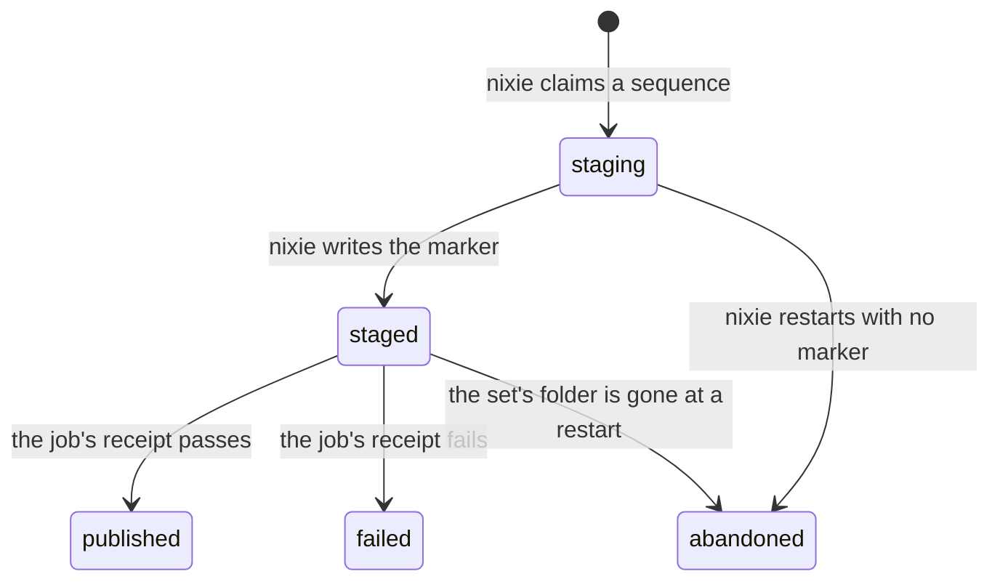

# Backups

nixie stages a snapshot set of both its databases on the backup interval, and at once after a
forget. A separate container, the backup job, ships each set to 2 restic repositories and writes a
receipt into the set, and nixie records the receipt on its next pass. nixie holds no backup
credential, and the job holds no deployment key, so neither container can both reach the backups and
read them. The [backup and restore design](../../design/platform/deployment/backup-and-restore.md)
gives the reasons for the 2 repositories, and [0013](../../decisions/0013-host-encrypted-backups.md)
records the split between the containers.

nixie keeps each set's state in its own table, and one transition table refuses every move the
diagram lacks. The job never reads that table: it reads only the files in the staging folder.

## Staging a set

A set stages in 3 ways: at the schedule's pass, after a forget, and on request through the
[`stage-backup` command](host-commands.md#backup-and-restore).

nixie's backup schedule runs a pass on a poll, and early when a record commits. A pass first records
every receipt that the job wrote, then stages a set when one is due:

1. A forget set is due once a forget record is newer than the log position of every set that staged,
   published or failed. A forget record is `erasure.finished`, which ends a note forget or a moment
   destroy, or the end record of a memory forget, a message forget or a reset of the conversations,
   each of which deletes its keys before it writes that record. The server passes the backup module
   the old end records from each descriptor, so the module imports no store. A set that staged
   before `erasure.finished` never publishes: the pass withdraws it, and stages a new set, because a
   stale set holds the deleted keys. The same transaction that writes `erasure.finished` writes
   `floor.json` into the staging folder, naming the highest set that exists then, and the job ships
   no set at or below it. The job reads `floor.json` again once a set's key snapshot is in the key
   repo, again once its data snapshot is in the data repo, and again after the key repo's prune and
   check, just before the receipt. When an erasure finished before one of those reads, the job
   removes the set's key snapshot, prunes the key repo, keeps the restore note and writes no
   receipt. A failure of that removal fails the job, and the next publish removes the stale snapshot
   with the other old ones. The data snapshot stays, because the erased text in it is unreadable
   once its keys are gone. A withdrawal after the prune leaves the key repo empty until the next
   publish. The receipt's rename still follows the last read, so a set can publish when an erasure
   finishes in that gap. Its receipt never covers the erasure, which waits for a set that started
   after it. The withdrawal waits for the job's staging lock, so it never removes a set that the job
   is shipping, and a pass that finds the lock held withdraws the set on the next pass. A withdrawal
   that a failure stopped after the rename finishes on the next pass.
2. A scheduled set is due once the newest staged set is a backup interval old, and never while a set
   waits for its receipt.

A set takes the next sequence above every row and every folder in staging, and nixie inserts its row
before it creates its folder. nixie copies the pair with the same check that the
[backup command](host-commands.md#backup-and-restore) runs, so the key store copy holds the key of
every record that the log copy keeps readable. It then writes the manifest with each copy's size and
checksum, and writes the `complete` marker last, with an fsync of each file and of the folder.

The `stage-backup` command stages a set at once, in place of a set that waits for the interval. The
server sends the request to the schedule's own actor, so the request runs after the pass in flight
and never beside it. The request first records every receipt that the job wrote, so a set that the
job shipped a moment ago no longer counts as waiting. It then refuses while any set is still copying
or has no receipt, and names that set's sequence, because the job ships a set only after its marker
exists and a second set would only pile up on the volume. When no set waits, it stages a forget set
if a forget is due, and a scheduled set otherwise, through the same steps as a pass. The command
answers once the marker exists and the row reads staged, and the next job run ships the set. The
request reports through the same log events and health state as a pass, and the next scheduled set
comes one backup interval after it.

nixie stages no set of any kind while it is paused after a restore. The first publish after a
restore replaces the key snapshot that the restore came from, and nothing undoes that, so staging
waits until the user has read the recovery and resumed nixie. The check reads the pause in the
transaction that inserts the set's row. A pause with cause `owner` or `spending` stages as on any
day. See [pausing nixie](../core/pause.md).

A set that fails before its marker exists, in its copy or in the marker's own write, removes its set
folder and moves its row to abandoned, so the schedule's next try starts from a clean staging
folder. A restart does the same for every set folder that a crash left without its marker. A marked
folder whose row never reached staged moves to staged, because its copies passed every check before
the marker. A crash at any point therefore leaves either a set the job may ship or no set at all.

## The backup job

The job is a separate program in its own image, which pins restic by version and checksum. Each job
run first takes an exclusive lock on a file in the staging folder, and holds it until its last set
is done. A job run that finds the lock held ships nothing and exits with success, because 2 job runs
at once would each keep only their own key snapshot and could forget the other's. The job run then
lists the set folders in sequence order, and skips each one that lacks its marker or holds a
receipt. For each set it ships, the job:

1. checks the manifest against the folder's sequence, and each copy against its size and checksum;
2. lists both repositories, and gives the publish the number one above the highest `publish-` tag in
   either, or 1 when neither holds one;
3. backs up the key store copy to the key repository first, with the tags `set-`, `kind-` and
   `publish-`, and the tags `legacy-set-` and `proven-from-` where the
   [tag rules](backup-pair.md#the-key-only-tags-of-a-new-key-snapshot) give them: the key snapshot
   copies both from the one it replaces, and takes `legacy-set-` when it is the first numbered one.
   It takes `proven-from-` with its own number, and no other tag, when a restore note shows the
   restored keys are not the newest's, or when the replaced snapshot has no number while a
   repository holds one;
4. backs up the log copy to the data repository with the same `set-`, `kind-` and `publish-` tags,
   then applies the data retention;
5. forgets every other key snapshot by its ID, prunes every unused byte, and checks the repository's
   data once the prune passes, whether the data snapshot passed or failed;
6. removes the restore note from the staging folder, when one was there;
7. writes the receipt with an fsync and a rename, so nixie never reads a partial one;
8. removes the set's copies, unless nixie has removed the set folder first.

A job run that cannot list the key repository writes a failed receipt and no snapshot. A job run
that cannot list the data repository counts from the key repository alone, and writes a failed
receipt and no snapshot only when the key repository holds no publish number, so a publish number
never repeats. A failed key snapshot also gives a failed receipt with no data snapshot, no removed
key snapshot and the restore note kept.

A restic failure in either repository gives the set a failed receipt that lists each failed step,
and the job moves on to the next set. A failed manifest check gives the set a failed receipt too.
Any other error before the receipt is in place stops the job run with a non-zero exit and leaves the
set with no receipt, so the next job run ships it again. An error after the receipt is in place,
such as a failed removal of the copies, stops the job run too, but the next job run skips the set
because it holds its receipt, and nixie removes the copies with the set's folder once it records the
receipt. The key repository forgets by ID, because restic's keep-last rule keeps one snapshot in
each host and path group, and an older group would keep a forgotten key.

The job passes each repository's password to restic in the child's environment, never in its
arguments, and gives restic only the backend variables that the job's own variables leave. It
refuses one repository for both data and keys, because the key repository's prune would then delete
the data snapshots.

## Fetching the backup pair

`nixie-backup fetch --to <directory>` copies a backup pair out of the two repositories, so
`nixie restore` can read it on a new host. It reads the job's own repository and password variables,
and never the staging folder. It exits 1 for a directory that exists and is not empty, and creates a
directory that does not exist. Its optional `--data-snapshot <snapshot_id>` names a data snapshot by
its full ID, which `nixie-backup snapshots` prints. A data snapshot named under a key snapshot with
no publish number is checked only by its `set-` number.

The fetch:

1. writes the unfinished-backup marker into the directory, before anything else;
2. lists both repositories and picks the pair: the newest key snapshot, and the data snapshot that
   goes with it. The [pick's rules](backup-pair.md#choosing-the-data-snapshot) give each refusal,
   and the table that rates a named data snapshot;
3. restores the key snapshot as `keys.db` and the data snapshot as `nixie.db`, as bytes;
4. lists the key repository again. When a publish changed the newest key snapshot, it empties the
   directory but for the marker and picks again, at most 3 times, and a fourth change fails the
   fetch;
5. writes `fetched-pair.json`, then removes the marker.

`fetched-pair.json` holds the snapshot ID, publish number, set number and restic time of each copy,
and the pair's relation: `same-publish`, or `older-data` for a named data snapshot from before the
key snapshot. The wire library owns its schema. The file holds no checksum, because the restore runs
SQLite's integrity check on each copy.

On success the fetch exits 0 after one `backup.fetched` line. On any failure it exits 1 after one
`backup.fetch_failed` line that holds the failed step. When the pick refused, the line also holds
the refusal and its message, which names the data snapshot to take when one goes with the key
snapshot. A failed fetch leaves the marker, so `nixie restore` refuses the directory. The fetch only
restores the newest key snapshot, because an older one would make a forgotten item readable again.

The fetch and `nixie-backup snapshots` run restic with `--no-lock`, so they work with a credential
that can only read the repositories. The job's own backups, forgets and prunes keep their locks.
Without a lock, a prune by a running backup job can remove repository data that the fetch still
reads. restic then exits non-zero, so the fetch fails and leaves the unfinished-backup marker.

`nixie restore --from <directory>` reads `fetched-pair.json` and returns the pair. It then empties
the staging folder and writes `restore-note.json` there, which holds the restore time and the key
snapshot ID of the pair, or none for a directory that `backup --to` wrote. The next publish reads
and removes the note, so it knows which key snapshot the restore came from.
[Backup and restore](host-commands.md#backup-and-restore) describes the restore, and the
[restore runbook](../../runbooks/restore.md) gives the steps.

`nixie-backup snapshots` prints one line of JSON for each snapshot of the data and key repositories:
the repository, the full snapshot ID, restic's time, and the set, kind and publish number from the
tags. It prints nothing else.

## Where the job runs

On Kubernetes, the [Pulumi component](kubernetes.md#the-pulumi-component) runs the job as a CronJob,
as nixie's user. The job's container mounts only the staging folder, and takes the backup
repositories and passwords from a secret that nixie's container never mounts. Before it starts, an
init container that holds no secret mounts the whole data volume to create the staging folder.
Kubernetes never restarts or retries a failed job run, so its Job ends failed. A second job run
would skip the failed set, because the set holds its receipt, and exit with success, so the Job
would end as a success. The reference Compose recipe runs no backup job, and its configuration turns
backups off. Its CI overlay runs the job as a container that loops and mounts the staging folder as
a subpath of the data volume, as the [Compose guide](../../guides/compose.md) describes.

## Receipts in nixie

nixie parses each receipt with the format's schema, and refuses a receipt whose sequence differs
from its folder's, or whose row is neither staging nor staged. A receipt for a staging row moves the
row to staged first, because the job ships only a marked set. An accepted receipt moves the row to
published or failed with the snapshot IDs and the receipt text. A refused receipt moves a staged row
to failed with the receipt text, because a set that waits on its receipt holds back every scheduled
set, and nixie logs the refusal. Either way, nixie then renames the set's folder to a name that is
no set, syncs the staging folder, and removes the renamed folder. A stop part way through the
removal therefore never leaves a marked set without its files, and the next start removes what the
stop left.

## A forget's backup state

A forget that ended with `erasure.finished` is complete once a set at or after that record is
published. nixie reads a forget's backup state from the sets whose log position is at or after the
forget record, because only a copy that started after that record lacks the deleted keys:

| Sets at or after the forget record                                                                   | Backup state                                                               |
| ---------------------------------------------------------------------------------------------------- | -------------------------------------------------------------------------- |
| any published set                                                                                    | complete                                                                   |
| none published, and the newest set that is not abandoned failed                                      | failed, with the receipt's failure, or with nixie's refusal of the receipt |
| none published, and the newest set that is not abandoned is staging or staged, or no such set exists | pending                                                                    |

One published set is enough, because its job run forgets every other key snapshot and prunes it. A
failed state keeps the forget open, and the next scheduled set covers the forget again, within one
backup interval. An abandoned set leaves the forget due, so the next pass stages a new forget set. A
set that never gets its receipt keeps the forget pending.

## An older data copy and a purge

An `older-data` restore pairs a data copy from before an
[evidence purge](../memory/store.md#the-evidence-purge) with the newest key copy, which lacks the
keys the purge deleted. The data copy holds no purge record, so a value reads shredded, never
removed:

| The item in the data copy | Unchanged between the copy and the purge              | Edited between them        |
| ------------------------- | ----------------------------------------------------- | -------------------------- |
| shared-key                | every value reads shredded, the current text included | every value reads shredded |
| with a version key        | only the current text reads                           | every value reads shredded |

An item is unchanged when its current version in the data copy is still current when the purge runs.
A shared-key item loses its current text because that text needs generation 0, which the purge
deleted, and the data copy holds no bridge version. An item that no purge reached keeps its keys and
reads as before. A pending proposal whose key is gone stays out of the proposal list.

## Backup health

nixie judges its backups from the receipts it records, because the backup job serves no health
endpoint. Each pass, after it records the receipts, nixie raises a notice for each set since the
newest published set that needs one:

| Set                                                         | Notice  |
| ----------------------------------------------------------- | ------- |
| failed, by its receipt or by nixie's refusal of the receipt | failed  |
| staged at least one backup interval ago, with no receipt    | missing |

nixie keeps each notice in a table keyed by its set and its cause, so a set raises each cause once,
across restarts, and a set that goes missing and then fails raises both. A set older than the newest
published set raises no notice, because that publish shows the backups work again. nixie logs each
notice as a warning. The client reads the newest notice since the newest published set once a
minute, and shows it above every signed-in page until a newer set publishes.

Readiness carries backups as a [dependency part](server.md#health). The part turns unready once no
set has published within twice the backup interval, counted from the newest published receipt or the
backup schedule's start, whichever is later, so a nixie that was down gives the backup job 2
intervals before it reports the job. Its details give the age in seconds of the newest set that is
not abandoned or still staging, and the time nixie recorded the newest published receipt. The part
is unready until the server's backups start step runs, with backups on or off, and that step makes
it ready when backups are off.

## Formats

The manifest, the receipt and the staging layout live in the wire library, because both programs
read them. Each format carries a version, and the committed files of each version are fixtures that
the tests parse, so a release reads every set and receipt that the release before writes.
