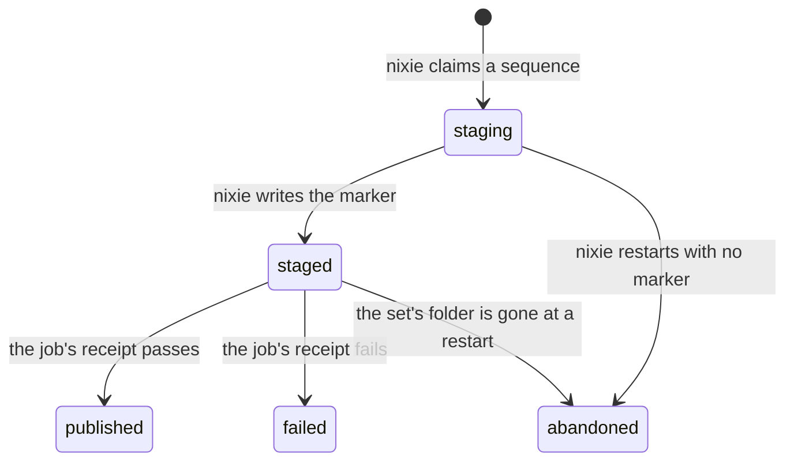

# Backups

nixie stages a snapshot set of both its databases on the backup interval, and at once after a
forget. A separate container, the backup job, ships each set to 2 restic repositories and writes a
receipt into the set, and nixie records the receipt on its next pass. nixie holds no backup
credential, and the job holds no deployment key, so neither container can both reach the backups and
read them. The [backup and restore design](../../design/platform/deployment/backup-and-restore.md)
gives the reasons for the 2 repositories, and
[0020](../../decisions/0020-deployment.md#the-backup-job) records the split between the containers.

nixie keeps each set's state in its own table, and one transition table refuses every move the
diagram lacks. The job never reads that table: it reads only the files in the staging folder.

## Staging a set

nixie's backup schedule runs a pass on a poll, and early when a record commits. A pass first records
every receipt that the job wrote, then stages a set when one is due:

1. A forget set is due once a forget record is newer than the log position of every set that staged,
   published or failed.
2. A scheduled set is due once the newest staged set is a backup interval old, and never while a set
   waits for its receipt.

A set takes the next sequence above every row and every folder in staging, and nixie inserts its row
before it creates its folder. nixie copies the pair with the same check that the
[backup command](host-commands.md#backup-and-restore) runs, so the key store copy holds the key of
every record that the log copy keeps readable. It then writes the manifest with each copy's size and
checksum, and writes the `complete` marker last, with an fsync of each file and of the folder.

A copy that fails before the marker removes its set folder and moves its row to abandoned, so the
schedule's next try starts from a clean staging folder. A restart does the same for every set folder
that a crash left without its marker. A marked folder whose row never reached staged moves to
staged, because its copies passed every check before the marker. A crash at any point therefore
leaves either a set the job may ship or no set at all.

## The backup job

The job is a separate program in its own image, which pins restic by version and checksum. Each job
run first takes an exclusive lock on a file in the staging folder, and holds it until its last set
is done. A job run that finds the lock held ships nothing and exits with success, because 2 job runs
at once would each keep only their own key snapshot and could forget the other's. The job run then
lists the set folders in sequence order, and skips each one that lacks its marker or holds a
receipt. For each set it ships, the job:

1. checks the manifest against the folder's sequence, and each copy against its size and checksum;
2. backs up the log copy to the data repository, then applies the data retention;
3. backs up the key store copy to the key repository, forgets every other key snapshot by its ID,
   prunes every unused byte, and checks the repository's data once the prune passes;
4. writes the receipt with an fsync and a rename, so nixie never reads a partial one;
5. removes the set's copies, unless nixie has removed the set folder first.

A restic failure in either repository gives the set a failed receipt that lists each failed step,
and the job moves on to the next set. A failed manifest check gives the set a failed receipt too.
Any other error before the receipt is in place stops the job run with a non-zero exit and leaves the
set with no receipt, so the next job run ships it again. An error after the receipt is in place,
such as a failed removal of the copies, stops the job run too, but the next job run skips the set
because it holds its receipt, and nixie removes the copies with the set's folder once it records the
receipt. The key repository forgets by ID, because restic's keep-last rule keeps one snapshot in
each host and path group, and an older group would keep a forgotten key.

The job passes each repository's password to restic in the child's environment, never in its
arguments, and gives restic only the backend variables that the job's own variables leave. It
refuses one repository for both data and keys, because the key repository's prune would then delete
the data snapshots.

## Where the job runs

On Kubernetes, the [Pulumi component](kubernetes.md#the-pulumi-component) runs the job as a CronJob
that mounts only the staging folder, as nixie's user, and takes the backup repositories and
passwords from a secret that nixie's container never mounts. The reference Compose recipe runs no
backup job. Its CI overlay runs the job as a container that loops and mounts the staging folder as a
subpath of the data volume, as the [Compose recipe's README](../../../deploy/compose/README.md)
describes.

## Receipts in nixie

nixie parses each receipt with the format's schema, and refuses a receipt whose sequence differs
from its folder's, or whose row is neither staging nor staged. A receipt for a staging row moves the
row to staged first, because the job ships only a marked set. An accepted receipt moves the row to
published or failed with the snapshot IDs and the receipt text. A refused receipt moves a staged row
to failed with the receipt text, because a set that waits on its receipt holds back every scheduled
set, and nixie logs the refusal. Either way, nixie then renames the set's folder to a name that is
no set, syncs the staging folder, and removes the renamed folder. A stop part way through the
removal therefore never leaves a marked set without its files, and the next start removes what the
stop left.

## Formats

The manifest, the receipt and the staging layout live in the wire library, because both programs
read them. Each format carries a version, and the committed files of each version are fixtures that
the tests parse, so a release reads every set and receipt that the release before writes.
