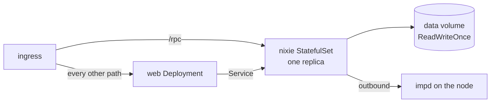

# Kubernetes

nixie ships reference manifests for Kubernetes in `deploy/kubernetes/`, and a
[Pulumi component](#the-pulumi-component) for a deployment that runs Pulumi. A deployment repo keeps
its own copy of the manifests with its host name, impd's URL, its address ranges and its model
profiles in place of the placeholders. One SQLite writer sets their shape: nixie runs as one pod
that owns one volume, the web server runs beside it with no state, and one ingress puts both behind
one host name. The manifests hold no host, cloud or tailnet detail, because the repo is public.

[The server](./server.md) covers the process the pod runs, its configuration and secrets, and how it
stops, and [the database](../core/database.md#the-single-writer) covers the writer lock. The
[deployment design](../../design/platform/deployment/deployment.md#kubernetes) covers the backup
sidecar that joins nixie's pod in a later slice.

## nixie's pod

nixie runs as a StatefulSet of one replica, with its data directory on a `ReadWriteOnce` volume from
the StatefulSet's claim template. A rolling update of a StatefulSet deletes the old pod and creates
the new one only once the old pod is gone, so two nixie processes never run on the volume at once.
The writer lock in the data directory guards the same rule a second time: a process that finds the
lock held exits instead of writing. The pod's stop grace exceeds the runner pools' grace, so a
rollout's stop lets the steps in flight commit and the writer close before the runtime kills the
process.

The pod mounts 3 sources read-only at `/etc/nixie`: the configuration from a ConfigMap, and the
encrypted secrets file and its age key from one Secret. nixie decrypts the file in its own process
at start, so no plaintext secret reaches the pod's spec, its environment or its disk. The Secret's
file mode is written in decimal, because YAML 1.1 reads `0440` as octal and YAML 1.2 reads it as
decimal, and a deployment's own tooling may use either.

The definitions mount one file at a time from their own ConfigMap. A ConfigMap volume presents each
key as a link into a hidden folder, and the path source skips every link, so a whole-volume mount
would seed no persona. A deployment that keeps its definitions in a repo replaces that ConfigMap
with its own source.

The pod runs as nixie's fixed non-root user on a read-only root filesystem with every capability
dropped, and the namespace enforces the restricted Pod Security Standard. The pod mounts no service
account token, because nixie never calls the Kubernetes API.

## impd and the address ranges

impd runs on the node, outside the cluster, and nixie's pod reaches it outbound by the URL in the
configuration. imp delivers each reverse-forward connection over nixie's own connection to impd, so
the pod declares no port for its tools. The configuration lists every address of the node and the
cluster's pod and service ranges as internal, because a fetch sandbox with public egress could
otherwise reach the node's services and every pod through the node's forwarding. The placeholders
hold k3s's default pod and service ranges and a documentation address for the node.

## The web server and the ingress

The web server runs as a Deployment, because it holds no state, no secrets and no database, so more
than one replica can serve. It reaches nixie's API by nixie's Service. One ingress serves both on
one host name: a path rule sends `/rpc` to nixie and the default rule sends every other path to the
web server, so the browser's session cookie reaches both on one origin. The ingress terminates HTTPS
with the certificate in a TLS Secret that the deployment provides.

## The Pulumi component

A deployment that runs Pulumi takes nixie's pod from the Pulumi component in `deploy/pulumi-k8s/`
instead of a copy of the manifests. Each nixie release publishes the component to npm as
`@heynixie/pulumi-k8s` at the release's version, so a deployment takes a change to the shape with a
version bump, as [the release pipeline](release-pipeline.md#the-release-workflow) describes. The
component registers nixie's StatefulSet, its Service, the configuration ConfigMap, the Secret of the
secrets file and its age key, and the Secret of the definitions deploy key. It registers the web
server's Deployment and Service beside them, and the web Deployment rolls out after the StatefulSet,
so a first deploy starts the API before the client that calls it. Its pod differs from the
manifests' pod in one way: a git-sync container beside nixie keeps the definitions checked out from
a repo on GitHub, which the deployment names with its ref and its read-only deploy key.

A deployment that sets a backup gets a CronJob that mounts nixie's data volume and runs the
deployment's backup script in the deployment's image, with the backup repository and its credentials
from a Secret. The job runs as nixie's user, so a restore leaves files nixie can open. The script's
ConfigMap and the Secret take fixed names, because a restore Job outside the component mounts them
by name.

The deployment passes the namespace, the images, the configuration text, the encrypted secrets file,
the age key, the volume's storage class and the backup's schedule. The namespace, its network
policies, the image pull Secret and the ingress stay in the deployment's own program, because each
depends on the cluster, the registry or the host name.

Each resource the component registers keeps a fixed Pulumi name, and an alias to the stack as its
parent. A stack that registered the same resources at its top level therefore moves onto the
component with no replacement, and the StatefulSet keeps its volume. The ConfigMap and the Secrets
take a name that Pulumi generates, so a change to one replaces it and rolls the StatefulSet, and
nixie reads the change at its next start.

## Images

Each manifest pins its image by the release's version tag and the image's digest, so the cluster
runs exactly the digest the release published while the tag shows a reader which release it is. An
upgrade changes the nixie and web digests in one pull request in the deployment repo, as
[upgrades](../../design/platform/deployment/upgrades.md) describes.
