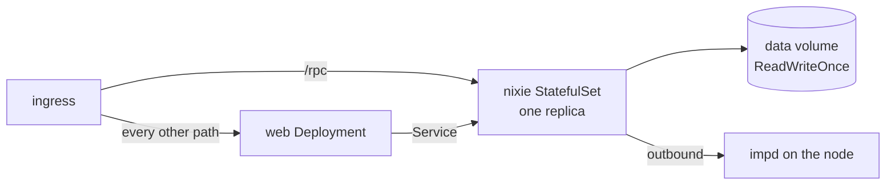

# Kubernetes

nixie ships reference manifests for Kubernetes in `deploy/kubernetes/`, and a deployment repo keeps
its own copy with its host name, impd's URL, its address ranges and its model profiles in place of
the placeholders. One SQLite writer sets their shape: nixie runs as one pod that owns one volume,
the web server runs beside it with no state, and one ingress puts both behind one host name. The
manifests hold no host, cloud or tailnet detail, because the repo is public. The live checks in
`e2e/k3s/` prove a deployment built from them, and
[the live checks runbook](../../runbooks/live-checks.md) runs them.

[The server](./server.md) covers the process the pod runs, its configuration and secrets, and how it
stops, and [the database](../core/database.md#the-single-writer) covers the writer lock. The
[deployment design](../../design/platform/deployment/deployment.md#kubernetes) covers the backup
sidecar that joins nixie's pod in a later slice.

## nixie's pod

nixie runs as a StatefulSet of one replica, with its data directory on a `ReadWriteOnce` volume from
the StatefulSet's claim template. A rolling update of a StatefulSet deletes the old pod and creates
the new one only once the old pod is gone, so two nixie processes never run on the volume at once.
The writer lock in the data directory guards the same rule a second time: a process that finds the
lock held exits instead of writing. The pod's stop grace exceeds the runner pools' grace, so a
rollout's stop lets the steps in flight commit and the writer close before the runtime kills the
process.

The pod mounts 3 sources read-only at `/etc/nixie`: the configuration from a ConfigMap, and the
encrypted secrets file and its age key from one Secret. nixie decrypts the file in its own process
at start, so no plaintext secret reaches the pod's spec, its environment or its disk. The Secret's
file mode is written in decimal, because YAML 1.1 reads `0440` as octal and YAML 1.2 reads it as
decimal, and a deployment's own tooling may use either.

The definitions mount one file at a time from their own ConfigMap. A ConfigMap volume presents each
key as a link into a hidden folder, and the path source skips every link, so a whole-volume mount
would seed no persona. A deployment that keeps its definitions in a repo replaces that ConfigMap
with its own source.

The pod runs as nixie's fixed non-root user on a read-only root filesystem with every capability
dropped, and the namespace enforces the restricted Pod Security Standard. The pod mounts no service
account token, because nixie never calls the Kubernetes API.

## impd and the address ranges

impd runs on the node, outside the cluster, and nixie's pod reaches it outbound by the URL in the
configuration. imp delivers each reverse-forward connection over nixie's own connection to impd, so
the pod declares no port for its tools. The configuration lists every address of the node and the
cluster's pod and service ranges as internal, because a fetch sandbox with public egress could
otherwise reach the node's services and every pod through the node's forwarding. The placeholders
hold k3s's default pod and service ranges and a documentation address for the node.

## The web server and the ingress

The web server runs as a Deployment, because it holds no state, no secrets and no database, so more
than one replica can serve. It reaches nixie's API by nixie's Service. One ingress serves both on
one host name: a path rule sends `/rpc` to nixie and the default rule sends every other path to the
web server, so the browser's session cookie reaches both on one origin. The ingress terminates HTTPS
with the certificate in a TLS Secret that the deployment provides.

## Images

Each manifest pins its image by the release's version tag and the image's digest, so the cluster
runs exactly the digest the release published while the tag shows a reader which release it is. An
upgrade changes the nixie and web digests in one pull request in the deployment repo, as
[upgrades](../../design/platform/deployment/upgrades.md) describes.

## The live checks

The live checks run from a workstation against a deployed nixie, by its URL and a kubeconfig, and
each suite skips until its variables are set. Each one checks one guarantee of the deployment:

- **The conversation.** A device enrols with a code from the host command in nixie's pod, sends a
  message, and receives a reply that used the web fetch, with the message, the step, the tool call,
  its result, the reply and the step's commit in order on the conversation's thread.
- **The rollout.** The StatefulSet rolls to another digest, and the old pod's last log line and its
  exit come before the new pod's writer opens the database, under a higher writer epoch.
- **The fetch sandbox.** A fetch sandbox built from the configuration and the sandbox manifest in
  nixie's pod fetches a public page and reaches the internet. A direct connection from it to impd,
  each node address, nixie's pod and Service, and a tailnet address fails. Every node, pod and
  Service address falls inside the ranges the configuration lists as internal.

The checks build their own fetch sandboxes and record them in their own scratch database, so they
never list or remove nixie's sandboxes.
