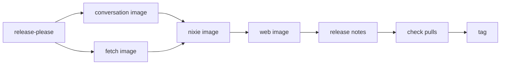

# The release pipeline

A nixie release is one version, cut from one commit on `main`, that publishes every nixie image to
GitHub Container Registry (GHCR). release-please opens a release pull request from the Conventional
Commits since the last release, and merging it creates the `v<version>` tag and the GitHub release.
The release workflow then builds the conversation and fetch images, the nixie image with their
digests inside it, and the web image, in that order. Each image gets a build provenance attestation
as it is pushed, and the version tag reaches every image only after all of them exist. Pull-request
CI checks the 2 compatibility rules that a one-release rollback depends on: the oRPC contract only
grows, and each migration keeps the schema readable by the release before.

[The server](server.md) covers how nixie reads the sandbox manifest that the pipeline writes into
the nixie image, and [the database](../core/database.md#migrations) covers migrations and the oldest
reader. [Releasing](../../runbooks/releasing.md) holds the steps the pipeline leaves to you. The
[release pipeline design](../../design/platform/deployment/release-pipeline.md) covers the images,
checks and verification that later slices add.

## Images and versions

Each image builds for `linux/amd64` only, from the Dockerfile in the package it ships, and lives in
one flat GHCR namespace: `nixie` for the server and `nixie-<image>` for the conversation, fetch and
web images. One release-please component at the repository root versions the whole repo, so one
version covers every image. Conventional Commits drive the bump under Semantic Versioning, the first
release is `0.1.0`, and before 1.0 a breaking change bumps the minor version. The release pull
request bumps the version in the server's source as well as in the manifest, so the server knows the
release it runs without reading a tag.

Each image gets the tag `<version>` without the `v`, such as `nixie:0.4.0`, and no image gets
`latest`, because every consumer pins a digest and a moving tag would invite an unpinned pull.

release-please runs with a GitHub App installation token rather than the workflow's own token. A
pull request that the workflow token opens runs no workflow, so the release pull request would never
run the checks that `main` requires.

## The release workflow

The release workflow runs on every push to `main`, in a concurrency group that never cancels a
release in progress. When release-please reports a new release, the workflow checks out the release
commit and runs one job per stage, each after the stage before it succeeds:

1. **Sandbox images.** The conversation and fetch images build in parallel, and each pushes by
   digest only.
2. **The nixie image.** The workflow builds the sandbox manifest from the stage 1 digests, writes it
   into the build context, then builds and pushes the nixie image by digest.
3. **The web image.** The web image builds and pushes by digest.
4. **Notes.** The workflow adds the migration list and every image digest to the GitHub release.
5. **Check pulls.** The workflow pulls each sandbox image with no credentials, as impd does, and
   fails while a sandbox package is private.
6. **Tag.** The workflow gives the version tag to each image's digest: the sandbox images first,
   then web, then nixie.

The nixie image needs the sandbox digests, so the sandbox images go first. A failed nixie build
stops the release before a web image exists that calls an API no image serves. The tag stage comes
last because Renovate and every other reader find a release by its tag, so the notes and every image
exist before a reader can see the version. A failure before the tag stage leaves untagged digests
that nothing pins, and re-running the failed jobs resumes from the stage that failed with the
digests the earlier stages recorded.

The tag stage copies each digest's manifest to the tag byte for byte, so the tag names the digest
the build pushed. It refuses before it tags anything when a repository already gives the version to
another digest, because a deployment may pin that tag. A tag already on its own digest stays as it
is, so a re-run finishes a partly tagged release. A manual run of the workflow starts on a release
tag, because each attestation names the commit of the run that made it. The manual run rebuilds the
release from that commit and refuses a version that any image already carries.

The sandbox manifest maps each sandbox kind to its image by digest, and no commit holds it. A
committed manifest would need a second commit after the images exist, so the nixie image would come
from a different commit than its sandbox images.

## Build settings and publishing

Every build runs Docker Buildx with its own provenance and SBOM attestations off. Buildx would
otherwise wrap the image in an index, and a single image manifest keeps one digest per image for
impd, Renovate and the attestation subject.

The workflow pushes with its own token, granted package write and no broader scope, so each package
links to the repository and its page shows the source. GHCR creates each package private on its
first push. The sandbox packages must then be set public once in their package settings, because
impd pulls without credentials, and the check-pulls stage fails the release until they are.

Every pull request rehearses the image stages against a registry that lives only for the job. It
builds all 4 images, writes the sandbox manifest, checks that the nixie image carries it, pulls the
sandbox images with no credentials, and tags every image twice to prove the tag stage keeps each
digest and repeats safely. A broken Dockerfile therefore fails the pull request, never a release.

## Attestations

The release workflow attests each image's build provenance as soon as its push returns a digest,
with the repository as the subject name and the attestation pushed beside the image. The attestation
is a Sigstore bundle signed through the workflow's OIDC token, so no signing key exists to store or
rotate. It records the repository, the workflow file, the commit and the run that built the digest,
and `gh attestation verify oci://<image>@<digest> --repo <owner>/nixie` checks one. Nothing verifies
an attestation at deploy yet.

## Compatibility checks

Pull-request CI compares each pull request with the last release, the newest `v*` tag reachable from
its base. Before the first release, CI skips the contract check, and the migration check lists every
migration and refuses none.

The contract check generates an OpenAPI document from the oRPC contract and diffs it with oasdiff
against the copy the release tag holds. The repo commits that document beside the contract, and a
test fails when the two differ, so every release tag holds the document of its own contract. oasdiff
fails on a removed procedure, a removed or retyped output field, a new required input field or a
narrowed input type. A procedure that the last release marks deprecated may go, because the release
that marked it stopped calling it.

The migration check installs the last release's own tree and has it report its migration names and
the schema they build. It then runs the released migrations of the pull request's build on a scratch
database, and fails when they build any table, index or trigger differently, or when the build
renames, removes or reorders a released migration. An edited released migration would leave a new
database with a schema that no upgraded database holds.

The check then records each statement of every migration added since the release. A build that keeps
the schema readable by the release before adds only what an insert from that release still
satisfies: a new table, a non-unique index, and a column that has a default or allows null and holds
no check. A unique index or a constrained column passes only on a table the same release creates,
because the release before never writes to it. A unique index also passes on columns the same
release adds without a default, and an update passes when it sets only such columns, because the
release before leaves them null and a unique index admits any number of nulls. That update is how a
migration backfills a column it adds. A read passes too, because it changes nothing. The check fails
on any other statement. A build declares that it breaks readability by raising its oldest reader
past the last release's schema version, and the check then allows every statement.

The release notes stage runs the same check against the release before, and adds its result to the
GitHub release: each added migration with its schema version, and whether the release before reads
the schema it leaves. The list comes from the code, so it holds every migration whatever the commit
messages say.
