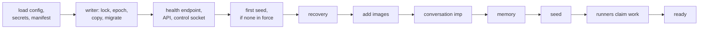

# The server

The nixie server is the composition root: one process that loads the deployment configuration and
the secrets, opens the database as its one writer, and hands each module what it needs from the
others. Modules never import adapters, so the server picks each adapter, such as the imp sandbox
adapter, and passes it to the modules that take its interface. The server starts its parts in a
fixed order behind a health endpoint, reports each part's readiness, and stops by letting the steps
in flight commit. The repo ships it as the nixie image, which runs the release bundle as a non-root
user on a read-only root filesystem. `apps/server` holds the wiring, and `modules/ops` holds the
health checks and the logger.

[The database](../core/database.md) covers the writer lock, the epoch and migrations.
[Leases and recovery](../core/leases-and-recovery.md) covers runner pools and crash recovery, and
[sandboxes](../connectors/sandboxes.md) covers the imp adapter that the server adds images through.

## Configuration and secrets

nixie reads one YAML file, `/etc/nixie/config.yaml` by default, and parses it with a zod schema that
the server composes from one section schema per module or adapter. Each section belongs to the
package that reads it, so a module adds a key by changing its own schema. Every object in the schema
is strict, so nixie refuses to start on an unknown key as it does on an invalid value, and the error
it logs holds the path of the key. A typo therefore stops the start instead of leaving a default in
force.

Secrets never appear in the configuration. The configuration holds the path of the secrets file, a
sops file that nixie decrypts at start by running sops in a child process and reading its JSON from
stdout. The plaintext stays in the process's memory: it never touches a tmpfs, an environment
variable or a Compose secret, so neither the container's configuration nor its disk holds it. The
deployment key becomes a non-extractable AES-KW key at once. A restart decrypts again, so the
restart policy alone brings nixie back after a reboot.

The user's name is private without being a credential. A deployment whose configuration lives in a
public repo therefore puts the name in the secrets file's settings, and the configuration names it
with a `deployment:<name>` reference in place of the name. The server resolves the reference once
the secrets load, and refuses to start when the settings lack the entry, so nixie never shows the
model the reference in place of the name.

The sandbox manifest fixes the image of each kind of sandbox by digest. The release workflow writes
it into the nixie image, so the images a release runs are the images it was tested with. The server
names each image after its kind and its digest, so a new release adds its images beside the old ones
and never overwrites a name a running sandbox uses.

## The start sequence

The server refuses a bad configuration, secrets file or sandbox manifest before it opens anything.
It then starts the parts in a fixed order, and the health endpoint listens before the slow steps.

Every record carries the snapshot hash of the definitions in force
([the definitions](../core/definitions.md)), so on a first start the seed runs before anything else
writes, recovery included. Recovery runs under the new writer epoch and before any runner starts, so
it sees every lease the last process left and settles each one
([crash recovery](../core/leases-and-recovery.md#crash-recovery)). Its sandbox cleanup destroys
every sandbox whose owner no longer runs, and keeps the conversation's sandbox, whose task never
ends, and the memory checker's, which the deployment owns. Recovery ends with a record of the start,
which holds nixie's version and the version of the start before it, so the conversation hears of the
restart ([the events block](../core/conversation-turns.md#the-events-block)).

The server adds each image in the manifest to impd before any part creates a sandbox, because a step
that creates a sandbox on an image impd lacks would fail. The server sends no add for an image that
impd holds under its name at the manifest's digest, so a token that may add no image still starts a
release once impd's administrator has added that release's images. The conversation imp then starts
on its image from the manifest, and the sandbox adapter replaces its sandbox when the image or the
model profile changed. The memory checker starts next on the conversation image
([the checker](../memory/writes.md#the-checker)), and the memory store starts behind it. The store
starts after the conversation imp, because a forget cleans up the conversation's sessions through
it, and before any runner claims work, so every forget that a crash left pending completes before a
turn can read the item ([forgetting](../memory/store.md#forgetting)). The seed runs after the memory
store, so a release's new definitions apply to the turns it runs. Only then do the runners claim
work.

The first seed, recovery, adding the images, starting the conversation imp and the memory store each
wait and run again when they fail, with a log line per attempt. nixie therefore stays live and
unready while impd is down or the definitions refuse to seed, and the container runtime sees why in
the readiness report instead of a restart loop. Any other failure in the sequence logs the error and
ends the process, so the container runtime restarts it instead of leaving it live with no runners. A
stop during the sequence ends it at the next step, and waits for the step in flight before any part
closes.

## Health

The health endpoint serves liveness and readiness, each as a report with one entry per part, and a
status of 200 when every part is ready or 503 when one is not. An unready part carries a short
reason, never an error's message, because a message can quote what the part was working on.

Liveness holds when the process answers and the database answers a query. Readiness lists the parts
this build holds:

| Part             | Ready when                                                  |
| ---------------- | ----------------------------------------------------------- |
| database         | Migrations finished and the integrity check at start passed |
| definitions      | The last seed applied, with no refused snapshot pending     |
| imp host         | impd answers, and every image in the manifest is added      |
| conversation imp | Its sandbox started, and its turns are not failing          |
| disk             | The data volume is under the fill limit                     |

The imp host and disk checks run on each request, and the rest read state that the start sequence
and the runners keep. Each check runs under a timeout, so a part that hangs reports unready instead
of holding the endpoint. The image's health check calls the same endpoint from inside the container.

## Logs

nixie logs JSON lines to stdout. Each line holds envelope fields only: an event name, IDs, kinds,
counts and outcomes. Message text, tool arguments and tool results never reach a log line, because a
line that copied them would keep them after their key is gone
([erasable fields](../core/erasable-fields.md)). The logger writes the envelope on both sides of the
event's fields, so a field can never overwrite the event name or the time.

Most events log only when nixie acts, such as a start, a seed or a check, so a conversation turn and
an idle nixie write no line. The definitions poll logs each probe, whether or not the definitions
changed, so the log shows the process and its timers alive between seeds. A seed logs only when the
probe finds a new revision of the definitions. A seed logs its result with the revision, the content
hash and the snapshot hash of the definitions in force afterwards, so a refused seed shows the last
good seed, and the revision traces a behaviour to a commit of the definitions. A step error logs the
task, the step, the errors in a row, the task's next state, its retry time and the error's name, so
the log shows a failure that a retry hid. The error's message stays on the task's thread, because it
may quote a provider's reply or the model's input.

## Stopping

nixie handles SIGTERM and SIGINT itself, because Bun running as PID 1 ignores a signal that the
process does not handle. The handlers exist before the start begins, so a signal that arrives during
migrations stops nixie once the writer is open. On the signal, every runner pool stops claiming at
once, and each step in flight gets the pool's grace period to commit. The server then stops its
parts in the reverse of their start order: the runners, the conversation imp, the HTTP and control
sockets, and the writer last. A step that misses its grace keeps its lease, and the next start's
recovery settles it. The process exits 0 after a clean stop and 1 when a part failed, such as
another process taking the writer. The container runtime's stop grace must exceed the runner pools'
grace, with room for the parts that stop after the runners, or the runtime kills nixie before the
writer closes.

## Host commands

A host command, such as the one that issues an enrolment code, runs as a second process in the
container. Only the writer may write, so the command never opens the database. It asks the running
server over a Unix control socket in the data directory, in a folder only nixie's user may enter.
Starting the server removes a stale socket file first, because the writer lock proves that no other
server runs.

The session host commands list the live device sessions and set the label of one, which writes the
label record [the API](../channels/api.md#device-sessions) describes. A label is one line of text,
because each message renders it beside the send time.

The memory host commands list the pending memory proposals and approve or reject one. The server
answers each through the memory gate's own answer path, so an approval applies the bound operation
with its approval record and keeps the proposal's provenance ([memory writes](../memory/writes.md)).
An answer names the proposal and the action hash the listing showed. The gate refuses an answer
under another hash, to a proposal that closed or lapsed since the listing, or to one whose item
moved on, and applies nothing. Its approval record names the host as the identity that answered,
because a shell in the container reaches the socket and no device session does. The memory commands
answer once the memory store starts, and refuse before then. An approval that the gate holds for a
close match prints the matching item, and the user answers it again as a revision of that item or as
a new item. An approval may carry the user's own text in place of the proposal's, and the approved
version then records the user as its origin.

The memory item host commands show one item with every version, and edit, retire, restore, pin or
unpin it. Each change runs through the memory store as the user's own action, as a change in the
memory view does, so its version records the user as origin and source, and the earlier versions
stay in the item's history. An edit, a retirement and a restore name the version the user read, and
the store refuses one whose item moved past that version. A pin adds no version, because it changes
where the item shows and not what it says.

## The image and the release bundle

The release build bundles the server into a single script with the test-build flag set false, so the
bundler drops every branch behind it with its imports. The process sandbox double, the crash tests'
fault points and the test policy rule therefore never ship
([the decision point](../policy/decision-point.md)). The SQLite worker is a second entry point of
the bundle, because the bundler does not follow a worker's file URL. The release build fails when
the bundle holds a fault point ID or the test rule's ID, and a test proves that a test build holds
them, so the check cannot pass by matching nothing.

The nixie image builds in two stages. The build stage runs the release build and downloads each
pinned binary, sops among them, and checks each against its pinned checksum. The runtime stage holds
Bun, the bundle, sops and the sandbox manifest: no Claude Code build, no backup tools and no
`node_modules`. It runs as a fixed non-root user with the data directory as its one volume, so the
container runs with a read-only root filesystem.
