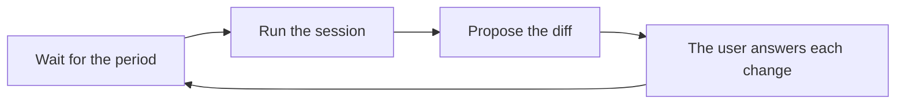

# Memory consolidation

Memory consolidation tidies the user's memory on a schedule: it merges duplicate items, rewrites
garbled wording and retires items that no longer hold. A model proposes those changes as one diff,
and nothing in the diff applies until the user approves it, either whole or one change at a time.
Each change binds to the versions of the items it read, so an approval never applies a change to an
item that moved on after the model read it. Consolidation never forgets an item, and it never reads
the conversation.

The consolidator is a system task in [the task runtime](../core/tasks.md), beside
[the memory writer](./writer.md). [The memory store](./store.md) covers the items, versions and keys
a change writes, and [model profiles](../core/model-profiles.md) cover the `memory-consolidator`
role that picks its model.

## A run

The server starts the consolidator on every start of nixie, and its first run is due at once. Each
later run is due a configurable period after the last one. A run waits while any change from an
earlier diff still waits for an answer, until that change is answered or lapses, so the user never
holds 2 diffs that touch the same item. A failed run waits a retry time and never fails the task.

Each run opens one fresh model session in the consolidator's own worker sandbox on the conversation
image. The prompt lists the active items, oldest first, until their text fills a token budget, and
it tells the model when the list is cut short. The session's only tools are `memory.recall` and
`memory.consolidate`. Every item reaches the session through recall, which records what it
delivered, so the consolidator reads the same items a conversation can and nothing else.

`memory.consolidate` stages the run's one diff. The staging area refuses the whole call, with the
reason going back to the model, in these cases:

- the diff holds more changes than the configured cap;
- one item appears in 2 changes, or twice in one change;
- a change names an item the session was never shown, in its prompt or through a recall;
- a change has the wrong shape: a merge needs 2 or more items and new text, a rewrite one item and
  new text, and a retirement one item and no text;
- the new text holds a destination-like token, such as an email address or a URL, that none of the
  change's items holds.

The token check is the content gate's token check applied to the change's inputs, because the
consolidator has no user message to quote. A diff that passes stages whole, and a second call in the
same run is refused.

## The diff

The step that ends the session commits the diff as one `memory.consolidation_proposed` record. Each
change in it holds its kind, the item and version of each input, the reason, its source, its action
hash and the time it lapses. A change's new text is sealed under the key of its first input, so a
forget of that item leaves nothing to open. A change whose first input lost its key between the read
and the commit drops out of the diff.

A merge keeps its first input and retires the others, and a pinned input goes first so the merged
item keeps the pin. The change takes the least trusted source among its inputs, so a merge of the
user's own fact with outside content never makes that content read as the user's. The action hash
covers the kind, the inputs at their versions and the text, and every answer must carry it. A random
salt sealed beside the text goes into the hash, so the hash reveals nothing about the text once a
forget makes the text unreadable.

## Answers

The user answers a change by approving it, rejecting it, or letting it lapse. An approval applies
the change in one write transaction: the new or retired versions of every input, and the approval
record. The approval record follows [0006](../../decisions/0006-approval-record.md), and an approval
of the whole diff writes one approval record per change. Each written version takes the consolidator
as a task for its origin, the change's source and the session's model.

An approval applies nothing for its change, and reports why, when the change is unknown, answered or
lapsed, when the action hash differs, when an input moved past the version the change read, or when
an input left the active state. The other changes in the same approval go on, so one stale change
never blocks the rest of the diff. A rejection and a lapse each write their own record and leave the
items as they are. The memory sweep lapses the changes whose time has passed.

## Review from the host

The control socket serves the pending diff and takes approvals and rejections, with `host` as the
identity that answers. A host command reads the diff with each input at the version its change read,
and the user approves the whole diff, approves single changes, or rejects one change. The web view
for a diff is not built.
