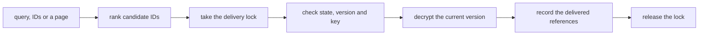

# The memory store

A memory item is one stored fact, such as "the spare key sits under the blue flowerpot", and every
change to it adds a version that nixie never rewrites. Each item has its own key, and every version
of the item's text is encrypted under it, so a forget deletes one key and every version becomes
unreadable at once, in the database and in every backup of it. The model and the client reach memory
through one interface whose verbs are recall, remember, retire, restore, undo, pin and forget. The
`modules/memory` package holds the store, under [0010](../../decisions/0010-memory-store.md) and
[0031](../../decisions/0031-memory-capture-context-and-removal.md).

[The event log](../core/event-log.md) covers the records memory appends, and
[erasable fields](../core/erasable-fields.md) covers the key store that holds each item's key.
[Memory writes](./writes.md) covers the checks a model write passes and the proposals it becomes,
and [memory in context](./context.md) covers how memory reaches the conversation.

## Items and versions

Memory lives in 2 projections of the event log. The items table holds one row per item: its current
version, its state, whether it is pinned, its [short ID](../core/database.md#short-ids), and the
sequences that created it and last changed it. The model reads and names an item by its short ID,
and the store keys everything else, the item's key included, by the item's UUID. The versions table
holds one row per version: what changed, the state that version gave the item, the sealed text, and
the provenance. A version's provenance is its origin (the user, the conversation, a task or the
memory writer), its source of content, the task and proposal behind it, the verdicts of the write
checks, and the evidence offsets inside the message the quote came from. nixie sets every provenance
field from the turn or the client action that wrote the version, and a tool's arguments never reach
them.

The provenance sits in plain columns, so the memory view and a review of poisoned memory filter on
it without decrypting anything. The text, the evidence quote and the user's request to retire the
item sit together in one sealed value.

A version's record carries the sealed value in its plain payload. The fold that builds the versions
table therefore reads only the envelope and the payload, as every fold must, and a rebuild from the
log gives the live rows. The sealed value is ciphertext under the item's key, never free text, so
the log's copy of each version falls to the same forget as the table's copy.

## States

An item is in one of 4 states:

| State      | Recall returns it                 | Changes it accepts                      |
| ---------- | --------------------------------- | --------------------------------------- |
| active     | Always                            | edit, retire, undo, pin, forget         |
| retired    | Only when asked for retired items | edit, restore, undo, unpin, forget      |
| forgetting | Never                             | none; the forget completes it           |
| forgotten  | Never                             | none; the key is gone and nothing reads |

Retirement ends a fact that stopped being true, and the item stays readable with its history. A
retired item leaves the pinned core, and a restore does not pin it again. Forgetting destroys an
item, and only a checked action in the client forgets one, so a misread "forget that" in the
conversation retires an item and never destroys it.

## Changing an item

Every change except a pin adds a version, and each one binds to the version the caller read. When
the item has moved past that version, the change fails as stale and writes nothing, so 2 tasks that
edit the same item never overwrite each other unseen. The version's record, the item's row and the
version's row commit in one write transaction, behind the writer epoch check that every write
transaction makes.

- **Remember** creates an item with its key and its first version, or adds an edited version that
  keeps the item's state.
- **Retire** and **restore** add a version with the same text and the other state. A retire, a
  restore and an undo keep the source of the text they copy and take only the origin from the actor,
  so a state change never relabels outside content as the user's words.
- **Undo** adds a version with the text and state of the version before the one it undoes. Undo
  binds to the version it undoes, so an undo after a later edit fails as stale instead of discarding
  that edit. An undo of a first version retires the item, because no earlier text exists.
- **Pin** changes where the item shows and not its text, so it appends a record and adds no version.
  Only an active item can be pinned. A pin, or an edit of a pinned item, fails when it would take
  the pinned core past its budget ([the pinned core](./context.md#the-pinned-core)).

## Keys

Each item's key is an AES-256-GCM key in the key store, under the item's ID, which is random as
every key store ID must be ([key store IDs](../core/database.md#key-store-ids)). The deployment key
wraps it, as it wraps every record key. Every version is encrypted under its item's key with the
item ID and the version number as additional data, so a sealed value copied under another item or
another version fails to decrypt.

## Recall

Recall takes a query, a list of item IDs, or neither, which lists every active item a page at a time
in the order they were created. It returns each item's text exactly as stored, with its ID, version,
origin, source, date, the quote the gate checked and the model that wrote it, and with its history
it returns every version. A recall never summarizes, so the user can check an answer about memory
against the items themselves, and the quote lets the model check a summary against the words it came
from.

The index and the listing rank candidate IDs and never supply the returned text. Under the delivery
lock, recall reads each candidate's current row again, drops any that is not in a state the request
allows or whose key is gone, decrypts the rest, and appends a recall record that lists each item and
version it delivered. For a query, each item in the record carries its match score from the index,
so the client can show what each turn was given and how well it matched. The record holds references
and scores and no text, so a later forget leaves no readable copy of what a recall delivered. A
client reads a delivered version's text through the API while its key exists.

### The index

The keyword index is an FTS5 table with the porter tokenizer in an in-memory SQLite database. It
holds the current text of active items only, and nothing writes it to disk, because a persisted
full-text index keeps forgotten words after their key is gone, as the
[shredding spike](../../design/platform/spikes/memory-shred/README.md) found. Each start rebuilds it
from the readable active items. A version's record is the index's invalidation record: after the
record commits, still under the delivery lock, the store replaces the item's entry with its current
text or drops an item that left the active state. A query matches any of its words, and the store
quotes each word, so no character a caller sends reads as FTS5 syntax. The index leaves function
words, such as "to" and "a", out of both the query and the text it stores. BM25 weighs a word by how
few items hold it and not by what it means, so a function word that one item holds would score as
high as a topic word and bring back an item the query says nothing about. The filter covers the
stored text too, because the porter tokenizer stems some content words to a function word, such as
"one" to "on". A word in capitals, such as "US", is an acronym and stays. A query can also set a
score floor, which drops each match whose BM25 score falls below it, and can leave pinned items out.
BM25 gives no weight to a word that half the items hold, so in an index of 1 or 2 items every match
scores about zero, and a floor above zero drops every match.
[Per-turn retrieval](./context.md#per-turn-retrieval) uses both, so a word that half the items share
places nothing, and under a floor above zero a store of 1 or 2 items places nothing per turn. A
query can also list excluded words. The index stems them with the same tokenizer as the query, and
drops each query word whose stems all match one of theirs, so "Nixie's" drops with "nixie".

### The delivery lock

Writes, retire, forget and the last step of every recall share one lock. A forget marks the item
forgetting and drops its index entry while it holds the lock, and a recall checks each item while it
holds the lock. A recall that ranked an item before a forget therefore finds the item gone when it
checks, and a recall that checked first has recorded its delivery before the forget begins, so no
recall delivers the text of an item after its forget started.

## Forgetting

A forget binds to the version the confirmation showed, so a later edit makes it stale. It runs as a
durable operation in 2 parts:

1. Under the delivery lock, nixie checks the item and its version, appends a record that marks the
   item forgetting, and drops the item from the index. From here no recall delivers the item.
2. The cleanup deletes the item's key and checkpoints the key store, drops the index entry again,
   runs the session cleanup for every live session, and appends the record that marks the item
   forgotten.

Every step of the cleanup is safe to run twice. A crash between the 2 parts, or anywhere inside the
cleanup, leaves the item forgetting, and the store's start runs the cleanup for every forgetting
item before it builds the index and before any runner claims work. A deleted key never returns while
a forget waits, and the forget completes only after the session cleanup returns.

The key deletion and its checkpoint are the ones [erasable fields](../core/erasable-fields.md)
describes, so neither the key store file nor its write-ahead log keeps the wrapped key. The version
rows and their records stay as ciphertext, and the memory view reads every version of a forgotten
item as a gap with its date and provenance.

With no key backup registered, a forget completes after local cleanup. The session cleanup is the
one the server passes in from the conversation, and
[memory in context](./context.md#forgetting-and-the-live-session) covers what it removes.

## The model's tools

The model reaches memory through 7 tools over the same interface:

| Tool              | Effect | Does                                                       |
| ----------------- | ------ | ---------------------------------------------------------- |
| `memory.recall`   | `read` | Recalls items by query, by ID or a page at a time          |
| `memory.pending`  | `read` | Lists the proposals that wait for the user's review        |
| `memory.remember` | `note` | Creates an item, with a quote                              |
| `memory.edit`     | `note` | Edits an item at a version it read, with a quote           |
| `memory.retire`   | `note` | Retires an item at a version it read, with an intent quote |
| `memory.diff`     | `read` | Shows the pending consolidation diff                       |
| `memory.comment`  | `note` | Leaves a comment on one change of that diff                |

Creating and editing are separate tools because the tool list is where the model learns what it can
do, and a model that finds editing only in the description of a create tool can miss it.

Each write tool runs its gate, and returns either the version it applied or the proposal it became,
with its review reason. A missing quote is no tool error, because the gate turns it into a proposal.
The result gives the review reason as its code followed by a fixed sentence: the write waits for the
user's review, and why. The store renders the sentence with the user's name and pronouns from the
deployment config and with the gate's own evidence window, so the model reads the rule the gate
applied instead of guessing at a bare code. Each code has one sentence that the model never writes,
so the reasons stay a closed set.

Each tool takes its provenance from the task run: the conversation's thread gives the conversation
as origin, any other thread gives a task, and the run's model gives the model ID. A recall result
takes outside content as its source, because the items it returns hold every source memory holds.
The `memory.recall` result gives each version its text and the line that says where it came from, in
the words the conversation reads ([how an item reads](./context.md#how-an-item-reads)), and its
description tells the model to reach for it when a half-remembered detail would change an answer. A
past version's line names the version that replaced or retired it. A stale version, a missing item
or a wrong state returns to the model as the tool's refusal, so the model reads the item again. The
model can retire an item and can never restore, undo or forget one. The server registers the 7 tools
beside web fetch, and the conversation's tool list names them. The read-only rule allows them,
because they declare `read` and `note` and run direct.

`memory.pending` lists every pending proposal, the model's own and the note-taker's, so the model
knows what it proposed after a compaction drops the turn it proposed in, and never proposes a change
that already waits. Each entry gives the proposal's text, its review reason, its age, and who noted
it in the words the model reads elsewhere: the conversation reads as the model itself, and the
memory writer as the note-taker. The tool lists and never answers, because only the user approves or
rejects a proposal. Its result takes outside content as its source, as a recall result does.

The records of a memory tool call never hold an item's text, so a forget leaves no readable copy in
them. A recall's result record lists each item and version it returned, as the recall's own record
does, while the model reads the items word for word. A pending call's result record lists only the
proposal IDs. Each call record leaves out the free text the model wrote: the search words, the
memory text and both quotes. The model can copy an item's text into any of them, and the record
holds them before a gate checks a quote. The version keeps the memory text under its item's key, and
its evidence points at the quote in the user's message.
