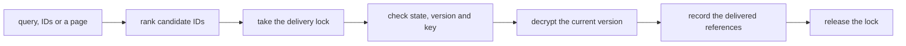

# The memory store

A memory item is one stored fact, such as "the spare key sits under the blue flowerpot", and every
change to its text or state adds a version that nixie never rewrites. Every value of an item that
holds words, its text, labels and quotes included, is encrypted under keys that belong to that item,
so a forget deletes those keys and every version becomes unreadable at once, in the database and in
every backup of it, under [0007](../../decisions/0007-crypto-shredding.md). The model and the client
reach memory through one interface whose verbs are recall, remember, edit, edit labels, retire,
restore, undo, pin, unpin and forget. The `modules/memory` package holds the store.

[The event log](../core/event-log.md) covers the records memory appends, and
[erasable fields](../core/erasable-fields.md) covers the key store that holds each item's keys.
[Memory writes](./writes.md) covers the checks a model write passes and the proposals it becomes,
and [memory in context](./context.md) covers how memory reaches the conversation.

## Items and versions

Memory lives in [projections](../core/event-log.md#projections): tables that nixie builds from the
records of the event log, and can rebuild from them. The items table holds one row per item: its
current version, its state, whether it is pinned, its [short ID](../core/database.md#short-ids), its
subject, a count of its label edits, and the sequences that created it and last changed it. The
model reads and names an item by its short ID, and the store keys everything else, the item's keys
included, by the item's UUID.

Each item has one of 3 subjects: owner for a fact about the user, shared for something between the
user and nixie, such as a deal, a nickname or a running joke, and self for a
[self-note](./writes.md#self-notes) that nixie writes about itself. A new item, or a new item's
proposal, is owner unless the same write transaction commits a subject mark: a record of its own,
`memory.shared_noted` or `memory.self_noted`, or the `memory.proposal_` form of each for a proposal.
Later, only an approved [subject change](./writes.md#subject-changes), an undo of one, or a
`memory.retopic` call moves the item. The first two write a subject change record beside the version
record that moves it; [a re-file](#moving-a-topic) writes a label record.

The subject travels in records of its own because nixie keeps its log and tables readable by the
release before it, so a rollback by one release works
([migrations](../core/database.md#migrations)). That release skips a record kind it does not know,
and refuses a version or proposal record with a field it does not know. For the same reason the
items row keeps a kind column, `self` or `fact`. When a row's subject column is empty, the store
reads `self` as the self subject and `fact` as owner.

The versions table holds one row per version: what changed, the state that version gave the item,
the sealed text, its [end time](#end-times), and the provenance. A version's provenance is its
origin (the user, the conversation, a task, or a lapse when an end time passed), its source of
content (the user's own words, or [untrusted](../../glossary.md) text), the task and proposal behind
it, the verdicts of the write checks, and the offsets of the evidence quote inside the message it
came from. nixie sets every provenance field from the turn or the client action that wrote the
version, and a tool's arguments never reach them. The provenance sits in plain columns, so the
memory view and a review of poisoned memory filter on it without decrypting anything.

The text sits in one sealed value, and the evidence quote and the user's request to retire the item
sit sealed apart from it, as [Keys](#keys) says. A version's record carries the text value in its
payload, which a projection reads. It keeps the value out of its erasable fields, which a projection
never reads ([what a record holds](../core/event-log.md#what-a-record-holds)), so a rebuild from the
log gives the live versions rows. The sealed values are ciphertext under the item's keys, so the
log's copy of each version falls to the same forget as the table's copy.

## Labels and the revision

Each item has labels: a gist of 1 to 80 characters, a topic of 1 to 40 and up to 5 trigger phrases
of 1 to 60, each on one line. The gist sums up the item, the topic groups it, and a trigger phrase
holds words that should bring it up. Recall lists items by their labels, so the model can choose
which items to open. The labels sit sealed under the item's key, in a `memory_labels` table with one
row per labelling, written by a `memory.labelled` record. The store keeps the current labels of
every item in memory, loads them at start, and drops an item's entry when a forget removes its keys.

A label edit adds no version, because the version counts changes to the text and the state. The
item's revision counts both: it is the version plus the items row's count of label edits, and the
store adds the two on read, so the items row holds no revision. A change binds to the revision
([changing an item](#changing-an-item)), so an edit of labels makes a stale read fail like any other
edit. The model's tools, the API and the memory view carry the revision in a field named `version`.
A labelling keeps the revision it made, and a proposal the revision it targets. Version records, the
versions table, the history, a recall record and a proposal's hash keep the version. In this doc,
"version" always means the text version.

An item with no label row shows labels that nixie derives from its text: the gist is the text with
its spacing collapsed and cut to 80 characters, the topic is the subject, and there are no triggers.
At each start the store writes those derived labels for each such item, in a `memory.labelled`
record whose change is `backfilled`. A backfill counts as no label edit, and a second start finds no
item to label. A new item takes the topic's spelling from an existing item that differs only in
case.

A topic has no ID and no hash in any record, so a forget leaves nothing that leads from the item to
its topic. Label text exists on disk only sealed: in the `memory.labelled` and
`memory.proposal_labelled` records, in `memory_labels.sealed` and in
`memory_proposals.sealed_labels`. nixie creates an item's ID and key when it writes the proposal
that creates it, and seals that proposal's labels under that key, so a proposal and an approval
never write label text in the clear.

The label record always holds the whole label set, and one function writes it for every path and
updates the in-memory entries. A waiting proposal writes nothing to its item. A label-only proposal
matches a pending one only when both whole label sets are equal: a second proposal with the same
labels merges into the pending one, and one with other labels waits beside it, so approving one
makes the other stale. A subject change writes no label record, and the item keeps its labels.
`undo` undoes the last text change only, so a label stays as it is until an edit changes it. A
session that holds the number from before a label edit gets the stale error once and reads the
revision from it. A label-only edit leaves the text unchanged, so `memory.retire` still accepts a
recall of the text from before that edit as the
[proof that the thread read the item](./writes.md#retirement-intent).

A label-only proposal's `memory.proposed` record holds the operation `remember`, the text version
and a copy of the text, so a reader that knows no label record kind still parses it.

## States

An item is in one of 4 states:

| State      | Recall returns it                 | Changes it accepts                                  |
| ---------- | --------------------------------- | --------------------------------------------------- |
| active     | Until its end time passes         | edit, edit labels, retire, undo, pin, unpin, forget |
| retired    | Only when asked for retired items | edit, edit labels, restore, undo, forget            |
| forgetting | Never                             | none; the forget completes it                       |
| forgotten  | Never                             | none; the keys are gone and nothing reads           |

Retire an item when its fact stopped being true: the item stays readable with its history. A
retirement takes the item out of the pinned core, and a restore does not pin it again. Forgetting
destroys an item, and only a checked action in the client or a reset of the memories at the host
forgets one, so a misread "forget that" in the conversation only retires an item.

## Changing an item

Each change binds to the revision its caller read, except the model's unpin and a pin from a
[host command](../deployment/host-commands.md#memory), which carry none. The client's pin and unpin
carry the revision the user saw. When the item has moved past that revision, the change fails as
stale and writes nothing, so 2 tasks that edit the same item never overwrite each other unseen. The
change's records and the rows they fold into commit in one write transaction, behind the check on
the writer's epoch that stops an older nixie process from writing
([the single writer](../core/database.md#the-single-writer)).

- **Remember** creates an item with its key and its first version, and **edit** adds an edited
  version that keeps the item's state.
- **Retire** and **restore** add a version with the same text and the other state. A retire, a
  restore and an undo keep the source of the text they copy and take only the origin from the actor,
  so a state change never relabels untrusted text as the user's words.
- **Undo** adds a version with the text and state of the version before the current one. An undo
  after a later edit therefore fails as stale instead of discarding that edit. An undo of a first
  version retires the item, because no earlier text exists.
- **Edit labels** adds a `memory.labelled` record and no version, and raises the revision by 1.
- **Pin** and **unpin** change where the item shows and not its text, so each appends a
  `memory.pinned` record and adds no version. A pin or unpin that joins a
  [notice](./writes.md#notices) also appends a `memory.pin_noticed` record that holds the notice
  key, because the release before refuses a `memory.pinned` record with any other field. A pin from
  the model or the client carries the revision its caller read, and fails as stale once the item
  moved past it. Only an active item can be pinned, whatever its subject. A pin, or an edit of a
  pinned item, fails when it would take [the pinned core](./context.md#the-pinned-core) past its
  budget. An unpin also fails when the item is not pinned.

## End times

An item can carry an end time, the UTC instant after which its fact stops holding, such as the end
of Sunday for "is in Lisbon this week". The end time sits in a plain column on each version, and the
item's row takes it from the current version. A remember that leaves the end time out of an edit
keeps the current one, and an edit can clear it. The store refuses an end time that has passed.

Recall treats an active item past its end time as retired from that instant, before any version
records it. A recall of active items and the pinned core drop the item, and a recall that asks for
retired items returns it as retired and unpinned. A restore accepts such an item as it accepts a
retired one, and unpins it as a retirement would. The cut-off sits at read time, against the store's
clock, because the indexes change only when a version is written.

The server runs a lapse sweep every hour. It lapses overdue
[proposals](./writes.md#memory-proposals), and retires each active item past its end time with the
lapse origin. The retirement keeps the end time on its version, so the history shows when the fact
was set to end. When an item changed between the sweep's read and its retirement, the sweep leaves
the item to the next sweep. A lapse never forgets an item, so an early end costs the user one
restore. A restore clears the end time, and so does an undo of a lapse, so the next sweep leaves the
item active.

## Keys

Each item key is an AES-256-GCM key in the key store, wrapped by the deployment key as every record
key is. Every version is encrypted with the item ID and the version number as additional data, so a
sealed value copied under another item or another version fails to decrypt. An item has keys of 2
kinds:

- A generation key seals each proposal and each labelling written while it is in force. The key
  whose ID is the item's UUID is generation 0, random as every key store ID must be
  ([key store IDs](../core/database.md#key-store-ids)). Each [purge](#the-evidence-purge) closes the
  generation in force and starts the next under a new key.
- A version key seals one version's text, so a purge can keep the current text and delete the rest.
  Every version written from the release that added version keys has one, the first version of a new
  item and a proposal's approval included. A version written before then shares generation 0 with
  its item's other values, as does its quote, which sits inside its text. Such an item is shared-key
  until its next version.

Every key after generation 0 has an ID of the form `<item UUID>/<random UUID>`, so the memory forget
finds every key of an item in the key store alone, by that prefix and the UUID itself. A writer
creates a version's key in the key store before the transaction that commits the version, under the
delivery lock. A key whose commit never lands decrypts nothing, and the memory forget deletes it by
its prefix.

A version with a version key seals its text there with no quote. Each quote of another record, the
evidence and the intent, sits sealed twice in the `memory.version_keyed` record that the version's
transaction writes: first under the quoted record's key, which binds the item, the record and the
offsets, then under the version key. A forget of the quoted record deletes the record's key, so the
quote becomes unreadable with no purge step, and the memory forget still deletes the outer seal. A
writer seals a quote only while the quoted record's key exists. When it is gone, the version keeps
the quote's offsets and stores no quote. A retire, a restore and an undo copy an earlier version, so
they seal its quote again under the new version's own key, from the earlier version's readable
quote.

### The evidence purge

A purge removes the copies of a forgotten message that a memory item holds. The message is the
evidence of some version, and the item's older versions and pending proposals keep its quote, so the
purge makes those values unreadable and keeps the current text readable. The started record holds
the forgotten record and the items to purge, the purge set: each active, retired or forgetting item,
and each pending proposal for a new item, that has a version or a proposal whose evidence or intent
evidence names the record. The [record forget](../channels/api.md#forgetting-a-record) writes the
record in the transaction that writes `record.forget_started`, so a crash leaves both or neither. It
writes none for a record that no item quotes, because a second read finds the same empty set.

From the started record on, every reader reads each older version and pending proposal of those
items as removed. Every proposal write for one of those items fails with `ItemPurgingError` until
its purge finishes. A write that quotes a record whose forget has begun fails with
`QuotedRecordForgettingError`, and an undo of a version that reads removed fails with
`VERSION_REMOVED`, as [memory writes](./writes.md) describes.

The purge of one item commits once, under [the delivery lock](#the-delivery-lock). That commit
lapses the item's pending proposals. When no version key seals the current text, it writes a bridge
version: a copy of that text under a new version key. It closes the generation key in force and
every version key except the current version's, in a `memory.evidence_purge_closed` record that
holds the next generation key. It then seals the current labels again under the next generation key.
The bridge and the new labelling each raise the revision, so a change bound to the revision before
the purge fails as stale. After the commit the purge deletes the closed keys and writes
`memory.evidence_purged`.

An item whose own [forget](#forgetting) has begun gets no closing commit, because that forget
deletes every key of the item. The purge waits for that forget: it runs the item's open erasure to
its end, which deletes every key of the item, and then writes `memory.evidence_purged`. A forget
that an earlier release left in forgetting gets its `erasure.started` first. So `record.forgotten`
always follows the delete of every key that holds the record's text, even when the item's own forget
has not reached its key delete.

The memory view's history shows a bridge with its text and "Kept when a message was removed", with
no change or origin. Recall shows its change as `kept`, with the line "kept when a message it quoted
was removed".

A record forget destroys the forgotten record and, for a task's brief, each `task.start` call record
that holds the brief ([started tasks](../core/started-tasks.md#the-start)). It runs the
[session cleanup](./context.md#forgetting-and-the-live-session), which invalidates each session that
can hold the record's text, once for each record it destroys. The call records go first and the
forgotten record last, because the cleanup for the forgotten record finishes that record's purge set
before the forget writes `record.forgotten`, and every other cleanup must have run before a purge
deletes a key. The backup job reads `record.forgotten` as the forget's end, so every key a purge
deletes is covered by [the forget's backup state](../deployment/backups.md#a-forgets-backup-state).

A forget that an earlier release began has `record.forget_started` and no purge set. Its cleanup
writes the set in one transaction before any key goes, because the set reads the evidence of the
items that the purge then changes, and then goes on. A cleanup that runs again finds the set and
writes nothing more. A forget that an earlier release finished, with a `record.forgotten` and no
purge set, leaves its quotes in the items, and the user forgets such an item from the memory view.

A kill at any step leaves a state that the next start finishes, because each step finds its own
record or a missing key and writes nothing more when it runs again:

| A kill after                          | The start finds                                    | The start does                          |
| ------------------------------------- | -------------------------------------------------- | --------------------------------------- |
| the forget's first transaction        | `record.forget_started` with no `record.forgotten` | the rest of the forget                  |
| the new keys, before the commit       | no closing record for the item                     | the item's purge again, with fresh keys |
| the commit, before the key deletes    | a key of the closing record still in the key store | the deletes                             |
| the key deletes, before the last mark | no `memory.evidence_purged` for the item           | `memory.evidence_purged`                |
| every item                            | no `record.forgotten`                              | `record.forgotten`                      |

[Crash tests](../core/crash-tests.md#fault-points-of-the-forget) lists the fault points that hold
each of these. The purge deletes a key with `removeRecordKey`, which fails when a reader of the key
store holds the write-ahead log. The purge then stops before `memory.evidence_purged`, so a purge
counts as done only after the checkpoint cleared the old key from the log.

The server's start finishes each purge that no open record forget owns, where an open forget has no
`record.forgotten` yet. The release before this one can end a forget with such a purge left: it
skips an item whose own forget began, deletes that item's keys at its start before any record
forget, and never marks the item purged. No code writes a purge set with no record forget behind it,
and the start scrubs nothing. A scrub of each merge change of the consolidator would be needed only
because a change sat under the key of its first input. The migration that removed the consolidator's
records and tables ran at every earlier release's first start, before memory starts, so no database
that this release opens holds such a change.

### Reading a key

Every reader of an item's value finds its key through one lookup, `readItemKeys`, which takes a
version, a version's quote, a proposal or a labelling, and answers `readable` with the key or one
of:

- `removed`, when a purge closed the key, or the item is under purge and the value is not current;
- `shredded`, when the key store no longer holds the key;
- `unreadable`, when the key fails to unwrap.

The lookup reads 2 projections: `memory_item_keys` holds each key after generation 0 with the
sequence of the record that closed it, and `memory_evidence_purges` holds each item of a purge set
and how far its purge got. A purge marks each key it closes in `memory_item_keys` before it deletes
the key. The lookup therefore reads those rows, then the keys, then the rows a second time, so a key
that a purge deleted during the key read reads as `removed`, never `shredded`. The lookup picks the
generation key in force when the value's record was written. A writer that seals a new value has no
record yet, so it takes the newest generation key from `readCurrentItemKey`, beside the lookup.

A test beside the lookup fails when a file under `modules/memory/src` outside its list calls the
log's raw key reader, `readRecordKeys`. The list holds the lookup, `readCurrentItemKey`, and 2
readers of keys that seal no item value: the version quote reader in `version/`, which reads the key
of a quoted record, and `readHeldRecordKeys` in `utils/record/`, which finds the keys still held
before a sweep deletes the keys of closed proposals for new items and of saved photo offers.

## Recall

Recall takes a query, a list of item IDs, or neither, which lists every active item a page at a time
in the order they were created. A call can instead ask for a topic or the topic list
([topic pages](#topic-pages-and-the-topic-list)). Each of these calls can name `subjects`, and the
items of every other subject then drop out before the call's limit applies. Recall returns each
item's text exactly as stored, with its ID, revision, origin, source, date, the quote that
[the content gate](./writes.md#the-content-gate) checked and the model that wrote it, and with its
history it returns every version. A recall never summarizes, so the user can check an answer about
memory against the items themselves, and the quote lets the model check a summary against the words
it came from.

The index and the listing rank candidate IDs and never supply the returned text. Under the delivery
lock, recall reads each candidate's current row again. It drops a candidate whose state the request
does not allow, and counts an item past its end time as retired for that check. It also drops a
candidate whose key is gone. It decrypts the rest, and appends a recall record that lists each item
and version it delivered. For a query, each item in the record carries its keyword score and its
similarity, each where that index placed it, and the record says how the query searched, so the
client can show what each turn was given and how well it matched. The record holds references and
scores and no text, so a later forget leaves no readable copy of what a recall delivered.

A query searches both indexes, each above its own floor, and reciprocal rank fusion merges the two
rankings, because a BM25 score and a similarity share no scale. A query can also cap self-notes on
their own: it then ranks them apart, so the user's and the shared items never crowd self-notes out,
and its one recall record lists both. The record's search mode is hybrid, keyword with no encoder,
or keyword fallback while the vector index rebuilds.

### The page limit

The conversation's `memory.recall` returns a page that fits a limit in UTF-8 bytes, because the
Agent SDK's command-line program cuts a longer tool result at a place the host cannot learn. That
program counts the tool-output limit in tokens, and text outside English or full of links comes to
under 3 bytes a token. The limit, `recallPageLimitBytes` in `libs/wire`, therefore allows 2 bytes
for each token of the tool-output limit, and keeps 4,000 bytes back for the rest of the result.

The store cuts the page, and it cuts under the delivery lock, before it appends the recall record.
The tool passes the byte budget, which is the limit less the largest the result can take outside its
items, and a function that measures each item exactly as the tool returns it. The store keeps each
item while the measured bytes, with a byte for each comma, fit the budget, and stops at the first
item that does not fit. It always keeps the first item. A request with no budget cuts nothing. The
record lists exactly the item versions the result holds. A `memory.retire` applies only to a version
that a recall record shows the thread received ([retirement intent](./writes.md#retirement-intent)),
so a retire of an item the page left out goes to the user's review.

When the first item alone goes over the budget, the store keeps its current version and the newest
past versions that fit, and the tool drops the item's links to [moments](./moments.md) from the end
until the result fits. A current version that goes over the budget on its own comes back and is
recorded whole.

The result's `leftOut` lists what the page left out, so the model can recall those items next, and
`next` starts the plain list at the first omitted item. `searched` echoes the call's query or item
IDs, cut so it always fits the page limit. A recall that finds nothing, from any caller,
[per-turn retrieval](./context.md#per-turn-retrieval) included, returns an empty `items` list and
appends no record. The stored tool record holds `leftOut` by item ID and no `searched`, so the query
text stays out of it.

For `itemIDs`, `leftOut` names the IDs past `limit` and the items the cut left out, as one run in
the order named. For `query`, it names the matches the cut left out, in rank order, and never a
match below the first `limit`. For the plain list and for topic pages it lists no IDs, and `next`
starts at the first omitted entry. `leftOut` never lists an ID that the store drops for another
reason, such as an unknown ID, a forgotten item, a retired item without `includeRetired`, or an item
outside `subjects`. A call that passes `subjects` limits any kind of call to those subjects. The
store's recall holds an item's whole current version, which is at most 6,000 characters of text
(2,000 for an owner or shared item) and 2,000 of quote, so the command-line program's own cut at
48,000 characters never reaches it.

### Topic pages and the topic list

A call with `topic` returns the gist of every active item that is not pinned and holds that topic or
a topic under it, such as `people` for `people/friends`, ignoring case. A call with `topics` returns
one entry per topic as its items hold it, with its subject and item count. Both read the in-memory
label entries and the item projection under the delivery lock, decrypt nothing and write no recall
record. Entries come in the order of [the memory index](./context.md#the-memory-index): by subject,
then topic, or newest first for the lines of a topic. A call can pass `subjects`, and `after` is the
decimal offset of the first entry to return.

A page holds at most the number of entries that the memory config's `index_topic_page` sets, and
then only the entries that fit the page limit, with the first entry always kept. `next` is the
offset of the first entry left out, or `null`, and `leftOut.count` counts every entry after the
page. A topic with no item returns an empty `lines` list with `searched`. The stored tool record of
a topic page holds the short IDs of its lines, and the UUIDs behind them under `hidden`, a field
that never reaches the model ([short IDs](../core/database.md#short-ids)). The record of a topic
list holds no topic name.

The tool refuses a call before it reaches the store, so with no record, when the call passes more
than one of `query`, `itemIDs`, `topic` and `topics`, passes `after` with `query` or `itemIDs`, or
passes `includeRetired`, `includeHistory` or `limit` with `topic` or `topics`.

### Moving a topic

`memory.retopic` moves either a whole topic, `from` a topic and subject, or a list of items, `items`
by short ID, `to` a topic and subject, in one call. A move of a topic takes each active or retired
item under that topic or a topic under it, and rewrites the matching part of each topic, so
`people/friends` follows `people` to its new name. A topic that would pass 40 characters refuses the
whole move. The item keeps its text, gist and triggers, so no version is added, and the call reuses
the spelling of a topic that another item already holds.

The call has the effect of a label-only edit. It writes the same `memory.labelled` record for each
item it moves, all in one write transaction under the delivery lock, so a failure leaves every item
and every in-memory label entry as it was. An item that changes subject carries its new and previous
subject in that same record, so every item gets one record. A pinned item stays under its subject,
because the pinned core renders each subject under its own heading, so a move that would change its
subject refuses.

A move refuses, with a named code and no write, when it holds no item (`EMPTY_MOVE`), names an item
that does not exist (`UNKNOWN_ITEM`), puts every item where it already is (`SAME_TOPIC`), passes 40
characters (`TOPIC_TOO_LONG`), moves a pinned item to another subject (`PINNED_SUBJECT_MOVE`), holds
an invisible character (`INVISIBLE_CHARACTER`) or moves other items than the card showed
(`CHANGED_SINCE_SHOWN`). The model reads and passes short IDs only, and an item's internal ID names
no item. The refusal for the contents of a move, such as an unknown item, comes from the call's run,
after the decision point, so a deny rule keeps what the memory holds from the model. A call with
both `from` and `items`, or neither, refuses before the decision point, because that reads no
memory.

The label record accepts a field it does not know, so the release before reads the record and leaves
the item under its old subject, with the new topic. The versions table records no previous subject
for a move, so an undo of the item's last text change leaves its subject as it is.

A refusal returns to the model as a result with `status` `refused`, its `code` and its message, and
the call records the code as its refusal code. An applied move returns `moved`, the count of items
moved as `active` and `retired`, and `move`, the move in words with the same split, such as
`owner/home → owner/house, 1 active, 32 retired`. A state with no item moved leaves its part out of
the words. An item whose end time passed before the lapse sweep counts as retired, as delivery reads
it.

The same rules cover `memory.retopic` as cover `memory.edit`: an allow, ask or deny rule that names
`memory.edit` or the effect `memory_write` matches it. A rule can check `subject`, the subject of
every item the move touches, `topic`, the topic each item moves to, one value or a list, since a
move of a whole topic gives each sub-topic its own, `itemID`, the short ID of each item that moves,
and `from.topic`, `to.topic` and `items`. A move into or out of self touches a self-note, so an
allow rule that covers it must check `subject` `eq` `self`, which only a move from self to self
meets, and no other allow rule counts. A move has no always-allow choice, because no check pins
free-text topics.

A call that no allow rule covers, and a call that an ask rule matches, waits for the user as an
action proposal, because one call moves many items. The call stores the move, such as
`self/lines → self/diary, 20 items`, the gist of each item and the item's ID, sealed under its own
record. The proposal's card shows the move as its sentence and the item count with the gists folded
under it. The user's approval runs the call only when it moves the items the card showed, so an item
that joined the topic since refuses the call and waits for a new card. The user's approval never
lifts the self-note caller check: an approved move into or out of self by a task without the
self-note grant fails ([self-notes](./writes.md#self-notes)).

A forget of an item removes the key of each stored card that names it, so the card then shows no
body and the call refuses. A card stored after the forget finished is checked once the call's record
holds it, and loses its key then, so no gist outlives its item.

### The folded order

`memory.fold` sets, for a topic of one subject, whether the folded rows of
[the memory index](./context.md#the-memory-index) show the newest or the oldest 3 items. The default
is the newest. The topic is the part before the first slash, and the setting covers the topic's row
and each sub-topic under it. The call refuses a topic that no active item holds under that subject.

The setting lives in a `memory.fold_ordered` record, which holds the subject and the order in its
payload and the topic in its erasable fields, because a topic name is label text. The index reads
the records when it renders, and the latest record of a subject and topic wins, so the setting
survives a restart and needs no table. The forget of an item removes the key of each fold record
whose topic no item holds under that subject any more, so the topic name goes with the last item.

### The indexes

The keyword index is an FTS5 table with the porter tokenizer in an in-memory SQLite database. It
holds the current text of active items only, and nothing writes it to disk, because a persisted
full-text index keeps forgotten words after their key is gone. FTS5 records a delete as a marker
until its segments merge, so under its default settings a deleted row's words stay in the database
file even after `VACUUM`, and no setting removes them from a backup taken before the forget. Each
start rebuilds the keyword index from the readable active items. After a version's record commits,
still under the delivery lock, the store replaces the item's entry with its current text or drops an
item that left the active state. A query matches any of its words, and the store quotes each word,
so no character a caller sends reads as FTS5 syntax.

The index leaves function words, such as "to" and "a", out of both the query and the text it stores.
BM25 weighs a word by how few items hold it and not by what it means, so a function word that one
item holds would score as high as a topic word and bring back an item the query says nothing about.
The filter covers the stored text too, because the porter tokenizer stems some content words to a
function word, such as "one" to "on". A word in capitals, such as "US", is an acronym and stays.

A query can also set a score floor, which drops each match whose BM25 score falls below it, and can
leave pinned items out. BM25 gives no weight to a word that half the items hold, so in an index of 1
or 2 items every match scores about zero, and a floor above zero drops every match.
[Per-turn retrieval](./context.md#per-turn-retrieval) uses both. A query can also list excluded
words. The index stems them with the same tokenizer as the query, and drops each query word whose
stems all match one of theirs, so "Nixie's" drops with "nixie".

The vector index holds the vectors of each active item in process memory, and nothing writes it to
disk. A local text encoder, `mdbr-leaf-ir` on its int8 ONNX weights, makes each vector, of which the
index keeps the first 256 numbers at one byte each. The encoder reads at most 512 tokens of a text,
so it splits a longer stored text, such as a long self-note, into chunks of at most 100 tokens, at a
paragraph break where one fits, then at a sentence, then at a word. A text the encoder reads whole
stays one chunk. The index keeps one vector per chunk and ranks each item by the best dot product of
its chunks with the query's vector, so a passage in the middle of a long item can match a query. The
chunks are small because the rest of a chunk dilutes its passage: on a 4,000-character test note, a
paraphrased query scores 0.39 against the 100-token chunk that holds its passage, and 0.29 against a
400-token chunk, under the similarity floor of 0.3 that `memory.recall` sets. Each start encodes
every item again, so a change to how texts split reaches every stored item at the next start. The
store leaves the excluded words out of the query text it encodes, because a name that nearly every
item holds pulls every item toward the query.

The trigger index is a second pair of indexes in process memory, built as the item indexes are but
with one keyword row and one vector for each trigger phrase of an active item. It ranks an item by
its best phrase. Each start rebuilds it from the newest labels, and each write keeps it current. A
retired item can still hold phrases, so the turn's selection also checks that an item is active
([per-turn retrieval](./context.md#per-turn-retrieval)).

The vector index rebuilds after the store starts, in the background, because encoding every item
takes seconds, and every query searches keywords alone until it ends. After a version's record
commits, the store drops the item's vector and queues its current text for encoding outside the
write transaction, and a retire or a forget drops the vector. The store discards an encoding that
ends after a later change to its item, so a slow encoding never brings back an old text or a
forgotten item. A failed rebuild goes to the server's log and leaves every query on keywords until
the next start.

## The delivery lock

Every change to an item, a forget included, and the last step of every recall share one lock. A
forget marks the item forgetting and drops its index entry while it holds the lock, and a recall
checks each item while it holds the lock. A recall that ranked an item before a forget therefore
finds the item gone when it checks, and a recall that checked first has recorded its delivery before
the forget begins, so a recall never delivers the text of an item after its forget started.

## Forgetting

A forget binds to the revision the confirmation showed, so a later edit makes it stale. An item
forgets through the erasure runner in `modules/log`, as a note and a moment do, and writes
`erasure.started` and `erasure.finished` in clear. It runs in 2 parts:

1. Under the delivery lock, nixie checks the item and its revision, writes `erasure.started` with
   what the forget deletes, and drops the item from the index, the labels, the vectors and the
   triggers. From here a recall never delivers the item, and the item's row reads forgetting.
2. The runner deletes the item's keys and checkpoints the key store, drops the item from the indexes
   again, runs the session cleanup for every live session, removes the turn inputs that can hold the
   text, and writes `erasure.finished`. That record marks the item forgotten and makes a backup due.

`erasure.started` names the item's key family, which is every key whose ID is the item's UUID or
starts with it, and each key of a held move's card that names the item. It also holds the session
cause, `{ itemID }`, and the turn-input scope: the conversation's thread, the threads of the
sessions the cleanup closes, and the first log sequence that can hold the item's text. A moment
registers the same way, as [moments](./moments.md#destroying-a-moment) describes, and
[the notebook](./notebook.md#forgetting-a-note) describes a note's. The runner owns the steps after
the start, and an item has no child.

The runner holds these rules, which the code enforces:

- One tree of erasures runs at a time. A retry of a forget, the catch-up at start and the watch
  below queue behind each other, so no cleanup runs twice and no run releases the capture hold that
  another still needs.
- A parent finishes after every child it reached, whichever erasure started that child. A child that
  changed after the runner read it is read again, so its keys go before the parent finishes.
- `erasure.started` holds a count of the keys the capture names, taken in the start transaction.
  `erasure.finished` reports that count as `removedKeys`, so a recovery after the keys went still
  reports them.
- At start, the catch-up finishes every open erasure after the session cleanup and before the
  turn-input repair, the turn-input intake and the runners start.
- A forget open for the `erasure.stuck_after_minutes` of the config (5 by default) is stuck. On a
  fixed interval the watch retries such a forget, and logs `erasure.stuck` at the error level for
  each one that stays open. A younger forget is left alone, because it may wait on the step that
  called it.
- Stuck forgets are read from the open erasures in the log and need no record of their own. The web
  client shows a "forget stuck" notice with a retry button, through `erasure.readStuck` and
  `erasure.retryStuck`. The conversation's model lists stuck forgets with the `forget.stuck` tool
  and runs them again with `forget.retry`. A retry only finishes a forget that a checked action or
  the host already started, so the model still never starts one. Each shows the kind, the short ID
  and the minutes open, never the erasure's own ID. A retry goes through the runner's queue, so it
  never runs beside the watch's retry.

The projections fold `erasure.started` and `erasure.finished` for the kind `memory_item`, as they
folded the earlier `memory.forget_started` and `memory.forgotten`. `erasure.started` marks the item
forgetting, clears its pin and end time, removes its moment links, and blocks the messages the item
quotes from new quotes. The block reads the item's quotes from the version and proposal rows at the
record, which is what the earlier start record carried. `erasure.finished` marks the item forgotten
and keeps its sequence, which the backup state reads. A rebuild gives the same rows as the live
projection. The earlier records and their folds stay, so a rebuild still reads every forget an
earlier release wrote.

Every step is safe to run twice. A crash between the 2 parts, or anywhere inside the second, leaves
the item forgetting with `erasure.started` open, and the catch-up at the server's start finishes it
before the store builds its index and before any runner claims work. A forget that an earlier
release left in forgetting, with `memory.forget_started` and no `erasure.started`, gets one at that
start, as the actor `user`, because only the user forgot an item then, and finishes the same way. A
deleted key never returns while a forget waits, and the forget completes only after the session
cleanup returns. [Memory in context](./context.md#forgetting-and-the-live-session) covers what that
cleanup removes.

The start also captures the key of each fold order whose topic no other item holds, because a fold
order keeps the name of its topic. The last item of a topic takes the name with it, and
`removedKeys` counts that key with the rest.

A second forget of an item that is already forgetting, from a request with a new client action,
joins the open erasure: it starts nothing and finishes the open one. A forget checks the caller's
client action and every revision before it starts any item, so a refused request starts nothing, and
a replay of a finished request replies with its saved result. It starts the items in turn, and
commits the client action with the last start. A stop between two starts leaves the action unsaved,
so the retry begins the items that never started and joins the ones that did, a forgotten one
included. A route replies pending when a step after the starts fails, and the retry finishes the
forget. The page keeps its retry control on a pending reply.

The model has no tool that forgets an item, as it has none that forgets a record. The model's
`forget.retry` only finishes a forget that a checked action or the host started. The runner still
records `by` as `assistant` for a forget whose provenance is not the owner's, so a later tool needs
no change to the record.

The migration that moved items onto the runner raises the oldest reader. The release before
registers only moments, so it cannot finish an open `memory_item` erasure, and it refuses to open a
database that the new release wrote.

The key deletion and its checkpoint are the ones [erasable fields](../core/erasable-fields.md)
describes, so neither the key store file nor its write-ahead log keeps the wrapped key. The version
rows and their records stay as ciphertext, and the memory view reads every version of a forgotten
item as a gap with its date and provenance.

### A forget and the key backups

A backup copied before a forget still holds the forgotten item's key. The key backups' storage must
let nixie delete every past copy, so a store with versioning that nixie does not manage, or with
immutable retention, cannot hold them. Staging files, restore samples and backup caches count as
copies too. A forget also reports the state of the backups of its keys: off, pending, failed with a
reason, or complete. A forget or a bulk forget answers with this state, and
`memory.readForgetStatus` reads it again. nixie applies these rules in order, and the first that
holds gives the state:

1. Off, when the deployment turned the backup schedule off.
2. Pending, until a forget has deleted every item asked about. An item that no forget took, or an
   unknown item ID, keeps it pending.
3. Complete, for a bulk forget that found no item to delete, because it removed no key.
4. Otherwise, the state of the backup sets at or after the newest forgotten record among the items,
   as [a forget's backup state](../deployment/backups.md#a-forgets-backup-state) describes.

With the schedule on, the answer of a forget that deleted a key reads pending: no backup set taken
after the forget exists until the backup job next runs.

### Forgetting retired items in bulk

A bulk forget takes a fixed set of retired items, each bound to the revision its preview showed. The
first item's start transaction checks every item and revision, so a stale or unretired target rolls
that transaction back and the bulk forget takes no item. A restore after the preview moves its item
past the revision the preview showed, so that item fails as stale. An item retired after the preview
was never in the set, so the bulk forget leaves it alone.

Each item then has an erasure of its own, started in turn under the delivery lock. The forgetting
state reserves each item, because restore, undo and edit refuse an item that is forgetting. The
store finishes each erasure in turn, stops at the first failure, and the reply names the items done
and the items pending. A crash leaves the rest of the set forgetting with `erasure.started` open,
for the catch-up to finish.

### Forgetting every item

The reset of the memories, a host command, forgets every item that is active or retired, at its
current revision. The store reads the set under the delivery lock, in the same hold that starts the
erasures, so a write that lands before the reset joins the set and a write that lands after it waits
for the lock. An item that an earlier forget took stays out of the set. Each erasure then runs as in
a bulk forget of retired items.

## The model's tools

| Tool              | Effect         | Does                                                            |
| ----------------- | -------------- | --------------------------------------------------------------- |
| `memory.recall`   | `read`         | Recalls items by query, by ID, by topic or a page at a time     |
| `memory.usage`    | `read`         | Lists the unpinned active items that no search or push surfaced |
| `memory.remember` | `memory_write` | Creates an item, with a quote or a photo as its source          |
| `memory.edit`     | `memory_write` | Edits an item at a revision it read, with a quote               |
| `memory.retire`   | `memory_write` | Retires an item at a revision it read, with an intent quote     |
| `memory.pin`      | `memory_write` | Pins an item at a revision it read, or asks to                  |
| `memory.unpin`    | `note`         | Takes an item out of the pinned core                            |
| `memory.retopic`  | `memory_write` | Moves a topic, or a list of items, to a topic and subject       |
| `memory.fold`     | `note`         | Sets the order a topic's folded rows show their items in        |

Each tool runs direct, and the user's rules decide each call by its effect or its name. The starter
rules `allow-reads` and `allow-notes` allow `read` and `note`. No starter rule allows
`memory_write`, so the memory gate decides those calls
([rules on memory writes](./writes.md#rules-on-memory-writes)). `memory.retopic` is the exception:
the memory gate decides none of its calls, and a call that no allow rule covers waits for the user
as an [action proposal](#moving-a-topic).

Each write tool except `memory.retopic` runs its gate, and returns either the revision it applied or
the proposal it became, with its review reason. A missing quote never fails the tool, because the
gate turns it into a proposal. The result gives the review reason as its code and a fixed sentence
that says why the write waits for the user's review, rendered with the user's name and the gate's
evidence window, the number of the user's latest messages it searches for a quote
(`evidence_window`, 20 by default), so the model reads the rule the gate applied. The model never
writes the sentence, so the reasons stay a closed set.

Each tool takes its provenance from the task run: the conversation's thread gives the conversation
as origin, any other thread gives a task, and the run's model gives the model ID. nixie marks a
recall result as untrusted content, because any item it returns can hold untrusted text. The
`memory.recall` result gives each version its text and the line that says where it came from, in the
words the conversation reads ([how an item reads](./context.md#how-an-item-reads)). A past version's
line names the version that replaced or retired it. A stale revision, a missing item or a wrong
state returns to the model as the tool's refusal, so the model reads the item again. The model can
retire, pin and unpin an item and can never restore, undo or forget one ([pins](./writes.md#pins)).

`proposals.pending` lists the pending proposals of the model and of the tasks it started, so the
model knows what it proposed after a compaction drops the turn it proposed in, and never proposes a
change that already waits ([approvals](../policy/approvals.md#one-lifecycle)). A memory proposal
shows its change, gist, topic and review reason, and its text on request. The tool lists and never
answers, because only the user approves or rejects a proposal. nixie marks its result as untrusted
content, as it marks a recall result.

A memory proposal holds its sealed body and its merges in `memory_proposals`. Its state and its
lapse live in the shared row, and its short ID comes from that row. When a proposal merges into an
open one, the merged proposer hears the settlement of the open one, and the short ID that the write
returns is the open proposal's.

The records of a memory tool call never hold an item's text, so a forget leaves no readable copy in
them. A recall's result record lists only the items and versions it returned, and a pending call's
only the short IDs. Each call record leaves out the free text the model wrote, the search words, the
memory text and both quotes, because the model can copy an item's text into any of them.
