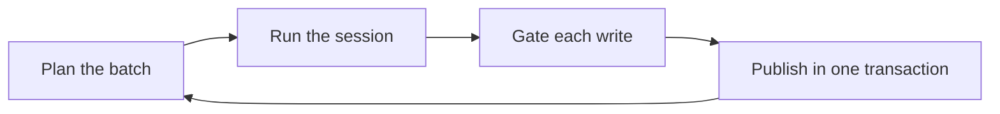

# The memory writer

The memory writer captures the facts the user states in passing, so memory grows without the user
asking for each item. It reads the conversation in batches of committed turns, runs a fresh model
session over each batch, and publishes what the session staged, with the writer's cursor, in one
database transaction. A crash anywhere in a batch therefore leaves either the whole batch published
or none of it, and a rerun never publishes a batch twice. The `modules/memory` package holds the
writer, beside [the memory store](./store.md) whose verbs it calls.

The writer is a system task in [the task runtime](../core/tasks.md): it never finishes, and it waits
between batches. [Memory writes](./writes.md) covers the content gate that checks a write, and
[model profiles](../core/model-profiles.md) cover the `memory-writer` role that picks its model.

## Batches

A batch covers the conversation's records after the writer's cursor: the user's messages and the
replies to them, as whole turns. A batch starts when enough of the user's messages wait, when the
conversation goes idle, or when the oldest waiting message reaches its maximum age, whichever comes
first. The age limit keeps capture moving while a busy conversation never goes idle. A pace limit
spaces batches out, and a token budget cuts a long run of turns, though the first turn always goes
in whole.

The triggers need the time each message arrived on the task runtime's clock, which a record's
wall-clock time is not. The writer subscribes to the conversation, and for each of the user's
messages it writes a wake into its own inbox that holds the message's sequence and the clock time.
The wake both starts a step and records the arrival. A wake lost to a crash costs nothing, because
every start of the writer wakes it again, and a message with no recorded arrival counts as due.

The writer records each batch it plans before it runs the session. A rerun after a crash finds that
record and takes the same bounds, so the batch it runs again is the one it lost.

## The catch-up

The server starts the writer, with the store's batch gate, on every start of nixie. The writer's
first start records the log's head sequence as the point where memory started. Every batch that
begins before that point is part of the catch-up, which reads the conversation from the start of the
log. A catch-up batch stops at the start point, so a message that arrived after memory started
always runs in a live batch. The cursor starts at the first record of the log, so the catch-up
begins by itself on that first start.

A catch-up batch posts no notice, because a notice per batch of old history would bury the
conversation. The batch that ends the catch-up posts one quiet notice with the count of items it
took in. When none of the user's earlier messages wait, that batch runs with no model call.

## A batch's session

Each batch runs one fresh model session in the writer's own worker sandbox on the conversation
image, never the conversation's sandbox, because the replies it reads can carry outside content. A
fresh session keeps one batch's reading from steering the next. The system prompt holds the persona
in force before the writer's rules, so the writer frames what it stores the way the assistant speaks
of the user. The [batch model spike](../../design/platform/spikes/memory-batch-model/README.md)
found the persona costs no capture. The writer's rules ask for each memory as one plain factual
sentence that names the user by the name in the owner section of the deployment configuration, or
calls the user "the owner" when the section sets none, so the writer's items read like the ones the
conversation saves. The rules keep the user's own distinctive words where those words carry the
meaning, because a generic paraphrase loses what made the fact worth saving.

The prompt holds the batch's records with their sequences, the user's pasted spans marked, a marker
line for each image the user sent and never its bytes, the active items, and the pending proposals
with the item each one changes. It lists every active item while the list fits its budget, else the
items a keyword recall over the batch finds. A rule tells the writer to stage nothing for a fact
that a pending proposal already holds, even in other words, because the gate merges only a proposal
of the same text. The session's tools are recall, remember, edit and retire, and they stage writes
instead of applying them. Remember only creates an item, and edit is the one tool that changes an
item's text, as in the conversation. Staging refuses a write that cites a record outside the batch,
a change to an item the session was never shown, and a second change to the same item, and the
refusal goes back to the model at once. Staging binds each change to the version the session was
shown, never to a version the model sent.

A batch's staging belongs to the step that opened it. A step that lost its lease and stops late
closes only its own staging, so it never empties the staging of the step that replaced it.

## Publishing

The host runs the content gate over each staged write outside the database transaction, because a
gate check can call a model. A write that repeats the text of an item the session was shown skips
the gate and writes nothing.

The batch gate runs the checks that [memory writes](./writes.md) sets out for a single write, one
staged write at a time, against the one message the write cites. That message is the write's whole
evidence, never a window of the user's latest messages, because a catch-up batch cites messages far
older than any window. The quote must be typed in that message, a memory's tokens must appear in the
quote, and the checker must confirm it; a message that backed a forgotten item never backs a write
again. A write that passes applies with its quote's place in the message as its evidence. An edit of
a pinned item waits for review even when every check passes, because the pinned core rides every
turn and a batch must never fail on the core's budget. Every other write becomes a proposal from the
memory writer: the gate seals its text and builds its records, and the batch publishes them in its
own transaction. A batch's proposals share one group for the cap and the notice. An edit or a
retirement whose item moved on or was forgotten since the session read it fails the gate before any
check runs, and so does a retirement of a retired item. The batch then runs again at once against
the item as it stands.

A proposal for a new item seals its text under a key the gate creates before the transaction. When
the proposal never publishes, because its batch split, ran again or failed, the writer removes that
key, so a key in the key store always seals a record or a published proposal.

One transaction then publishes the batch:

1. It checks that the step still holds its lease at the task clock's time inside the transaction, so
   a step that lost the writer to another runner, or whose lease expired while it waited for the
   delivery lock, writes nothing.
2. It checks that the batch is still the one the cursor waits on, so a rerun after a commit that a
   crash hid publishes nothing twice.
3. It reads each cited message again and leaves out every write whose message the user forgot during
   the session, or whose message backed an item the user forgot since the gate ran, and the batch
   counts them as dropped.
4. It checks that the item each proposal targets still stands at the version the session read, so
   the user can approve every proposal the batch publishes, and it applies each write at that
   version. A write or a proposal whose item changed or was forgotten in the meantime aborts the
   transaction, and the batch runs again at once against the item as it stands.
5. It writes the proposals' records one at a time, and merges each proposal that makes the same
   change as a pending one into it, so a batch's proposal sees every proposal before it. It then
   writes the batch's notice and the advanced cursor.

A batch that would hold more proposals than the proposal cap allows never publishes them. A batch
over several of the user's messages splits in half and runs each half again, so each proposal still
points at one message. A batch over one message keeps the first proposals up to the cap and counts
the rest as dropped, because no smaller batch exists.

## Failure and backoff

A batch that fails, such as one whose model call the provider refuses, records the error and backs
off, doubling the wait after each consecutive failure up to a maximum. The writer step never throws
the error, so the task never fails and the writer resumes on its own once the model answers. A
published batch clears the failure count. The memory view reads the writer's cursor, its backlog,
whether the catch-up still runs, and its last error with the time it tries again.

[The crash tests](../core/crash-tests.md) kill nixie at each boundary of a batch, in the catch-up
and in a live batch, and check that the batch publishes once.

## Changes the conversation hears of

A conversation turn hears of memory that changed outside it through
[the events block](../core/conversation-turns.md#the-events-block), where memory registers three
kinds of event. A memory change is an item that anything but the conversation itself wrote, such as
a writer batch or an edit in the memory view. Each item lists once, at its latest version in the
block's range, with its current text. The catch-up's items appear as one event that counts them,
because the catch-up covers conversation the user already had. A merge names each of the
conversation's pending proposals that another source proposed again, so the conversation knows its
proposal merged and still waits.

The block reads a listed item's text through a recall marked as a turn note's, and only after its
cap, so the recall records no item the block leaves out. A rating binds to the newest recall without
that mark, so the item list the turn's own recall gave stays the one the model rates. Memory's kinds
leave out an item that a forget has begun before the block applies its cap, so a forgotten item
never takes the place of a later event. The recall checks again, because a forget can begin between
the read and the recall.
