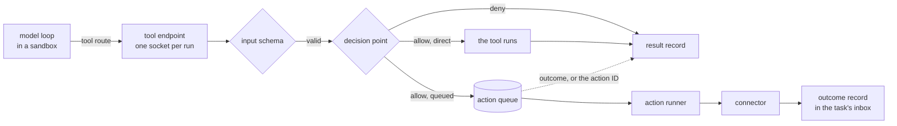
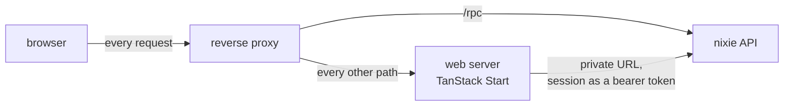

# Architecture overview

nixie keeps all of its state in one SQLite database, which one process writes, and records
everything it does in an append-only event log. Every model loop runs in a sandbox, an imp microVM
with no network of its own, and acts on the world only by calling nixie's tools. The tools run on
the host, outside the sandbox, and every call passes a decision point before it runs. A call whose
effects reach outside nixie becomes an action on a durable queue, so a crash never runs it twice.
[The product overview](../overview.md) says what nixie is for and who it works for.

The code is one Bun workspace, laid out by the [code layout](../design/platform/code-layout.md):
domain modules under `modules/`, adapters to outside systems under `adapters/`, shared libraries
under `libs/`, and the deployables under `apps/`. Modules never import adapters and never form a
cycle, so the server, as the composition root, passes each module what it needs from the others. The
conversation runs each turn as a task step that spawns a model loop in its long-lived sandbox
([conversation turns](./core/conversation-turns.md)), on the model profile that the deployment
configuration maps to the conversation role ([model profiles](./core/model-profiles.md)).

## The path of a tool call

A tool call starts in a model loop inside a sandbox and ends as records in the log, with an action
on the queue when the call acts outside nixie.

The sandbox has no network route to the host. Its tool route is a reverse forward that imp opens
from a loopback port inside the guest to the host, and the sandbox adapter relays each connection to
the tool endpoint of the run that owns the sandbox ([sandboxes](./connectors/sandboxes.md)). The
socket a connection arrives on decides its run, so a guest can never act as another run. The
endpoint lists only the tools on the run's tool list, checks each call's input, asks the decision
point, and records the call with its decision before the tool runs
([tool calls](./connectors/tool-calls.md)). The decision point allows a call only when the tool's
declared effects are reads, fetches or notes, and denies the rest, because it has no way to ask the
user about them ([the decision point](./policy/decision-point.md)).

A tool with effects outside nixie, such as a send or a write, never runs inside the turn. The call
becomes an action whose ID is also the idempotency key the connector sends to its provider, and a
pool of action runners attempts it apart from the task runners ([actions](./core/actions.md)). The
turn waits a bounded time for the outcome. The outcome reaches the task's inbox either way, so the
task's next step reads it. The read-only rule denies every such call in a release build, so the
queue carries only the crash tests' send tool in a test build.

## The client path

The user talks to nixie through a client that calls one typed API, the oRPC contract in
`libs/contract` ([the client](./channels/client.md)). The web client is a TanStack Start server of
its own beside the API, and the deployment design puts both behind a reverse proxy on one host name.

The browser calls the API on its own origin, so one host-only session cookie reaches both servers
and no call crosses origins. The web server holds no session of its own. When it renders a page, it
forwards the browser's session to the API as a bearer token, so a render carries exactly the
authority of the browser that asked for it. [The API](./channels/api.md) covers device sessions,
message sends and the live stream on the server side.

## Topology

The built parts run in two kinds of process. The nixie server is the one process that writes the
database, and it holds an exclusive lock on its data directory for its whole life, so a second copy,
such as the new pod of a rollout, exits instead of writing ([the database](./core/database.md)). It
reaches impd, imp's daemon, which runs every sandbox as a microVM, through the sandbox adapter. The
tool endpoint listens on Unix sockets in a directory only nixie's user may enter, and nothing
reaches it except through a sandbox's reverse forward. [The server](./deployment/server.md) covers
how the nixie process starts, reports its health and stops, and the nixie image it ships in. The web
server is the second process. The repo builds its image and the conversation's guest image, which
runs in a sandbox. [Kubernetes](./deployment/kubernetes.md) covers the reference manifests that run
both processes in a cluster, and the
[deployment design](../design/platform/deployment/deployment.md) covers the host they run on.

## Data

The data directory sits on a local volume and holds two SQLite files:

- **`nixie.db`** holds the event log, the projections that fold it into tables, the definitions in
  force, and the state that lives outside the log: the leases runners hold, the writer epoch and the
  schema version. Before a release migrates it, nixie writes a copy of it beside it.
- **`keys.db`** is the key store. It holds one key per record that has free text, wrapped by the
  deployment key, so a backup of `nixie.db` holds only ciphertext, and deleting a key forgets that
  record's text in every copy ([erasable fields](./core/erasable-fields.md)).

Every fact nixie keeps is a record first. A projection, such as the tasks table or the actions
table, changes in the same transaction as the record that changes it, and a rebuild from the first
record gives the same rows ([the event log](./core/event-log.md)). The leases, the writer epoch and
the schema version sit outside the log, because they say who may write now and what shape the file
has, not what happened.

## Cross-cutting

- **One writer.** The writer lock, and a writer epoch that every write transaction checks first,
  keep a second process from writing, even when a bug drops the lock
  ([the single writer](./core/database.md#the-single-writer)).
- **Definitions on every record.** Every record carries the snapshot hash of the definitions in
  force, so a replay of a decision can read the persona and the policy it ran under
  ([the definitions](./core/definitions.md)).
- **One claim path.** Task steps and action attempts claim their work through one lease with a
  generation, and every write a runner makes checks that generation, so a runner that lost its claim
  commits nothing ([leases and recovery](./core/leases-and-recovery.md)).
- **Free text is erasable.** Message text, tool arguments and tool results sit in a record's
  encrypted fields under the record's own key, never in its plain payload, and no projection reads
  them.
- **Test builds.** One compile-time flag marks a test build. The release bundle drops every branch
  behind it with its imports, so the process sandbox double, the crash-test fault points and the
  test policy rule never ship.
