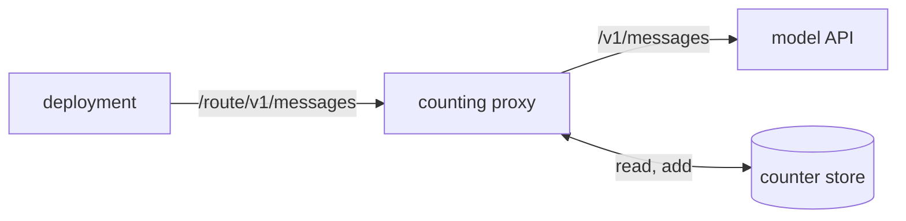

# The counting proxy

The counting proxy is a process of its own on the host that sits between a deployment and the model
API. Every model request the deployment sends passes through it. The proxy prices each reply from
the reply's own token counts, adds the price and the tokens to one running count, and refuses every
request once the count reaches the configured limit. It fails closed: when it cannot read or write
its count, it refuses every request instead of letting one through uncounted. Because the proxy runs
outside the deployment, code that the deployment runs cannot raise or skip its limit. The proxy is
the first part of the hard spending stop that the
[budgets design](../../design/platform/policy/budgets.md#the-hard-spending-stop) describes, and a
preview host runs one per preview with a small limit.

## Routes

The proxy holds one route per model profile. A route has an ID, the upstream origin it sends to, the
model it allows, and the profile's price table. A request names its route in the first segment of
its path, and the proxy sends the rest of the path, with the query, to the route's upstream. A
deployment therefore points a profile's base URL at the proxy with the route ID on the end, and the
model client adds the API path after it.

The proxy prices every reply on a route with that route's table, so a request for another model
would be priced wrong. The proxy refuses a message or token count request whose body names no model,
or a model other than its route's, and sends nothing upstream. A path whose first segment names no
route gets a 404.

The proxy forwards only the endpoints whose spend it can count: messages, token counts and the model
list. It refuses every other endpoint with a 403, because a message batch, for one, spends after its
reply and names its models inside each request, out of reach of both the count and the model check.

The proxy passes every header through except the hop-by-hop ones, and asks the upstream for an
uncompressed reply so that it can read the usage as the reply passes. It never adds or reads a
credential: a credential broker in front of it, or the deployment itself, supplies one.

## The count

The count is two totals, dollars and tokens, kept in a counter store on the host's disk. The proxy
reads both from the store before it admits a request, and adds a reply's price and tokens once the
reply ends. The models module's call pricing sets the price, the same pricing that the deployment's
own records use, so a cache write for the long lifetime takes the profile's price for that lifetime.
The tokens are the input, the cache writes, the cache reads and the output. Where a reply's cache
write total and its split by cache lifetime disagree, the larger figure counts for both.

A whole reply carries its usage in its body. A streamed reply carries the input side in its first
event and the running output count in each later delta, and the proxy reads the events as they pass
on to the caller. The streamed reply ends for the caller only after the count is written, so a
caller that reads a whole reply and sends again never gets ahead of its own count. A caller that
stops reading early, and an upstream that breaks mid-stream, still leave the count of the events
that arrived. A reply with no usage, such as an error, adds nothing.

The store writes each count to a new file and renames it over the old one, so a crash leaves the
last whole count. It adds one reply at a time, so two replies that end together each count once.

## The limit

The configured limit names dollars, tokens or both, and the proxy refuses a request once either
total reaches its limit. The refusal is a 403 in the model API's error shape, with a message that
names the totals and the limit, so the model client stops instead of retrying. Requests already in
flight when the count crosses the limit finish and count, so the totals can pass the limit by the
replies that were running at that moment.

## Failing closed

The proxy treats a counter store it cannot use as a store that holds no room:

- **The store cannot be read.** A missing store file, a missing directory or a file that holds no
  count fails the read, and the proxy answers the request with a 503 and sends nothing upstream.
- **A count cannot be written.** The reply that could not be counted still reaches its caller, but
  the proxy refuses every later request until it restarts, because its store now holds less than was
  spent.
- **A reply breaks before its usage arrives.** The caller gets a 502, and the proxy refuses every
  later request until it restarts, because the model may have spent on a reply the proxy never
  counted.
- **The store directory does not exist at start.** The proxy exits, so the route it would serve has
  no way to the model API.

A stop signal closes the listener and lets each reply under way finish, up to a bounded wait, so the
count holds every reply the model sent before the proxy exits.

The release attaches the proxy as one compiled binary for Linux, so a host runs it without a Bun
install. The [preview recipe](../../../preview/README.md#model-calls) covers how a preview names its
route.
