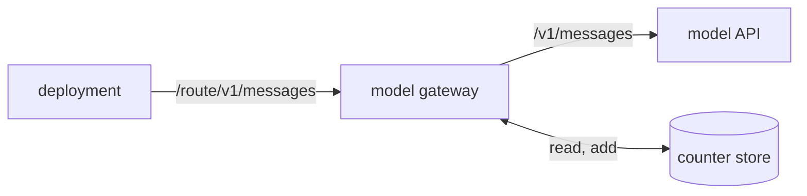

# The model gateway

The model gateway is a process of its own on the host that sits between a deployment and the model
API. When the deployment's config sets `spendStop`, every model request the deployment sends passes
through it. The gateway prices each reply from the reply's own token counts, adds the price to its
route's count, and refuses every request on a route once that route's count reaches the route's own
limit. It fails closed: when it cannot read or write its count, it refuses every request, so none
passes uncounted. Because the gateway runs outside the deployment, code that the deployment runs
cannot skip its limit, or raise it past the cap in the gateway's config. The gateway is the first
part of the hard spending stop that the
[budgets design](../../design/platform/policy/budgets.md#the-hard-spending-stop) describes, and a
preview host runs one per preview with a small limit.

With `spendStop` set, a sandbox reaches the model API only through its credential broker, so every
model call from a worker's sandbox passes through the gateway.
[The imp adapter](../connectors/sandboxes.md#the-imp-adapter) sets up the sandbox with no other
route.



## Routes

The gateway holds one route per model profile. A route has an ID, the model API it speaks, the
upstream origin it sends to, the model it allows, the profile's price table and, in a config with
its own dollar [limits](#the-periods). The API is Anthropic's Messages API, `anthropic-messages`,
unless the route names OpenAI's Responses API, `openai-responses`. A request names its route in the
first segment of its path, and the gateway sends the rest of the path, with the query, to the
route's upstream. A deployment therefore points a profile's base URL at the gateway with the route
ID on the end, and the model client adds the API path after it.

The gateway prices every reply on a route with that route's table, so a request for another model
would be priced wrong. The gateway refuses a request to a spending or token count endpoint whose
body names no model, or a model other than its route's, and sends nothing upstream. A path whose
first segment names no route gets a 404.

A route's model is the only model the count prices, so the gateway also refuses, with a 400 and
nothing sent upstream, a request to a spending or token count endpoint that could bill anything
else. It refuses a request whose body holds:

- `models`, `fallbacks`, `route` or `plugins`, which let the model API run another model;
- `provider`, unless the route sets `providerPin` and the field is exactly
  `{ "order": ["<providerPin>"], "allow_fallbacks": false }`;
- `speed` with any value but `standard` or null, `service_tier` with any value but `auto`,
  `standard_only`, `default` or null, or `inference_geo` with any value but `global` or null,
  because the price table holds no premium tier or regional price. Both model APIs treat an absent
  `service_tier` as `auto`, so each allowed value bills no more than a body without the field. A
  [plan route](#the-path-of-a-plan-request) refuses `service_tier` with any value;
- a `tools` entry that is not a tool the caller runs: an object with no `model` key and a `type`
  that is absent, `custom` or `function`, or a `namespace` whose `tools` all pass the same check.
  Any other type, such as a web search, an image generation or an advisor, is a tool that the model
  API runs and bills apart from the tokens, often on a second model. The check reads the `tools`
  entries and nothing else, because a tool call's input can hold a `model` key of its own.

The gateway sends the body on byte for byte, so it also refuses a body that names one key twice in
any object, counting an escaped spelling of a key as the same key. JSON parsers disagree on which of
the 2 values wins, so the model API could read a value that the checks never saw.

It also refuses a request that holds both an `authorization` and an `x-api-key` header. The
credential broker sets its own header and the gateway passes the others through, so a second one
would reach the model API beside the broker's.

A route sets `providerPin` to the provider that its profile's `provider_pin` names, and the two must
match, or the gateway refuses every pinned request:

```yaml
routes:
  router:
    upstream: https://models.example.com
    model: example/model-small
    providerPin: example-host
```

A route sets `maxOutputTokens` to the model's largest output. It bounds the output of a reply whose
request sets no output limit, as [the estimate](#the-estimate) describes. A route that speaks
`openai-responses` must set it, and the gateway refuses to start without it. A Messages route may
leave it out.

```yaml
routes:
  review:
    api: openai-responses
    upstream: https://models.example.com
    model: example/model-o
    maxOutputTokens: 128000
```

The gateway forwards only the endpoints of the route's API whose spend it can count, and refuses
every other endpoint with a 403:

| API                  | Endpoints                                 |
| -------------------- | ----------------------------------------- |
| `anthropic-messages` | messages, token counts and the model list |
| `openai-responses`   | creating a response, and the model list   |

A [plan route](#the-plan-route) refuses the model list with a 403 too. The method and path of each
endpoint live in one table in
[`find-model-api-endpoint.ts`](../../../libs/wire/src/spool/find-model-api-endpoint.ts). The
scripted model that stands in for the model API in tests routes its requests through the same table.

A message batch, for one, spends after its reply and names its models inside each request, out of
reach of both the count and the model check. A stored response read back by its ID spends nothing
that the gateway could count. The gateway refuses a request for a background response with a 400
too, because that response spends after its reply, and the reply holds no usage.

The gateway passes every header through except the hop-by-hop ones, and asks the upstream for an
uncompressed reply so that it can read the usage as the reply passes. On every route except a
[plan route](#the-plan-route), it never adds or reads a credential: a credential broker in front of
it, or the deployment itself, supplies one.

## The plan route

A plan route lets a task on the Codex harness
([model profiles](../core/model-profiles.md#harnesses)) spend a ChatGPT plan in place of an OpenAI
API key. The gateway holds the plan's login: a refresh token, from which it gets the short-lived
access token that ChatGPT's backend takes. It refreshes the login and sets the access token on each
plan request itself. The nixie server and each sandbox hold only stand-in values in place of either
token, so every plan request passes through the count.

A route holds a plan login when its config has a `login` block. The nixie server reads each login's
status from the [control listener](#the-control-listener), which every config has:

```yaml
routes:
  codex-plan:
    api: openai-responses
    upstream: https://chatgpt.com/backend-api/codex # the gateway adds the rest of the path
    model: gpt-6-luna
    prices: { … } # the prices the count and the stop use
    maxOutputTokens: 128000
    limits: { day: 40, month: 600 } # dollars; a route with no limits refuses every request
    login:
      file: /var/lib/model-gateway/logins/codex-plan.json
      routeKeyFile: /run/secrets/codex-plan-route-key # one line: the route key
```

The `openai-responses` endpoint table matches `/responses` and `/v1/responses`, because Codex sends
`/responses` after its base URL. The [operator runbook](../../runbooks/chatgpt-plan-login.md) sets a
plan route up.

### The path of a plan request

A plan request leaves the sandbox for `chatgpt.com`, on a path that starts with the sandbox's name
and the route, as in [count by sandbox](#count-by-sandbox). impd, the daemon that runs each sandbox,
holds the plan profile's model secret, and its credential broker matches the request by the host
`chatgpt.com`. The broker sends the request to the gateway's model listener, the address that takes
model requests, apart from the control listener ([the route of a request](#the-route-of-a-request)).

| Hop               | What it receives                                         | What it sends on                                                                  |
| ----------------- | -------------------------------------------------------- | --------------------------------------------------------------------------------- |
| The Codex guest   | nothing                                                  | `https://chatgpt.com/<sandbox>/codex-plan/responses`, with a placeholder token    |
| The broker        | that request, checked against `/<sandbox>/codex-plan/**` | the same path to the gateway's model listener, with `Authorization: Bearer <key>` |
| The model gateway | `/<sandbox>/codex-plan/responses` and the route key      | `/responses` to the route's upstream, with `Authorization: Bearer <access token>` |
| The upstream      | `https://chatgpt.com/backend-api/codex/responses`        | the reply, which the gateway counts                                               |

- The route key is 32 random bytes in hex. It is the value of the plan profile's model secret
  ([model secrets](../deployment/impd-names.md#model-secrets)) and the content of the route's
  `routeKeyFile`. The gateway compares the `Authorization` header with it in constant time and
  answers a mismatch with a 403 that sends nothing upstream. Only a sandbox granted the profile's
  secret gets the header from the broker, so no other sandbox can use the route by naming it in its
  path.
- The gateway answers `GET /models` on a plan route with a 403. The broker refuses every other
  ChatGPT path that Codex calls, such as `/backend-api/wham/accounts/check`, because the grant
  covers only the paths under the sandbox's own name and route
  ([credentials with a spending gateway](../core/model-profiles.md#credentials-with-a-spending-gateway)).
- After the key check, the gateway removes the `Authorization` header and sets
  `Authorization: Bearer <access token>`.
- A body that sets `service_tier`, to any value, gets a 400. Codex use past the plan's own limit
  draws on credits bought for the account, and a faster tier spends them at a higher rate than the
  route's prices count.
- A request on a route whose login is not `active` gets a 401 in the Responses error shape, and
  nothing goes upstream.
- The gateway counts a plan request under the route's prices, as it counts every other request. A
  plan has no price per token, so the operator sets the route's prices and the profile's prices to
  OpenAI's API prices for the same model. The route's day and month dollar limits then cap the
  credits that Codex use past the plan's own limit spends.

### The login file and the refresh

The login file has mode 0600, and only the gateway's user reads it. It holds these fields:

- `version`: 1;
- `loginID`: a random ID that each login replaces;
- `refreshToken`;
- `accountID`, `planType` and `email`, from the ID token of the sign-in;
- `status`: `active`, `failing` or `needs_login`;
- `reason`: `refused`, `service_error` or `no_answer`, and null while the status is `active`;
- `statusSince` and `lastRefreshAt`.

The access token lives only in the gateway's memory, with the time the gateway got it and the
`loginID` it came from. The auth endpoints, the client ID and the time limits of a sign-in are
constants of the gateway binary in
[`chatgpt-auth.ts`](../../../apps/model-gateway/src/login/chatgpt-auth.ts), the values of the Codex
CLI that the `codex` image pins. The refresh times below are constants in
[`create-plan-login.ts`](../../../apps/model-gateway/src/login/create-plan-login.ts).

- The gateway refreshes a login at its own start, `refreshLeadMs` before the access token's `exp`,
  and at least every `refreshIntervalMs`, one refresh per login at a time. An access token with no
  readable `exp` counts as one that expires `unknownLifeMs` after the refresh. A request waits for a
  refresh in flight.
- When the upstream answers 401, the gateway starts a refresh before it passes the 401 on, once its
  current access token is at least `rejectionAgeMs` old.
- The gateway writes a rotated refresh token to the file through a second file and a rename, before
  it uses the new access token, and only while the file's `loginID` is the one it read before the
  refresh. A lock on the file spans the read and the write, and `chatgpt-login` and `chatgpt-logout`
  take the same lock. A process that waits `loginLockWaitMs`
  ([`with-login-lock.ts`](../../../apps/model-gateway/src/login/with-login-lock.ts)) for the lock
  gives up with an error that names the file. A refresh that gives up keeps no new token, so the
  request that waited on it gets a 401. A command that gives up exits with the error.
- Before it admits each request, the gateway reads the file's `loginID`. A different ID drops the
  token and refreshes. A missing file gives a 401.
- The gateway reads the refresh token only to refresh, and sends it only to the token endpoint.

| The answer to a refresh                                                                          | Status        | Reason                                                                  |
| ------------------------------------------------------------------------------------------------ | ------------- | ----------------------------------------------------------------------- |
| a token                                                                                          | `active`      | null                                                                    |
| `refresh_token_expired`, `refresh_token_reused`, `refresh_token_invalidated` or `invalid_grant`  | `needs_login` | `refused`                                                               |
| 3 in a row of a 5xx, a 429, another 4xx, a 200 with no token, or no answer in `requestTimeoutMs` | `failing`     | `service_error` after an answer, `no_answer` after none, from the third |

A `failing` login keeps its retries, `backoffFirstMs` apart at first and doubling up to
`backoffMaxMs`, and returns to `active` on the first token. A `needs_login` login stops its
refreshes until the next login writes a new `loginID`. When an answer is lost, or the gateway stops
after OpenAI answers and before the rename, OpenAI may have spent the stored refresh token. The next
refresh then gets a refusal and the login becomes `needs_login`. The file still holds the earlier
refresh token and parses, so the gateway reports the status and an operator signs the route in
again. A login file stays on disk when a gateway release is rolled back, so the plan login works
again once the release that holds plan routes returns.

### The commands

```bash
model-gateway chatgpt-login --config <config file> --route codex-plan
model-gateway chatgpt-logout --config <config file> --route codex-plan
```

`chatgpt-login` runs OpenAI's device code flow on the gateway host. It prints the URL, the code and
its expiry, and opens no browser. It waits for the account's user to approve the code, for at most
the code's life, `deviceCodeLifetimeMs`. It then writes the login file with a new `loginID`,
replaces any file the route had, and prints the email and the plan, never a token. Device code login
must be on in the account's ChatGPT security settings, and the command says so when OpenAI refuses
the code request. `chatgpt-logout` removes the file. OpenAI documents no revocation for this
sign-in, so the command tells the operator to sign the device out in ChatGPT. Both commands refuse a
route with no `login` block. A running gateway picks up a new login through the `loginID` check.

### The logins on the control listener

`GET /chatgpt-logins` on the [control listener](#the-control-listener) answers each plan route with
its `status`, `reason`, `since`, `accountID` and `planType`, and no token or email. A route with no
login file shows `needs_login` with a null reason. The model listener serves no login path.

## The count

The count is dollars and tokens, kept in a counter store on the host's disk. It keeps the dollars of
each route's day and month, and the dollars and tokens of each sandbox. The gateway reads the count
from the store before it admits a request, and adds a reply's price once the reply ends. The gateway
takes the price from the models module's call pricing, the same pricing that the deployment's own
records use, so a cache write for the long lifetime takes the profile's price for that lifetime, and
a reply to a long prompt takes the profile's
[long-prompt prices](../core/model-profiles.md#prices-and-the-provider-pin) when it has them.

The tokens are the input, the cache writes, the cache reads and the output. Where a reply's cache
write total and its split by cache lifetime disagree, the larger figure counts for both. A Responses
reply counts its cache reads and writes inside its input count, so the gateway takes them out of the
input before it prices the rest as uncached. Its shorter cache lifetime takes the profile's shorter
lifetime price, and its longer one, or a write with no lifetime, takes the longer lifetime price.

A whole reply carries its usage in its body. A streamed Messages reply carries the input side in its
first event and the running output count in each later delta. The count is final once the
`message_stop` event arrives, so a stream that ends without it adds an estimate. A streamed
Responses reply carries its whole usage in the event that ends the response, whether the response
completed, stopped early or failed. A caller that stops reading right after that event, as Codex
does, leaves the whole usage, and so does a gateway that stops while the stream stays open after it.

The gateway reads a reply as a stream when its content type is `text/event-stream`. It also reads a
successful reply with no content type as a stream when the request set `stream: true`, because
ChatGPT's Codex backend sends its stream with no content type. The gateway reads the events as they
pass on to the caller. The streamed reply ends for the caller only after the count is written, so a
caller that reads a whole reply and sends again never gets ahead of its own count. A caller that
stops reading early, and an upstream that breaks mid-stream, still count: the usage of the events
that arrived when it was whole, and [an estimate](#the-estimate) when it was not. A reply with no
usage that spent nothing, such as an error, adds nothing.

A stream that began no reply adds nothing. That is a stream whose body ended with no event except a
`ping`, or that held an `error` event such as `overloaded_error` and no event before it. A stream
that its reader stops or that breaks before its body ends adds the estimate, unless it already held
an `error` event, because the events the gateway did not read may hold the start of a reply. A
stream has begun once an event other than an `error` or a `ping` has arrived, or an event the
gateway cannot read: it ends a line at CR, LF or CRLF, joins the data lines of one event with a
newline, and counts an event that stops halfway through its JSON as begun. A reply with no body adds
nothing. The gateway logs each such stream as `count.skipped`, at the warn level, with the route,
the sandbox, the reason, the upstream status, and the type and message of the error event (each
`null` when it held none, the message cut to 200 characters).

A non-2xx reply adds nothing, whatever its content type, its body or its usage says, and however its
body ends: the caller gets its status. The gateway reads the body whole and logs the reply as
`upstream.refused` with the status and the type and message of the first error the body holds, or
`null` for each when it holds none or has no body. A gateway that stops while a stream that held
only an error stays open adds nothing for it.

A reply that spent, or may have, with no whole usage the gateway can read adds
[an estimate](#the-estimate).

The gateway logs each reply it counts from its whole usage as `count.charged`, at the info level,
with the route, the sandbox, the usage's 5 token counts (uncached input, cache reads, the 2 cache
writes and output), its reasoning tokens or `null` when the reply reported none, and the dollars and
tokens it added. The reasoning tokens are a part of the output tokens. The line holds counts only
and never copies a key, a prompt or a reply.

### The estimate

A reply that spent, or may have, and ends without its whole usage, adds a cautious estimate to the
count and the gateway keeps serving. That covers a reply with no usage block, usage in a shape the
gateway cannot read, a stream that breaks or that its caller cancels before its final usage, a
connection that fails after the request went out, a reply whose body breaks, and a reply still open
when a stop gives up. The estimate is an upper bound on the provider's bill for the request, so the
count never lets spend grow past it. The gateway builds it from the request alone and makes no call
to the provider.

- **Input.** The input tokens are the UTF-8 byte length of the request body, plus an allowance of
  4,096 tokens for what the provider adds, such as the tool-use system prompt and message framing. A
  text token is never shorter than 1 byte. The gateway prices them at the highest input-side rate of
  the route: `input`, `cacheWrite`, `cacheWrite1h` and `cachedInput`, and the same 4 rates of
  `longPrompt` when the route has it.
- **Output.** The output bound is the request's `max_tokens` on Messages, or `max_output_tokens` on
  Responses. When the request sets none, it is the route's `maxOutputTokens`. The gateway prices it
  at the higher of `output` and `longPrompt.output`.
- **A reply with part of its usage, or a cut Messages stream from Anthropic's own API.** A usage
  that holds only some of its counts, and a stream that ends without its final usage, count as
  uncounted. When the stream delivered its first event with input counts, the input side is those
  counts, each class at its own rate, because that API sends the final input counts there. The
  output side stays the output bound. With no such event, and on any other route, the input side is
  the larger of the byte bound and the input the partial usage reported. A stop that cuts off an
  open reply charges what it had reported by then, the same way.

A cut or cancelled stream charges the full output bound. That over-counts the budget, and never the
real bill.

The estimate leaves a request unbounded when the byte count cannot bound its input, or when it has
no output bound. A reply that spent with no usage, to such a request, marks the count as lost, and
the `count.lost` log line names the field:

- Messages: `mcp_servers`, `container`, and an `image` or `document` block, in a message or in a
  tool result, whose source is a URL or a file ID, as `messages.content.source`;
- Responses: `previous_response_id`, `conversation`, `prompt`, an `item_reference` input item, and
  an input image or file by file ID or by a URL that is not a `data:` URL;
- `max_tokens` on Messages, or `max_output_tokens` on Responses, when the request and the route set
  no bound.

The gateway logs each estimate as `count.estimated`, at the warn level, with the route, the sandbox,
the reason and the dollars and tokens it added.

The store writes each count to a new file and renames it over the old one, so a crash leaves the
last whole count. It adds one reply at a time, so two replies that end together each count once.

## The periods

The gateway counts the day and the month of each route in US dollars, and limits each route on its
own. No limit spans routes, and the gateway holds no limit in tokens. Each period resets at local
midnight in `periods.zone`, an IANA zone that equals the deployment's default time zone, and
[`periodOf`](metering.md#periods) works out each start. The route's limits and the cap above its day
limit sit in the gateway's own config, so code in the deployment cannot move a limit or a cap.

```yaml
periods:
  zone: Europe/London
routes:
  codex-plan:
    # api, upstream, model and prices as in the routes above
    limits: { day: 40, month: 600, dayCap: 80 } # dollars; dayCap defaults to twice day
control:
  listen: { hostname: 127.0.0.1, port: 8790 } # an address no sandbox reaches
  tokenFile: /run/secrets/gateway-control-token # one line
countBySandbox: true # default false
override: /var/lib/model-gateway/override.json # no path, no override
```

The schema requires `periods` and `control`, and refuses a top-level `limits` key, because no limit
spans routes. It refuses a `dayCap` below its route's `day`. The store is a file of its own, in
version 3: the lost mark, for each route its day and its month, and a count and a limit per sandbox.
A period holds its start, the instant it ends, its count in whole micros of a dollar, the raise and
the trip time. A sandbox's count is in whole micros too. The count is an integer, so a long run of
replies adds no drift, whatever the size of the total. A reply that costs less than half a micro
still adds one micro, so small replies always accumulate, and a limit under half a micro counts as
one micro. A period's trip time is the instant the gateway first found its count at the limit in
force, and a reset or a raise that lifts the limit clears it.

At start, the gateway rewrites a store file of an earlier shape, a count of one total or a version 2
store, as a version 3 store in one write. A count of one total says nothing of a route's spend, so
every route starts at zero. A version 2 store did not split its count by route, so each route takes
the whole count of each period still under way, with its raise and its trip. The count of a route is
then an upper bound, and a restart never reopens a limit. The lost mark and the sandboxes carry
over, and the gateway logs the old totals. The gateway refuses to start on a store file in any other
shape, and a route that the config gained starts at zero.

### Admission and the reset

Before each admission the gateway reads the store and the override file, and answers:

- a 503 while the lost mark stands, so a gateway that lost count sends nothing upstream;
- a 503 for a route with no `limits`, so a route nobody limited refuses its requests;
- a 403 for a sandbox that the store lacks, when the config counts by sandbox;
- the limit 403 when the route's day or month count has reached its limit in force. The day's limit
  is the override when it applies to the day's current start, and otherwise the larger of the
  configured limit and the day's raise. The month's limit is the configured one;
- the limit 403 when a sandbox's count has reached its own limit.

A limit 403 has the model API's error shape with the type `limit_reached`, and adds `counter`, which
is `route_day`, `route_month` or `sandbox`, and `route`, the route that the request named. Its
message holds no dollar figure. Another route goes on while one route is at its limit. A request
that a sandbox's count refuses also stores the refusal on the sandbox's entry as its last refusal:
the counter, the route and the time.

Each read of the store, for an admission, a reply or a control call, first resets each period whose
end has passed: the count goes to zero, the start and the end move to the zone's current ones, and
the raise drops. A period keeps the end that the zone gave it when it started, so a changed
`periods.zone` takes effect at the next reset. A period with no stored end ends at the next start in
the zone. The lost mark stays. A reset therefore needs no model request, and a `/status` read after
midnight shows the new day. The store runs one change at a time, so a reply counted after midnight
lands in the new day and the month once. A reply adds its dollars, rounded to whole micros, to its
route's day and month, and its micros and tokens to its sandbox, in one write.

### Count by sandbox

With `countBySandbox`, a path is `/<sandbox>/<route>/[~in.<tag>/]<path>`. The gateway takes the
sandbox from the first segment and the route from the second, and strips both, and the capture tag,
before it calls the model API. Without it the path is as [the routes](#routes) describe.

### The control listener

A second listener on `control.listen` serves the server alone. It answers 401 to any request without
`Authorization: Bearer <token>`, with the token read from `control.tokenFile` at start. The model
listener serves no control path.

| Call                       | Effect                                                                                                                                                                            |
| -------------------------- | --------------------------------------------------------------------------------------------------------------------------------------------------------------------------------- |
| `GET /status`              | the zone, the lost mark, and for each route its day and month: start, reset time, dollars, limit in force, cap and `tripped`                                                      |
| `POST /raise`              | raises one route's day for its start, never below that day's earlier raise; 409 `above_cap` with the route and its cap, 409 `period_ended` for another start, 404 `unknown_route` |
| `PUT /sandboxes/<name>`    | sets the sandbox's limit, or `null` to count only, and sets its count to zero                                                                                                     |
| `GET /sandboxes/<name>`    | the sandbox's count, whether it is past its limit and its last refusal; 404 for a name the store lacks                                                                            |
| `DELETE /sandboxes/<name>` | removes the sandbox; 204 also for a name the store lacks                                                                                                                          |

A refused call changes nothing. A raise body is `{ route, start, dollars }`, and the raise is for
the day only: the month's limit moves only in the gateway's config. A period's `tripped` is true
while its dollars are at its limit in force, and its `sinceMs` is the period's trip time. The status
holds the lost mark apart from the routes, and a lost gateway answers its routes as they stand. The
status lists only the routes in the config: the store keeps the count of a route the config dropped,
and the status leaves that route out. A count reaches a limit in whole micros of a dollar, so ten
replies of 0.1 dollars reach a limit of 1 dollar. The status and the sandbox read answer in dollars,
worked out from the micros.

### The override

`model-gateway raise --config <file> --route <id> --dollars <n>` is the only way past a route's cap.
It writes the route's entry in the override file for the day now in force in the config's zone,
through a second file and a rename, and keeps the entries of the other routes. A lock on the file
spans the command's read and its write, so 2 raises of different routes at once keep both entries.
The dollars it names may pass the cap, and the command refuses a route that has no `limits`. The
gateway ignores an entry whose start is not the day's current start, and an override file that it
cannot read. The control listener has no call that writes the override, and the server has no path
to the override, the store or the config. A config with no `override` path makes the command refuse
to run.

## How nixie uses the gateway

A deployment whose config sets `spendStop` sends every model request through the gateway, under the
count of the sandbox that sends it. A deployment with no `spendStop` changes nothing: no request
takes the gateway path, no sandbox registers, and no start check calls the gateway.

```yaml
spendStop:
  control: http://127.0.0.1:8790 # the gateway's control listener
  token: deployment:gateway-control # a reference into the secrets file's settings
  modelURL: http://10.0.0.2:8789 # the gateway's model listener, as the sandbox host reaches it
```

The server refuses to start when the secrets file lacks the settings entry that `token` names. The
gateway's client calls the control URL through a fetcher of
[the credential store](../connectors/credentials.md#the-fetcher), which adds the token on the host.
The control URL is the one address that fetcher reaches over `http` and at a private address.

The [spending stop](spending-stop.md) adds the turn count, the pause and the raise.

### The start checks

After the migrations, and before any other part starts, the server checks the gateway. It refuses to
start in either of these cases:

- the secrets file has a `model_credentials` entry;
- the gateway's `/status` shows a zone that differs from the time tool's `default_zone`.

When the gateway does not answer, the server starts and logs `spend.gateway_unanswered`. The spend
watcher trips the stop on its first poll that finds no answer, and clears it when the gateway
answers. The gateway holds each route's limits in its own config, so the server sends none. A late
answer checks the zone first.

### The route of a request

Each turn frame's base URL is the profile's base URL followed by `/<sandbox name>/<profile ID>`. The
server builds it for the conversation, each task run, each worker run and the consent checker, and
the guest changes nothing. The gateway reads the sandbox name from the first path segment, so the
server refuses to start when a profile's base URL has a path. The sandbox name is the sandbox's ID,
which is also its name in the sandbox host. The profile ID is the gateway's route ID. The
[capture](#the-tag) tag follows the profile ID, in the order the gateway parses. The secret still
names the profile's own host, so the credential broker matches the request by host and sends it to
the secret's upstream. The credential broker admits that request only on the route of the sandbox's
own profile, so a sandbox cannot send its model credential to another profile's route.

### The count of a sandbox

Before a sandbox's first model request, the server registers it with `PUT /sandboxes/<name>`:

| Sandbox                                | Limit                                                    |
| -------------------------------------- | -------------------------------------------------------- |
| a worker run's sandbox                 | the run's planned dollars and tokens                     |
| the conversation, a task and the check | none: the gateway counts it and sets no limit of its own |

A sandbox with no limit of its own still gets the limit 403 once the day or month count reaches its
limit.

A worker run's planned limit is the worker's configured limit, held to what the calling task run has
left, so the gateway and nixie hold one number. A registration that fails fails the sandbox's start.
A sandbox that an earlier server process made registers the first time this process reads it, so a
sandbox kept across a restart has its count. Once a sandbox's destroy succeeds, the server deletes
its entry. A sandbox whose destroy fails keeps its entry, because it may still run. A delete that
fails is logged.

### Worker limits

A worker run ends at `workerRun.turns`, which the guest passes to the Agent SDK as its turn cap, and
at `workerRun.minutes`. The gateway ends it at the sandbox's dollar and token limits. At the end of
a worker run the server reads `GET /sandboxes/<name>`. The `worker.run_ended` record holds the
gateway's dollars and tokens, and a sandbox the gateway found past its limit ends the run with the
limit `dollars` or `tokens`, unless the run ended with an answer, a stop, its minutes or a failed
start first. When the gateway does not answer that read, the record holds the run's planned dollars
and tokens, where the gateway starts to refuse the sandbox's requests, because the guest's own count
can miss spend. The run's dollars still count toward the calling task run's dollar limit. A task run
has no token limit: it ends at its turns and its dollars. The same read holds the sandbox's last
refusal, with the counter and the route that refused it, so a run that a route's limit stopped shows
which route.

## The capture

The gateway copies the exact body of a model request to a spool folder, sealed to a key that only
nixie holds, so a guest cannot vouch for its own input. The [turn-input log](turn-input-log.md)
describes the nixie side: the tag, the intake and the store.

### The tag

A tag is one path segment right after the route, `~in.<captureID>.<key>`. The capture ID is a
lowercase version 4 UUID, and the key is a P-256 public key, uncompressed, in unpadded base64url.
The gateway always removes a segment that starts with `~in.` before it matches the endpoint, so the
endpoint match, the model check and the count see the path as if no tag were there. The 403 and 404
replies echo the path as sent, tag included, which holds no secret.

The gateway decodes the tag with the wire library, which checks the key's length, its first byte and
that the point lies on the curve. A tag that fails any check is removed, and the gateway writes no
file for that request. The tag is not authenticated: a guest could swap its key for another valid
point, which only makes that capture unreadable to nixie.

### What the gateway copies

With the `capture` config key, the gateway copies a tagged request only when it sends the request
upstream to `messages` or `responses`. A request that the gateway refuses, and a tagged
`count_tokens` or `models` request, writes no file. The gateway never changes a body, so a copy
equals the bytes that the model API received.

The handler takes a counter value for the copy, one per capture ID that runs from 1 while the
gateway runs, and starts the spool work just before it sends the request. It never waits for the
spool. When the model API answers, the gateway renames the file to record the response's status,
before the reply streams. When the model API gives no response, the gateway removes the file. A
request with no response keeps its counter value, which leaves a gap that nixie counts.

### The spool file

Each file is named `<captureID>.<writer>.<counter>` plus an ending. The writer is 16 random
lowercase hex characters, new at each start of the gateway. The ending is `.part` while the gateway
writes, then `.<upstreamStatus>.cap` once the response's status arrives. The wire library owns the
name grammar, the header, the seal and the open, and committed fixtures pin each of them.

A `.cap` file holds a 4-byte header length, the header as JSON, then the body in AES-256-GCM. The
header is plain text: it shows a request's time, route, endpoint and size, and nothing of its body.
The gateway makes a new P-256 key pair for each request, derives the AES key from it and the tag's
key with ECDH and HKDF-SHA-256, and passes the length bytes and the header bytes as the additional
data, so a changed header fails the open.

When the gateway cannot write a body, it writes a `.miss` file of plain JSON, with the request's own
counter value and one reason:

| Reason               | Cause                                                                            |
| -------------------- | -------------------------------------------------------------------------------- |
| `queue_full`         | `max_pending` bodies already wait for the spool                                  |
| `spool_full`         | the `.part`, `.cap` and `.miss` files, with the new file, would pass `max_bytes` |
| `spool_write_failed` | the folder could not be read, or the file could not be created or renamed        |
| `seal_failed`        | the seal threw                                                                   |

When the `.miss` write fails too, the gateway logs `capture.miss_failed` with the reason and the
error's code. No log line holds a byte of a body, a key or a tag.

### The config

```yaml
capture:
  spool: /var/lib/nixie/turn-input-spool # an absolute path
  max_bytes: 536870912 # default
  max_pending: 16 # default
```

With no `capture` key, the gateway still removes a tag and writes no file. The deployment creates
the spool folder, owned by a group that the gateway and nixie share, with mode 0770. At its start,
the gateway checks that the spool is a directory that it can write and enter, and refuses to start
when it is not. It never creates the folder or changes its mode. It then removes every `.part` file
in the spool, whatever its writer, and leaves the `.cap` and `.miss` files. So 2 gateways never
share one spool.

### The capture ask

A `GET /~capture?spool=<folder>` answers `{ "canCapture": true }` only when the config has the
`capture` key, the folder resolves to the configured spool, and the gateway can write and enter the
spool at the time of the ask. Any other ask gets `{ "canCapture": false }`, which never names the
configured folder. A missing `spool` query gets a 400, and another method a 405. No route ID can
match `~capture`, and the answer does not depend on the counter store. The wire library holds the
path and the answer's schema.

nixie tags requests only after a yes, so the gateway takes its release before the nixie release that
tags requests.

## Failing closed

The gateway treats a counter store it cannot use, and a count it has lost, as a store that holds no
room. A lost count is one that fell behind the spend, and the gateway marks it as lost in the store
itself. While the lost mark stands, the gateway answers every request with a 503 and sends nothing
upstream, across restarts, until an operator removes the `lost` field from the store file. The mark
survives a restart because a restart cannot recover the spend the count missed. From the moment a
count is lost until its mark is in the store, the gateway refuses every request in its own process,
also while a second mark is still being written. When a mark cannot be written, the gateway refuses
every later request until it exits.

The mark covers 2 cases: a count that cannot be written, and a reply that spent with no usage to a
request that holds an input the [estimate](#the-estimate) cannot bound. Every other lost reply adds
its estimate and leaves the count marked as whole.

- **The store cannot be read.** A missing store file, a missing directory or a file that holds no
  count fails the read, and the gateway answers the request with a 503 and sends nothing upstream.
- **A count cannot be written.** The reply that could not be counted still reaches its caller, and
  the gateway marks the count as lost, because its store now holds less than was spent.
- **A message reply is lost before its usage arrives.** A call whose connection fails, or whose
  whole reply breaks, gets the caller a 502, and a stream that breaks or that its caller cancels
  ends where it stopped. Either way the gateway adds the estimate, because the model may have spent
  on a reply the gateway never counted, and the next request passes. A failed token count or model
  list spends nothing, so it only gets the caller a 502.
- **A successful message reply holds no usage the gateway can read.** The reply reaches its caller,
  and the gateway adds the estimate.
- **The store directory does not exist at start.** The gateway exits, so the route it would serve
  has no way to the model API.

A stop signal closes the listener and lets each reply under way finish, up to a bounded wait, so the
count holds every reply that finishes within that wait. A reply still open when the wait ends is cut
off before its whole usage arrives, so the gateway adds the estimate of each open reply that spends
before it closes that reply. A later cancel of the same reply adds nothing.

The release attaches the gateway as one compiled binary for Linux, so a host runs it without a Bun
install. The gateway imports prices from `@heynixie/models/prices` only, because the package's main
entry also takes in the database code, whose migrations a compiled binary cannot read. The bundle
test lane compiles the binary with the release's arguments and starts it. The
[preview recipe](../../runbooks/preview.md#model-calls) covers how a preview names its route.
