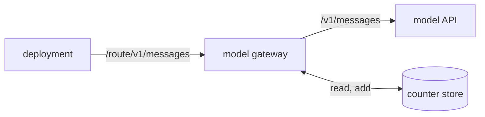

# The model gateway

The model gateway is a process of its own on the host that sits between a deployment and the model
API. Every model request the deployment sends passes through it. The gateway prices each reply from
the reply's own token counts, adds the price and the tokens to one running count, and refuses every
request once the count reaches the configured limit. It fails closed: when it cannot read or write
its count, it refuses every request instead of letting one through uncounted. Because the gateway
runs outside the deployment, code that the deployment runs cannot raise or skip its limit. The
gateway is the first part of the hard spending stop that the
[budgets design](../../design/platform/policy/budgets.md#the-hard-spending-stop) describes, and a
preview host runs one per preview with a small limit.

A sandbox reaches the model API only through its credential broker, so every model call from a
worker's sandbox passes through the gateway.
[The imp adapter](../connectors/sandboxes.md#the-imp-adapter) gives the sandbox no other route.



## Routes

The gateway holds one route per model profile. A route has an ID, the model API it speaks, the
upstream origin it sends to, the model it allows, and the profile's price table. The API is
Anthropic's Messages API, `anthropic-messages`, unless the route names OpenAI's Responses API,
`openai-responses`. A request names its route in the first segment of its path, and the gateway
sends the rest of the path, with the query, to the route's upstream. A deployment therefore points a
profile's base URL at the gateway with the route ID on the end, and the model client adds the API
path after it.

The gateway prices every reply on a route with that route's table, so a request for another model
would be priced wrong. The gateway refuses a request to a spending or token count endpoint whose
body names no model, or a model other than its route's, and sends nothing upstream. A path whose
first segment names no route gets a 404.

A route's model is the only model the count prices, so the gateway also refuses, with a 400 and
nothing sent upstream, a request to a spending or token count endpoint that could bill anything
else. It refuses a request whose body holds:

- `models`, `fallbacks`, `route` or `plugins`, which let the model API run another model;
- `provider`, unless the route sets `providerPin` and the field is exactly
  `{ "order": ["<providerPin>"], "allow_fallbacks": false }`;
- `speed` with any value but `standard` or null, or `service_tier` with any value but `auto`,
  `standard_only`, `default` or null, because the price table holds no premium tier. Both model APIs
  treat an absent `service_tier` as `auto`, so each allowed value bills no more than a body without
  the field;
- a `tools` entry that has a `model` key or a `type` that starts with `advisor_` or `openrouter:`,
  which run a second model. The check reads the `tools` entries and nothing else, because a tool
  call's input can hold a `model` key of its own.

It also refuses a request that holds both an `authorization` and an `x-api-key` header. The
credential broker sets its own header and the gateway passes the others through, so a second one
would reach the model API beside the broker's.

A route sets `providerPin` to the provider that its profile's `provider_pin` names, and the two must
match, or the gateway refuses every pinned request:

```yaml
routes:
  router:
    upstream: https://models.example.com
    model: example/model-small
    providerPin: example-host
```

The gateway forwards only the endpoints of the route's API whose spend it can count, and refuses
every other endpoint with a 403:

| API                  | Endpoints                                 |
| -------------------- | ----------------------------------------- |
| `anthropic-messages` | messages, token counts and the model list |
| `openai-responses`   | creating a response, and the model list   |

The method and path of each endpoint live in one table in
[`find-model-api-endpoint.ts`](../../../libs/wire/src/spool/find-model-api-endpoint.ts). The
scripted model that stands in for the model API in tests routes its requests through the same table.

A message batch, for one, spends after its reply and names its models inside each request, out of
reach of both the count and the model check. A stored response read back by its ID spends nothing
that the gateway could count. The gateway refuses a request for a background response with a 400
too, because that response spends after its reply, and the reply holds no usage.

The gateway passes every header through except the hop-by-hop ones, and asks the upstream for an
uncompressed reply so that it can read the usage as the reply passes. It never adds or reads a
credential: a credential broker in front of it, or the deployment itself, supplies one.

## The count

The count is two totals, dollars and tokens, kept in a counter store on the host's disk. The gateway
reads both from the store before it admits a request, and adds a reply's price and tokens once the
reply ends. The models module's call pricing sets the price, the same pricing that the deployment's
own records use, so a cache write for the long lifetime takes the profile's price for that lifetime,
and a reply to a long prompt takes the profile's
[long-prompt prices](../core/model-profiles.md#prices-and-the-provider-pin) when it has them. The
tokens are the input, the cache writes, the cache reads and the output. Where a reply's cache write
total and its split by cache lifetime disagree, the larger figure counts for both. A Responses reply
counts its cache reads and writes inside its input count, so the gateway takes them out of the input
before it prices the rest as uncached. Its shorter cache lifetime takes the profile's shorter
lifetime price, and its longer one, or a write with no lifetime, takes the longer lifetime price.

A whole reply carries its usage in its body. A streamed Messages reply carries the input side in its
first event and the running output count in each later delta. A streamed Responses reply carries its
whole usage in the event that ends the response, whether the response completed, stopped early or
failed. The gateway reads the events as they pass on to the caller. The streamed reply ends for the
caller only after the count is written, so a caller that reads a whole reply and sends again never
gets ahead of its own count. A caller that stops reading early, and an upstream that breaks
mid-stream, still leave the count of the events that arrived. A reply with no usage, such as an
error, adds nothing.

The store writes each count to a new file and renames it over the old one, so a crash leaves the
last whole count. It adds one reply at a time, so two replies that end together each count once.

## The limit

A config sets either `limits`, which this section describes, or `periods`, which
[the periods](#the-periods) describes. A preview's config sets `limits`.

The configured limit names dollars, tokens or both, and the gateway refuses a request once either
total reaches its limit. The refusal is a 403 in the model API's error shape, with a message that
names the totals and the limit, so the model client stops instead of retrying. Requests already in
flight when the count crosses the limit finish and count, so the totals can pass the limit by the
replies that were running at that moment.

## The periods

A config with `periods` counts a day and a month in place of one total. Each resets at local
midnight in `periods.zone`, an IANA zone that equals the deployment's default time zone. The server
sets the limits and the gateway's own config sets the caps above them, so code in the deployment
cannot move a cap.

```yaml
periods:
  zone: Europe/London
caps: # default: twice nixie's default day and month limits
  day: { dollars: 120, tokens: 160000000 }
  month: { dollars: 1200, tokens: 1200000000 }
control:
  listen: { hostname: 127.0.0.1, port: 8790 } # an address no sandbox reaches
  tokenFile: /run/secrets/gateway-control-token # one line
countBySandbox: true # default false
override: /var/lib/model-gateway/override.json # no path, no override
```

A config with `periods` needs `control`, and the schema refuses a config that sets both `periods`
and `limits`, or neither. It also refuses `caps`, `control`, `countBySandbox` and `override` in a
config with `limits`. The store of a `periods` config is a file of its own, in version 2: the start,
the count, the base limit, the raise and the trip time of each period, and a count and a limit per
sandbox. A period's trip time is the instant the gateway first found its count at its limit in
force, and a reset or a raise that lifts the limit clears it.

At start, the gateway rewrites a store file in the shape of a `limits` count as a version 2 store,
in one write. The periods start at zero, because a total that never reset says nothing of today's
spend or this month's. The lost mark carries over, and the gateway logs the old totals. The gateway
refuses to start on a store file in any other shape.

### Admission and the reset

Before each admission the gateway reads the store and the override file, and answers:

- a 503 while the lost mark stands, or while either period's base limit is null, so a gateway that
  the server never set sends nothing upstream;
- a 403 for a sandbox that the store lacks, when the config counts by sandbox;
- the limit 403 when a period's count has reached its limit in force. That limit is the override
  when it applies to the period's current start, and otherwise the larger of the base limit and the
  day's raise;
- the limit 403 when a sandbox's count has reached its own limit.

Each read of the store, for an admission, a reply or a control call, first resets each period whose
next start in the zone has passed: the count goes to zero, the start moves, and the raise drops. The
base limit and the lost mark stay. A reset therefore needs no model request, and a `/status` read
after midnight shows the new day. The store runs one change at a time, so a reply counted after
midnight lands in the new day and the month once. A reply adds its dollars and tokens to the day,
the month and its sandbox in one write.

### Count by sandbox

With `countBySandbox`, a path is `/<sandbox>/<route>/[~in.<tag>/]<path>`. The gateway takes the
sandbox from the first segment and the route from the second, and strips both, and the capture tag,
before it calls the model API. Without it the path is as [the routes](#routes) describe.

### The control listener

A second listener on `control.listen` serves the server alone. It answers 401 to any request without
`Authorization: Bearer <token>`, with the token read from `control.tokenFile` at start. The model
listener serves no control path.

| Call                       | Effect                                                                                                                       |
| -------------------------- | ---------------------------------------------------------------------------------------------------------------------------- |
| `GET /status`              | the zone, the lost mark, each period's start, reset time, count, limit in force and cap, and `tripped`                       |
| `PUT /limits`              | sets the base limits of both periods; 409 `above_cap` past a cap                                                             |
| `POST /raise`              | raises the day for its start, never below that day's earlier raise; 409 `above_cap`, or 409 `period_ended` for another start |
| `PUT /sandboxes/<name>`    | sets the sandbox's limit, or `null` to count only, and sets its count to zero                                                |
| `GET /sandboxes/<name>`    | the sandbox's count and whether it is past its limit; 404 for a name the store lacks                                         |
| `DELETE /sandboxes/<name>` | removes the sandbox; 204 also for a name the store lacks                                                                     |

A refused call changes nothing. `tripped` is null while each count is under its limit in force and
the lost mark is absent. For a limit, its `at` is the period's trip time. While only the lost mark
stands, `tripped` is `{ "lost": true, "at": … }`, and `at` is the time of the read, because an
operator clears the mark by deleting one field and the store keeps no time beside it.

### The override

`model-gateway raise --config <file> --period day|month --dollars <n> --tokens <n>` is the only way
past a cap. It writes the override file for the period now in force in the config's zone, through a
second file and a rename, and the limit it names may pass the cap. The gateway ignores an override
whose start is not the period's current start, and an override file that it cannot read. The control
listener has no call that writes the override, and the server has no path to the override, the store
or the config. A config with no `override` path makes the command refuse to run.

## How nixie uses the gateway

A deployment whose config sets `spendStop` sends every model request through the gateway, under the
count of the sandbox that sends it. A deployment with no `spendStop` changes nothing: no request
takes the gateway path, no sandbox registers, and no start check calls the gateway.

```yaml
spendStop:
  control: http://127.0.0.1:8790 # the gateway's control listener
  token: deployment:gateway-control # a reference into the secrets file's settings
  modelURL: http://10.0.0.2:8789 # the gateway's model listener, as the sandbox host reaches it
```

The server refuses to start when the secrets file lacks the settings entry that `token` names.

The [spending stop](spending-stop.md) adds the turn count, the pause and the raise.

### The start checks

After the migrations, and before any other part starts, the server checks the gateway. It refuses to
start in each of these cases:

- the secrets file has a `model_credentials` entry;
- the gateway's `/status` shows a zone that differs from the time tool's `default_zone`;
- `PUT /limits` with the day and month limits of the models config answers `above_cap`. The error
  holds the cap.

When the gateway does not answer, the server starts, logs `spend.limits_unsent`, and sends the
limits on a fixed short interval until the gateway answers. Until then the gateway holds no limit
and refuses every model request. A late send checks the zone first, and sends nothing to a gateway
in another zone.

### The route of a request

Each turn frame's base URL is the profile's base URL followed by `/<sandbox name>/<profile ID>`. The
server builds it for the conversation, each task run, each worker run and the consent checker, and
the guest changes nothing. The gateway reads the sandbox name from the first path segment, so the
server refuses to start when a profile's base URL has a path. The sandbox name is the sandbox's ID,
which is also its name in the sandbox host. The profile ID is the gateway's route ID. The
[capture](#the-tag) tag follows the profile ID, in the order the gateway parses. The secret still
names the profile's own host, so the credential broker matches the request by host and sends it to
the secret's upstream. The credential broker admits that request only on the route of the sandbox's
own profile, so a sandbox cannot send its model credential to another profile's route.

### The count of a sandbox

Before a sandbox's first model request, the server registers it with `PUT /sandboxes/<name>`:

| Sandbox                                | Limit                                            |
| -------------------------------------- | ------------------------------------------------ |
| a worker run's sandbox                 | the run's planned dollars and tokens             |
| the conversation, a task and the check | none: the gateway counts it and never refuses it |

A worker run's planned limit is the worker's configured limit, held to what the calling task run has
left, so the gateway and nixie hold one number. A registration that fails fails the sandbox's start.
A sandbox that an earlier server process made registers the first time this process reads it, so a
sandbox kept across a restart has its count. Once a sandbox's destroy succeeds, the server deletes
its entry. A sandbox whose destroy fails keeps its entry, because it may still run. A delete that
fails is logged.

### Worker limits

A worker run ends at `workerRun.turns`, which the guest passes to the Agent SDK as its turn cap, and
at `workerRun.minutes`. The gateway ends it at the sandbox's dollar and token limits. At the end of
a worker run the server reads `GET /sandboxes/<name>`. The `worker.run_ended` record holds the
gateway's dollars and tokens, and a sandbox the gateway found past its limit ends the run with the
limit `dollars` or `tokens`, unless the run ended with an answer, a stop, its minutes or a failed
start first. When the gateway does not answer that read, the record holds the run's planned dollars
and tokens, where the gateway starts to refuse the sandbox's requests, because the guest's own count
can miss spend. The run's dollars still count toward the calling task run's dollar limit. A task run
has no token limit: it ends at its turns and its dollars.

## The capture

The gateway copies the exact body of a model request to a spool folder, sealed to a key that only
nixie holds, so a guest cannot vouch for its own input. The
[turn-input log design](../../design/queue/turn-input-log.md) describes the nixie side: the tag, the
intake and the store.

### The tag

A tag is one path segment right after the route, `~in.<captureID>.<key>`. The capture ID is a
lowercase version 4 UUID, and the key is a P-256 public key, uncompressed, in unpadded base64url.
The gateway always removes a segment that starts with `~in.` before it matches the endpoint, so the
endpoint match, the model check and the count see the path as if no tag were there. The 403 and 404
replies echo the path as sent, tag included, which holds no secret.

The gateway decodes the tag with the wire library, which checks the key's length, its first byte and
that the point lies on the curve. A tag that fails any check is removed, and the gateway writes no
file for that request. The tag is not authenticated: a guest could swap its key for another valid
point, which only makes that capture unreadable to nixie.

### What the gateway copies

With the `capture` config key, the gateway copies a tagged request only when it sends the request
upstream to `messages` or `responses`. A request that the gateway refuses, and a tagged
`count_tokens` or `models` request, writes no file. The gateway never changes a body, so a copy
equals the bytes that the model API received.

The handler takes a counter value for the copy, one per capture ID that runs from 1 while the
gateway runs, and starts the spool work just before it sends the request. It never waits for the
spool. When the model API answers, the gateway renames the file to record the response's status,
before the reply streams. When the model API gives no response, the gateway removes the file. A
request with no response keeps its counter value, which leaves a gap that nixie counts.

### The spool file

Each file is named `<captureID>.<writer>.<counter>` plus an ending. The writer is 16 random
lowercase hex characters, new at each start of the gateway. The ending is `.part` while the gateway
writes, then `.<upstreamStatus>.cap` once the response's status arrives. The wire library owns the
name grammar, the header, the seal and the open, and committed fixtures pin each of them.

A `.cap` file holds a 4-byte header length, the header as JSON, then the body in AES-256-GCM. The
header is plain text: it shows a request's time, route, endpoint and size, and nothing of its body.
The gateway makes a new P-256 key pair for each request, derives the AES key from it and the tag's
key with ECDH and HKDF-SHA-256, and passes the length bytes and the header bytes as the additional
data, so a changed header fails the open.

When the gateway cannot write a body, it writes a `.miss` file of plain JSON, with the request's own
counter value and one reason:

| Reason               | Cause                                                                            |
| -------------------- | -------------------------------------------------------------------------------- |
| `queue_full`         | `max_pending` bodies already wait for the spool                                  |
| `spool_full`         | the `.part`, `.cap` and `.miss` files, with the new file, would pass `max_bytes` |
| `spool_write_failed` | the folder could not be read, or the file could not be created or renamed        |
| `seal_failed`        | the seal threw                                                                   |

When the `.miss` write fails too, the gateway logs `capture.miss_failed` with the reason and the
error's code. No log line holds a byte of a body, a key or a tag.

### The config

```yaml
capture:
  spool: /var/lib/nixie/turn-input-spool # an absolute path
  max_bytes: 536870912 # default
  max_pending: 16 # default
```

With no `capture` key, the gateway still removes a tag and writes no file. The deployment creates
the spool folder, owned by a group that the gateway and nixie share, with mode 0770. At its start,
the gateway checks that the spool is a directory that it can write and enter, and refuses to start
when it is not. It never creates the folder or changes its mode. It then removes every `.part` file
in the spool, whatever its writer, and leaves the `.cap` and `.miss` files. So 2 gateways never
share one spool.

### The capture ask

A `GET /~capture?spool=<folder>` answers `{ "canCapture": true }` only when the config has the
`capture` key, the folder resolves to the configured spool, and the gateway can write and enter the
spool at the time of the ask. Any other ask gets `{ "canCapture": false }`, which never names the
configured folder. A missing `spool` query gets a 400, and another method a 405. No route ID can
match `~capture`, and the answer does not depend on the counter store. The wire library holds the
path and the answer's schema.

nixie tags requests only after a yes, so the gateway takes its release before the nixie release that
tags requests.

## Failing closed

The gateway treats a counter store it cannot use, and a count it has lost, as a store that holds no
room. A lost count is one that fell behind the spend, and the gateway marks it as lost in the store
itself. While the lost mark stands, the gateway answers every request with a 503 and sends nothing
upstream, across restarts, until an operator removes the `lost` field from the store file. The mark
survives a restart because a restart cannot recover the spend the count missed. From the moment a
count is lost until its mark is in the store, the gateway refuses every request in its own process,
also while a second mark is still being written. When a mark cannot be written, the gateway refuses
every later request until it exits.

- **The store cannot be read.** A missing store file, a missing directory or a file that holds no
  count fails the read, and the gateway answers the request with a 503 and sends nothing upstream.
- **A count cannot be written.** The reply that could not be counted still reaches its caller, and
  the gateway marks the count as lost, because its store now holds less than was spent.
- **A message reply is lost before its usage arrives.** A call whose connection fails, or whose
  whole reply breaks, gets the caller a 502, and a stream that breaks or that its caller cancels
  ends where it stopped. Either way the gateway marks the count as lost, because the model may have
  spent on a reply the gateway never counted. A failed token count or model list spends nothing, so
  it only gets the caller a 502.
- **A successful message reply holds no usage the gateway can read.** The reply reaches its caller,
  and the gateway marks the count as lost, because the reply spent an amount the gateway cannot
  count.
- **The store directory does not exist at start.** The gateway exits, so the route it would serve
  has no way to the model API.

A stop signal closes the listener and lets each reply under way finish, up to a bounded wait, so the
count holds every reply that finishes within that wait. A reply still open when the wait ends is cut
off before its whole usage arrives, so the gateway marks the count as lost before it closes that
reply.

The release attaches the gateway as one compiled binary for Linux, so a host runs it without a Bun
install. The gateway imports prices from `@heynixie/models/prices` only, because the package's main
entry also takes in the database code, whose migrations a compiled binary cannot read. The bundle
test lane compiles the binary with the release's arguments and starts it. The
[preview recipe](../../runbooks/preview.md#model-calls) covers how a preview names its route.
