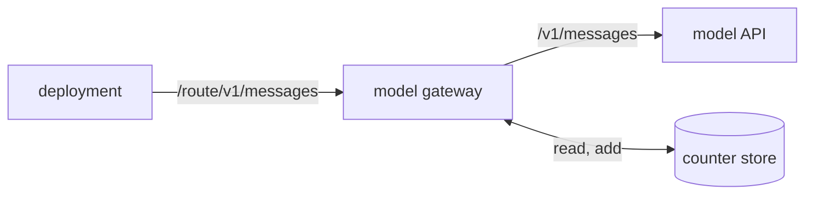

# The model gateway

The model gateway is a process of its own on the host that sits between a deployment and the model
API. Every model request the deployment sends passes through it. The gateway prices each reply from
the reply's own token counts, adds the price and the tokens to one running count, and refuses every
request once the count reaches the configured limit. It fails closed: when it cannot read or write
its count, it refuses every request instead of letting one through uncounted. Because the gateway
runs outside the deployment, code that the deployment runs cannot raise or skip its limit. The
gateway is the first part of the hard spending stop that the
[budgets design](../../design/platform/policy/budgets.md#the-hard-spending-stop) describes, and a
preview host runs one per preview with a small limit.



## Routes

The gateway holds one route per model profile. A route has an ID, the model API it speaks, the
upstream origin it sends to, the model it allows, and the profile's price table. The API is
Anthropic's Messages API, `anthropic-messages`, unless the route names OpenAI's Responses API,
`openai-responses`. A request names its route in the first segment of its path, and the gateway
sends the rest of the path, with the query, to the route's upstream. A deployment therefore points a
profile's base URL at the gateway with the route ID on the end, and the model client adds the API
path after it.

The gateway prices every reply on a route with that route's table, so a request for another model
would be priced wrong. The gateway refuses a request to a spending or token count endpoint whose
body names no model, or a model other than its route's, and sends nothing upstream. A path whose
first segment names no route gets a 404.

The gateway forwards only the endpoints of the route's API whose spend it can count, and refuses
every other endpoint with a 403:

| API                  | Endpoints                                 |
| -------------------- | ----------------------------------------- |
| `anthropic-messages` | messages, token counts and the model list |
| `openai-responses`   | creating a response, and the model list   |

The method and path of each endpoint live in one table in
[`find-model-api-endpoint.ts`](../../../libs/wire/src/find-model-api-endpoint.ts). The scripted
model that stands in for the model API in tests routes its requests through the same table.

A message batch, for one, spends after its reply and names its models inside each request, out of
reach of both the count and the model check. A stored response read back by its ID spends nothing
that the gateway could count. The gateway refuses a request for a background response with a 400
too, because that response spends after its reply, and the reply holds no usage.

The gateway passes every header through except the hop-by-hop ones, and asks the upstream for an
uncompressed reply so that it can read the usage as the reply passes. It never adds or reads a
credential: a credential broker in front of it, or the deployment itself, supplies one.

## The count

The count is two totals, dollars and tokens, kept in a counter store on the host's disk. The gateway
reads both from the store before it admits a request, and adds a reply's price and tokens once the
reply ends. The models module's call pricing sets the price, the same pricing that the deployment's
own records use, so a cache write for the long lifetime takes the profile's price for that lifetime,
and a reply to a long prompt takes the profile's
[long-prompt prices](../core/model-profiles.md#prices-and-the-provider-pin) when it has them. The
tokens are the input, the cache writes, the cache reads and the output. Where a reply's cache write
total and its split by cache lifetime disagree, the larger figure counts for both. A Responses reply
counts its cache reads and writes inside its input count, so the gateway takes them out of the input
before it prices the rest as uncached. Its shorter cache lifetime takes the profile's shorter
lifetime price, and its longer one, or a write with no lifetime, takes the longer lifetime price.

A whole reply carries its usage in its body. A streamed Messages reply carries the input side in its
first event and the running output count in each later delta. A streamed Responses reply carries its
whole usage in the event that ends the response, whether the response completed, stopped early or
failed. The gateway reads the events as they pass on to the caller. The streamed reply ends for the
caller only after the count is written, so a caller that reads a whole reply and sends again never
gets ahead of its own count. A caller that stops reading early, and an upstream that breaks
mid-stream, still leave the count of the events that arrived. A reply with no usage, such as an
error, adds nothing.

The store writes each count to a new file and renames it over the old one, so a crash leaves the
last whole count. It adds one reply at a time, so two replies that end together each count once.

## The limit

The configured limit names dollars, tokens or both, and the gateway refuses a request once either
total reaches its limit. The refusal is a 403 in the model API's error shape, with a message that
names the totals and the limit, so the model client stops instead of retrying. Requests already in
flight when the count crosses the limit finish and count, so the totals can pass the limit by the
replies that were running at that moment.

## The capture

The gateway copies the exact body of a model request to a spool folder, sealed to a key that only
nixie holds, so a guest cannot vouch for its own input. The
[turn-input log design](../../design/queue/turn-input-log.md) describes the nixie side: the tag, the
intake and the store.

### The tag

A tag is one path segment right after the route, `~in.<captureID>.<key>`. The capture ID is a
lowercase version 4 UUID, and the key is a P-256 public key, uncompressed, in unpadded base64url.
The gateway always removes a segment that starts with `~in.` before it matches the endpoint, so the
endpoint match, the model check and the count see the path as if no tag were there. The 403 and 404
replies echo the path as sent, tag included, which holds no secret.

The gateway decodes the tag with the wire library, which checks the key's length, its first byte and
that the point lies on the curve. A tag that fails any check is removed, and the gateway writes no
file for that request. The tag is not authenticated: a guest could swap its key for another valid
point, which only makes that capture unreadable to nixie.

### What the gateway copies

With the `capture` config key, the gateway copies a tagged request only when it sends the request
upstream to `messages` or `responses`. A request that the gateway refuses, and a tagged
`count_tokens` or `models` request, writes no file. The gateway never changes a body, so a copy
equals the bytes that the model API received.

The handler takes a counter value for the copy, one per capture ID that runs from 1 while the
gateway runs, and starts the spool work just before it sends the request. It never waits for the
spool. When the model API answers, the gateway renames the file to record the response's status,
before the reply streams. When the model API gives no response, the gateway removes the file. A
request with no response keeps its counter value, which leaves a gap that nixie counts.

### The spool file

Each file is named `<captureID>.<writer>.<counter>` plus an ending. The writer is 16 random
lowercase hex characters, new at each start of the gateway. The ending is `.part` while the gateway
writes, then `.<upstreamStatus>.cap` once the response's status arrives. The wire library owns the
name grammar, the header, the seal and the open, and committed fixtures pin each of them.

A `.cap` file holds a 4-byte header length, the header as JSON, then the body in AES-256-GCM. The
header is plain text: it shows a request's time, route, endpoint and size, and nothing of its body.
The gateway makes a new P-256 key pair for each request, derives the AES key from it and the tag's
key with ECDH and HKDF-SHA-256, and passes the length bytes and the header bytes as the additional
data, so a changed header fails the open.

When the gateway cannot write a body, it writes a `.miss` file of plain JSON, with the request's own
counter value and one reason:

| Reason               | Cause                                                                            |
| -------------------- | -------------------------------------------------------------------------------- |
| `queue_full`         | `max_pending` bodies already wait for the spool                                  |
| `spool_full`         | the `.part`, `.cap` and `.miss` files, with the new file, would pass `max_bytes` |
| `spool_write_failed` | the folder could not be read, or the file could not be created or renamed        |
| `seal_failed`        | the seal threw                                                                   |

When the `.miss` write fails too, the gateway logs `capture.miss_failed` with the reason and the
error's code. No log line holds a byte of a body, a key or a tag.

### The config

```yaml
capture:
  spool: /var/lib/nixie/turn-input-spool # an absolute path
  max_bytes: 536870912 # default
  max_pending: 16 # default
```

With no `capture` key, the gateway still removes a tag and writes no file. The deployment creates
the spool folder, owned by a group that the gateway and nixie share, with mode 0770. At its start,
the gateway checks that the spool is a directory that it can write and enter, and refuses to start
when it is not. It never creates the folder or changes its mode. It then removes every `.part` file
in the spool, whatever its writer, and leaves the `.cap` and `.miss` files. So 2 gateways never
share one spool.

### The capture ask

A `GET /~capture?spool=<folder>` answers `{ "canCapture": true }` only when the config has the
`capture` key, the folder resolves to the configured spool, and the gateway can write and enter the
spool at the time of the ask. Any other ask gets `{ "canCapture": false }`, which never names the
configured folder. A missing `spool` query gets a 400, and another method a 405. No route ID can
match `~capture`, and the answer does not depend on the counter store. The wire library holds the
path and the answer's schema.

nixie tags requests only after a yes, so the gateway takes its release before the nixie release that
tags requests.

## Failing closed

The gateway treats a counter store it cannot use, and a count it has lost, as a store that holds no
room. A lost count is one that fell behind the spend, and the gateway marks it as lost in the store
itself. While the lost mark stands, the gateway answers every request with a 503 and sends nothing
upstream, across restarts, until an operator removes the `lost` field from the store file. The mark
survives a restart because a restart cannot recover the spend the count missed. When the mark cannot
be written, the gateway still refuses every later request until it exits.

- **The store cannot be read.** A missing store file, a missing directory or a file that holds no
  count fails the read, and the gateway answers the request with a 503 and sends nothing upstream.
- **A count cannot be written.** The reply that could not be counted still reaches its caller, and
  the gateway marks the count as lost, because its store now holds less than was spent.
- **A message reply is lost before its usage arrives.** A call whose connection fails, or whose
  whole reply breaks, gets the caller a 502, and a stream that breaks or that its caller cancels
  ends where it stopped. Either way the gateway marks the count as lost, because the model may have
  spent on a reply the gateway never counted. A failed token count or model list spends nothing, so
  it only gets the caller a 502.
- **A successful message reply holds no usage the gateway can read.** The reply reaches its caller,
  and the gateway marks the count as lost, because the reply spent an amount the gateway cannot
  count.
- **The store directory does not exist at start.** The gateway exits, so the route it would serve
  has no way to the model API.

A stop signal closes the listener and lets each reply under way finish, up to a bounded wait, so the
count holds every reply that finishes within that wait. A reply still open when the wait ends is cut
off before its whole usage arrives, so the gateway marks the count as lost before it closes that
reply.

The release attaches the gateway as one compiled binary for Linux, so a host runs it without a Bun
install. The [preview recipe](../../runbooks/preview.md#model-calls) covers how a preview names its
route.
