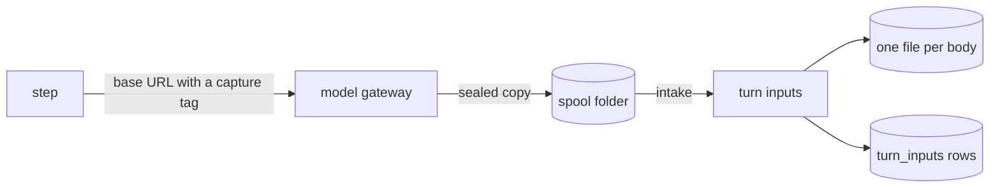

# The turn-input log

The turn-input log stores the exact body of each model request a step sends, so the user can open
what a model received: the system prompt, the reminders the harness added, every message and the
tool list. The harness builds each request inside the sandbox, so the event log never holds it. The
[model gateway](model-gateway.md#the-capture) copies each request, and nixie keeps the copies in
`modules/turn-inputs`, outside the backup set. A copy made by the guest would let the guest vouch
for its own input.

## Configuration

The deployment turns the log on with a `turn_input_log` section. With no section, nixie opens no
capture and the three host procedures answer `NOT_CONFIGURED`.

| Key               | Default                | Meaning                                                                                   |
| ----------------- | ---------------------- | ----------------------------------------------------------------------------------------- |
| `default`         | `always`               | `always` captures from the start, `off` waits for `nixie turn-input on`                   |
| `max_window`      | `24h`                  | the longest a `turn-input on --for` window can last                                       |
| `close_wait`      | `5s`                   | how long a step end waits for a spool file that a gateway still writes                    |
| `roles`           | `conversation`, `task` | the roles that capture: also `memory-writer` and `memory-consolidator`                    |
| `retention.days`  | `7`                    | 3, 7 or 30; a request older than this is removed                                          |
| `retention.bytes` | `2147483648`           | the most the bodies take; the oldest go first                                             |
| `sources`         | none                   | each gateway as `base_url` and `dir`, the origin a profile points at and its spool folder |

The `checker` role sends no turn frame and no runner uses `worker`, so a config that names either
fails to load.

## The capture of a step

A step that covers a captured role opens a capture before its first model call and closes it when
the step ends. Opening works like this:

1. nixie finds the source whose `base_url` starts the profile's base URL. With none, or with a Codex
   harness, the step runs unchanged and a `no_capture_point` miss records why.
2. nixie asks the gateway at `/~capture` whether it can capture into the source's folder. A refusal,
   an error or a late answer leaves the step unchanged.
3. nixie makes a P-256 key pair. It seals the private key with AES-256-GCM under a capture key from
   the key store, and puts the public key in the capture tag.
4. The step's base URL becomes the profile's base URL plus `/~in.<tag>`, so the gateway seals each
   copy to the public key.

A fault in any of this never changes a model request. Each copy reaches the spool as
`<captureID>.<writer>.<counter>.<status>.cap`, and a request that the gateway could not copy gives a
`.miss` file with a reason.

When the step ends, nixie takes in the spool files, waits up to `close_wait` for a file that is
still `.part`, and then shreds the capture key. A late file gets a `capture_closed` miss. Per
writer, a run of missing counters gives one `not_received` miss with a count, and so does the number
of model call frames that the step reported above the files it holds.

## Intake and storage

An intake tick runs each second on the injected clock, one serial lane for the whole module. For
each spool file it opens the file with the capture key, checks the body for an own secret value, and
stores it:

1. nixie reserves a `turn_inputs` row in state `writing`.
2. It creates a random per-body key in the key store.
3. It writes the body as `<data dir>/turn-inputs/<input ID>.bin`, sealed with AES-256-GCM under that
   key and bound to the key ID and the input ID, then fsyncs the file and the folder.
4. One transaction sets the row to `stored`.

A body that holds an own secret value in plain or JSON-escaped form is never stored and gives a
`holds_own_value` miss. A file that fails to open gives `undecodable`, and 5 failed intakes of one
file give `intake_failed` and remove the file. A symlink in the spool is never followed.

## Removal

Every removal deletes the body's key first, with a checkpoint of the key store, then the file, then
the row: a `writing` row is deleted and any other becomes `removed`. A crash leaves a state that the
start repair finishes.

| Cause             | When                                                                            |
| ----------------- | ------------------------------------------------------------------------------- |
| `retention_days`  | the periodic sweep finds a request older than `retention.days`                  |
| `retention_bytes` | the sweep finds the bodies above `retention.bytes`                              |
| `forget`          | a record, a memory item or a moment is forgotten                                |
| `dropped`         | `nixie turn-input off --drop`                                                   |
| `restore`         | a body write fails, or the start repair finds a row without its key or its file |

A forget closes the open captures of the tasks it covers, then removes the requests it covers. A
request is covered when its thread is covered, or when its intake sequence is at or after the
forget's floor: the sequence of the forgotten record, or the first record of the forgotten item or
moment. The boundary is inclusive, so a request taken in at the floor goes. When nixie cannot find a
floor, every request goes. A failed shred fails the forget, and the start sequence runs it again. A
full reset removes every body after the log's own reset. A reset of the conversations closes the
conversation thread's open captures and removes every request on that thread, in the same order as
any removal, before it writes its `log_reset` record. A failed removal fails the reset.

## Reading

Each open is a record first: `model.input_opened` commits before nixie reads any body, and a failed
commit gives `OPEN_NOT_RECORDED` and no body. The state comes from the latest `model.input_log_set`
record, or from `default`. See [host commands](../deployment/host-commands.md#turn-inputs) for the
commands.
