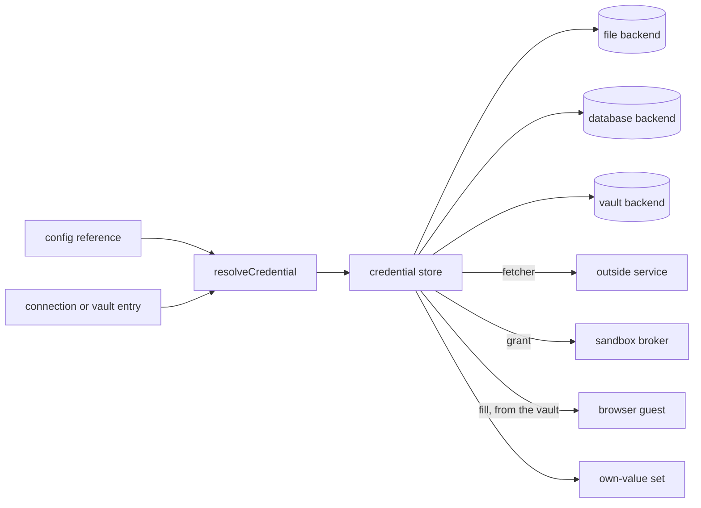

# The credential store

- **Status:** agreed. The first slice is built and described in
  [the credential store](../../../architecture/connectors/credentials.md): the file backend, the
  resolver, the fetcher, the model grant, the fingerprint and the own-value set, with the search,
  image, spend, owner and model credentials on them. The rest is not built: bindings with a removal
  counter, `exchange`, `refresh`, the database and vault backends, Disconnect, the statuses,
  `pairing`, `stream` and the mail and phone entries.
- Decisions: [0003](../../../decisions/0003-sdk-placement.md), which puts the model loop in a
  sandbox, so its model credential reaches it through a grant

nixie uses credentials from 3 sources: secrets the deployment supplies in its secrets file, such as
an API key or a model credential; secrets nixie holds and changes at runtime, such as an OAuth token
or an app password you enter; and passwords and cards in the vault. Today the secrets file has 7
hand-written resolvers and 2 reference patterns, and 3 designs each add a store of their own. After
this design, one store with one interface sits in front of 3 backends, the file, the database and
the vault, and each kind of credential has one backend. One resolver turns every reference into a
credential. A tool or a connector uses a credential on the host, and a value never enters a tool
result, a prompt, a log or a record in clear.

Build the rest of this design's work items from it and the built
[configuration and secrets](../../../architecture/deployment/configuration.md) it replaces.
Disconnect, the statuses, `pairing`, `stream` and a fetcher with no credential come with their first
callers; the database backend comes with the
[Google connections](../../../architecture/connectors/google-connections.md), and the vault backend
with the [vault](../../queue/accounts.md).

## Shape



## Terms

- A **reference** names a credential without its value: `deployment:kagi` in the config, or the UUID
  of a connection or a vault entry.
- An **origin** is a scheme, a host and a port, such as `https://kagi.com:443`.
- A **binding** is one use of a credential, with its own origins and placement. One reference can
  back several bindings, such as one image key behind 2 providers. Each reference has a lock and a
  removal counter, which every removal and every reconnect advances for all of its bindings.
- A **fingerprint** is the first 8 hex digits of an HMAC-SHA-256 of a value under the fingerprint
  key. It shows a rotation in the client without the value.

## Contracts

### The reference and the resolver

A query names a credential, the resolver turns it into a reference to one backend, and `register`
turns a reference and a spec into a binding, which every other call takes.

```ts
// credentials module. createResolver binds the resolver to the loaded secrets file; it throws
// MissingCredentialError at start for a missing entry, except a model entry.
const resolveCredential = createResolver(secretsFile);
const ref = resolveCredential({ class: 'connector', reference: 'deployment:kagi' });
// → { backend: 'file', group: 'connector_credentials', name: 'kagi' }
resolveCredential({ class: 'model', reference: 'deployment:openai' }); // → null when it is missing
resolveCredential({ class: 'setting', reference: 'deployment:spend' }); // → { …, group: 'settings' }
resolveCredential({ class: 'held', credentialID: '0c1d…' }); // → { backend: 'database', … }
resolveCredential({ class: 'vault', entryID: '5e7a…' }); // → { backend: 'vault', entryID: '5e7a…' }

type CredentialQuery =
  | { class: 'model' | 'connector' | 'setting'; reference: string } // a deploymentReference
  | { class: 'held'; credentialID: string } // a connection, an OAuth client or a consent
  | { class: 'vault'; entryID: string };

// The one schema for a reference in the config; the 5 copies go. It accepts every reference the
// two patterns accept today, such as deployment:example.v2, so the model profiles' references,
// which accept only [\w-] today, accept more.
const deploymentReference = z.string().regex(/^deployment:.+$/);

// The owner's name and pronouns are settings the prompt needs, not credentials.
readSetting('deployment:owner-name'); // → 'Sam'

type CredentialRef =
  | {
      backend: 'file';
      group: 'model_credentials' | 'connector_credentials' | 'settings';
      name: string;
    }
  | { backend: 'database'; credentialID: string } // a UUID: a connection, an OAuth client or a consent
  | { backend: 'vault'; entryID: string }; // a UUID
```

- The class picks the group: `model` reads `model_credentials`, `connector` reads
  `connector_credentials`, and `setting` reads `settings`. A missing model entry resolves to `null`,
  because the sandbox host holds that credential, as today.
- `settings` keeps the owner's name and pronouns, which `readSetting` returns, and the spend
  gateway's token, which resolves with the `setting` class and registers as a static credential.
  Both stay in `settings` so no deployment's secrets file changes. The spend token joins every scan
  for your own values, whatever the filter leaves out of `settings`.
- Of the 7 hand-written resolvers, the search, image, spend, owner and model ones go.
- A tool takes a short ID, and the module that owns the record maps it to the UUID before it calls
  the store. The store never sees a short ID, and the model never sees a UUID.
- `impd_token` and the definitions export secrets stay top-level fields that the server reads at
  start. They are infrastructure, and no tool uses them.
- A new credential in the secrets file, such as the Telegram bot token, the atc listener token or an
  MCP server's token, goes in `connector_credentials`.
- An entry's value is one secret. Every other field goes in the config. Mail's session URL and
  account ID, and the phone's account SID, API key SID and number, move from their secrets file
  entries to the config.
- Name every origin a binding may reach in the config or in the provider's code. An image provider's
  origin and header are fixed in its adapter, as its API URL is today.

### The interface

```ts
// credentials module. createCredentialStore takes the host-name resolver and the deny list once;
// the deny list is web fetch's: the non-public ranges plus the deployment's egress denies.
const store = createCredentialStore({ resolveHost, denied });
const search = store.register(ref, {
  kind: 'static',
  label: 'Kagi',
  origins: ['https://kagi.com'],
});
const fetch = store.fetcher(search, ['https://kagi.com']); // the shape of the global fetch

type Backend = CredentialRef['backend'];
type BindingRef<B extends Backend = Backend> = { bindingID: string; backend: B }; // bindingID: UUID

interface CredentialStore {
  register<B extends Backend>(
    ref: Extract<CredentialRef, { backend: B }>,
    spec: CredentialSpec,
  ): BindingRef<B>;
  fetcher(
    binding: BindingRef<'file' | 'database'> | null, // null: no credential, the same checks
    origins: string[], // must all be in the spec's origins; a stray one throws here
    options?: FetchOptions,
  ): typeof fetch;
  // A model credential the sandbox host holds has no binding; its grant names only the profile.
  grant(
    source: BindingRef<'file'> | { hostHeld: true; profileID: string },
    sandbox: Sandbox,
    spec: GrantSpec, // …existing
  ): Promise<void>;
  disconnect(binding: BindingRef<'file'>): Promise<void>; // stops local use
  reconnect(binding: BindingRef<'file'>): Promise<void>; // a checked action
  status(binding: BindingRef): Promise<CredentialStatus>; // a status from the Statuses table
}

// The database backend's own methods; no connector calls them.
interface HeldCredentials {
  exchange(client: BindingRef, request: TokenExchange): Promise<TokenResult>; // OAuth consent
  refresh(binding: BindingRef): Promise<void>;
}

// The vault backend's own methods, as the vault design sets out.
interface VaultCredentials {
  fill(binding: BindingRef, frame: FillFrame): Promise<FillResult>;
  reveal(binding: BindingRef, device: DeviceSession): Promise<RevealedValue>; // after a passkey check
}

// libs/egress, so an adapter can tell it apart without importing the credentials module. A tool
// call that meets it fails with an error, never a reply.
class CredentialRefusalError extends Error {}

interface CredentialSpec {
  kind: 'oauth_client' | 'oauth_token' | 'static' | 'model' | 'password' | 'card';
  label: string; // such as 'Google, personal'
  // Where the value may go: https, except a paired private service or the deployment's own
  // service. Empty for a password or a card, which only fill sends.
  origins: string[];
  // An oauth_token goes in Authorization as Bearer. Left out, a static value does the same.
  placement?:
    | { header: string; scheme?: 'Bearer' } // no scheme: the raw value, such as x-goog-api-key
    | { basic: { user: string } } // HTTP Basic with the value as the password, such as Twilio
    | { path: true }; // the value replaces {credential} in the URL path, such as Telegram
  expiresAt?: string;
}

interface FetchOptions {
  pairing?: { host: string; range: string }; // the one host that may resolve into the CIDR range
  redirects?: 'same_origin' | 'none'; // 'same_origin' by default
  stream?: boolean; // scrub chunk by chunk, with no size cap
  deploymentService?: true; // the deployment's own service, such as the spend gateway: http and a
  //                           private address pass
}
```

### Backends

| Backend  | Holds                                                 | Writes | fetcher | grant | Its own methods       |
| -------- | ----------------------------------------------------- | ------ | ------- | ----- | --------------------- |
| File     | the secrets file's credentials, read once at start    | no     | yes     | yes   | none                  |
| Database | OAuth clients and tokens, consents, secrets you enter | yes    | yes     | no    | `exchange`, `refresh` |
| Vault    | passwords and cards                                   | yes    | no      | no    | `fill`, `reveal`      |

- **File.** The server decrypts the secrets file once at start, as today, and holds the values in
  process memory only. No backend reads the environment. You rotate a value in the deployment, and
  nixie reads it at its next start.
- **Database.** Plain tables in `nixie.db`, owned by the module that owns the connection, as the
  [Google connections](../../../architecture/connectors/google-connections.md) doc sets out. Each
  value is sealed under a key of its own. `exchange` runs an OAuth token exchange and `refresh` a
  refresh: each puts the client secret and any PKCE verifier in the request body itself, so no
  connector holds either.
- **Vault.** The vault's records and projection, as the [vault](../../queue/accounts.md) design sets
  out. `fill` types a value into the browser guest's fill frame, and `reveal` returns a value to a
  signed-in device after a passkey check. A vault value leaves the server through these 2 methods
  only. A password rotation is a fill of the new value. An entry holds one password, and a mail
  reset recovers a rotation the site didn't keep, as [the vault design](../../queue/accounts.md)
  sets out.

### The fetcher

A connector never reads a value. It calls a service through `fetcher`, which adds the credential on
the host. A fetcher with no credential makes the same checks and adds nothing, so the store owns the
address checks for every call a connector makes from the host. The checks themselves live in
`libs/egress`, which web fetch shares.

- The fetcher allows only the origins its caller passes, which must all be in the credential's spec,
  and refuses a request to any other origin. It keeps the credential only on a redirect to the same
  origin. With `redirects: 'none'`, it returns a redirect unfollowed.
- On every hop it resolves the host, refuses any
  [non-public address](../../../architecture/connectors/web-fetch.md#the-fetcher), and connects to
  the address it checked. A private service passes only when `pairing` names its host and the
  resolved address falls in its range. The caller builds the pairing from the service's config.
- A fetcher with `deploymentService` skips the non-public check and allows `http`, as impd's client
  does. Only the spend gateway's control URL sets it: the deployment runs that service and names it
  in the config.
- A test passes the store a resolver that maps a `.test` host to a loopback server, as
  [the MSW server](../../../../.agents/skills/project-testing/SKILL.md#the-msw-server) sets out for
  the fetch guest.
- It refuses a request that sets `Authorization`, `Proxy-Authorization`, `Cookie` or the
  credential's own header, compared without regard to case, and a URL that holds a user name or a
  password. The refusal is the fetcher's own error, which the connector lets pass, as
  [connectors](connector.md#the-interface) defines. **Why:** a connector that builds one of these
  from a tool argument or outside content sends your request to an allowed host under another
  account.
- It removes the value from the response's headers and body, and from any error, before the
  connector sees them, in its plain, base64 and URL-encoded forms. The search and image adapters
  drop their own masking.
- To scrub a body, the fetcher buffers it, up to 32 MiB, and refuses a larger one. A caller that
  reads a stream passes `stream: true`, and the fetcher holds back as many bytes as the longest
  value it scans for, so a value split across any number of chunks is found before a byte of it
  leaves.
- It never logs a URL that holds a value in its path.

### Grants into a sandbox

A grant puts a credential into a sandbox's broker, limited to one host, so the sandbox's code sends
a placeholder and the broker adds the value. The first build makes one kind of grant: the model
credential of the sandbox's model profile. Any other grant goes only to a coding session, by your
rule for the coding context, and its approval card says that the key works on every path of the
host, such as "this key works on all of github.com".

- The broker's secret name is a keyed digest, under the fingerprint key, of the profile, the header,
  the host and the value, cut to the broker's 31-character cap. For a value the sandbox host holds,
  the name keeps today's unkeyed digest of the first three, since no value goes in. A rotation gives
  a new name, and a sandbox keeps the value it was granted until it is replaced.
- nixie removes a broker secret it added once no live sandbox holds a grant of it, at start and
  after each sandbox destroy. It finds the names it added in the `sandbox.grant_started` records and
  in the `sandbox.granted` records that carry a reference, and never removes a name the config's
  host-held profiles give or a name this process added.
- The store refuses a grant on a token endpoint and a grant of an OAuth client's secret, whatever a
  rule says. imp's broker returns the response body unchanged, so a guest that calls a granted token
  endpoint receives live tokens, as the
  [imp broker spike](https://github.com/zgeoff/nixie/tree/e232631a587680970a5c8804455415e7f97140bc/docs/design/platform/spikes/imp-broker/README.md)
  found.
- `sandbox.granted` keeps `secret`, the broker's name, and gains optional `reference` and
  `fingerprint` fields. A record without them reads as it does today.

### Fingerprints and your own values

```ts
// credentials module. The loader imports the deployment key's bytes twice: as the AES-KW key it
// uses today, and as a non-extractable HKDF key with only deriveBits. The fingerprint key is
// HKDF-SHA-256 of it with an empty salt and the info 'nixie fingerprint', imported as a
// non-extractable HMAC key, so the secrets file gains no entry.
await readFingerprint(value, fingerprintKey); // → 'a3f09c1e'
```

- A record, a column or the client shows a credential by its reference and fingerprint, never by the
  value or an unkeyed hash of it, Google's client secret included. **Why:** a card number or a short
  password hashed without a key is guessable from the hash.
- Every scan for your own values reads one live set. Each backend adds a value to the set when it
  loads or changes the value, and removes it when the credential is forgotten. The loader adds the
  top-level secrets too. Each value carries its group and entry name, so each scan keeps its own
  filter: `secret_own_values` and its minimum length as today, which leave out `settings` by
  default.
- The turn-input search, the web fetch scan, the computer scan and the vault's redaction pass read
  the set at each scan, not at start.
- A scan that cuts a value from a response puts `[secret removed]` in its place, so the model sees
  that something was cut.
- A locked entry's secret is in the set only while an attempt holds its unwrapped key, as the
  [locked entries](../../queue/locked-entries.md) design sets out.

### Refresh

- The store refreshes an OAuth token on the host, 5 min before expiry by default, and at least every
  7 days. A request the service rejects as unauthorised gets one refresh and one retry; a second
  rejection marks the credential `failing`.
- The store runs one refresh per credential at a time. A refresh that rotates the refresh token
  seals it under a new key, and saves the sealed token and the new key ID in the transaction of the
  refresh's record. The key store and the database commit apart, so the refresh writes the new key
  first and names its ID in `credential.refresh_started`. It deletes the old key after the commit;
  the start and the hourly sweep delete only a key that no connection row and no unfinished
  `credential.refresh_started` names. An older data snapshot then can't open the new token, nor a
  newer key snapshot the old one. A crash before the commit loses the rotated token, and when the
  provider spent the old one, the next refresh marks the credential `needs_consent`.
- A refresh that fails for a while backs off as a [poll](../channels/trigger-source.md#polls) does,
  and marks the credential `failing` after 3 failures in a row. A refusal for good, such as
  `invalid_grant`, marks it `needs_consent`.
- A ChatGPT plan login stays outside the store, in the model gateway, as
  [the plan route](../../../architecture/policy/model-gateway.md#the-plan-route) sets out. A model
  token from `claude setup-token` never refreshes, and the client warns 14 days before its expiry.

### Statuses

| Status          | Meaning                                                                   | Tools that need it | The model sees            |
| --------------- | ------------------------------------------------------------------------- | ------------------ | ------------------------- |
| `active`        | The last use or refresh succeeded                                         | Available          | Nothing                   |
| `failing`       | Refreshes or uses fail, and the store retries                             | Listed, calls fail | The status and its reason |
| `needs_consent` | The provider refused the refresh for good, or a refresh's result was lost | Removed            | The status                |
| `expiring`      | A credential that can't refresh expires soon                              | Available          | The status                |
| `disconnected`  | You disabled a file credential's binding                                  | Removed            | The status                |
| `forgotten`     | You forgot it, and its key is gone                                        | Removed            | Nothing                   |

- The store keeps the reason for `failing` (`unauthorised`, `service_error` or `no_answer`), the
  time the status began, and the time of the last success.
- The model learns of a status from a line in its context when a session opens and when the status
  changes, and from the error on a call the status stops, as
  [one endpoint per task run](tools.md#one-endpoint-per-task-run) covers. The line names the
  connection by its short ID.
- A `forgotten` credential never shows to the model by name. **Why:** a line would carry its label,
  which defaults to the account address, into every later session. A session open when the forget
  starts gets one line with no name: "A connection was removed by the owner."
- A `needs_consent` file credential's line tells the model that the owner must fix the value in the
  secrets file and restart nixie, because no consent flow can change it.

### Disconnect, forget and rotation

- Disconnect applies to a file credential. It disables the binding, keyed by the reference, so a
  restart never reconnects it, and nixie never touches the value in the secrets file. Reconnect is a
  checked action, and waits until the disconnect's sandbox replacements finish.
- A disconnect or a forget during a turn whose sandbox holds a grant of the credential stops that
  turn at once. The next turn's context says that the owner disconnected a key.
- Disconnect and forget replace every live sandbox that holds a grant of the credential, because a
  broker grant can't be withdrawn from a running sandbox. A grant record with no reference, written
  before this design, counts as a grant of every credential of its profile. The start resumes a
  replacement a crash interrupted.
- The store checks the reference's removal counter under the reference's lock just before a fetch
  sends, a fill types or a grant installs, and again when a fetch, a refresh or a grant saves its
  result.
- Forget applies to a database or vault credential, and runs through the erasure runner as the
  erasable kind `credential` or `vault_entry`. Its start disables the binding and records one
  revocation attempt. The runner's `revoke` step sends it once, after the start commits and before
  any key goes. The catch-up never sends it again on its own, as the constraints below set out.
- A forget of a vault entry also clears the cookies and site storage of the entry's sites in the
  computer's browser, so a session that the entry's fill signed in ends with it.
- The client shows the local erasure apart from the provider's revocation, and never reports a
  revocation without a confirmed outcome.
- A credential that names an account, such as a bot token or an OAuth grant, records the account it
  named at its first use. When a new value names another account, the store marks the credential
  `needs_consent` and drops every pairing made under the old account, such as Telegram's paired
  chat.

## Constraints

- Every config key that takes a credential reference uses `deploymentReference`, and every consumer
  reads the value through `resolveCredential` and the store. A lint rule refuses a read of the
  secrets file's groups outside the credentials module.
- A value never enters a tool result, a prompt, a log line or an error message, and enters a record
  only sealed, as a vault record's erasable field. The secrets loader's error names the file and the
  exit code, never the decryptor's output.
- The search, image and spend credentials keep their config keys; only their resolvers go.
- `web_fetch.secret_own_values` keeps its entry names, and the type check that ties them to the
  secrets file's groups stays.
- A locked entry's passkey wrapper is a key-store key with a random UUID. A `locked_wrappers` table
  in `nixie.db` maps each entry and passkey to its wrapper's key ID and salt, so an erasure captures
  the IDs. The key store reads a wrapper's blob as stored, without the deployment key.
- Removing one passkey's wrapper makes a backup due, as a lock or an unlock does.
- An MCP server's OAuth connection is bound to the server's resource URI. A changed URI or a removed
  server forgets the connection.
- An OAuth client can't be removed while a consent request or a live connection uses it. A consent
  for an account whose forget is under way waits until the forget finishes.
- nixie checks an ID token's issuer, audience and expiry before it reads `sub` or `email`.
- A disconnect or a forget blocks every handle of the reference made before it, on every binding.
- A forget keeps the sealed token until the revocation has a confirmed or refused outcome. When the
  catch-up finds an attempt with no outcome, it records `unknown`, keeps the forget open and shows
  it to you with a retry, and deletes the key only once you retry to an outcome or dismiss it. A
  retry may send the revocation twice, which the provider answers as a success, because revoking a
  revoked token succeeds in [RFC 7009](https://www.rfc-editor.org/rfc/rfc7009.html#section-2.2).
- A refresh writes `credential.refresh_started` before it sends. When a start finds one with no
  saved result, the provider may hold a token nixie never saved, and revoking the spent one may not
  end it. The store marks the credential `needs_consent`, and a forget of it tells you to remove
  nixie's access in the account's own settings, with the provider's page linked.
- When a forget advances the counter while a refresh is in flight, the refresh revokes the token it
  received before it discards it. When that revocation fails, the forget stays open and tells you to
  remove nixie's access in the account's own settings.
- A grant writes `sandbox.grant_started` before it installs the broker secret, and `sandbox.granted`
  after. Cleanup also removes the secret of a started grant with no `sandbox.granted`, unless a live
  sandbox holds a grant of the same name.
- A removal ends only when every sandbox that held a grant of the credential is destroyed. A failed
  destroy keeps the removal open and retried, across restarts, and the client shows it as pending.
- Every tool result passes a scan of every value in the live set, with no filter but the minimum
  length and the exclusion of the user's name and pronouns, before it reaches the model. A connector
  that returns another credential's value has it cut, as the fetcher cuts its own.
- A secret you enter for a service, such as a mail account's app password, lives in the database
  backend with its connection. The vault holds only your own logins and cards.
- Each backend keeps its own storage shape. The database backend keeps values in plain tables, so no
  value enters the append-only log. The vault keeps them as erasable fields of its records, so a
  record forget reaches them.
- A forget reaches the managed backup sets only. A standalone copy that `backup --to` writes keeps
  every key it held, and the host command says so when it writes one.

## Builder decides

- The credentials module's name and where the lint rule lives.
- The format of the line the model sees for each status.
- How the client groups credentials by backend.

## Out of scope

- An external secret manager as a backend.
- What a page does with a password after `fill` types it, which the vault design accepts as the risk
  of signing in.
