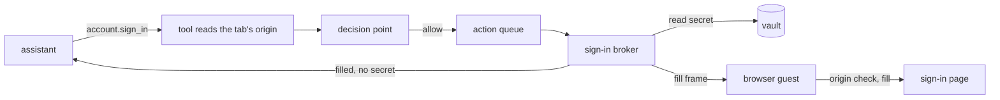

# Accounts, sign-in and the purse

- **Status:** draft
- **Work items:**
  [the assistant's own email and accounts](https://linear.app/zgeoff/issue/GEO-2731), then
  [the purse](https://linear.app/zgeoff/issue/GEO-2757). Both build on [the computer](computer.md),
  which lands first.

The assistant gets its own mailbox and its own accounts, and signs in to them in its browser without
ever seeing a password. Each account's secret sits in a vault that only the server reads. When the
assistant asks to sign in, the request passes your rules like any other action, and on allow the
server sends the secret over the browser guest's private channel, where it goes straight into the
page's password field. The purse is one more vault entry, a capped card, and a purchase is a `spend`
action under the [budgets design](../platform/policy/budgets.md).

## Shape



## Contracts

### The tools

```ts
accounts.list({});
// → { accounts: [
//     { account: 'a7q2m9x4kd', kind: 'password', label: 'library card', origins: ['https://library.example.org'],
//       username: 'nix@example.net' },
//     { account: 'c3w8p1z6mt', kind: 'card', label: 'purse', origins: [], username: null } ] }

account.sign_in({ tab: 't1', account: 'a7q2m9x4kd', submit: 'E7' });
// → { status: 'signed_in', tab: 't1', url: 'https://library.example.org/account', fields: ['username', 'password'],
//     part: 1, parts: 1, text: '…the page after the submit…' }
//   submit: an element of the tab's latest snapshot, which the guest clicks right after the fill, in
//   the same action, so a sign-in is one card or none. status is 'signed_in' when the page navigated
//   after the click, and 'filled' with no submit or when the page stayed. fields lists what the page
//   had, so a two-step sign-in takes one call for the username and one on the next page.
//   or { refused: 'ORIGIN_MISMATCH', origin: 'https://library-example.top' } | { refused: 'NO_FIELD' }
//   or { refused: 'CROSS_ORIGIN_SUBMIT' } | { refused: 'UNKNOWN_ACCOUNT' } | { refused: 'WRONG_KIND' }
//   or { refused: 'ACCOUNT_FORGOTTEN' } | { refused: 'TAB_GONE' } | { refused: 'STALE_ELEMENT' }
//   or { refused: 'PAGE_CHANGED' } | { refused: 'FAILED' }. The guest checks the submit element before
//   it fills, so a refusal fills nothing.

account.sign_up({ tab: 't1', label: 'library card', username: 'nix@example.net', submit: 'E9' });
//   it refuses as sign_in does, except the account checks. The entry exists once the fill lands.
// → { status: 'signed_in', account: 'a7q2m9x4kd', state: 'ready', … the sign_in result's fields }
//   state is 'ready' when status is 'signed_in', and 'pending' when status is 'filled'
//   the broker makes the password, fills every password field with it, fills an email field with the
//   username, and keeps the tab's origin as the entry's one origin. The assistant fills any other
//   field, such as a name, with computer.fill first.

purse.pay({
  tab: 't1',
  amount: { value: 12.5, currency: 'AUD' },
  item: 'one font licence',
  card: 'c3w8p1z6mt',
  submit: 'E12',
});
// → { status: 'paid', purchase: 'pq3z8w1n5v', merchant: 'https://fonts.example.com', pageTotal: '12.50 AUD' }
//   card: an account ID, needed when the vault holds more than one card. The guest fills, rereads the
//   total, and clicks submit only when the total still matches; computer.click never pays.
//   or { refused: 'NO_CARD_FIELD' } | { refused: 'ORIGIN_MISMATCH' } | { refused: 'TOTAL_CHANGED' }
//   or { refused: 'STALE_ELEMENT' } | { refused: 'WHICH_CARD' } | { refused: 'UNKNOWN_ACCOUNT' }
//   or { refused: 'WRONG_KIND' } | { refused: 'ACCOUNT_FORGOTTEN' } | { refused: 'TAB_GONE' }
//   or { refused: 'PAGE_CHANGED' } | { refused: 'CROSS_ORIGIN_SUBMIT' } | { refused: 'FAILED' }
//   A bank check that shows after the submit waits up to 5 minutes for you to approve it in the
//   bank's app, then returns 'paid'. After that, { status: 'needs_owner', purchase }: an unknown
//   outcome that you settle, as the budgets design settles one.

purse.read({});
// → { month: { budget: '100.00 AUD', spent: '37.50 AUD', left: '62.50 AUD' },
//     lifts: [{ merchants: ['https://fonts.example.com'], perAction: '25.00 AUD' }],
//     purchases: [{ purchase: 'pq3z8w1n5v', at, merchant: 'https://fonts.example.com', amount: '12.50 AUD',
//                   item: 'one font licence', approval: 'lift' }], next: null }
//   lifts lists each lifting rule that names purse.pay
```

```ts
// connectors module: the effects each tool declares
// accounts.list, purse.read: ['note'], run direct
// account.sign_in, account.sign_up: ['sign_in'], a new effect of the routine risk class, queued;
//   destination: the tab's origin. Its "always allow" rule pins the origin and the account.
// purse.pay: ['spend'], queued; destination: the tab's origin; amount: the page's total, see below
// No tool takes an origin. Each tool's prepare hook, from the computer design, reads the tab's
// origin, its URL and, for purse.pay, the checkout's total from the guest before the decision.
// The fill happens only on that origin, and a URL that changed returns PAGE_CHANGED.
```

The approval card for a sign-in shows the account's label, its username and the origin. The card for
a purchase shows the merchant, the declared amount and the total the guest read from the page, or
"no total found"

### The vault

```ts
// connectors module; the vault_entries table, sealed like erasable fields
interface VaultEntry {
  entryID: string; // crypto.randomUUID(); keys the entry's own key in the key store
  account: string; // short ID from createShortID; the only ID the model sees
  label: string; // erasable
  kind: 'password' | 'card';
  origins: string[]; // exact origins, no wildcards; a card has none
  username: string | null; // the model reads it; it's the assistant's own address
  secret: SealedValue; // a password, or a card's number, expiry and code, under the entry's own key
  fingerprint: string | null; // a card: an HMAC of its number under a server key; the only form in records
  frameOrigins: string[]; // a card: the payment frames you allow, such as https://js.pay.example; else []
  state: 'pending' | 'ready' | 'forgotten'; // a sign_up is pending until it or a sign_in reaches signed_in
}

// contract lib: owner calls, each behind the passkey check
vault.add({ kind: 'card', label: 'purse', secret: { number, expiry, code }, frameOrigins: [] }); // → { account: 'c3w8p1z6mt' }
vault.add({
  kind: 'password',
  label: 'forum',
  origins: ['https://forum.example.org'],
  username,
  secret: { password },
});
vault.remove({ account: 'c3w8p1z6mt' }); // destroys the key; the row stays with state 'forgotten'
```

### The fill frame

```ts
// wire lib: 3 more ops in ComputerRequest, and FillReply joins ComputerReply
type OriginRequest = { op: 'origin'; tab: string }; // → { ok: true; origin: string } | tab_gone
type TotalRequest = { op: 'total'; tab: string }; // → { ok: true; pageTotal: string | null } | tab_gone
// the server sends the fill op; no tool sends or reads it
type FillRequest = {
  op: 'fill';
  tab: string;
  expectOrigin: string; // the origin the action kept: the sign-in page, or the merchant
  expectURL: string; // the URL the prepare hook read
  fields: {
    role:
      | 'username'
      | 'email'
      | 'password'
      | 'new_password'
      | 'card_number'
      | 'card_expiry'
      | 'card_code';
    value: string; // new_password fills every password field on the page
  }[];
  submit?: { element: string; expectTotal?: string }; // with expectTotal, click only while the total matches
};
type FillReply =
  | {
      ok: true;
      origin: string;
      filled: FillRequest['fields'][number]['role'][];
      pageTotal: string | null;
      isNavigated: boolean; // after the submit
      isBankCheck: boolean; // a bank's check frame showed after the submit
    }
  | {
      ok: false;
      reason:
        | 'origin_mismatch'
        | 'no_field'
        | 'cross_origin_submit'
        | 'tab_gone'
        | 'stale_element'
        | 'page_changed'
        | 'total_changed'
        | 'failed';
      origin: string | null;
    };
```

### The purchase record

```text
purchase.recorded              -- budgets module, one per purse.pay that clicks submit
  purchase       text          -- short ID
    amount         integer       -- micros of the card's currency, the amount the policy checked
  page_total     integer null  -- micros, the total the guest read; null when none was found
    currency       text          -- the card's currency; the purse's budget counts in it
  merchant       text          -- the origin the card was filled on
  item           text          -- erasable
  approval       text          -- 'lift' or the approval's ID
  card           text          -- the card entry's fingerprint
```

### The mailbox

```ts
// connectors module. Adapter: mail-jmap, against the mail host's JMAP API.
mail.list({ unread: true, from: 'penpal@example.com', text: 'chess' }); // from, subject, text: JMAP filters
// → { messages: [{ message: 'mz4k8q2w7p', thread: 'th6p2k9w4x', from: 'hello@library.example.org',
//                  subject: 'Your code', at, isUnread: true }], next: null }
mail.read({ message: 'mz4k8q2w7p' });
// → { from, subject, thread, text: 'Your code is 482913. [L4] Sign in',
//     attachments: [{ attachment: 1, name: 'board.png', bytes: 30422 }] }   // every field outside, links as link IDs
mail.mark({ message: 'mz4k8q2w7p', isUnread: false }); // → { message: 'mz4k8q2w7p', isUnread: false }
mail.saveAttachment({ message: 'mz4k8q2w7p', attachment: 1 });
// → { file: 'f7m3q8k2wz', name: 'board.png' }   a file like computer.exportFile's; at most 25 MiB
mail.send({ to: ['hello@library.example.org'], subject, text, files: ['f2r8k5w1mz'] });
mail.reply({ message: 'mz4k8q2w7p', text, files: [] }); // threads with In-Reply-To; to: the sender
// mail.list, mail.read, mail.mark, mail.saveAttachment: ['note'], direct
// mail.send, mail.reply: ['send'], queued, destination: each address; files: up to 10 file or image
//   IDs, 25 MiB in all. Their "always allow" rule pins `to` (mail.reply: the sender), so a rule
//   allows one address; subject, text and files are free text to the card
// refusals: UNKNOWN_MESSAGE, UNKNOWN_ATTACHMENT, TOO_BIG, UNKNOWN_FILE, FILE_FORGOTTEN,
//   UNKNOWN_IMAGE, IMAGE_FORGOTTEN
// the mail_messages table maps each message's and thread's short ID to its JMAP ID.
// the adapter's credential is deployment:mail, a connector_credentials entry
```

### New mail

```ts
// a task's trigger, beside the schedule triggers; a new trigger source
trigger: { on: 'mail', from?: ['penpal@example.com', '@example.org'] }
// from: addresses, or a domain after @, matched without case; absent, every mail matches.
// A task run gets "New mail from <from>: <subject> (message mz4k8q2w7p)" for each mail it takes.

// with no task matching, the conversation gets a system message
// { kind: 'mail', messages: [{ message: 'mz4k8q2w7p', from, subject }] }   from and subject are outside
```

## Constraints

Secrets:

- The secret never reaches the model's context, a tool result, a `hidden` value, a screenshot, a
  snapshot, an approval card, the event log or the server log. Nothing logs the body of a fill
  frame.
- Before any `computer.*` result reaches the model, the server replaces each vault secret it finds
  in the result's text with dots. This catches a page that copies a filled value verbatim, and
  misses one that encodes it.
- `computer.screenshot` returns `FILLED_ORIGIN` for a tab with any frame on an origin that a fill
  reached: every password entry's origins, and each merchant and payment frame a card filled. The
  vault keeps those origins, so a browser restart keeps the block. Every snapshot shows each filled
  field as dots.
- `computer.click` and `computer.fill` return `FILLED_TAB` on a tab that holds a filled card field,
  so only `purse.pay` submits a payment.
- The browser profile never saves a password or a card. Chromium's password manager and autofill are
  off.

Filling:

- `sign_in` asks unless a rule allows it. A rule scopes it by destination and may pin the account,
  so "sign in to the library" covers one origin.
- The tool checks the account, its kind, its state and the tab's origin against the entry's origins
  before the decision, in that order, and returns the first refusal. A forgotten entry returns
  `ACCOUNT_FORGOTTEN`.
- The guest compares `expectOrigin` with the live top frame's origin right before it fills, and
  fills nothing when they differ.
- A password goes only into an `<input type=password>` whose form posts to the same origin, or that
  sits in no form. A card part goes only into a field whose `autocomplete` names that part, in a
  frame whose own origin is the merchant's or one of the card's `frameOrigins`.
- A `sign_up` entry turns `ready` when the sign-up itself reaches `signed_in`. Otherwise it lists
  with state `pending` until its first `sign_in` reaches `signed_in`, and then turns `ready`. A
  pending entry signs in like a ready one, so a site that took the password never loses it. A
  pending entry that no sign-in reaches within 7 days turns `forgotten`.
- A forget of a vault entry destroys its key, and the next `sign_in` with it returns
  `ACCOUNT_FORGOTTEN`.

Spending:

- Before the decision, the guest reads the checkout's total from the page. The policy checks the
  page's total when the guest found one and it matches the declared amount to the cent, in the
  card's currency, and asks with the passkey otherwise.
- A `purse.pay` passes without asking only under a lifting rule whose destinations include the
  merchant and whose `perAction` covers the amount. Every other `purse.pay` asks with the passkey.
- A lift charges the purse's budget when the action queues, as the budgets design says, and a
  purchase you approved is never charged. A `purse.pay` that ends before its click, with
  `TOTAL_CHANGED`, `STALE_ELEMENT` or `FAILED`, credits the charge, and the guest clears the card
  fields it filled.
- Every `purse.pay` that clicks submit writes a `purchase.recorded` record.
- The purse starts with a lift of 25 AUD per purchase and a budget of 100 AUD a month. The card's
  own limit in the bank's app is the hard cap.

Mail:

- Every mail field comes back with the source `outside`, and HTML mail is parsed in a fetch sandbox,
  as [the Gmail design](gmail-calendar-drive-tools.md) does it.
- A one-time code in a mail is visible to the assistant, which types it with `computer.fill`.
- The adapter follows the host's JMAP push stream, and writes a `mail.received` record for each new
  mail. A lost stream reconnects, and nixie reads what arrived since its last state.
- Each mail is a `mail.received` record, keyed by its JMAP ID so a reconnect never repeats one, with
  from and subject among its erasable fields. The adapter's cursor is the JMAP state.
- Every task whose trigger matches starts for the mail. A mail that arrives while that task runs
  waits, and the next run takes every waiting mail at once.
- New mail that no task takes goes to the conversation in a `mail` system message. The first mail
  goes at once, and each mail in the next 15 minutes folds into one message at the window's end.
- A saved attachment counts as untrusted, like a download.

## Decisions

- **The server fills over the guest's private channel.** A swap of a placeholder on the wire would
  keep the secret out of the guest, and it breaks on a page that hashes the password in script and
  on a payment form in a frame from another origin.
- **The browser has no terminal beside it.** [The computer](computer.md) keeps the shell in its own
  sandbox, so nothing the model can run reads the page's memory.
- **The tool reads the origin, and the guest checks it again.** A model that names the origin can be
  talked into naming the wrong one, and a page can navigate between the decision and the fill.
- **The page's total gates the lift.** The model's declared amount alone can be talked down, so a
  lift passes only when the page agrees with it.
- **A merchant can keep the card.** nixie can't see a later charge from a merchant that saved the
  card. The bank's limit caps it, and the purchase records let you spot it in the bank's app.
- **A page on the account's own origin gets the secret.** A script on that page can read the filled
  field and send it anywhere, as it could from any browser. The origin checks keep the secret off
  every other site.
- **The assistant can reset its own passwords.** Its mailbox is every account's way back in. The
  vault keeps secrets out of the model's context; it can't stop the assistant from using its own
  mail.

## Builder decides

- How the guest finds the fields and the checkout's total, within the rules above.
- How the broker makes a password, at 24 characters or more.
- The JMAP calls, and how `mail.list` pages.
- Where `vault.add` sits in the web client.
- The tools' descriptions and the refusal wording.

## Out of scope

- Two-factor apps and passkeys for the assistant's accounts.
- Solving a CAPTCHA. A sign-up that shows one stops there, and the assistant tells you which site
  asked.
- Reading a card statement from the bank. The card has no API.
- Signing in to your accounts. Every account here is the assistant's own.

## Open questions

- **Which mail host and domain?** The owner settles it. Until then, the adapter targets JMAP, which
  Fastmail serves.
- **Does the bank ask for a 3-D Secure check on each purchase?** A test purchase settles it. Until
  then, a purchase waits for a bank check as `purse.pay` describes.
- **Does the assistant get a phone number?** Many sign-ups ask for one, and a number that takes
  texts costs a monthly fee. The owner settles it. Until then, a sign-up that asks for a phone
  number stops, as a CAPTCHA does.
- **Are `account`, `purse` and the tool names right?** The owner settles it. Until then, the build
  uses them.
