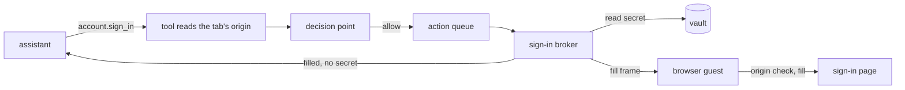

# Accounts, sign-in and the purse

- **Status:** draft
- **Work items:**
  [the assistant's own email and accounts](https://linear.app/zgeoff/issue/GEO-2731), then
  [the purse](https://linear.app/zgeoff/issue/GEO-2757). Both build on [the computer](computer.md),
  which lands first.

The assistant gets its own mailbox and its own accounts, and signs in to them in its browser without
ever seeing a password. Each account's secret sits in a vault that only the server reads. When the
assistant asks to sign in, the request passes your rules like any other action, and on allow the
server sends the secret over the browser guest's private channel, where it goes straight into the
page's password field. The purse is one more vault entry, a capped card, and a purchase is a `spend`
action under the [budgets design](../platform/policy/budgets.md).

## Shape



## Contracts

### The tools

```ts
accounts.list({});
// → { accounts: [
//     { account: 'a7q2m9x4kd', kind: 'password', label: 'library card', origins: ['https://library.example.org'],
//       username: 'nix@example.net' },
//     { account: 'c3w8p1z6mt', kind: 'card', label: 'purse', origins: [], username: null } ] }

account.sign_in({ tab: 't1', account: 'a7q2m9x4kd' });
// → { status: 'filled', tab: 't1', url: 'https://library.example.org/login', fields: ['username', 'password'] }
//   it fills and never submits: the assistant submits with computer.click. fields lists what the page
//   had, so a two-step sign-in takes one call for the username and one on the next page for the password
//   or { refused: 'ORIGIN_MISMATCH', origin: 'https://library-example.top' } | { refused: 'NO_FIELD' }
//   or { refused: 'CROSS_ORIGIN_SUBMIT' } | { refused: 'UNKNOWN_ACCOUNT' } | { refused: 'WRONG_KIND' }
//   or { refused: 'ACCOUNT_FORGOTTEN' } | { refused: 'TAB_GONE' }

account.sign_up({ tab: 't1', label: 'library card', username: 'nix@example.net' });
// → { status: 'filled', account: 'a7q2m9x4kd' }
//   the broker makes the password and stores it, with the tab's origin as the entry's one origin

purse.pay({ tab: 't1', amount: { value: 12.5, currency: 'AUD' }, item: 'one font licence' });
// → { status: 'filled', purchase: 'pq3z8w1n5v', merchant: 'https://fonts.example.com', pageTotal: '12.50 AUD' }
//   or { refused: 'NO_CARD_FIELD' } | { refused: 'ORIGIN_MISMATCH' } | { refused: 'NEEDS_OWNER' }
```

```ts
// connectors module: the effects each tool declares
// accounts.list: ['note'], run direct
// account.sign_in, account.sign_up: ['sign_in'], a new effect, queued; destination: the tab's origin
// purse.pay: ['spend'], queued; destination: the tab's origin; amount: the page's total, see below
// No tool takes an origin. Before the decision, the tool reads the tab's origin from the guest
// and the action keeps it; the fill happens only on that origin.
```

The approval card for a sign-in shows the account's label, its username and the origin. The card for
a purchase shows the merchant, the declared amount and the total the guest read from the page, or
"no total found".

### The vault

```ts
// connectors module; the vault_entries table, sealed like erasable fields
interface VaultEntry {
  entryID: string; // crypto.randomUUID(); keys the entry's own key in the key store
  account: string; // short ID from createShortID; the only ID the model sees
  label: string; // erasable
  kind: 'password' | 'card';
  origins: string[]; // exact origins, no wildcards; a card has none
  username: string | null; // the model reads it; it's the assistant's own address
  secret: SealedValue; // a password, or a card's number, expiry and code, under the entry's own key
  fingerprint: string; // an HMAC of the secret under a server key; the only form of it in records
  state: 'pending' | 'ready' | 'forgotten'; // a sign_up is pending until its page confirms
}

// contract lib: owner calls, each behind the passkey check
vault.add({ kind: 'card', label: 'purse', secret: { number, expiry, code } }); // → { account: 'c3w8p1z6mt' }
vault.add({
  kind: 'password',
  label: 'forum',
  origins: ['https://forum.example.org'],
  username,
  secret: { password },
});
vault.remove({ account: 'c3w8p1z6mt' }); // destroys the key; the row stays with state 'forgotten'
```

### The fill frame

```ts
// wire lib: 2 more ops in ComputerRequest, and FillReply joins ComputerReply
type OriginRequest = { op: 'origin'; tab: string }; // → { ok: true; origin: string } | tab_gone
// the server sends the fill op; no tool sends or reads it
type FillRequest = {
  op: 'fill';
  tab: string;
  expectOrigin: string; // the origin the action kept: the sign-in page, or the merchant
  fields: {
    role: 'username' | 'password' | 'card_number' | 'card_expiry' | 'card_code';
    value: string;
  }[];
};
type FillReply =
  | {
      ok: true;
      origin: string;
      filled: FillRequest['fields'][number]['role'][];
      pageTotal: string | null;
    }
  | {
      ok: false;
      reason: 'origin_mismatch' | 'no_field' | 'cross_origin_submit' | 'tab_gone' | 'failed';
      origin: string | null;
    };
```

### The purchase record

```text
purchase.recorded              -- budgets module, one per purse.pay that fills
  purchase       text          -- short ID
  amount         integer       -- micros, the amount the policy checked
  page_total     integer null  -- micros, the total the guest read; null when none was found
  currency       text
  merchant       text          -- the origin the card was filled on
  item           text          -- erasable
  approval       text          -- 'lift' or the approval's ID
  card           text          -- the card entry's fingerprint
```

### The mailbox

```ts
// connectors module. Adapter: mail-jmap, against the mail host's JMAP API.
mail.list({ unread: true });
// → { messages: [{ message: 'mz4k8q2w7p', from: 'hello@library.example.org', subject: 'Your code', at, isUnread: true }] }
mail.read({ message: 'mz4k8q2w7p' });
// → { from, subject, text: 'Your code is 482913. [L4] Sign in' }   // every field outside, links as link IDs
mail.send({ to: ['hello@library.example.org'], subject, text }); // effects ['send'], queued, destination: each address
```

## Constraints

Secrets:

- The secret never reaches the model's context, a tool result, a `hidden` value, a screenshot, a
  snapshot, an approval card, the event log or the server log. Nothing logs the body of a fill
  frame.
- Before any `computer.*` result reaches the model, the server replaces each vault secret it finds
  in the result's text with dots. This catches a page that copies a filled value verbatim, and
  misses one that encodes it.
- After a fill, `computer.screenshot` of that tab returns `FILLED_TAB` until the tab leaves the
  origin, and every snapshot shows each filled field as dots.
- The browser profile never saves a password or a card. Chromium's password manager and autofill are
  off.

Filling:

- `sign_in` asks unless a rule allows it, and a rule scopes it by destination, so "sign in to the
  library" covers one origin.
- The tool checks the account, its kind, its state and the tab's origin against the entry's origins
  before the decision, in that order, and returns the first refusal. A pending entry returns
  `UNKNOWN_ACCOUNT`.
- The guest compares `expectOrigin` with the live top frame's origin right before it fills, and
  fills nothing when they differ.
- A password goes only into an `<input type=password>` whose form posts to the same origin, or that
  sits in no form. A card part goes only into a field whose `autocomplete` names that part, in the
  top frame or in a frame the top frame embeds.
- A `sign_up` entry stays `pending` until the page navigates after the submit. A pending entry is
  never listed and never filled, and nixie removes it after 10 minutes.
- A forget of a vault entry destroys its key, and the next `sign_in` with it returns
  `ACCOUNT_FORGOTTEN`.

Spending:

- Before the decision, the guest reads the checkout's total from the page. The policy checks the
  page's total when the guest found one and it matches the declared amount, and asks otherwise.
- A `purse.pay` passes without asking only under a lifting rule whose destinations include the
  merchant and whose `perAction` covers the amount. Every other `purse.pay` asks with the passkey.
- Every `purse.pay` that fills writes a `purchase.recorded` record and counts against the purse's
  budget, whether a lift passed it or you approved it.
- The purse starts with a lift of 25 AUD per purchase and a budget of 100 AUD a month. The card's
  own limit in the bank's app is the hard cap.

Mail:

- Every mail field comes back with the source `outside`, and HTML mail is parsed in a fetch sandbox,
  as [the Gmail design](gmail-calendar-drive-tools.md) does it.
- A one-time code in a mail is visible to the assistant, which types it with `computer.fill`.

## Decisions

- **The server fills over the guest's private channel.** A swap of a placeholder on the wire would
  keep the secret out of the guest, and it breaks on a page that hashes the password in script and
  on a payment form in a frame from another origin.
- **The browser has no terminal beside it.** [The computer](computer.md) keeps the shell in its own
  sandbox, so nothing the model can run reads the page's memory.
- **The tool reads the origin, and the guest checks it again.** A model that names the origin can be
  talked into naming the wrong one, and a page can navigate between the decision and the fill.
- **The page's total gates the lift.** The model's declared amount alone can be talked down, so a
  lift passes only when the page agrees with it.
- **A merchant can keep the card.** nixie can't see a later charge from a merchant that saved the
  card. The bank's limit caps it, and the purchase records let you spot it in the bank's app.
- **A page on the account's own origin gets the secret.** A script on that page can read the filled
  field and send it anywhere, as it could from any browser. The origin checks keep the secret off
  every other site.
- **The assistant can reset its own passwords.** Its mailbox is every account's way back in. The
  vault keeps secrets out of the model's context; it can't stop the assistant from using its own
  mail.

## Builder decides

- How the guest finds the fields and the checkout's total, within the rules above.
- How the broker makes a password, at 24 characters or more.
- The JMAP calls, and how `mail.list` pages.
- Where `vault.add` sits in the web client.
- The tools' descriptions and the refusal wording.

## Out of scope

- Two-factor apps and passkeys for the assistant's accounts.
- Reading a card statement from the bank. The card has no API.
- Signing in to your accounts. Every account here is the assistant's own.

## Open questions

- **Which mail host and domain?** The owner settles it. Until then, the adapter targets JMAP, which
  Fastmail serves.
- **Does the bank ask for a 3-D Secure check on each purchase?** A test purchase settles it. Until
  then, a purchase that stops at a bank check returns `NEEDS_OWNER` and waits for you.
- **Are `account`, `purse` and the tool names right?** The owner settles it. Until then, the build
  uses them.
